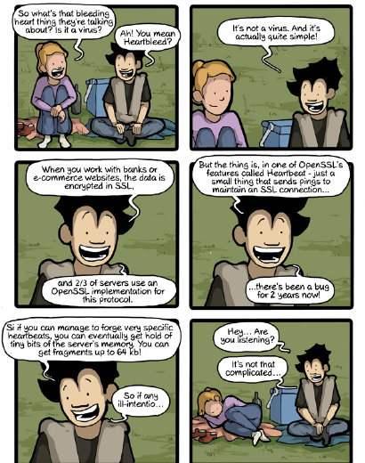
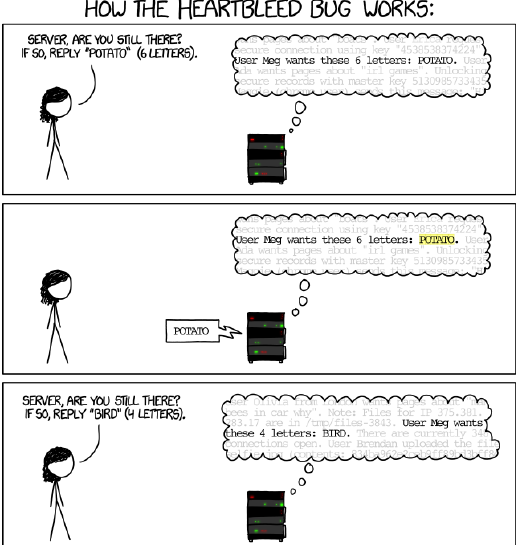
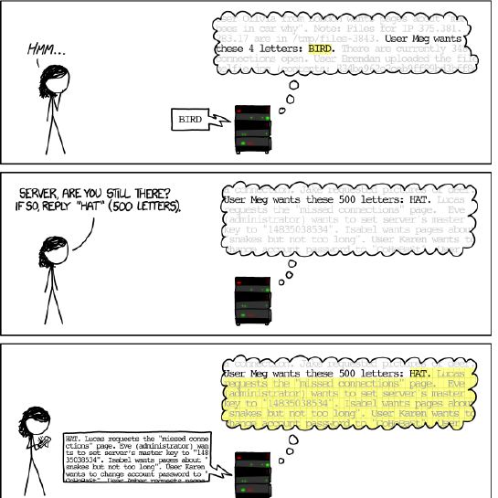
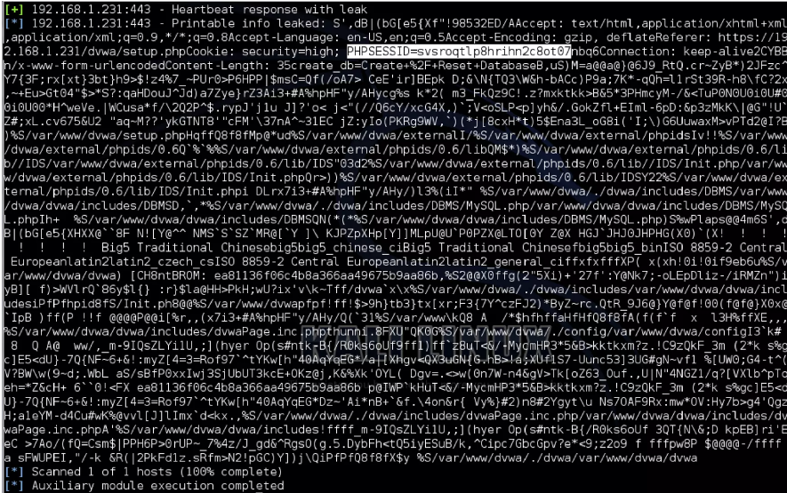
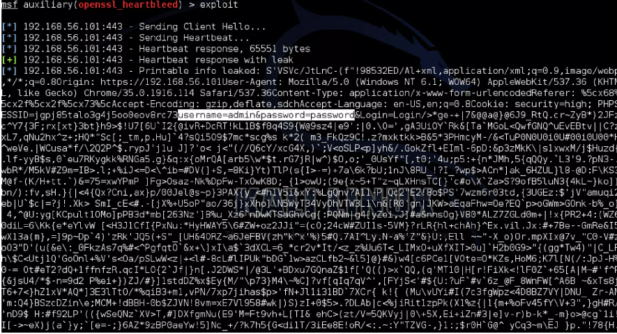
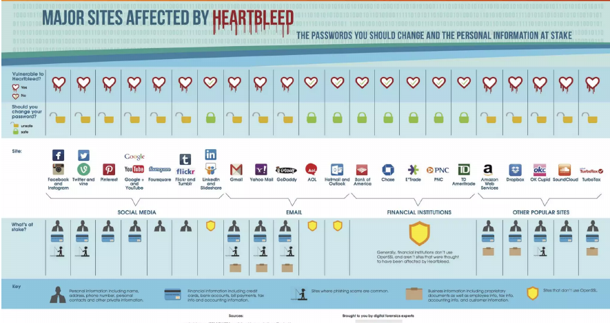

## Heartbleed-Analyse {.title-slide data-state="hide-footer"}


Prof. Dr. Lukas Iffländer   
HTW Dresden  


---

## Agenda {.content-slide .agenda-slide}

<ul class="agenda">
<li class="agenda-item"><strong>01</strong><span>HTTP und SSL/TLS</span></li>
<li class="agenda-item"><strong>02</strong><span>Entdeckung von Heartbleed</span></li>
<li class="agenda-item"><strong>03</strong><span>TLS Heartbeat</span></li>
<li class="agenda-item"><strong>04</strong><span>CVE-2014-0160</span></li>
<li class="agenda-item"><strong>05</strong><span>Auswirkungen</span></li>
<li class="agenda-item"><strong>06</strong><span>Verteidigung</span></li>
</ul>

---

## Heartbleed {.image-slide}



---

## HTTP-Kommunikation {.content-slide}
<br>

```{mermaid}
sequenceDiagram
    participant C as Client
    participant S as Server
    C->>S: Connection Request
    S-->>C: OK
    C->>S: GET file location
    S-->>C: Page or Error
    C->>S: Close Connection
    S-->>C: OK
    Note over C,S: Time
```

---

## SSL: Kurze Auffrischung {.content-slide .pdf-slide}
<br>

- Gewährleistet Authentifizierung, Vertraulichkeit und Integrität
- Asymmetrische Verschlüsselung für den Schlüsselaustausch
- Der ausgetauschte Sitzungsschlüssel gewährleistet die Vertraulichkeit der Daten
- OpenSSL ist eine Open-Source-Implementierung der SSL-/TLS-Protokolle

---

## Entdeckung von Heartbleed {.content-slide .pdf-slide}
<br>

- Unabhängig entdeckt durch ein Team von Security-Experten bei Codenomicon [1] und Neel Mehta von Google Security [2].
- Erste Meldung an das OpenSSL-Projekt am 1. April 2014 [3]
- Schwere Sicherheitslücke mit weltweiten Auswirkungen
- Nach einer Netcraft-Analyse waren 17,5% der HTTPS-Websites betroffen [4]
- Betroffene OpenSSL-Versionen: 1.0.1 bis 1.0.1f sowie 1.0.2-beta1 [3]
- Die weit verbreiteten Webserver Apache und Nginx verwenden OpenSSL

---

## Was ist TLS Heartbeat {.content-slide .pdf-slide}
<br>

- Heartbeats sind in RFC 6520 [5] definiert
- Heartbeats sind Nachrichten, die der Server unverändert zurücksendet
- Sie signalisieren dem Client, dass der Server weiterhin verbunden ist und Anfragen entgegennimmt
- Kann ohne Authentifizierung genutzt werden
- Ähnlich dem HTTP-Header `Connection: keep-alive`

---

## How the Heartbleed Bug Works I {.image-slide}



---

## Heartbleed (CVE-2014-0160) {.content-slide .code-slide}
<br>

- Schwachstelle in der Heartbeat-Implementierung
- Speicher wird anhand der angegebenen Payload-Länge (und optionalem Padding) alloziert
- Padding ist nutzergesteuert
- Referenz: NVD-Eintrag CVE-2014-0160 [6]

```{.text code-line-numbers="|3|8"}
[...]

buffer = OPENSSL_malloc(1 + 2 + payload + padding);
bp = buffer;

[...]

memcpy(bp, pl, payload);
```

---

## How the Heartbleed Bug Works II {.image-slide}



---

## Bösartiger Heartbeat und die Antwort des Servers {.content-slide .table-slide}
<br>

#### Heartbeat Request

| Size [B] | Type | Length [B] | Payload [B] |
|---:|---|---:|---:|
| 4 | TLS1_HB_REQUEST | 65535 | 1 |

<br>

#### Antwort

| extbfSize [B] | Type | Length [B] | Payload [B] |
|---:|---|---:|---:|
| 65538 | TLS1_HB_RESPONSE | 65535 | 65535 |

---

## Heartbeat Response with Leak I {.image-slide}



---

## Heartbeat Response with Leak II {.image-slide}



---

## Major Sites Affected by Heartbleed {.image-slide}



---

## Auswirkungen {.image-slide}


---

## Verteidigung {.content-slide .pdf-slide}
<br>

- Heartbeat deaktivieren
- OpenSSL auf Version 1.0.1g oder neuer aktualisieren [3]
- Schlüssel austauschen und Zertifikate neu ausstellen
- Nutzer zur Passwortänderung auffordern

---

## Literaturverzeichnis I {.content-slide .pdf-slide}
<br>

[1] Codenomicon. The Heartbleed Bug. [Online; accessed 11. Dec. 2025]. Apr. 2014. URL: <https://heartbleed.com/>.

[2] Google Online Security Blog. OpenSSL CVE-2014-0160. [Online; accessed 11. Dec. 2025]. 7. Apr. 2014. URL: <https://security.googleblog.com/2014/04/openssl-cve-2014-0160.html>.

[3] OpenSSL Project. OpenSSL Security Advisory [07 Apr 2014]. CVE-2014-0160 (Heartbleed). 7. Apr. 2014. URL: <https://www.openssl.org/news/secadv/20140407.txt>.

[4] Netcraft. Millions of websites vulnerable to OpenSSL Heartbleed bug. [Online; accessed 11. Dec. 2025]. 8. Apr. 2014. URL: <https://news.netcraft.com/archives/2014/04/08/millions-of-websites-vulnerable-to-openssl-heartbleed-bug.html>.

[5] Michael Williams, Michael Tüxen und Robin Seggelmann. Transport Layer Security (TLS) and Datagram Transport Layer Security (DTLS) Heartbeat Extension. RFC 6520. Feb. 2012. DOI: 10.17487/RFC6520. URL: <https://www.rfc-editor.org/info/rfc6520>.

[6] NIST National Vulnerability Database. CVE-2014-0160. [Online; accessed 11. Dec. 2025]. 2014. URL: <https://nvd.nist.gov/vuln/detail/CVE-2014-0160>.


---

## Vielen Dank! {.title-slide data-state="hide-footer"}


Prof. Dr. Lukas Iffländer   
HTW Dresden  

