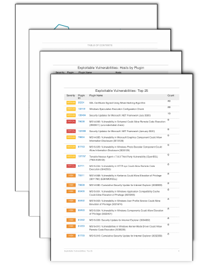
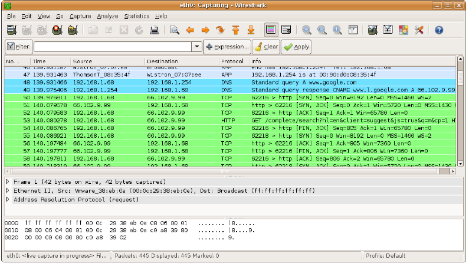

## Hackerwerkzeuge {.title-slide data-state="hide-footer"}


Prof. Dr. Lukas Iffländer   
HTW Dresden  


---

## Agenda {.content-slide .agenda-slide}

<ul class="agenda">
<li class="agenda-item"><strong>01</strong><span>Ethik & Recht</span></li>
<li class="agenda-item"><strong>02</strong><span>Nmap</span></li>
<li class="agenda-item"><strong>03</strong><span>Nessus</span></li>
<li class="agenda-item"><strong>04</strong><span>Wireshark</span></li>
<li class="agenda-item"><strong>05</strong><span>Metasploit</span></li>
</ul>

---

## Ethik & Recht {.content-slide .pdf-slide}
<br>

- Tests nur auf eigenen Systemen oder mit ausdrücklicher, schriftlicher Erlaubnis (Scope).
- Rechtliche Rahmenbedingungen beachten: § 202a/b/c, § 303b StGB sowie Datenschutz.
- Verantwortungsvolle Offenlegung (Responsible Disclosure); Risiken minimieren, sauber dokumentieren.
- Logging, Dokumentation und Abstimmung mit Beteiligten (z. B. IT, Datenschutz) sicherstellen.

---

## Nmap {.content-slide .pdf-slide}
<br>

- Port-Scanner für Linux, macOS und Windows (TCP/UDP/IPv6)
- Typische Scans: SYN-Scan (`-sS`), UDP-Scan (`-sU`), Service/Version (`-sV`), OS-Erkennung (`-O`), NSE-Skripte (`-sC`/`--script`)
- Ziel: offene Ports, Dienste und Angriffsoberfläche erkennen
- Nmap kann das Betriebssystem des Zielsystems per Fingerprinting schätzen
- Einsatz nur im autorisierten Scope; rechtliche Rahmenbedingungen beachten (§ 202a/b/c, § 303b StGB)

---

## Einsatzbeispiel Nmap {.content-slide .code-slide}
<br>

```{.text code-line-numbers="|1|4-8|9-12|14"}
$ nmap -O 192.168.178.1

Starting Nmap 4.11 ( http://www.insecure.org/nmap/ ) at 2008-01-25 21:53 CET
Interesting ports on fritz.box (192.168.178.1):
Not shown: 1679 closed ports
PORT    STATE SERVICE
80/tcp  open  http
MAC Address: 00:15:0C:FC:58:69 (AVM GmbH)
Device type: general purpose
Running: Linux 2.4.X|2.5.X
OS details: Linux 2.4.0 - 2.5.20
Uptime 36.447 days (since Thu Dec 20 11:10:33 2007)

Nmap finished: 1 IP address (1 host up) scanned in 6.258 seconds
```

Historisches Beispiel (2008); für die Methode relevant, Ausgabe kann je nach Version variieren.

---

## Nessus {.content-slide .pdf-slide}
<br>

- Vulnerability Scanner (Tenable Nessus) für Unix/Windows
- Ermittelt potenzielle Schwachstellen anhand von Plugins/Signaturen; NASL zur Plugin-Beschreibung
- Kommerziell lizenziert; freie Alternative: Greenbone/OpenVAS
- Ergebnisse priorisieren (z. B. CVSS), False Positives verifizieren
- <https://www.tenable.com/products/nessus>
- Alternative: <https://www.greenbone.net/>

---

## Screenshot eines typischen Reports {.image-slide}



---

## Wireshark {.content-slide .pdf-slide}
<br>

- Netzwerk-Sniffer und Protokoll-Analysator
- Live-Capture und pcap-Analyse; leistungsfähige Display-Filter (z. B. `http.request`, `tls.handshake`, `ip.addr == 10.0.0.5`)
- "Follow Stream", Reassembly, "Export Objects"; TLS-Entschlüsselung mit Session-Keys möglich
- Datenschutz und Scope beachten (z. B. keine unbeteiligten Netze mitschneiden)

---

## Screenshot eines typischen Dumps {.image-slide}



---

## Die Mutter aller Tools: Metasploit {.content-slide .pdf-slide}
<br>

- Tausende Module: Exploits, Payloads, Auxiliary, Post, Evasion
- Angriff in mehreren Schritten aus einem Tool:
  - Ziel auf Schwachstellen prüfen
  - Exploit auswählen
  - Payload auswählen
  - Zusammenführen
  - Angriff starten
- Einsatz nur in autorisierten Testumgebungen; <https://www.metasploit.com>
- Mehr in der Übung.

---

## Vielen Dank! {.title-slide data-state="hide-footer"}


Prof. Dr. Lukas Iffländer   
HTW Dresden  
