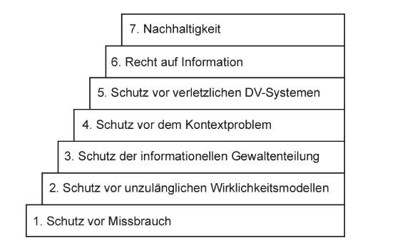
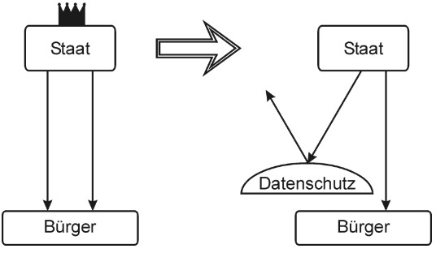
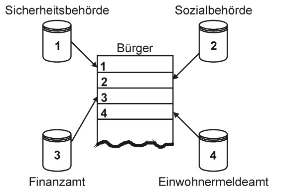
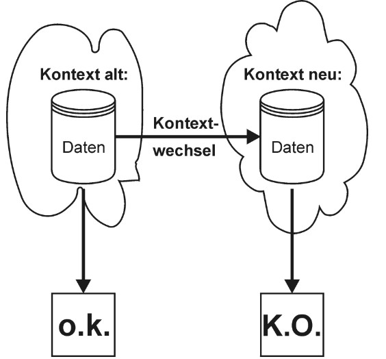
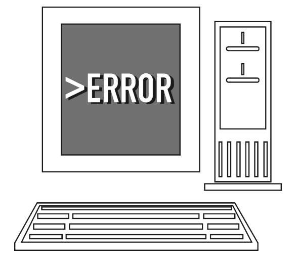

<!-- Titelbild hier aendern:
     src: Bilddatei
     --title-image-width: Bild breiter/schmaler machen
     --title-image-right: negative Werte schieben nach rechts, positive nach links
     --title-image-top: negative Werte schieben nach oben, positive nach unten
     --title-image-object-position: Ausschnitt innerhalb der Bildbox verschieben -->
## Datenschutz {.title-slide data-state="hide-footer"}

Prof. Dr. Lukas Iffländer   
HTW Dresden  


---

## Agenda {.content-slide .agenda-slide}

<ul class="agenda">
<li class="agenda-item"><strong>01</strong>Rechtliche Grundlagen</li>
<li class="agenda-item"><strong>02</strong>Geschichte</li>
<li class="agenda-item"><strong>03</strong>Datenschutzrechtliche Grundlagen</li>
<li class="agenda-item"><strong>04</strong>Datenschutzbeauftragte</li>
<li class="agenda-item"><strong>05</strong>DSGVO-Durchsetzung</li>
<li class="agenda-item"><strong>06</strong>Literatur</li>
</ul>

---

## Lernziele {.content-slide .pdf-slide}

### Nach dieser Vorlesung können Sie:

 1. Die rechtlichen Grundlagen des Datenschutzes (EU-Grundrechtecharta, GG) erläutern
 2. Das informationelle Selbstbestimmungsrecht definieren und seine Herkunft erklären
 3. Die zentralen Prinzipien der DSGVO (Zweckbindung, Transparenz, Datenminimierung) anwenden
 4. Die Rechtsgrundlagen für Datenverarbeitung nach Art. 6 DSGVO benennen
 5. Die Aufgaben und Stellung eines Datenschutzbeauftragten beschreiben 
 
 **Hinweis**: Vertiefende Themen (DPIA, internationale Datenübermittlung, Auftragsverarbeitung) werden im Master-Studiengang behandelt.

---

## EU-Grundrechtecharta {.content-slide .pdf-slide}

**Art. 7: Achtung des Privat- und Familienlebens:**

„Jede Person hat das Recht auf Achtung ihres Privat- und Familienlebens, ihrer Wohnung und ihrer Kommunikation.“ 

- Recht auf Achtung privater Kommunikation ist ebenso Jedermannsrecht 

- Recht eng verknüpft mit Privatleben (Privatheit)

- „Achtung“ = Vertraulichkeitsschutz

- Vertraulichkeitsschutz ist Voraussetzung für andere Grundrechte 
- Briefgeheimnis, Postgeheimnis & Fernmeldegeheimnis basieren auf diesem 
- ertraulichkeitsschutz 
- Recht auf Achtung privater Kommunikation ergänzt Datenschutz 
- Recht auf Achtung privater Kommunikation liefert eigenes Schutzniveau

---

## EU-Grundrechtecharta {.content-slide .pdf-slide}

**Art. 8: Schutz personenbezogener Daten**

(1) Jede Person hat das Recht auf Schutz der sie betreffenden personenbezogenen Daten.

(2) Diese Daten dürfen nur nach Treu und Glauben für festgelegte Zwecke und mit Einwilligung der betroffenen Person oder auf einer sonstigen gesetzlich geregelten legitimen Grundlage verarbeitet werden. Jede Person hat das Recht, Auskunft über die sie betreffenden erhobenen Daten zu erhalten und die Berichtigung der Daten zu erwirken.

(3) Die Einhaltung dieser Vorschriften wird von einer unabhängigen Stelle überwacht.

- Datenschutz ist Jedermannsrecht 
- Treu & Glauben = Vertrauensschutz (gegenseitige Erwartungshaltung!)
- Verarbeitungszwecke müssen eindeutig festgelegt werden 
- Datenverarbeitung nur nach Einwilligung des Betroffenen oder aufgrund Gesetz 
- Betroffenenrecht auf Auskunft über erhobene Daten & Berichtigung 
- Datenschutzkontrolle durch unabhängige Stelle (gemeint: Aufsichtsbehörde)

---

## Fernmeldegeheimnis {.content-slide .pdf-slide}

- Art. 10 GG:   
Brief-, Post- und Fernmeldegeheimnis:
„Das Briefgeheimnis sowie das Post- und Fernmeldegeheimnis sind unverletzlich.“   

- § 3 Abs 1 TTDSG: 
„Dem Fernmeldegeheimnis unterliegen der Inhalt der Telekommunikation und ihre näheren Umstände, insbesondere die Tatsache, ob jemand an einem Telekommunikationsvorgang beteiligt ist oder war. Das Fernmeldegeheimnis erstreckt sich auch auf die näheren Umstände erfolgloser Verbindungsversuche.“ 

- § 3 Nr. 24 TKG:  
„interpersoneller Telekommunikationsdienst“ = ein […] Dienst, der einen direkten interpersonellen und interaktiven Informationsaustausch über Telekommunikationsnetze zwischen einer endlichen Zahl von Personen ermöglicht, wobei die Empfänger von den Personen bestimmt werden, die die Telekommunikation veranlassen oder daran beteiligt sind.

---

## Klassische Geschichtsübersicht {.two-column-slide}

:::: {.columns}
::: {.column width="50%"}

1. Anfänge (vor 1977)  
    - Persönlichkeitsrecht (Herrenreiter-Urteil) → Privatsphäre   
    - weltweit 1. Datenschutzgesetz in Hessen (1970)   

2. 1\. BDSG (1977)  
    - Schutz personenbezogener Daten vor Missbrauch bei der Datenverarbeitung & der Beeinträchtigung schutzwürdiger Belange der Betroffenen entgegenzuwirken

3. 2\. BDSG nach Volkszählungsurteil (1990)  
    - Informationelles Selbstbestimmungsrecht (Volkszählungsurteil)
    - Schutz des Einzelnen vor Beeinträchtigung seines Persönlichkeitsrechts beim Umgang mit personenbezogenen Daten
:::

::: {.column .fragment width="50%"}

4. 3\. BDSG nach EU-DSRL (2001)  
    - international vergleichbarer Datenschutz Vorabkontrolle besonders sensibler Datenverarbeitungen

5. 4\. BDSG nach Datenschutzskandale (2009)  
    - mehr Nachweispflichten und höhere Strafen

6. EU-DSGVO (2016)   
    - neue EU-weit seit 2018 verbindliche Rechtsgrundlage
:::
::::

---

## Geschichte nach Schutzzielen {.image-slide}

---

## Datenschutz als Abwehrrecht {.two-column-slide}
### Schutz vor Missbrauch
:::: {.columns}
::: {.column width="60%"}
- Datenschutz als Abwehrrecht 
- Schutz vor Missbrauch personenbezogener Daten (Ende 60er Jahre)
- Kontrolle durch Datenschutzbeauftragte
:::

::: {.column width="40%"}

:::
::::
---

## Datenschutz als Abwehrrecht {.two-column-slide .table-slide}

### Schutz vor unzulänglichen Wirklichkeitsmodellen

:::: {.columns}
::: {.column width="60%"}
- Problem im der Zuge der 1. Rasterfahndung (1970)
- Schutz vor unzulänglichen Wirklichkeitsmodellen (Ende 70er Jahre)
- keine automatisierte Einzelentscheidung
:::

::: {.column width="40%"}
| Merkmal | Q1 | Q2 | Q3 | Q4 | Q5 |
|---|---|---|---|---|---|
| Merkmal 1 | A | B | D | G | H |
| Merkmal 2 | A | C | D | G | H |
| Merkmal 3 | B | D | E | F | H |   
| | | | | | |
- Person D und H weisen gem. maschinellem Datenabgleich alle drei Merkmale auf
- Verfahren zur Personermittlung 

:::
::::

---

## Datenschutz als Abwehrrecht {.two-column-slide}
### Schutz der informationellen Gewaltenteilung

:::: {.columns}
::: {.column width="60%"}
- gegen die Datensammelwut des Staates 
- Schutz der informationellen Gewaltenteilung (Anfang 80er Jahre) 
- personenbezogene Daten anonymisieren 
:::

::: {.column width="40%"}

Ergebnis: Umfassendes Persönlichkeitsbild zu einer bereits bekannten Person
:::
::::
---

## Datenschutz als Abwehrrecht {.two-column-slide}
### Schutz vor dem Kontextproblem

:::: {.columns}
::: {.column width="60%"}
- gegen die Vernachlässigung des „Alterns“ von Daten 
- Schutz vor dem Kontextproblem (Ende der 80er Jahre)
- Beachtung von Löschfristen
:::

::: {.column width="40%"}

:::
::::

---

## Datenschutz als Abwehrrecht {.two-column-slide}
### Schutz vor verletzlichen Datenverarbeitungssystemen
:::: {.columns}
::: {.column width="60%"}
-  gegen den Irrglauben unfehlbarer Software 
- Schutz vor verletzlichen Datenverarbeitungssystemen (Anfang der 90er Jahre)
- Regelungen zum Schadensersatz
:::

::: {.column width="40%"}

:::
::::

---

## Datenschutz zur Gestaltung {.two-column-slide}

:::: {.columns}
::: {.column width="50%"}
### Recht auf Information (Ende der 90er)

- Erster Gedanke oder Begriffdie Verwirklichung eigener Rechte orientiert erfordert  
Zugang zu Informationen
- Akteneinsichtsrecht
:::

::: {.column width="50%"}
### Nachhaltigkeit (Anfang 2010er Jahre)

- an Erfordernissen künftiger Generationen orientiert 
- Reversibilität von Entscheidungen z. B. durch Verfallsdatum von Gesetzen
- Übernahme der Verantwortlichkeit für Handlungen im Sinne der Ethik auf Basis eigener Informiertheit
- Privay by Design
:::
::::

---

## Urteile {.two-column-slide}

:::: {.columns}
::: {.column width="50%"}
### Übersicht

**1958** BGH: Herrenreiterurteil [1]   
    - Schadensersatz für die Verletzung des Persönlichkeitsrechts  

**1969** BVerfG: Mikrozensusbeschluss [2]   
    - Menschen nicht als Sachen behandeln  

**1970** BVerfG: Scheidungsaktenbeschluss [3]   
    - unantastbarer Bereich privater Lebensführung 

**1973** BVerfG: Lebachurteil [4]   
    - Eingriff ins Persönlichkeitsrecht zeitlich begrenzt 

**1983** BVerfG: Volkszählungsurteil [5]   
    - informationelles Selbstbestimmungsrecht  

:::

::: {.column width="50%"}
### Gründe für Volkszählungsurteil
-  zu viele Daten 
- keine Anonymisierung 
- gläsener Bürger 
- Zähler zugleich Entscheider 
- Melderegisterabgleich 
- viele Datenempfänger

:::
::::

---

## Informationelles Selbstbestimmungsrecht {.content-slide .pdf-slide}
### Defintion

::: {.summary}
**Begründung BVerfGE 65,1 [5]**  

Unter den Bedingungen der modernen Datenverarbeitung wird der Schutz des Einzelnen gegen unbegrenzte Erhebung, Speicherung, Verwendung und Weitergabe seiner persönlichen Daten von dem allgemeinen Persönlichkeitsrecht des GG Art 2 Abs. 1 in Verbindung mit GG Art 1 Abs.
1 umfaßt. Das Grundrecht gewährleistet insoweit die Befugnis des Einzelnen, grundsätzlich selbst über die Preisgabe und Verwendung seiner persönlichen Daten zu bestimmen.
:::

::: {.summary}
**Informationelles Selbstbestimmungsrecht**  

Grundrecht des Einzelnen, grundsätzlich selbst über die Preisgabe und Verwendung seiner persönlichen Daten zu bestimmen
:::
 
---

## Informationelles Selbstbestimmungsrecht {.two-column-slide}

### Grundlagen

:::: {.columns}
::: {.column width="50%"}
### Art. 1 Abs. 1 GG
- Die Würde des Menschen ist unantastbar. Sie  zu achten und zu schützen ist Verpflichtung aller staatlichen Gewalt.
:::

::: {.column width="50%"}
### Art. 2 Abs. 1 GG
- Jeder hat das Recht auf die freie Entfaltung seiner Persönlichkeit, soweit er nicht die Rechte anderer verletzt und nicht gegen die verfassungsmäßige Ordnung oder das Sittengesetz verstößt.
:::
::::
    
⇒ viel höher geht in unserer Verfassung nicht

---

## Verbot mit Erlaubnisvorbehalt {.content-slide .pdf-slide}

### Grundsatz 

- Die Verarbeitung personenbezogener Daten ist grundsätzlich **verboten**.

- Eine Gestattung ist jedoch unter Umständen auf Basis von Art. 6 Abs. 1 EU-DSGVO möglich.

---

## Verbot mit Erlaubnisvorbehalt {.content-slide .pdf-slide}

### Anforderungen an die Einwilligung (Art. 7 EU-DSGVO) 

- der Betroffene muss frei entscheiden können (Art. 4 Nr. 11 EU-DSGVO) dem Betroffenen muss vorher der Zweck der geplanten Verarbeitung und ggf. Empfänger, etwaige verfolgte berechtigte Interessen & geplante Drittstattenübermittlung mitgeteilt werden (Art. 13 Abs. 1 EU-DSGVO)
- Einwilligung schriftlich oder konkludent abzugeben (Art. 4 Nr. 11 EU-DSGVO) die Einwilligung ist jederzeit widerrufbar (Art. 7 Abs. 3 EU-DSGVO)

---

## Verbot mit Erlaubnisvorbehalt {.content-slide .pdf-slide}

### Öffentliche Quellen 

- Öffentlich zugängliche Daten dürfen verarbeitet werden 
- Beispiele:
    - öffentlicher Quellen Address- und Telefonbücher 
    - öffentliche Register 
    - Veröffentlichungen 
    - Internet (soweit nicht passwortgeschützt) 

- zu beachten:
    - bei besonderen Kategorien personenbezogener Daten (z.B. Religionszugehörigkeit, Gesundheitsdaten) sind Daten nur öffentlich, wenn sie durch den Betroffenen selbst öffentlich gemacht wurden (Art. 9 Abs. 2 lit. e EU-DSGVO) 
    - unzulässig veröffentlichte Daten bleiben unzulässig 
    - Betroffener muss über Verarbeitung informiert werden (Art. 14 EU-DSGVO)

---

## Verbot mit Erlaubnisvorbehalt {.content-slide .pdf-slide}

### Gesetzliche Erlaubnis 

- Erlaubnis durch: 
    - EU-DSGVO selbst 
    - einer anderen Rechtsvorschrift (Gesetz, Verordnung, Satzung eines autonomen öffentlich-rechtlichen Verbandes mit gesetzlicher Ermächtigung), die verfassungsgemäß (normenklar und verhältnismäßig) ist und nicht gegen die Vorgaben aus der EU-DSGVO verstoßen.

---

## Verbot mit Erlaubnisvorbehalt {.content-slide .pdf-slide}

### Verarbeitung auf rechtmäßige Weise und nach Treu und Glauben 

Nach Art. 5 Abs. 1 lit. a EU-DSGVO müssen personenbezogene Daten auf rechtmäßige Weise und nach Treu und Glauben verarbeitet werden  

→ rechtmäßige Weise: im Einklang mit Art. 6 Abs. 1 EU-DSGVO:  

1. Einwilligung des Betroffenen für einen o. mehrere bestimmte Zwecke
2. Erfüllung eines Vertrags mit dem Betroffenen bzw. zur Durchführung vorvertraglicher Maßnahmen auf Anfrage des Betroffenen
3. Erfüllung einer rechtlichen Verpflichtung der verantwortlichen Stelle
4. Schutz lebenswichtiger Interessen des Betroffenen oder einer anderen natürlichen Person
5. Wahrnehmung einer öffentlichen Aufgabe, die der verantwortlichen Stelle übertragen wurde
6. Wahrung berechtigter Interessen der verantwortlichen Stelle oder eines Dritten, sofern nicht die Interessen oder Grundrechte & Grundfreiheiten des Betroffenen zum Schutz personenbezogener Daten überwiegen (→Abwägung nötig! Nicht auswählbar für Behörden)
→ Treu und Glauben: Vertrauensschutz (erfüllte gegenseitige Erwartung)

---

## Verbot mit Erlaubnisvorbehalt {.content-slide .pdf-slide}

### Besondere personenbezogene Daten 

Nach Art. 9 Abs. 1 EU-DSGVO ist die Verarbeitung besonderer Kategorien personenbezogener Daten verboten, soweit nicht die Ausnahmen aus Art. 9 Abs. 2 EU-DSGVO greifen    

**Zu den besonderen Kategorien personenbezogener Daten zählen:**

- Daten zur rassischen und ethnischen Herkunft   
- Daten über politische Meinungen   
- Daten über religiöse oder weltanschauliche Überzeugungen   
- Daten über die Gewerkschaftszugehörigkeit   
- Genetische Daten   
- Biometrische Daten   
- Gesundheitsdaten Daten zum Sexualleben oder zur sexuellen Orientierung  

---

## Verbot mit Erlaubnisvorbehalt {.two-column-slide}
### Zulässige Ausnahmen nach Art. 9 Abs. 2 EU-DSGVO I  

:::: {.columns}
::: {.column width="50%"}
- Ausdrückliche Einwilligung des Betroffenen, soweit Einwilligung gesetzlich nicht verboten ist 
- Erforderliche Angabe nach Arbeitsrecht, Recht der sozialen Sicherheit bzw. Sozialschutz 
- Zum Schutz lebenswichtiger Interessen des Betroffenen bzw. einer anderen natürlichen Person, wobei der Betroffene aus körperlichen oder rechtlichen Gründen außerstande für Einwilligung sein muss 
- Auf Grundlage einer geeigneten Garantie bei Tendenzschutzbetrieb 
- Vom Betroffenen selbst offensichtlich öffentlich gemachte Daten
:::

::: {.column width="50%"}
- Geltendmachung, Ausübung oder Verteidigung von Rechtsansprüchen 
- Vorgeschriebener Rechtsakt (EU-weit oder in Mitgliedsstaat)
- Gesundheitsvorsorge, Arbeitsmedizin, medizinische Diagnostik, Versorgung oder Behandlung im Gesundheits- bzw. Sozialbereich 
- Öffentliche Gesundheit 
- Archivierung im öffentlichen Interesse, wissenschaftliche oder historische Forschung bzw. Statistik (unter Berücksichtigung von Art. 89 EU-DSGVO)
:::
::::

---

## Prinzip der Zweckbindung {.content-slide .pdf-slide}

- Nach Art. 5 Abs. 1 lit. b EU-DSGVO müssen personenbezogene Daten für festgelegte, eindeutige und legitime Zwecke erhoben werden und dürfen nicht in einer mit diesen Zwecken nicht mehr zu vereinbarenden Weise weiterverarbeitet werden!
- Erfordernis zur Zweckfestlegung (Haupt- und Nebenzwecke) bei der Erhebung 
- Zweck abhängig von geplanter Verwendung 
- Verfahren (= festgelegte Art & Weise, wie Tätigkeit/Prozess im Daten-Life-Cycle auszuführen ist) im Datenschutzrecht kontextsensitiv, d.h. zweckabhängig → zweckbezogen verknüpfte Verarbeitungsschritte 
- Verarbeitungsschritte unterliegen Zweckbindung 
- Zweckänderung nur bei berechtigtem Interesse unter Abwägung (→ abhängig vom Schutzgrad; muss mit ursprünglichen Zweck aber vereinbar sein!) 
- teilweise existiert besondere Zweckbindung

---

## Prinzip der Transparenz {.content-slide .pdf-slide}

- Nach Art. 5 Abs. 1 lit. a EU-DSGVO müssen personenbezogene Daten in einer für die betroffene Person nachvollziehbare Weise verarbeitet werden!
- Betroffener muss folglich ihn betreffende Verfahren kennen 
- Informationspflicht bei Direkterhebung beim Betroffenen (Art. 13 EU-DSGVO)
- Benachrichtigungspflicht bei fehlender Direkterhebung, inkl. Angabe, aus welcher Quelle Daten stammen (Art. 14 EU-DSGVO)
- Auskunftsrecht des Betroffenen (Art. 15 EU-DSGVO)
- Einwilligung muss von verantwortlicher Stelle nachgewiesen werden (Art. 7 Abs. 1 EU-DSGVO)
- Es existieren besondere Informationspflichten (z.B. bei Verletzung des Schutzes personenbez. Daten sowie Logik & Tragweite Profiling)
- Anlegen des Verzeichnisses von Verarbeitungstätigkeiten nach Art. 30 Abs. 1 EU-DSGVO

---

## Verzeichnis von Verarbeitungstätigkeiten {.content-slide .pdf-slide}

 1. Angaben zur verantwortlichen Stelle und der zugehörigen Kontaktdaten (inkl. Datenschutzbeauftragter)
 2. Zwecke der Verarbeitung
 3. Kategorien der Betroffenen und personenbezogener Daten
 4. Kategorien von Empfänger
 5. Angaben zur Übermittlung in Drittländer oder internationalen Organisationen
 6. Löschungsfristen je Datenkategorie
 7. Allgemeine Beschreibung der technischen und organisatorischen Maßnahmen (nach Art. 32 Abs. 1 EU-DSGVO)

 → 1\. bis 6. sind Informationspflichten gegenüber dem betroffenen; 6. im Sinne der geplanten Speicherdauer

---

## Prinzip der Datenminimierung {.content-slide .pdf-slide}

- Nach Art. 5 Abs. 1 lit. c EU-DSGVO müssen personenbezogene Daten dem Zweck angemessen und erheblich sowie auf das für die Zwecke der Verarbeitung notwendige Maß beschränkt sein 
- Anforderung zur Gestaltung der eingesetzten IT-Systeme (maßgeblich für privacy by design)
- Verbot unnötiger Vorratsdatenhaltung 
- Vermeidung des Personenbezugs, sofern dieser nicht unbedingt (zur Erfüllung des Verwendungszwecks unmittelbar) erforderlich ist 
- Verwendung datenschutzfreundlicher Techniken 
- Ermöglichung anonymer und unbeobachteter Nutzung von Telemedien 
- Betrifft alle Phasen der automatisierten Verarbeitung

---

## Prinzip der begrenzten Speicherung {.content-slide .pdf-slide}

- Nach Art. 5 Abs. 1 lit. e EU-DSGVO müssen personenbezogene Daten in einer Form gespeichert werden, die die Identifikation der betroffenen Personen nur so lange ermöglicht, wie es für die Zwecke, für die sie verarbeitet werden, erforderlich ist 
- An vielen Stellen der EU-DSGVO wird daher ausdrücklich eine Pseudonymisierung der Daten eingefordert:
    - Erleichterung bei Zweckänderung (Art. 6 Abs. 4 lit. e)
    - Einschränkung bei Auskunftsrechten (Art. 12 Abs. 2)
    - Umsetzung von Privacy by Design bzw. by Default (Art. 25)
    - Empfohlene Maßnahme zur Sicherheit der Verarbeitung (Art. 32 Abs. 1 lit. a)
- Pseudonyme Daten sind für Empfänger nicht personenbezogen, wenn weder über eigene Mittel noch mittels beschaffbarer Zusatzinformation repersonalisierbar

---

## Betroffenenrechte {.content-slide .pdf-slide}

- Recht auf Auskunft (Art 15. EU-DSGVO)
- Recht auf Berichtigung (Art 16. EU-DSGVO)
- Das Recht auf Löschung / ”Recht auf Vergessenwerden” (Art. 17 EU-DSGVO)
- Das Recht auf Einschränkung der Verarbeitung (Art. 18 DSGVO)
- Das Recht auf Widerspruch (Art. 21 DSGVO)

---

## Aufgaben (Art. 39 EU-DSGVO) {.content-slide .pdf-slide}

- Unterrichtung & Beratung des Verantwortlichen bzw. Auftragsverarbeiters und der Beschäftigten über datenschutzrechtliche Pflichten   
    → Schulung der Beschäftigten, die personenbezogene Daten verarbeiten   
    → Mitwirkung bei Abschluss von Verträgen, Betriebsvereinbarungen, Policies und Dienstanweisungen, sobald personenbezogene Daten betroffen sind 
- Überwachung der Einhaltung datenschutzrechtlicher Vorschriften 
- Beratung zur und Überwachung der Datenschutz-Folgenabschätzung 
- Ansprechpartner für Aufsichtsbehörde 
- Ansprechpartner für Betroffene nach Art. 38 Abs. 4 EU-DSGVO 
- Übernahme weiterer Aufgaben nach Art. 38 Abs. 6 EU-DSGVO, soweit daraus kein Interessenkonflikt resultiert   

Unter Berücksichtigung der mit den Verarbeitungsvorgängen verbundenen Risiken

---

## Anforderungen {.content-slide .pdf-slide}

- Nach Art. 37 Abs. 5 EU-DSGVO wird der Datenschutzbeauftragte benannt auf der Grundlage seiner beruflichen Qualifikation und seines Fachwissens auf dem Gebiet des Datenschutzrechts und der Datenschutzpraxis 
- Fachkunde: Datenschutzrecht, Datenverarbeitung, betriebliche Organisation, Didaktik, Psychologie [Beschluss des LG Ulm, 1990] 
- nur natürliche Person kann bestellt werden

---

## Absicherung {.content-slide .pdf-slide}

- Frühzeitige Einbindung in alle mit dem Schutz personenbezogener Daten zusammenhängenden Fragen (Art. 38 Abs. 1 EU-DSGVO)
- Unterstützung durch Unternehmen (Art. 38 Abs. 2 EU-DSGVO)
- Weisungsfreiheit (Art. 38 Abs. 3 EU-DSGVO)
- Keine Benachteiligung wegen Aufgabenerfüllung (Art. 38 Abs. 3 EU-DSGVO)
- Bericht an höchste Managementebene (Art. 38 Abs. 3 EU-DSGVO)

---

## Typische Tätigkeiten {.content-slide .pdf-slide}

- Recherchen zur aktuellen Rechtslage (Auswertung aktueller Urteile)
- Lesen & Auswerten zahlreicher & umfangreicher Fachartikel & Fachliteratur 
- Vorbereitung von & Teilnahme an & Protokollierung der Meetings (Geschäftsführung, IT-Leitung, Fachverantwortliche)
- Erstellung von Stellungnahmen & Verzeichnis von Verarbeitungstätigkeiten 
- Durchführung & Dokumentation von Vor-Ort-Kontrollen & Vertragskontrollen 
- Unterstützung bei der Durchführung von Datenschutz-Folgenabschätzungen 
- Erstellung & Begutachtung von Sicherheitskonzepten 
- Planung & Durchführung von Mitarbeiterschulungen 
- Gespräche mit Aufsichtsbehörden

---

## Unerfreuliche Erfahrungen {.content-slide .pdf-slide}

- komplexe Materie erfordert permanente Erneuerung der Informationsbasis 
- verspätete Information (z.B. durch nachzuholende Vorabkontrolle) hat Mehrarbeit & Mehrkosten zur Folge 
- Eigenschaft als Miesmacher gegenüber „schöner neuer Welt“ 
- Abwägungserfordernis führt teilw. zu fehlender Trennschärfe 
- Feststellung von Fehlverhalten wichtiger Mitarbeiter & von strukturellen Defiziten 
- festgestellte Datenschutzverstöße teilweise Kündigungsgrund von Mitarbeitern 
- Durchsicht von Festplatten mit (Kinder-) Pornographie 
- Anrufung mit Ziel der Verhinderung arbeitsrechtlicher Aufklärung

---

## Sanktionen bei Verstößen (Art. 83 EU-DSGVO) {.content-slide .pdf-slide}

**Kategorie 1:** Bis 10 Mio. € oder 2% des weltweiten Jahresumsatzes 

- Technische/organisatorische Maßnahmen (Art. 25, 32)  
- Auftragsverarbeitung (Art. 28)  
- Verzeichnis von Verarbeitungstätigkeiten (Art. 30)  

**Kategorie 2:** Bis 20 Mio. € oder 4% des weltweiten Jahresumsatzes   

- Grundsätze der Verarbeitung (Art. 5-7)  
- Betroffenenrechte (Art. 12-22)  
- Datenübermittlung in Drittländer (Art. 44-49)    

*Es gilt jeweils der höhere Betrag!*

---

## Bußgeldbeispiele {.content-slide .pdf-slide}

**2020** – H&M (35 Mio €)
- Mitarbeiterüberwachung

**2021** – Amazon (746 Mio €)
- Werbe-Targeting ohne Einwilligung

**2022** – Meta/Instagram (405 Mio €)
- Kinder-Datenverarbeitung

**2023** – Meta (1,2 Mrd €)
- Datenübermittlung USA

**Fazit:** Datenschutzverstöße können existenzbedrohend sein!

---

## Zusammenfassung {.content-slide .pdf-slide}

✓ Datenschutz ist Grundrecht (Art. 7, 8 EU-Grundrechtecharta; Art. 1, 2 GG) 

✓ Informationelles Selbstbestimmungsrecht seit Volkszählungsurteil 1983     

✓ DSGVO-Prinzipien: Verbot mit Erlaubnisvorbehalt, Zweckbindung, Transparenz Datenminimierung   

✓ Verarbeitung nur mit Rechtsgrundlage nach Art. 6 EU-DSGVO   

✓ Datenschutzbeauftragte: unabhängig, weisungsfrei, Ansprechpartner   

✓ Bußgelder bis 20 Mio. € oder 4% Jahresumsatz möglich   

**Vertiefung im Master:** Datenschutz-Folgenabschätzung (Art. 35-36), internationale Datenübermittlung (Kapitel V), Auftragsverarbeitung (Art. 28)

---

## Literaturverzeichnis I {.content-slide .pdf-slide}

[1] BGH. Urteil vom 14.02.1958 - I ZR 151/56. 14. Feb. 1958. URL: [https://openjur.de/ u/190815.html](https://openjur.de/u/190815.html).  

[2] BVerfG. Beschluss vom 16.07.1969 - 1 BvL 19/63. 16. Juli 1969. URL: [https://openjur. de/u/183523.html](https://openjur.de/u/183523.html).  

[3] BVerfG. Beschluss vom 15.01.1970 - 1 BvR 13/68. 15. Jan. 1970. URL: [https://openjur. de/u/193589.html](https://openjur.de/u/193589.html).  

[4] BVerfG. Urteil vom 05.06.1973 - 1 BvR 536/72. 5. Juni 1973. URL: [https://openjur. de/u/177284.html](https://openjur.de/u/177284.html). 

[5] BVerfG. Urteil vom 15.12.1983 - 1 BvR 209/83, 1 BvR 269/83, 1 BvR 362/83, 1 BvR 420/83,
1 BvR 440/83, 1 BvR 484/83. 15. Dez. 1983. URL: [https://openjur.de/u/268440.html](https://openjur.de/u/268440.html).

---

## Vielen Dank! {.title-slide data-state="hide-footer"}

Prof. Dr. Lukas Iffländer   
HTW Dresden  

