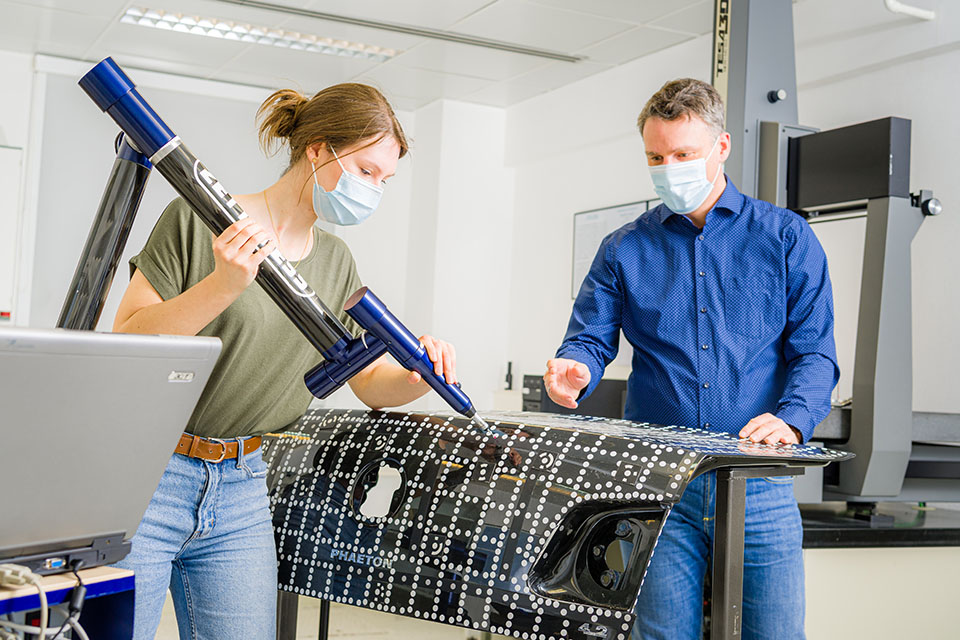

## Titelfolie mit Bild mit bis zu maximal drei Zeilen langem Text {.title-slide data-state="hide-footer"}

Titel (Erste Listenebene)  
Namen (Zweite Listenebene)  
Fakultät (Dritte Listenebene)  


---

## Titelfolie ohne Bild mit bis zu maximal drei Zeilen langem Text {.title-slide .ppt-color-title data-state="hide-footer" style="--ppt-bg: #8bd4d5;"}

Prof. Dr. phil.  
Berta Beispiel-Müllermeier  
Fakultät Wirtschaftswissenschaften  


---

## Titelfolie ohne Bild mit bis zu maximal drei Zeilen langem Text {.title-slide .ppt-corner-title data-state="hide-footer" style="--ppt-bg: #ff6600;"}

Prof. Dr. phil.  
Berta Beispiel-Müllermeier  
Fakultät Wirtschaftswissenschaften  


---

## Beispiel mit wenig Text {.content-slide .low-text-slide}
 

Erste Listenebene, 18 pt. Bulletpoint weggeklickt, lorem ipsum dolor sit amet, consetetur sadipscing elitr, sed diam nonumy eirmod tempor.

- Erste Listenebene, 18 pt

- At vero eos et accusam et justo duo dolores et ea rebum. Stet clita kasd gubergren, no sea takimata sanctus est.

- Lorem ipsum dolor sit amet. Lorem ipsum dolor sit amet, consetetur sadipscing elitr

---

## Beispiel mit einspaltigem Text {.content-slide .low-text-slide}
### Headline ggf. mit zweiter Zeile
 

Erste Listenebene, 18 pt. Bulletpoint weggeklickt lorem ipsum dolor sit amet, consetetur sadipscing elitr, sed diam nonumy eirmod tempor invidunt ut labore et dolore magna aliquyam erat, sed diam voluptua. At vero eos et accusam justo duo dolores et ea rebum.

- Stet clita kasd gubergren, no sea takimata sanctus est
- Lorem ipsum dolor sit amet. Lorem ipsum dolor sit amet, consetetur sadipscing elitr, sed diam nonumy eirmod tempor
- Invidunt ut labore et dolore magna aliquyam erat.
- Sed diam voluptua.
- At vero eos et accusam et justo duo dolores et ea rebum. Stet clita kasd gubergren, no sea takimata sanctus est Lorem ipsum dolor sit amet.

---

## Folie mit zweispaltigem Text {.two-column-slide}
### Headline ggf. mit zweiter Zeile
 

:::: {.columns}
::: {.column width="50%"}
- Erste Listenebene, 18 pt, lorem ipsum dolor sit amet, consetetur sadipscing elitr.
- Sed diam nonumy eirmod tempor invidunt ut labore et dolore magna aliquyam erat
- Sed diam voluptua.
- At vero eos et accusam et justo duo dolores et ea rebum.
- Stet clita kasd gubergren, no sea takimata sanctus est lorem ipsum dolor sit amet.
:::

::: {.column width="50%"}
- Lorem ipsum dolor sit amet, consetetur sadipscing elitr, sed diam nonumy eirmod tempor invidunt ut
- Labore et dolore magna aliquyam erat, sed diam voluptua.
- At vero eos et accusam et justo duo dolores et ea rebum.
- Stet clita kasd gubergren, no sea takimata sanctus est Lorem ipsum dolor sit amet.
- Lorem ipsum dolor sit amet, consetetur sadipscing elitr.
:::
::::

---

## Folie mit zweispaltigem Text {.two-column-slide .pdf-slide}
### Headline ggf. mit zweiter Zeile
 

:::: {.columns}
::: {.column width="50%"}
#### Nachhaltig
 

- Dritte Listenebene, 16 pt, lorem ipsum dolor sit amet, consetetur sadipscing elitr.
- Sed diam nonumy eirmod tempor invidunt ut labore et dolore magna aliquyam erat

#### Digital
 

- Sed diam voluptua.
- At vero eos et accusam et justo duo dolores et ea rebum.
:::

::: {.column width="50%"}
#### Interdisziplinär
 

- Lorem ipsum dolor sit amet, consetetur sadipscing elitr, sed diam nonumy eirmod tempor invidunt ut
- Labore et dolore magna aliquyam erat, sed diam voluptua.

#### International
 

- At vero eos et accusam et justo duo dolores et ea rebum.
- Stet clita kasd gubergren, no sea takimata sanctus est Lorem ipsum dolor sit amet.
:::
::::

---

## Kapiteltrenner mit Sekundärfarbe {.ppt-section-slide data-state="hide-footer" style="--ppt-bg: #d7df00;"}

---

## Zitatfolie {.ppt-quote-slide style="--ppt-bg: #c9ccd6;"}
 

> "Durch diesen Anwendungsbezug, aber auch durch die individuellen Lernatmosphäre und die Nähe zu den praxiserfahrenen Professoren wurde ich bestens auf meinen Berufsalltag vorbereitet."
>
> <cite>Thomas Krieg (Zweite Listenebene) Absolvent Bauingenieurwesen</cite>

---

## Folie mit Diagramm {.two-column-slide}
### und nebenstehendem Text
 

:::: {.columns}
::: {.column width="48%"}
- Erste Listenebene, 18 pt, Bulletpoint weggeklickt lorem ipsum dolor sit amet, consetetur sadipscing elitr, sed diam nonumy.
- Erste Listenebene, 18 pt
- At vero eos et accusam et justo duo dolores et ea rebum.
- Lorem ipsum dolor sit amet. Lorem ipsum dolor sit amet, consetetur sadipscing elitr
:::

::: {.column width="52%"}
<svg class="ppt-chart ppt-donut-chart" viewBox="0 0 520 360" role="img" aria-label="Kreisdiagramm mit fuenf Segmenten">
  <g transform="rotate(-90 260 150)">
    <circle cx="260" cy="150" r="96" pathLength="100" fill="none" stroke="#ffd800" stroke-width="54" stroke-dasharray="34 66" stroke-dashoffset="0"></circle>
    <circle cx="260" cy="150" r="96" pathLength="100" fill="none" stroke="#d7df00" stroke-width="54" stroke-dasharray="24 76" stroke-dashoffset="-34"></circle>
    <circle cx="260" cy="150" r="96" pathLength="100" fill="none" stroke="#83bd56" stroke-width="54" stroke-dasharray="18 82" stroke-dashoffset="-58"></circle>
    <circle cx="260" cy="150" r="96" pathLength="100" fill="none" stroke="#83d1d4" stroke-width="54" stroke-dasharray="14 86" stroke-dashoffset="-76"></circle>
    <circle cx="260" cy="150" r="96" pathLength="100" fill="none" stroke="#8fb2dd" stroke-width="54" stroke-dasharray="10 90" stroke-dashoffset="-90"></circle>
  </g>
  <circle cx="260" cy="150" r="58" fill="#fff"></circle>
  <g class="ppt-chart-legend" transform="translate(98 312)">
    <rect x="0" y="-10" width="12" height="12" fill="#ffd800"></rect><text x="20" y="0">Primärfarbe</text>
    <rect x="134" y="-10" width="12" height="12" fill="#d7df00"></rect><text x="154" y="0">Sekundärfarbe</text>
    <rect x="292" y="-10" width="12" height="12" fill="#83bd56"></rect><text x="312" y="0">Akzent</text>
  </g>
</svg>
:::
::::

---

## Großes Diagramm {.content-slide .chart-slide}
 

<svg class="ppt-chart ppt-bar-chart" viewBox="0 0 1040 430" role="img" aria-label="Gruppiertes Balkendiagramm mit vier Kategorien und drei Datenreihen">
  <g class="ppt-chart-grid">
    <line x1="90" y1="320" x2="980" y2="320"></line>
    <line x1="90" y1="260" x2="980" y2="260"></line>
    <line x1="90" y1="200" x2="980" y2="200"></line>
    <line x1="90" y1="140" x2="980" y2="140"></line>
    <line x1="90" y1="80" x2="980" y2="80"></line>
  </g>
  <line class="ppt-chart-axis" x1="90" y1="320" x2="980" y2="320"></line>
  <line class="ppt-chart-axis" x1="90" y1="80" x2="90" y2="320"></line>
  <g class="ppt-chart-series">
    <rect x="176" y="164" width="34" height="156" fill="#ffd800"></rect>
    <rect x="218" y="206" width="34" height="114" fill="#d7df00"></rect>
    <rect x="260" y="224" width="34" height="96" fill="#83bd56"></rect>
    <rect x="392" y="206" width="34" height="114" fill="#ffd800"></rect>
    <rect x="434" y="152" width="34" height="168" fill="#d7df00"></rect>
    <rect x="476" y="218" width="34" height="102" fill="#83bd56"></rect>
    <rect x="608" y="188" width="34" height="132" fill="#ffd800"></rect>
    <rect x="650" y="224" width="34" height="96" fill="#d7df00"></rect>
    <rect x="692" y="194" width="34" height="126" fill="#83bd56"></rect>
    <rect x="824" y="152" width="34" height="168" fill="#ffd800"></rect>
    <rect x="866" y="200" width="34" height="120" fill="#d7df00"></rect>
    <rect x="908" y="134" width="34" height="186" fill="#83bd56"></rect>
  </g>
  <g class="ppt-chart-labels">
    <text x="235" y="360" text-anchor="middle">Kategorie 1</text>
    <text x="451" y="360" text-anchor="middle">Kategorie 2</text>
    <text x="667" y="360" text-anchor="middle">Kategorie 3</text>
    <text x="883" y="360" text-anchor="middle">Kategorie 4</text>
  </g>
  <g class="ppt-chart-legend" transform="translate(310 405)">
    <rect x="0" y="-12" width="14" height="14" fill="#ffd800"></rect><text x="24" y="0">Datenreihe 1</text>
    <rect x="176" y="-12" width="14" height="14" fill="#d7df00"></rect><text x="200" y="0">Datenreihe 2</text>
    <rect x="352" y="-12" width="14" height="14" fill="#83bd56"></rect><text x="376" y="0">Datenreihe 3</text>
  </g>
</svg>

---

## Tabelle (HTWD Tabellenstil) {.table-slide .table-style-2}
 

| Bachelor (7. Semester) | Master (4. Semester) |
|---|---|
| Agrarwirtschaft | Produktmanagement Agrarwirtschaft |
| Chemieingenieurwesen | Chemieingenieurwesen |
| Gartenbau | Landschaftsarchitektur |
| Umweltmonitoring |  |
| Informatik | Angewandte Informatik |
| Medieninformatik |  |
| Wirtschaftsinformatik |  |
| Verwaltungsinformatik |  |

---

## Tabelle mit Überschrift {.table-slide .table-style-2}
 

| Überschrift | Überschrift | Überschrift | Überschrift | Überschrift |
|---|---|---|---|---|
| Normale Zeile | Normale Zeile | Normale Zeile | Normale Zeile | Normale Zeile |
| Normale Zeile | Normale Zeile | Normale Zeile | Normale Zeile | Normale Zeile |
| Normale Zeile | Normale Zeile | Normale Zeile | Normale Zeile | Normale Zeile |
| Normale Zeile | Normale Zeile | Normale Zeile | Normale Zeile | Normale Zeile |

---

## Tabelle (HTWD Tabellenstil 2) mit Überschrift {.table-slide}
 

| Überschrift | Überschrift | Überschrift | Überschrift | Überschrift |
|---|---|---|---|---|
| Normale Zeile | Normale Zeile | Normale Zeile | Normale Zeile | Normale Zeile |
| Normale Zeile | Normale Zeile | Normale Zeile | Normale Zeile | Normale Zeile |
| Normale Zeile | Normale Zeile | Normale Zeile | Normale Zeile | Normale Zeile |
| Normale Zeile | Normale Zeile | Normale Zeile | Normale Zeile | Normale Zeile |

---

## Video {.content-slide}
 

Video

---

## Kapiteltrenner mit Bild {.ppt-section-image-slide data-state="hide-footer" style="--ppt-bg: #ffd800;"}

  

---

## Folie zweispaltig, Titel, Text links und Bild rechts {.two-column-slide .text-image-slide}
 

:::: {.columns}
::: {.column width="50%"}
- Erste Listenebene, 18 pt. Bulletpoint weggeklickt, lorem ipsum dolor sit amet, consetetur sadipscing elitr, sed diam.
- Erste Listenebene, 18 pt
- At vero eos et accusam et justo duo dolores et ea rebum. Stet clita kasd gubergren, no sea takimata sanctus est.
- Lorem ipsum dolor sit amet. Lorem ipsum dolor sit amet, consetetur sadipscing elitr
:::

::: {.column width="50%"}

Hier ist Platz für eine Bildunterschrift oder eine Quelle

:::
::::

---

## Folie zweispaltig, Titel, Bild links und Text rechts {.two-column-slide .image-text-slide}
 

:::: {.columns}
::: {.column width="50%"}

Hier ist Platz für eine Bildunterschrift oder eine Quelle

:::

::: {.column width="50%"}
- Erste Listenebene, 18 pt. Bulletpoint weggeklickt, lorem ipsum dolor sit amet, consetetur sadipscing elitr, sed diam.
- Erste Listenebene, 18 pt
- At vero eos et accusam et justo duo dolores et ea rebum.
- Stet clita kasd gubergren, no sea takimata sanctus est.
- Lorem ipsum dolor sit amet. Lorem ipsum dolor sit amet, consetetur sadipscing elitr
:::
::::

---

## Folie mit zwei Bildern {.content-slide}
 

<figure>

<figcaption class="ppt-caption">Hier ist Platz für eine Bildunterschrift oder eine Quelle</figcaption>
</figure>
<figure>

<figcaption class="ppt-caption">Hier ist Platz für eine Bildunterschrift oder eine Quelle</figcaption>
</figure>

---

## Folie mit vier Bildern {.content-slide}
### Headline ggf. mit zweiter Zeile

:::: {.columns}

::: {.column width="50%"}

{width=50%}
{width=50%}

:::

::: {.column width="50%"}

{width=50%} 
{width=50%}

:::
::::

---

## Folie mit großem Bild Headline ggf. mit zweiter Zeile {.ppt-full-image-slide data-state="hide-footer"}

  

---

## Vielen Dank! {.title-slide data-state="hide-footer"}

Prof. Dr. phil.  
Berta Beispiel-Müllermeier  
Fakultät Wirtschaftswissenschaften  
T +49 351 462 1234    M +49 171 123 4567  
berta.beispiel-muellermeier@htw-dresden.de

---

## Vielen Dank! {.title-slide .ppt-color-title data-state="hide-footer" style="--ppt-bg: #8fb2dd;"}

Prof. Dr. phil.  
Berta Beispiel-Müllermeier  
Fakultät Wirtschaftswissenschaften  
T +49 351 462 1234    M +49 171 123 4567  
berta.beispiel-muellermeier@htw-dresden.de

