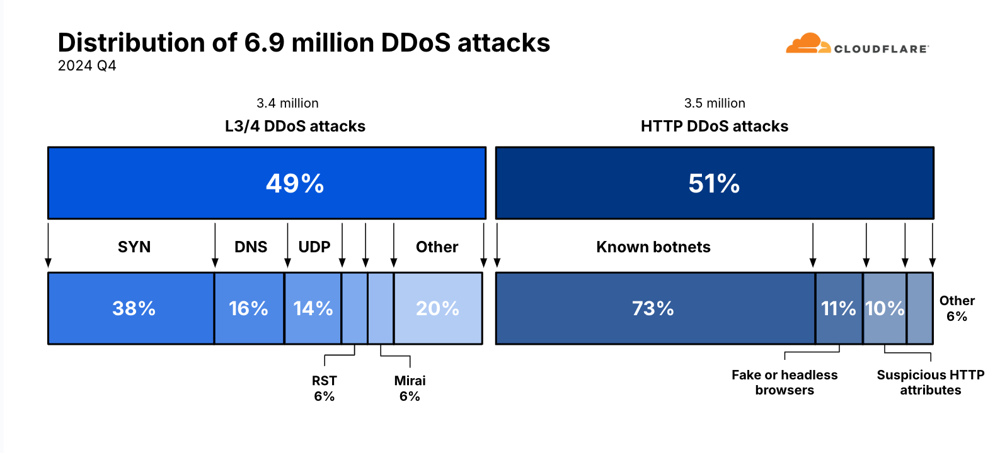
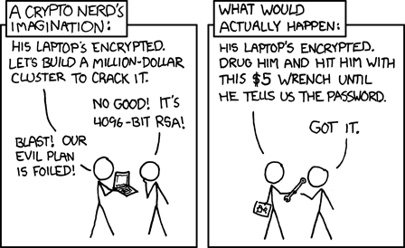

## Einführung in die Informationssicherheit {.title-slide data-state="hide-footer"}

Prof. Dr. Lukas Iffländer   
HTW Dresden  


---

## Agenda {.content-slide .agenda-slide}
 

<ul class="agenda">
<li class="agenda-item"><strong>01</strong>Motivation</li>
<li class="agenda-item"><strong>02</strong>Schutzziele</li>
<li class="agenda-item"><strong>03</strong>Begriffsdefinitionen und Gesetze</li>
<li class="agenda-item"><strong>04</strong>Literatur</li>
</ul>

---

## Vorkommnisse der letzten Zeit I {.content-slide .table-slide}
 

| Angriff oder Ziel | Beschreibung |
|---|---|
| MOVEit | Daten bei 2.600 Firmen und über 83 Millionen Einzelpersonen "herausgetragen". [1] |
| UK Electoral Commission | 40 Millionen Wählerdaten abgegriffen. [2] |
| Police Service of Northern Ireland | Versehentlich über 10.000 Datensätze über Mitarbeiter herausgegeben, auch solche, die undercover waren. [3] |
| DarkBeam | 3,8 Milliarden Datensätze einer Firma, die auf "Digital Risk" spezialisiert ist, offen im Netz. [4] |
| Indian Council of Medical Research | 815 Millionen Datensätze über COVID-19-Tests. [5] |

---

## Vorkommnisse der letzten Zeit II {.content-slide .table-slide}
 

| Angriff oder Ziel | Beschreibung |
|---|---|
| 23andMe | 20 Millionen Datensätze mit genetischen Informationen gestohlen. [6] |
| Rapid Reset DDoS attacks | DDoS-Angriff mit 398 Millionen Anfragen pro Sekunde im Vergleich zum bisherigen Rekord mit 46 Millionen. [7] |
| T-Mobile | 37 Millionen Datensätze, 800-mal Zahlungsdaten. [8, 9] |
| MGM International/Caesars | Angriff auf Casino-IT mit Einnahmeausfall von 100 Mio. USD. [10] |
| The Pentagon Leaks | Mitarbeiter hat, um anzugeben, geheime Informationen auf Discord veröffentlicht. [11] |
| Crowdstrike | Security-Anbieter schießt seine eigenen Systeme beim Update ab. [12] |

---

## Hackerangriff auf den Bundestag 2015 [13, 14] {.content-slide .pdf-slide}
 

- Mai 2015: Gesamtes Netz des Bundestags Ziel eines Hackerangriffs
- Angriffsmittel: Phishingangriff via Mail (Absender: un.org), Link auf Website mit Schadsoftware
- Ein Rechner mit Trojaner infiziert, Adminpasswörter ausgelesen
- Folge: viertägige Abschaltung des gesamten Bundestagsnetzes
- Ziel: vermutlich Abgreifen aller möglichen Dokumente (Trojaner suchte nach .pdf, .xls, .xlsx, .doc, .docx)

---

## Größter bisherige Denial of Service Angriff [15] {.content-slide .image-slide}
 

- Januar 2025: DDoS-Angriff mit 5,6 Tbps auf einen Kunden von Cloudflare
- Bisheriger Rekord: 3,47 Tbps (Microsoft Azure, März 2023)

---

## Security-Nur um Security zu haben I {.content-slide .image-slide}
 

---

## Security-Nur um Security zu haben II {.content-slide .image-slide}
 

---

## Falsche Einschätzungen zu Security {.content-slide .image-slide}
 

---

## Überblick {.content-slide .pdf-slide}
 

::: {.callout-note title="Die originalen Schutzziele aus der CIA Triade:"}
- Vertraulichkeit (Confidentiality)
- Integrität (Integrity)
- Verfügbarkeit (Availability)
:::

::: {.callout-tip title="Über die Zeit sind hinzugekommen:"}
- Authentizität (Authenticity)
- Verbindlichkeit (Non-Repudiation)
- Anonymität (Anonymity)
:::

---

## Schutzziel Vertraulichkeit (Confidentiality) {.content-slide .pdf-slide}
 

**Ziel:** Verbergen oder Geheimhalten von Informationen

::: {.callout-tip title="sensitive Daten wie z. B.:"}
- personenbezogen (insbesondere Gesundheitsdaten)
- militärische und geschäftliche Geheimnisse
:::

::: {.callout-note title="Unterschiedliche Mechanismen gewährleisten dieses Ziel"}
- Ver- und Entschlüsselung (Kryptografie)
- Verbergen in "unverdächtigen" Daten (Steganografie)
- Zugriffssteuerung (Access Control)
:::

::: {.callout-important title="Durchführung dieser Prozesse durch Menschen"}
- fehleranfällig, zu komplex - nötige Vereinfachungen schaffen Angriffsfläche
- Technische Unterstützung notwendig
:::

---

## Schutzziel: Integrität (Integrity) {.content-slide .pdf-slide}
 

**Kernfrage:** "Sind Daten vertrauenswürdig?"

**Ziel:** Verhinderung der Verfälschung von Daten

::: {.callout-important title="Integrität kann verletzt werden durch:"}
- unautorisierte Personen (Angriff von außen)
- autorisierte Personen (Angriff von innen oder Versehen)
:::

::: {.callout-note title="Schutz möglich durch"}
- Verhinderung unautorisierter Schreibzugriffe (z. B. durch Dateisystemberechtigungen)
- Erkennung von Integritätsverletzungen (z. B. durch kryptografische Prüfsummen)
:::

---

## Schutzziel: Verfügbarkeit (Availability) {.content-slide .pdf-slide}
 

**Ziel:** Daten und Dienste müssen verfügbar sein

::: {.callout-important title="Verfügbarkeit kann verletzt werden durch:"}
- technische Probleme (z. B. Hardwareausfall)
- Angriffe (z. B. DDoS)
:::

::: {.callout-note title="Schutz möglich durch:"}
- Redundanz (z. B. RAID-Systeme)
- Lastverteilung (z. B. Load Balancer)
- DDoS-Schutz (z. B. Cloudflare)
:::

(!) Safety und Security beide betroffen.

---

## Schutzziel: Authentizität (Authenticity) {.content-slide .pdf-slide}
 

**Ziel:** Verifizierung der Identität von Kommunikationspartnern

::: {.callout-important title="Authentizität kann verletzt werden durch:"}
- Identitätsdiebstahl
- Fälschung von Identitäten
:::

::: {.callout-note title="Schutz möglich durch:"}
- Authentifizierung (z. B. Passwörter, Zertifikate)
- Signatur von Nachrichten (z. B. kryptografische Signatur)
- Zwei-Faktor-Authentifizierung
:::

---

## Schutzziel: Verbindlichkeit (Non-Repudiation) {.content-slide .pdf-slide}
 

**Ziel:** Verhinderung der Leugnung von Kommunikationsvorgängen

::: {.callout-important title="Verbindlichkeit kann verletzt werden durch:"}
- Leugnung von Kommunikationsvorgängen
:::

::: {.callout-note title="Schutz möglich durch:"}
- Protokollierung von Kommunikationsvorgängen
- Signatur von Nachrichten (z. B. kryptografische Signatur)
:::

---

## Schutzziel: Anonymität (Anonymity) {.content-slide .pdf-slide}
 

**Ziel:** Verbergen der Identität von Kommunikationspartnern

::: {.callout-important title="Anonymität kann verletzt werden durch:"}
- Lokales Tracking (z. B. durch Cookies)
- Nachverfolgung durch Logdaten
:::

::: {.callout-note title="Schutz möglich durch:"}
- Anonymisierungsdienste (z. B. Tor)
- Pseudonymisierung
- Eliminierung oder Einschränkung lokaler Trackingfunktionen
:::

---

## Policy und Mechanism (Strategie und Mechanismus) {.content-slide .pdf-slide}
 

::: {.callout-note title="Sicherheitsstrategie (Security Policy)"}
Die Formulierung der Aktionen, welche Nutzer durchführen dürfen und welche nicht.
:::

::: {.callout-note title="Sicherheitsmechanismus (Security Mechanism)"}
Die Methode oder Vorgehensweise zur Umsetzung der Sicherheitsstrategie.
:::

::: {.callout-tip title="Beispiel"}
- Strategie: Jeder Nutzer hat ausschließlich Zugriff auf sein Homeverzeichnis (Linux: /home/$USER, Windows: C:\Users\$USER)
- Mögliche Mechanismen:
  - Betriebssystem prüft jeden Zugriff auf Dateisystem und verwehrt Zugriffe außerhalb;
  - Jeder Nutzer besitzt einen mobilen Datenträger mit seinem Homeverzeichnis;
  - Jeder Nutzer hat ein verschlüsseltes Homeverzeichnis, für das nur er den Entschlüsselungsschlüssel hat.
- Mechanismen können kombiniert werden.
:::

---

## Bedrohungen (Threats) {.content-slide .pdf-slide}
 

- Eine Bedrohung ist eine potenzielle Verletzung der Sicherheitsstrategie.

- Klassifizierung (gibt auch andere Schemata):

::: {.callout-note title="Aufdeckung (Disclosure)"}
unbefugter Zugriff auf Informationen (Abhören, Durchsuchen, Kopieren)
:::

::: {.callout-note title="Täuschung (Deception)"}
Verfälschung von Informationen (Manipulation, Fälschung)
:::

::: {.callout-note title="Unterbrechung (Disruption)"}
Verhinderung des Zugriffs auf Informationen (Zerstörung, Blockierung)
:::

::: {.callout-note title="Übernahme (Usurpation)"}
unbefugte Übernahme von Kontrolle (Einschleusen, Übernahme)
:::

---

## Strafgesetzbuch {.content-slide .pdf-slide}
 

- §202a StGB: Ausspähen von Daten
- §202b StGB: Abfangen von Daten
- §202c StGB: Vorbereiten des Ausspähens und Abfangens von Daten
- §202d StGB: Datenhehlerei
- §303a StGB: Datenveränderung
- §303b StGB: Computersabotage

---

## Strafgesetzbuch {.content-slide .pdf-slide}
### §202a "Ausspähen von Daten"
 

1. Wer unbefugt sich oder einem anderen Zugang zu Daten, die nicht für ihn bestimmt und die gegen unberechtigten Zugang besonders gesichert sind, unter Überwindung der Zugangssicherung verschafft, wird mit Freiheitsstrafe bis zu drei Jahren oder mit Geldstrafe bestraft.
2. Daten im Sinne des Absatzes 1 sind nur solche, die elektronisch, magnetisch oder sonst nicht unmittelbar wahrnehmbar gespeichert sind oder übermittelt werden.

---

## Strafgesetzbuch {.content-slide .pdf-slide}
### §202b "Abfangen von Daten"
 

Wer unbefugt sich oder einem anderen unter Anwendung von technischen Mitteln nicht für ihn bestimmte Daten (§ 202a Abs. 2) aus einer nichtöffentlichen Datenübermittlung oder aus der elektromagnetischen Abstrahlung einer Datenverarbeitungsanlage verschafft, wird mit Freiheitsstrafe bis zu zwei Jahren oder mit Geldstrafe bestraft, wenn die Tat nicht in anderen Vorschriften mit schwererer Strafe bedroht ist.

---

## Strafgesetzbuch {.content-slide .pdf-slide}
### §202c "Vorbereiten des Ausspähens und Abfangens von Daten"
 

1. Wer eine Straftat nach § 202a oder § 202b vorbereitet, indem er
   1. Passwörter oder sonstige Sicherungscodes, die den Zugang zu Daten (§ 202a Abs. 2) ermöglichen, oder
   2. Computerprogramme, deren Zweck die Begehung einer solchen Tat ist,
   
   herstellt, sich oder einem anderen verschafft, verkauft, einem anderen überlässt, verbreitet oder sonst zugänglich macht, wird mit Freiheitsstrafe bis zu zwei Jahren oder mit Geldstrafe bestraft.
2. §149 Abs. 2 und 3 gilt entsprechend.

---

## Strafgesetzbuch I {.content-slide .pdf-slide}
### §202d "Datenhehlerei"
 

1. Wer Daten (§ 202a Absatz 2), die nicht allgemein zugänglich sind und die ein anderer durch eine rechtswidrige Tat erlangt hat, sich oder einem anderen verschafft, einem anderen überlässt, verbreitet oder sonst zugänglich macht, um sich oder einen Dritten zu bereichern oder einen anderen zu schädigen, wird mit Freiheitsstrafe bis zu drei Jahren oder mit Geldstrafe bestraft.
2. Die Strafe darf nicht schwerer sein als die für die Vortat angedrohte Strafe.
3. Absatz 1 gilt nicht für Handlungen, die ausschließlich der Erfüllung rechtmäßiger dienstlicher oder beruflicher Pflichten dienen. Dazu gehören insbesondere
   1. solche Handlungen von Amtsträgern oder deren Beauftragten, mit denen Daten ausschließlich der Verwertung in einem Besteuerungsverfahren, einem Strafverfahren oder einem Ordnungswidrigkeitenverfahren zugeführt werden sollen, sowie
   2. solche beruflichen Handlungen der in § 53 Absatz 1 Satz 1 Nummer 5 der Strafprozessordnung genannten Personen, mit denen Daten entgegengenommen, ausgewertet oder veröffentlicht werden.

---

## Strafgesetzbuch {.content-slide .pdf-slide}
### §303a "Datenveränderung"
 

1. Wer rechtswidrig Daten (§ 202a Abs. 2) löscht, unterdrückt, unbrauchbar macht oder verändert, wird mit Freiheitsstrafe bis zu zwei Jahren oder mit Geldstrafe bestraft.
2. Der Versuch ist strafbar.
3. Für die Vorbereitung einer Straftat nach Absatz 1 gilt § 202c entsprechend.

---

## Strafgesetzbuch I {.content-slide .pdf-slide}
### §303b "Computersabotage"
 

1. Wer eine Datenverarbeitung, die für einen anderen von wesentlicher Bedeutung ist, dadurch erheblich stört, dass er
   1. eine Tat nach § 303a Abs. 1 begeht,
   2. Daten (§ 202a Abs. 2) in der Absicht, einem anderen Nachteil zuzufügen, eingibt oder übermittelt oder
   3. eine Datenverarbeitungsanlage oder einen Datenträger zerstört, beschädigt, unbrauchbar macht, beseitigt oder verändert,
   
   wird mit Freiheitsstrafe bis zu drei Jahren oder mit Geldstrafe bestraft.
2. Handelt es sich um eine Datenverarbeitung, die für einen fremden Betrieb, ein fremdes Unternehmen oder eine Behörde von wesentlicher Bedeutung ist, ist die Strafe Freiheitsstrafe bis zu fünf Jahren oder Geldstrafe.
3. Der Versuch ist strafbar.

---

## Strafgesetzbuch II {.content-slide .pdf-slide}
### §303b "Computersabotage"
 

4. In besonders schweren Fällen des Absatzes 2 ist die Strafe Freiheitsstrafe von sechs Monaten bis zu zehn Jahren. Ein besonders schwerer Fall liegt in der Regel vor, wenn der Täter
   1. einen Vermögensverlust großen Ausmaßes herbeiführt,
   2. gewerbsmäßig oder als Mitglied einer Bande handelt, die sich zur fortgesetzten Begehung von Computersabotage verbunden hat,
   3. durch die Tat die Versorgung der Bevölkerung mit lebenswichtigen Gütern oder Dienstleistungen oder die Sicherheit der Bundesrepublik Deutschland beeinträchtigt.
5. Für die Vorbereitung einer Straftat nach Absatz 1 gilt § 202c entsprechend.

---

## Zusammenfassung {.content-slide .pdf-slide}
 

- Früher: Bloßes Eindringen nicht strafbar.
- Heute: Unbefugter Zugang unter Überwindung von Sicherheitsvorkehrungen strafbar.
- Hauptmangel: fehlende präzise Definition strafrechtlich relevanter Werkzeuge ("Hackertools").
- Werkzeuge nach § 202b sind auch viele Sicherheitstools, deren Einsatz zur Sicherung von Systemen notwendig ist.
- Gerichte kommen oft zu "merkwürdigen" Entscheidungen.

---

## Literaturverzeichnis I {.content-slide .pdf-slide}
 

[1] Zach Simas. "Unpacking the MOVEit Breach: Statistics and Analysis". In: Emsisoft | Cybersecurity Blog (Feb. 2024). url: https://www.emsisoft.com/en/blog/44123/unpacking-the-moveit-breach-statistics-and-analysis.

[2] Public notification of cyber-attack on Electoral Commission systems. [Online; accessed 19. Feb. 2024]. Feb. 2024. url: https://www.electoralcommission.org.uk/privacy-policy/public-notification-cyber-attack-electoral-commission-systems.

[3] Police Service of Northern Ireland statement on data breach. [Online; accessed 19. Feb. 2024]. Feb. 2024. url: https://www.psni.police.uk/latest-news/police-service-northern-ireland-statement-data-breach.

[4] Damien Fisher. "DarkBeam's Alarming Data Breach Exposes 3.8 Billion Records". In: Tech Report (Sep. 2023). url: https://techreport.com/news/darkbeams-alarming-data-breach-exposes-3-8-billion-records.

---

## Literaturverzeichnis II {.content-slide .pdf-slide}
 

[5] PII Belonging to Indian Citizens, Including their Aadhaar IDs, Offered for Sale on the Dark Web. [Online; accessed 19. Feb. 2024]. Feb. 2024. url: https://www.resecurity.com/blog/article/pii-belonging-to-indian-citizens-including-their-aadhaar-ids-offered-for-sale-on-the-dark-web.

[6] A. J. Vicens. "DNA testing service 23andMe investigating theft of user data". In: CyberScoop (Okt. 2023). url: https://cyberscoop.com/23andme-user-data-theft.

[7] Google Cloud mitigated largest DDoS attack, peaking above 398 million rps. [Online; accessed 19. Feb. 2024]. Feb. 2024. url: https://cloud.google.com/blog/products/identity-security/google-cloud-mitigated-largest-ddos-attack-peaking-above-398-million-rps/?hl=en.

---

## Literaturverzeichnis III {.content-slide .pdf-slide}
 

[8] T-Mobile. United States Securities and Exchange Commission - Form 8-K. [Online; accessed 19. Feb. 2024]. 19. Jan. 2023. url: https://www.sec.gov/ixviewer/ix.html?doc=/Archives/edgar/data/0001283699/000119312523010949/d641142d8k.htm.

[9] T-Mobile Consumer Sample - February-March data breach. [Online; accessed 19. Feb. 2024]. 8. Apr. 2023. url: https://www.documentcloud.org/documents/23793945-t-mobile-consumer-sample-february-march-data-breach.

[10] MGM Ressorts International. United States Securities and Exchange Commission - Form 8-K. [Online; accessed 19. Feb. 2024]. 5. Okt. 2023.

[11] Phil Muncaster. "The Pentagon Leaks: An Insider Horror Story • Assured". In: Assured (Mai 2023). url: https://assured.co.uk/2023/the-pentagon-leaks-an-insider-horror-story.

---

## Literaturverzeichnis IV {.content-slide .pdf-slide}
 

[12] Aditi Uberoi. Blue Screen of Death: Live Timeline of the Microsoft Outage & Impact. [Online; accessed 9. Oct. 2025]. Okt. 2025. url: https://www.cm-alliance.com/cybersecurity-blog/blue-screen-of-death-live-timeline-of-the-microsoft-outage-impact.

[13] Digital Attack on German Parliament: Investigative Report on the Hack of the Left Party Infrastructure in Bundestag. [Online; accessed 12. Mar. 2024]. Juni 2015. url: https://netzpolitik.org/2015/digital-attack-on-german-parliament-investigative-report-on-the-hack-of-the-left-party-infrastructure-in-bundestag.

[14] Wir veröffentlichen Dokumente zum Bundestagshack: Wie man die Abgeordneten im Unklaren ließ. [Online; accessed 12. Mar. 2024]. März 2016. url: https://netzpolitik.org/2016/wir-veroeffentlichen-dokumente-zum-bundestagshack-wie-man-die-abgeordneten-im-unklaren-liess.

---

## Literaturverzeichnis V {.content-slide .pdf-slide}
 

[15] Record-breaking 5.6 Tbps DDoS attack and global DDoS trends for 2024 Q4. [Online; accessed 9. Oct. 2025]. Feb. 2025. url: https://blog.cloudflare.com/ddos-threat-report-for-2024-q4.

---

## Vielen Dank! {.title-slide data-state="hide-footer"}

Prof. Dr. Lukas Iffländer   
HTW Dresden  


