## Historische Kryptosysteme {.title-slide data-state="hide-footer"}

Prof. Dr. Lukas Iffländer   
HTW Dresden  


---

## Agenda {.content-slide .agenda-slide}
 

<ul class="agenda">
<li class="agenda-item"><strong>01</strong>Grundbegriffe</li>
<li class="agenda-item"><strong>02</strong>Skytale und Caesar-Chiffre</li>
<li class="agenda-item"><strong>03</strong>Substitution und Vigenère</li>
<li class="agenda-item"><strong>04</strong>Kasiski- und Friedman-Test</li>
<li class="agenda-item"><strong>05</strong>Codex Copiale und Voynich</li>
<li class="agenda-item"><strong>06</strong>Playfair-Chiffre</li>
</ul>

---

## Grundbegriffe {.content-slide .low-text-slide}
 

**Kryptographie** beschäftigt sich mit der sicheren Übertragung von Informationen.

**Kryptoanalyse** beschäftigt sich mit dem Brechen kryptographisch verschlüsselter Nachrichten.

**Kryptologie** ist die Wissenschaft von Kryptographie und Kryptoanalyse und ein Teilgebiet der Mathematik.

---

## Grundbegriffe II {.content-slide .pdf-slide}
 

- **Sender** und **Empfänger** tauschen Nachrichten aus.
- Damit die Nachrichten nicht von **Dritten** gelesen werden können, werden sie vom Sender **verschlüsselt** und vom Empfänger **entschlüsselt**.

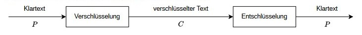

- Verschlüsselungsfunktion E (encryption)
- Entschlüsselungsfunktion D (decryption)
- Die unverschlüsselte Nachricht wird **Klartext** (P, Plain Text oder M, Message) genannt.
- Die verschlüsselte Nachricht wird **Chiffretext** (C, Cipher Text) genannt.
- E(P) = C und D(C) = P. Damit gilt auch D(E(P)) = P.

---

## Skytale {.content-slide .text-image-slide}
### Grundidee
 

:::: {.columns}
::: {.column width="58%"}
- älteste (dokumentierte) kryptographische Methode (Sparta, ≈ 500 v. Chr.)
- Pergament- bzw. Lederstreifen um Holzstab definierter Dicke gewickelt
- längs beschriftet
- abgewickelt unlesbar
- Empfänger kann nur mit gleich dickem Stab lesen

Beispiel einer Skytale^a^

<small>^a^ https://commons.wikimedia.org/wiki/File:Skytale.png</small>
:::

::: {.column width="42%"}
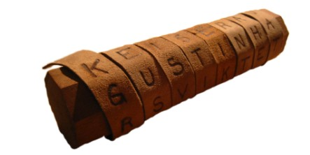
:::
::::

---

## Skytale {.content-slide .table-slide}
### Konzept
 

- **Idee:** Nur die Positionen der zu kodierenden Zeichen werden verändert.
- **Beispiel:** Spaltentransposition
- **Klartext:** DIE PERSER GREIFEN IM MORGENGRAUEN AN
- **Text auf Skytale:**

| Zeile | Text |
|---:|---|
| 1 | DIEPERSE |
| 2 | RGREIFEN |
| 3 | IMMORGEN |
| 4 | GRAUENAN |

- **Chiffretext:** DRIG IGMR ERMA PEOU EIRE RFGN SEEA ENNN

---

## Chiffrierung mittels Substitution {.content-slide .text-image-slide}
### Caesar-Chiffre
 

:::: {.columns}
::: {.column width="58%"}
- **Idee:** Jeder Buchstabe wird um eine feste Anzahl von Positionen im Alphabet verschoben.
- **Beispiel:** Verschiebung um 3 Positionen
- **Klartext:** DIE GALLIER HABEN NEUEN ZAUBERTRANK GEBRAUT
- **Chiffretext:** GLH JDOOLHU KDEHQ QHXHQ CDXEHUWUDQN JHEUDXW
:::

::: {.column width="42%"}
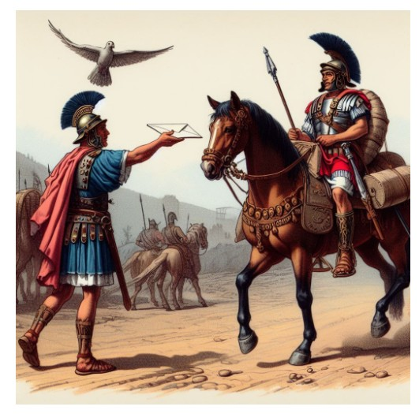
:::
::::

---

## Chiffrierung mittels Substitution {.content-slide .pdf-slide}
### Konzept
 

- **Idee:** Elemente im Klartext werden durch andere Elemente im Chiffretext ersetzt.
- Dechifrierung durch Umkehrung der Substitution.
- Einfachste From: **monoalphabetische Substitution**
  - jedem Zeichen im Klartext ist genau ein Zeichen im Chiffretext zugeordnet (genau ein Alphabet)
  - Caesar-Chiffre (Position im Alphabet +3 mod 26)
  - Rot-13 (Position im Alphabet +13 mod 26)

---

## Chiffrierung mittels Substitution {.content-slide .table-slide}
### Angriffsvektor Buchstabenhäufigkeit
 

Tabelle: Buchstabenhäufigkeit im Deutschen

| Buchstabe | Häufigkeit | Buchstabe | Häufigkeit | Buchstabe | Häufigkeit |
|---|---:|---|---:|---|---:|
| a | 6,51 % | j | 0,27 % | s | 7,27 % |
| b | 1,89 % | k | 1,21 % | t | 6,15 % |
| c | 3,06 % | l | 3,44 % | u | 4,35 % |
| d | 5,08 % | m | 2,53 % | v | 0,67 % |
| e | 17,40 % | n | 9,78 % | w | 1,89 % |
| f | 1,66 % | o | 2,51 % | x | 0,03 % |
| g | 3,01 % | p | 0,79 % | y | 0,04 % |
| h | 4,76 % | q | 0,02 % | z | 1,13 % |
| i | 7,55 % | r | 7,00 % |  |  |

---

## Chiffrierung mittels Substitution {.content-slide .pdf-slide}
### Weitere Kategorien von Chiffren
 

- **homophone Substitution:**
  - jedem Zeichen im Klartext können mehrere Zeichen im Chiffretext zugeordnet sein
  - Zeichenvorrat des Chiffretextes größer
- **polygrafische Substitution:**
  - Blöcke von Zeichen im Klartext werden auf Blöcke von Zeichen im Chiffretext abgebildet
- **polyalphabetische Substitution:**
  - je nach Position des Zeichens werden unterschiedliche Kodierungsalphabete verwendet
  - Vigenère-Chiffre

---

## Chiffrierung mittels Substitution {.content-slide .image-slide}
### Digrafisches System von Giovanni Battista Porta (1563)
 

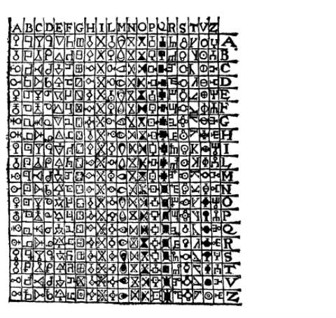

Paare von Buchstaben werden durch graphische Symbole ersetzt. [1]

---

## Vigenère-Verschlüsselung {.content-slide .pdf-slide}
 

- **Idee:** Nutzung mehrerer (bis zu 26) monoalphabetischer Verschlüsselungen im Wechsel
- entwickelt von Blaise de Vigenère (1523-1596)
- Basis vieler Verschlüsselungen, die bis heute in Gebrauch sind (z. B. RC2, das bei Worddokumenten mit Kompatibilität zu alten Lotus-Notes-Versionen verwendet wird)
- gleicht unterschiedliche Auftrittswahrscheinlichkeiten der Buchstaben aus
- ⇒ über Analyse der Buchstabenhäufigkeit nicht brechbar

---

## Vigenère-Verschlüsselung {.content-slide .image-slide}
### Vigenère-Quadrat
 

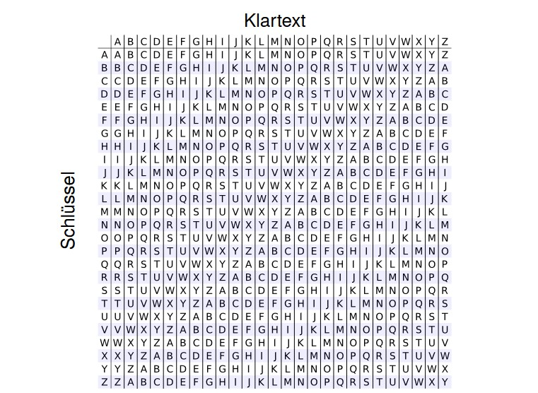

---

## Vigenère-Verschlüsselung {.content-slide .pdf-slide}
### Anwendung
 

- Wahl eines Schlüsselworts-Zuordnung Buchstaben des Schlüsselworts zu Klartextbuchstaben (ggf. mehrfach)
- Verschlüsselung: Schnittpunkt Zeile Schlüsselbuchstabe und Spalte Klartextbuchstabe
- Entschlüsselung: Spalte des Schnittpunkts der Zeile des Schlüsselbuchstabe und des Wert des Chiffretextbuchstabens

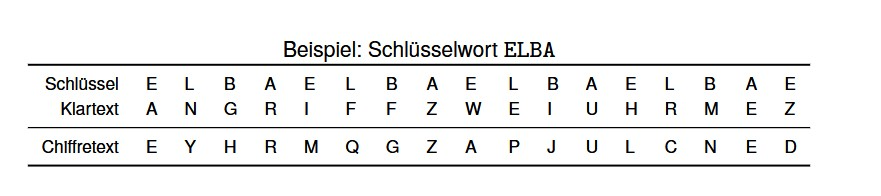

---

## Vigenère-Verschlüsselung {.content-slide .pdf-slide}
### Kasiski-Test-Idee
 

Friedrich Wilhelm Kasiski (1805-1881) entwickelte 1863 eine Methode, um die Länge des Schlüsselworts zu bestimmen.

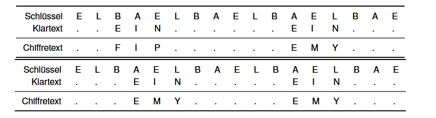

- Identische Klartextpassagen werden auf gleiche Chiffretextpassagen abgebildet, wenn sie unter identischen Schlüsselbuchstaben stehen.
- Abstand ist ein Vielfaches der Schlüssellänge

---

## Vigenère-Verschlüsselung {.content-slide .pdf-slide}
### Kasiski-Test-Methodik
 

- Suche nach sich wiederholenden Passagen im Chiffretext mit Länge > 3.
- Bestimme Abstand zwischen den Wiederholungen.
- Abstand ist ein Vielfaches der Schlüssellänge.
- Gibt es mehrere Abstände, so muss die Schlüssellänge ein gemeinsamer Teiler der meisten Abstände sein.
- Ermittlung der Schlüssellänge ausreichend um Vigenère-Chiffre zu brechen.

---

## Vigenère-Verschlüsselung {.content-slide .image-slide}
### Kasiski-Test-Beispiel
 

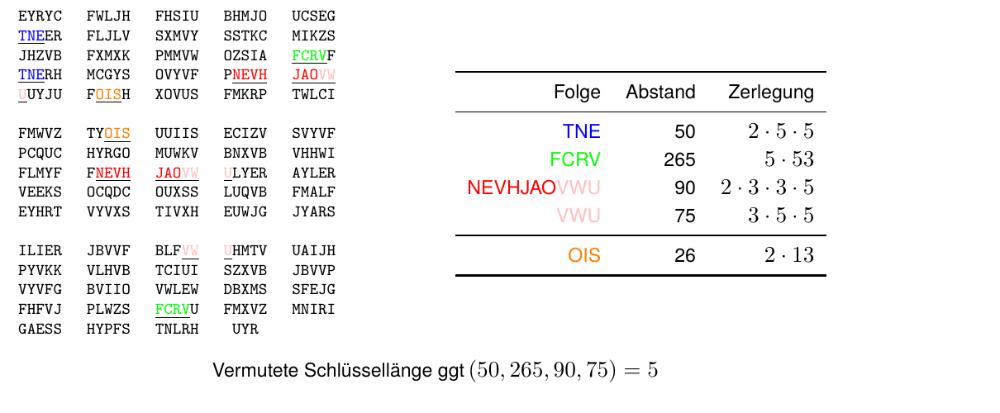

---

## Vigenère-Verschlüsselung {.content-slide .pdf-slide}
### Friedman-Test
 

- von William F. Friedman (1891-1969) im Jahr 1925 entwickelt
- statistische Größe
- kann zur Kryptoanalyse unbekannter Chiffretexte verwendet werden
- Frage: Mit welcher Wahrscheinlichkeit treten zwei zufällig gewählte Buchstaben im Klartext an gleicher Stelle im Chiffretext auf?

---

## Vigenère-Verschlüsselung {.content-slide .image-slide}
### Friedman-Test-Koinzidenzindex I
 

- Anzahl Buchstabenpaare **'aa'** aus einem Text, der \(n_1\) **'a'**s enthält:

  $$
  \frac{n_1\cdot(n_1-1)}{2}
  \tag{1.1}
  $$

- Anzahl Buchstabenpaare **'aa'**, **'bb'**, ..., **'zz'** aus einem Text, der
  \(n_1\) **'a'**s, \(n_2\) **'b'**s, ..., \(n_{26}\) **'z'**s enthält:

  $$
  \frac{n_1\cdot(n_1-1)}{2}
  +
  \frac{n_2\cdot(n_2-1)}{2}
  +
  \cdots
  +
  \frac{n_{26}\cdot(n_{26}-1)}{2}
  =
  \sum_{i=1}^{26}
  \frac{n_i\cdot(n_i-1)}{2}
  \tag{1.2}
  $$

---

## Vigenère-Verschlüsselung {.content-slide .image-slide}
### Friedman-Test-Koinzidenzindex II
 

- Wahrscheinlichkeit, bei zufälliger Auswahl zweier Zeichen aus einem Text der Länge \(n\) zwei gleiche Zeichen zu erhalten:

  $$
  \frac{\displaystyle\sum_{i=1}^{26}\frac{n_i(n_i-1)}{2}}
       {\displaystyle\frac{n(n-1)}{2}}
  =
  \frac{\displaystyle\sum_{i=1}^{26}n_i(n_i-1)}
       {n(n-1)}
  =
  \kappa
  \tag{1.3}
  $$

- \(\kappa\) (Kappa) ist der **Friedmansche Koinzidenzindex**.

---

## Vigenère-Verschlüsselung {.content-slide .image-slide}
### Friedman-Test-Koinzidenzindex mit Auftrittswahrscheinlichkeiten I
 

- **Gegeben:** Text deutscher Sprache (Auftretenswahrscheinlichkeiten der einzelnen Buchstaben bekannt)

- Wahrscheinlichkeit, dass der erste Buchstabe eines Paares **'a'** ist, ist \(p_1\).

- Wahrscheinlichkeit, dass der zweite Buchstabe eines Paares **'a'** ist, ist ebenfalls \(p_1\).

- Wahrscheinlichkeit, dass beide Buchstaben **'a'** sind, ist

  $$
  p_1^2
  $$

- Wahrscheinlichkeit, bei zufälliger Auswahl zweier Zeichen aus einem deutschen Text zwei gleiche Buchstaben zu erhalten:

  $$
  \kappa
  =
  \sum_{i=1}^{26}p_i^2
  \tag{1.4}
  $$

---

## Vigenère-Verschlüsselung {.content-slide .image-slide}
### Friedman-Test-Koinzidenzindex mit Auftrittswahrscheinlichkeiten II
 

- \(\kappa\) der deutschen Sprache ist damit:

  $$
  \kappa_{\mathrm{DE}}
  =
  0{,}0651^2
  +
  0{,}0189^2
  +
  \cdots
  +
  0{,}0113^2
  \approx
  0{,}0762
  \tag{1.5}
  $$

  $$
  \left(\kappa_{\mathrm{EN}}\approx0{,}0667\right)
  $$

- Für einen Text aus zufälligen Buchstaben ergibt sich hingegen:

  $$
  \kappa_{\mathrm{RND}}
  =
  \sum_{i=1}^{26}
  \frac{1}{26^2}
  =
  \frac{1}{26}
  \approx
  0{,}0385
  \tag{1.6}
  $$

---

## Vigenère-Verschlüsselung {.content-slide .image-slide}
### Friedman-Test
 

- **Gegeben:**

  - Chiffretext \(C\) der Länge \(n\) (Koinzidenzindex \(\kappa_C\) trivial berechenbar)

  - Wissen über die Sprache des Klartexts und deren Koinzidenzindex \(\kappa_{\mathrm{DE}}\)

- Dann beträgt die Länge \(h\) des Schlüssels näherungsweise:

  $$
  h
  \approx
  \frac{\kappa_{\mathrm{DE}}-\kappa_{\mathrm{RND}}}
       {\kappa_C\cdot(n-1)+\kappa_{\mathrm{DE}}-\kappa_{\mathrm{RND}}}
  \tag{1.7}
  $$

---

## Vigenère-Verschlüsselung {.content-slide .image-slide}
### Entschlüsselung mit bekannter Schlüssellänge
 

Schlüssellänge h bedeutet, der Chiffretext besteht aus h Folgen, die monoalphabetisch verschlüsselt wurden:

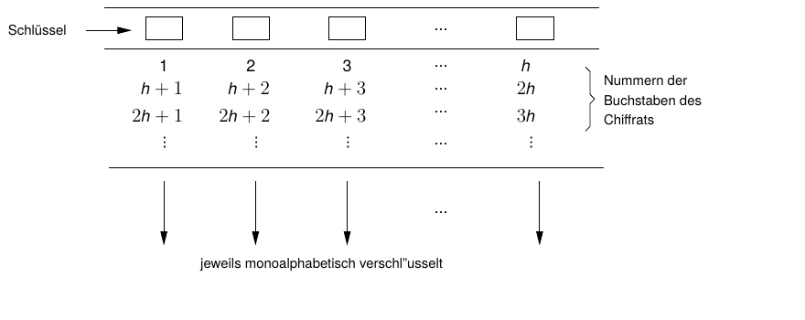

---

## Codex Copiale I {.content-slide .image-slide}
 

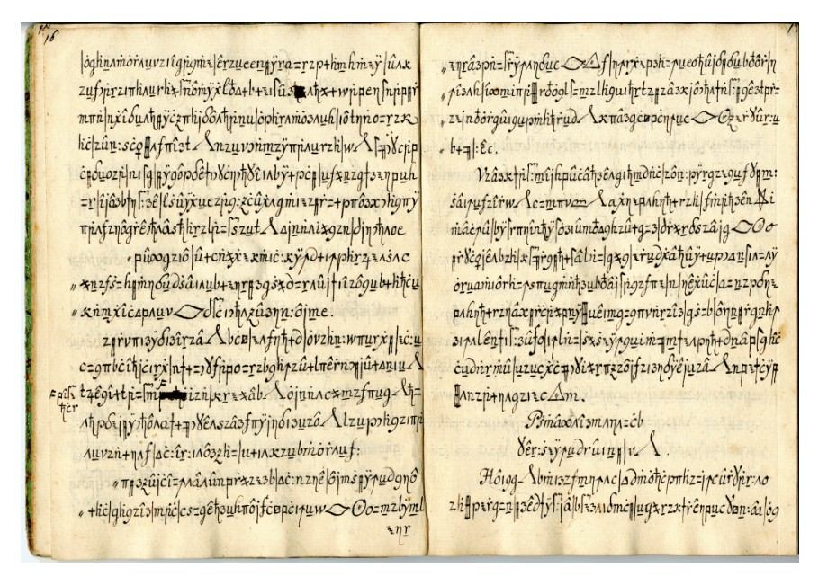

---

## Codex Copiale II {.content-slide .pdf-slide}
 

- verschlüsselte Handschrift aus dem 18. Jahrhundert
- homophone Verschlüsselung
- 2011 entschlüsselt [2]
- deutscher Klartext
- Beschreibung geheimer Initiationsriten einer deutschen freimaurerähnlichen Geheimgesellschaft (“Oculisten”)

---

## Das Voynich-Manuskript {.content-slide .text-image-slide}
 

:::: {.columns}
::: {.column width="58%"}
- wahrscheinlich zwischen 1404 und 1438 geschrieben
- 102 (erhaltene) Pergament-Blätter
- beschrieben in einer unbekannten Sprache
- “Text” gehorcht bestimmten natürlichsprachigen Statistiken
- bis heute nicht entschlüsselt
:::

::: {.column width="42%"}
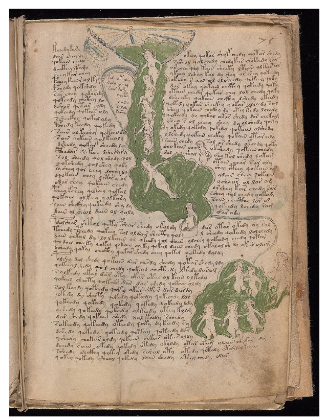
:::
::::

---

## Playfair-Chiffre {.content-slide .pdf-slide}
### 1. Vorbereitung des Klartexts
 

- Kleinbuchstaben werden in Großbuchstaben umgewandelt
- Interpunktionszeichen und Leerzeichen werden entfernt
- Substitution von ‘J’ durch ‘I’
- Umlaute werden durch Zwielaute ersetzt (Ä → AE, Ö → OE, Ü → UE)
- Unterteilung in Bigramme (Buchstabenpaare), dabei Einfügen von ‘X’, falls Buchstaben in einem Bigramm doppelt vorkommen
- Anfügen eines ‘X’, falls die Anzahl der Buchstaben ungerade ist
- Beispielklartext: “Jawoll, Ostern ist schön!”
- Vorbereiteter Text: “IA WO LX LO ST ER NI ST SC HO EN”

---

## Playfair-Chiffre {.content-slide .text-image-slide}
### 2. Erstellung des Playfair-Quadrats
 

:::: {.columns}
::: {.column width="58%"}
Anordnung aller Buchstaben des Alphabets (ohne ‘J’) in einer 5x5-Matrix nach folgender Vorschrift:

- Zuerst die Buchstaben des Schlüsselworts von links oben beginnen nach rechts
- Dann die restlichen Buchstaben des Alphabets in alphabetischer Reihenfolge
- Beispiel: Schlüsselwort “Osterhase”

Sender und Empfänger müssen das gleiche Playfair-Quadrat verwenden, also beide das gleiche Schlüsselwort kennen.
:::

::: {.column width="42%"}
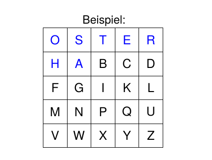
:::
::::

---

## Playfair-Chiffre {.content-slide .text-image-slide}
### 3. Bigrammweise Verschlüsselung
 

:::: {.columns}
::: {.column width="58%"}
- Stehen beide Zeichen des Klartextes in der gleichen Zeile, so wird jeder Buchstabe durch den Buchstaben rechts von ihm ersetzt (mit Wrap-Around).
  - Beispiel:
[ST]{.red}
→
[TE]{.red}

- Stehen beide Zeichen des Klartextes in der gleichen Spalte, so
wird jeder Buchstabe durch den Buchstaben unter ihm ersetzt
(mit Wrap-Around).
  - Beispiel:
[OH]{.blue}
→
[HF]{.blue}

- Ansonsten werden beide Zeichen durch die diagonal
gegenüberliegenden Ecken des durch die beiden Buchstaben
aufgespannten Rechtecks ersetzt. Dabei wird jeweils das Eck
in der gleichen Zeile genutzt.
  - Beispiel:
[LX]{.green}
→
[IZ]{.green}
:::

::: {.column width="42%"}
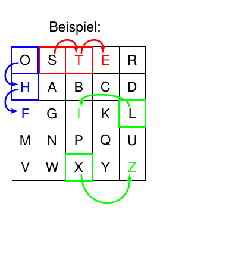{.pdf-crop}
:::
::::

---

## Playfair-Chiffre {.content-slide .image-slide}
### Verschlüsselung des Beispiels
 

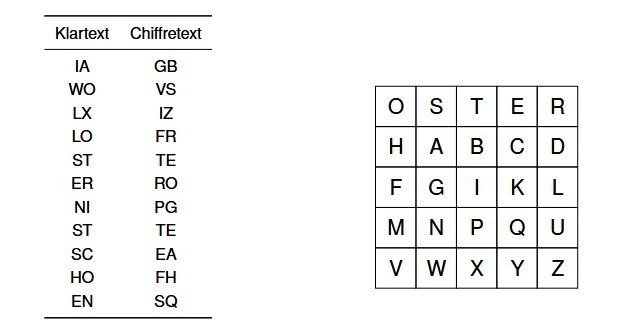

---

## Playfair-Chiffre {.content-slide .pdf-slide}
### Anmerkungen
 

- Entschlüsselung erfolgt analog zur Verschlüsselung in geometrisch umgekehrter Richtung
- Verfahren ist monoalphabetisch bigraphisch
- überlegen gegenüber Verfahren mit einzelnen Buchstaben
- sehr leicht zu erlernen und anzuwenden
- 1854 von Sir Charles Wheatstone erfunden aber Lord Lyon Playfair zugeschrieben
- genutzt bis etwa zum ersten Weltkrieg
- heute kryptographisch gebrochen und folglich unsicher

---

## Weiterführende Literatur {.content-slide .pdf-slide}
 

- Friedrich L. Bauer. Entzifferte Geheimnisse: Methoden und Maximen der Kryptologie, 3. Auflage. Springer, 2000. isbn: 3-540-67931-6
- Simon Singh. Geheime Botschaften. Die Kunst der Verschlüsselung von der Antike bis in die Zeiten des Internet. Hrsg. von Klaus Fritz. 15. Auflage. dtv 33071. München: dtv, 2019. 458 S. isbn: 9783423330718
- David Kahn. The Codebreakers. The Comprehensive History of Secret Communication from Ancient Times to the Internet. 2nd ed. New York: Scribner, 1996. 11146 S. isbn: 9781439103555
- Klaus Schmeh. Codeknacker gegen Codemacher. Wiesbaden, Germany: Springer Fachmedien, 2014. isbn: 978-3-658-34189-3. url: https://link.springer.com/book/10.1007/978-3-658-34189-3

---

## Literaturverzeichnis {.content-slide .pdf-slide}
 

[1] David Kahn. The Codebreakers. The Comprehensive History of Secret Communication from Ancient Times to the Internet. 2nd ed. New York: Scribner, 1996. 11146 S. isbn: 9781439103555.

[2] Kevin Knight, Beáta Megyesi und Christiane Schaefer. „The Copiale cipher“. In: Proceedings of the 4th Workshop on Building and Using Comparable Corpora: Comparable Corpora and the Web. BUCC ’11. Portland, Oregon: Association for Computational Linguistics, 24. Juni 2011, S. 2-9. isbn: 9781937284015.

[3] Friedrich L. Bauer. Entzifferte Geheimnisse: Methoden und Maximen der Kryptologie, 3. Auflage. Springer, 2000. isbn: 3-540-67931-6.

[4] Simon Singh. Geheime Botschaften. Die Kunst der Verschlüsselung von der Antike bis in die Zeiten des Internet. Hrsg. von Klaus Fritz. 15. Auflage. dtv 33071. München: dtv, 2019. 458 S. isbn: 9783423330718.

[5] Klaus Schmeh. Codeknacker gegen Codemacher. Wiesbaden, Germany: Springer Fachmedien, 2014. isbn: 978-3-658-34189-3. url: https://link.springer.com/book/10.1007/978-3-658-34189-3.

---

## Vielen Dank! {.title-slide data-state="hide-footer"}

Prof. Dr. Lukas Iffländer   
HTW Dresden  

