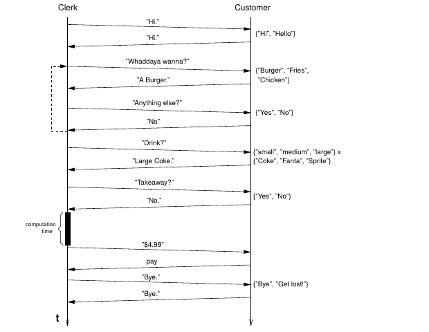

## Kryptographische Protokolle {.title-slide data-state="hide-footer"}

Prof. Dr. Lukas Iffländer   
HTW Dresden  


---

## Agenda {.content-slide .agenda-slide}
 

<ul class="agenda">
<li class="agenda-item"><strong>01</strong>Begriff des Protokolls</li>
<li class="agenda-item"><strong>02</strong>Beispiel eines Protokolls</li>
<li class="agenda-item"><strong>03</strong>Beteiligte Helfer</li>
<li class="agenda-item"><strong>04</strong>Symmetrische Verfahren</li>
<li class="agenda-item"><strong>05</strong>Public-Key-Kryptografie</li>
<li class="agenda-item"><strong>06</strong>Hybride Kryptosysteme</li>
</ul>

---

## Kryptografische Protokolle {.content-slide .pdf-slide}
### Begriff des Protokolls
 

- beschreibt den dynamischen Aspekt einer Relation kommunizierender Komponenten
- beschreibt also den Ablauf der Kommunikation
- umgangssprachlich: eine Menge von "Wenn-Dann"-Beziehungen ("Wenn Alice einen Schlüssel schickt, dann verschlüsselt Bob damit irgendwas...")
- muss allen Teilnehmern bekannt sein
- darf keine Mehrdeutigkeiten enthalten
- erfordert (mindestens) zwei Teilnehmer

Der statische Aspekt der Relation wird durch die Schnittstelle beschrieben.

---

## Beispiel eines Protokolls {.image-slide}
### Kommunikation eines Kunden mit dem Clerk bei McDonald's
 

---

## Kryptografische Protokolle {.content-slide .table-slide}
### Beteiligte Helfer
 

Anstatt schwerfälliger Begriffsungetüme verwendet man für die Kennzeichnung der Kommunikationsparteien  
in der Kryptografie die folgenden Namen:

| Name | Funktion |
|---|---|
| Alice | Erste Teilnehmerin am Protokoll |
| Bob | Zweiter Teilnehmer am Protokoll |
| Carol | Dritte Teilnehmerin (wenn nötig) |
| Dave | Vierter Teilnehmer (wenn nötig) |
| Eve | Lauscherin (eavesdropper) |
| Mallory | Bösartiger aktiver Angreifer (malicious) |
| Trent | (vertrauenswürdiger) Treuhänder (trust) |

---

## Kommunikation bei symmetrischen Verfahren {.content-slide .pdf-slide}
### Prinzipieller Ablauf
 

1. Alice und Bob einigen sich auf ein Kryptosystem.
2. Alice und Bob vereinbaren einen Schlüssel K.
3. Alice chiffriert Klartext M mittels Schlüssel K und dem vereinbarten Algorithmus:

$$
C = E_K(M)
\tag{1.1}
$$

4. Alice sendet Chiffretext-Nachricht C an Bob.
5. Bob dechiffriert Chiffretext mittels desselben Algorithmus und Schlüssels und liest den Klartext:

$$
M = D_K(C) = D_K(E_K(M))
\tag{1.2}
$$

Analogie: Safe, zu dem mehrere Personen Zugang haben.

---

## Kommunikation bei symmetrischen Verfahren {.content-slide .pdf-slide}
### Störungsmöglichkeiten
 

- Eve kann durch Belauschen von 2. den Schlüssel abfangen
- kann danach alle Nachrichten von Alice an Bob mitlesen
- Mallory kann alles was Eve kann und zusätzlich
- Nachrichten von Alice abfangen (diese erreichen Bob nie)
- Nachrichten fälschen (indem er eigene Nachrichten mit dem gestohlenen Schlüssel verschlüsselt und einspeist)

=> Sicherheit des Verfahrens hängt maßgeblich von Geheimhaltung des Schlüssels ab

---

## Kommunikation bei symmetrischen Verfahren {.content-slide .pdf-slide}
### (systemimmanente) Nachteile
 

- Verteilung unter Geheimhaltung des Schlüssels ist aufwändig/teuer/riskant.
- kompromittierter Schlüssel erlaubt das Mitlesen und Fälschen von Nachrichten
- da jeweils zwei Partner einen Schlüssel benötigen, wächst die nötige Schlüsselanzahl quadratisch mit der Teilnehmerzahl

Für n = 100 Teilnehmer benötigt man 
$$
n(n - 1) / 2 = 4950 
$$
Schlüssel.

---

## Kommunikation mit Public-Key-Kryptografie {.content-slide .pdf-slide}
 

- erfordert für jeden Teilnehmer genau zwei Schlüssel
     - einen öffentlichen zum Verschlüsseln
     - einen privaten zum Entschlüsseln
- privater Schlüssel kann nicht1 aus dem öffentlichen errechnet werden
- jeder kann öffentlichen Schlüssel nutzen, um etwas zu verschlüsseln
- nur der Besitzer des privaten Schlüssels kann dieses wieder entschlüsseln
- Analogie: Briefkasten (am Haus)

<small>1 besser gesagt, nur sehr sehr schwer</small>

---

## Kommunikation mit Public-Key-Kryptografie {.content-slide .pdf-slide}
### Prinzipieller Ablauf
 

1. Alice und Bob einigen sich auf ein Kryptosystem mit öffentlichem Schlüssel.
2. Bob macht Alice seinen öffentlichen Schlüssel EKB zugänglich2.
3. Alice chiffriert ihre Nachricht mit EKB:
$$
C = E_{K_B}(M)
\tag{1.3}
$$

4. Alice schickt C an Bob.
5. Bob dechiffriert C mittels seines privaten Schlüssels DKB

$$
M = D_{K_B}(C)
\tag{1.4}
$$

Das Problem der Schlüsselübermittlung ist gelöst!

<small>2 Der öffentliche Schlüssel kann nur zum Verschlüsseln verwendet werden, daher bezeichnen wir wir ihn mit E.</small>

---

## Kommunikation mit Public-Key-Kryptografie {.content-slide .pdf-slide}
### (systemimmanente) Nachteile
 

- ca. um den Faktor 1000 langsamer als symmetrische Verfahren
- durch chosen-plaintext-Angriffe gefährdet, wenn Anzahl möglicher Nachrichten gering
- da öffentlicher Schlüssel bekannt, kann man "durchprobieren" und zu einem Chiffrat den zugehörigen Klartext ermitteln
- funktioniert bei symm. Verfahren nicht, da Schlüssel dem Angreifer unbekannt

=> Kombination symmetrischer und asymmetrischer Verfahren (aka hybride Kryptosysteme)

---

## Hybride Kryptosysteme {.content-slide .pdf-slide}
### Prinzipieller Ablauf
 

1. Bob übermittelt Alice seinen öffentlichen Schlüssel EKB.
2. Alice generiert einen zufälligen Sitzungsschlüssel K und chiffriert ihn mit EKB.

$$
C = E_{K_B}(K)
\tag{1.5}
$$

3. Alice übermittelt C an Bob.
4. Bob entschlüsselt die Nachricht C mit seinem privaten Schlüssel und erhält den Sitzungsschlüssel.

$$
K = D_{K_B}(C)
\tag{1.6}
$$

5. Beide verschlüsseln ihre Kommunikation nun symmetrisch mit K, dem Sitzungsschlüssel.

---

## Hybride Kryptosysteme {.content-slide .pdf-slide}
### Fazit
 

- Public-Key-Kryptografie dient hier zum sicheren Schlüsseltransport
- Schlüsselverwaltungsproblem also auch gelöst
- Kommunikation trotzdem effizient, da symmetrisch verschlüsselt
- Flexibilisierung: Schlüssel kann jederzeit aufwandsarm ersetzt werden (z. B. bei Kompromittierung)
- Angriffsmöglichkeit: bei der initialen Übermittlung der öffentlichen Schlüssel

---

## Vielen Dank! {.title-slide data-state="hide-footer"}

Prof. Dr. Lukas Iffländer   
HTW Dresden  

