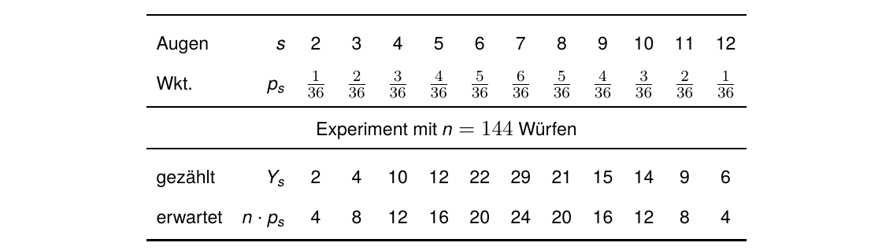
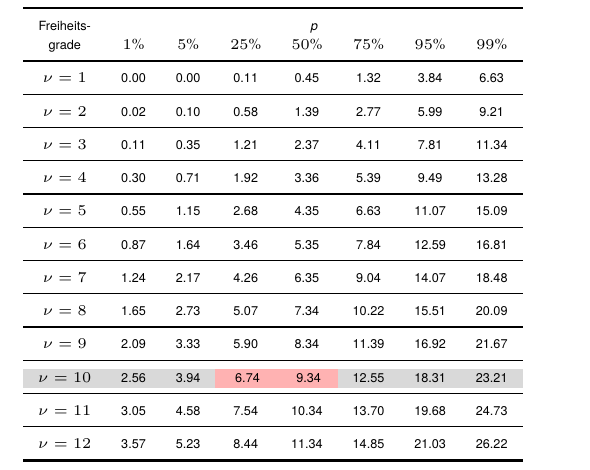
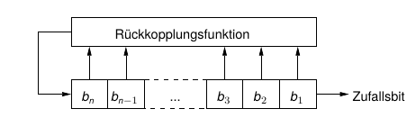
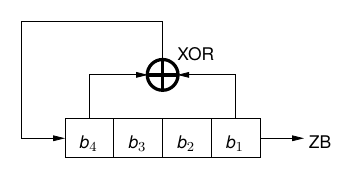

## Zufallszahlen {.title-slide data-state="hide-footer"}

Prof. Dr. Lukas Iffländer   
HTW Dresden  


---

## Agenda {.content-slide .agenda-slide}

<ul class="agenda">
<li class="agenda-item"><strong>01</strong>Zufallszahlen</li>
<li class="agenda-item"><strong>02</strong>Güte von Zufallszahlen</li>
<li class="agenda-item"><strong>03</strong>χ²-Test</li>
<li class="agenda-item"><strong>04</strong>Lineare Kongruenzgeneratoren</li>
<li class="agenda-item"><strong>05</strong>Schieberegister</li>
<li class="agenda-item"><strong>06</strong>Kryptografisch sichere Generatoren</li>
</ul>

---

## Zufallszahlen {.content-slide .pdf-slide}
 

#### Wozu?

- (Monte-Carlo-)Simulation, Statistik
- randomisierte Algorithmen
- Spiele
- **Kryptografie:** Schlüssel, große Primzahlen finden, ...

**Zufallszahlen** durch einen echten zufälligen Prozess generiert (Rauschen, atomare Zerfallsprozesse, ...)

**Pseudozufallszahlen** - Folgen von Zahlen, die wie Zufallszahlen aussehen (, aber durch einen deterministischen Prozess generiert werden)

---

## Güte von Zufallszahlen {.content-slide .table-slide}
 

#### Anforderungen

1. Gleichverteilung
2. lange bzw. keine Periode
3. Unabhängigkeit
4. effizient ermittelbar

Kryptografisch sichere Zufallszahlen dürfen zusätzlich nicht vorhersehbar sein.

#### Prüfung der Güte erfolgt mittels Tests, z.B.:

| wahrscheinlichkeitstheoretisch | empirisch |
|---|---|
| χ2-Test1 | Gleichverteilungstest |
| Kolmogorov-Smirnov-Test | Serientest |

<small>1 sprich: "Tschih-Quadrat-Test"</small>

---

## χ²-Test {.content-slide .pdf-slide}
### Beispiel: Zwei gekoppelte Würfel [1]
 

 

- Maß für die „Abweichung“ der Würfelwerte vom „richtigen“ Verhalten:
$$     
Vabs = (Y_2 − n · p_2)^2 + (Y_3 − n · p_3)^2 + · · · + (Y_{12} − n · p_{12})^2   \tag{1.1}
$$
- unausgewogen, da (z. B.) Fehler in Y7 aufgrund p7 > p2 viel stärker gewichtet als Fehler in Y2

---

## χ²-Test {.content-slide .pdf-slide}
### Beispiel: Zweigekoppelte Würfel und Verallgemeinerung

#### ⇒ Normierung mit erwarteter Anzahl:

$$
V=
\frac{(Y_2-np_2)^2}{np_2}
+
\frac{(Y_3-np_3)^2}{np_3}
+
\cdots
+
\frac{(Y_{12}-np_{12})^2}{np_{12}}
\tag{1.2}
$$

#### Allgemein gilt:

$$
V=
\sum_{s=1}^{k}
\frac{(Y_s-np_s)^2}{np_s}
\tag{1.3}
$$

**\(V\) wird nun in der Tabelle der Quantile der \(\chi^2\)-Verteilung gesucht:**

- Freiheitsgrade \(\nu\) ("nü"):

  $$
  \nu = k-1
  $$

  *(Anzahl Kategorien − 1)*

- Tabelleneintrag \(x\) in Zeile \(\nu\):    
"\(V\) ist kleiner oder gleich \(x\) mit Wahrscheinlichkeit \(p\)."

---

## χ²-Test {.content-slide .pdf-slide}
### Tabelle der Quantile der χ²-Verteilung
 

:::: {.columns}
::: {.column width="50%"}

:::

::: {.column width="50%"}

- Für das Beispiel gilt     
V ≈ 7.15, ν = 10 .
- Abzulesen: V ≤ 9.34 mit     
50%iger Wkt., V ≤ 6.74 mit         
25%iger Wkt.      
- V = 7.15 tritt also rund einem
Drittel aller Fälle auf.     
**⇒ Würfel sind o.k.!**

:::
::::

---

## Lineare Kongruenzgeneratoren [2] {.content-slide .pdf-slide}
 

Berechnung einer Zufallsfolge mittels

$$
z_{i+1}
=
(a \cdot z_i + b)
\bmod m
\tag{1.4}
$$

(m prim, Initialisierungswert z0 mit 0 < z0 < m; a, b Parameter)

**Beispiel:** a = 6, b = 0, m = 13, z0 = 2

| i | 0 | 1 | 2 | 3 | 4 | 5 | 6 | 7 | 8 | 9 | 10 | 11 | 12 | ... |
|---|---|---|---|---|---|---|---|---|---|---|---|---|---|---|
| zi | 2 | 12 | 7 | 3 | 5 | 4 | 11 | 1 | 6 | 10 | 8 | 9 | 2 | ... |

- generiert volle Periode (auch für m = 231 - 1, a = 16807, u. a.)
- zi = 0 nicht erreichbar (warum?)
- keine volle Periode z. B. für m = 13, a = 5, b = 0, z0 = 1
- effiziente Berechnung, gutes statistisches Verhalten
- ungeeignet für kryptografische Zwecke, da vorhersehbar

---

## Linear rückgekoppelte Schieberegister {.content-slide .pdf-slide}
### Prinzip

*Abbildung: Rückgekoppeltes Schieberegister mit n Bit Länge*

#### Arbeitsweise:
- Ausgabe des Bits b1 als neues Zufallsbit
- gleichzeitig Verknüpfung der Bits bi miteinander (z. B. mittels ⊕) in Rückkopplungsfunktion
- Ergebnis der Verknüpfung wird bn, alle anderen Bits eine Stelle nach rechts

---

## Linear rückgekoppelte Schieberegister {.content-slide .pdf-slide}

### Beispiel

:::: {.columns}

::: {.column width="40%"}

- sog. *linear feedback shift register* (LFSR)
- \(n=4\) Bit, Initialisierung: \(z_0=1111\)
- maximale Periode: \(2^n-1\)
- Ergebnis darf nie \(0\) sein

:::

::: {.column width="30%"}

| \(i\) | \(b\) | Ausgabe |
|---:|:----:|:------:|
|0|1111|–|
|1|0111|1|
|2|1011|1|
|3|0101|1|
|4|1010|1|
|5|1101|0|
|6|0110|1|
|7|0011|0|
|8|1001|1|

:::

::: {.column width="30%"}

| \(i\) | \(b\) | Ausgabe |
|---:|:----:|:------:|
|9|0100|1|
|10|0010|0|
|11|0001|0|
|12|1000|1|
|13|1100|0|
|14|1110|0|
|15|1111|0|

**usw.**

:::

::::

---

## Mersenne-Twister [3] {.content-slide .pdf-slide}
 

- modern
- einfacher Algorithmus, effizient
- liefert jeweils 624 32-Bit-Werte auf einmal
- nicht für kryptografische Zwecke geeignet (aus einer Reihe Ergebnisse können zukünftige Zufallszahlen ermittelt werden)
- sehr große Periodenlänge (p = 219937 - 1 ≈ 4.3 * 106001)
- in sehr vielen Programmen/Programmiersprachen genutzt, z. B. Excel, libgmp, PHP, Python, R, Ruby

---

## Kryptografisch sichere Generatoren {.content-slide .pdf-slide}
### aka Cryptographically Secure Random Number Generators (CSRNG)

#### Zusätzliche Anforderungen

- Wenn die ersten k Bit eines Zufallsgenerators bekannt sind, dann soll es keinen effizienten Algorithmus geben, der den Wert des k + 1-ten Bits mit mehr als 50% Wahrscheinlichkeit bestimmt.
- Wenn ein Angreifer den inneren Zustand des CSRNG ganz oder teilweise kennt, soll es unmöglich sein, die bis dahin erzeugte Zufallszahlenfolge zu rekonstruieren.

#### Beispiele (komplexe Algorithmen)

- Blum Blum Shub (1986) [4]
- Yarrow (B. Schneier, 1999) [5]
- Fortuna [6]

---

## Lesevorschläge {.content-slide .pdf-slide}
 

- Kapitel 3 "Random Numbers" in Donald Ervin Knuth. *Art of Computer Programming, Volume 2 Seminumerical Algorithms*. Seminumerical Algorithms. Pearson Education, Limited, 1998. ISBN: 9780133488791
- Kapitel 5 "Pseudorandom Bits and Sequences" in Alfred J. Menezes, Paul C. Oorschot und Scott A. Vanstone. *Handbook of applied cryptography*. Rev. repr. with updates, [5. print.] Discrete mathematics and its applications. Boca Raton, Fla. [u.a.]: CRC Press, 2001. 780 S. ISBN: 0849385237
- S. K. Park und K. W. Miller. "Random number generators: good ones are hard to find". In: *Communications of the ACM* 31.10 (Okt. 1988), S. 1192-1201. ISSN: 1557-7317. DOI: 10.1145/63039.63042

---

## Literaturverzeichnis I {.content-slide .pdf-slide}
 

[1] Donald Ervin Knuth. *Art of Computer Programming, Volume 2 Seminumerical Algorithms*. Seminumerical Algorithms. Pearson Education, Limited, 1998. ISBN: 9780133488791.

[2] James Reeds. ""Cracking" a Random Number Generator". In: *Cryptologia* 1.1 (Jan. 1977), S. 20-26. ISSN: 1558-1586. DOI: 10.1080/0161-117791832760.

[3] Makoto Matsumoto und Takuji Nishimura. "Mersenne twister: a 623-dimensionally equidistributed uniform pseudo-random number generator". In: *ACM Transactions on Modeling and Computer Simulation* 8.1 (Jan. 1998), S. 3-30. ISSN: 1558-1195. DOI: 10.1145/272991.272995.

[4] L. Blum, M. Blum und M. Shub. "A Simple Unpredictable Pseudo-Random Number Generator". In: *SIAM Journal on Computing* 15.2 (Mai 1986), S. 364-383. ISSN: 1095-7111. DOI: 10.1137/0215025.

---

## Literaturverzeichnis II {.content-slide .pdf-slide}
 

[5] John Kelsey, Bruce Schneier und Niels Ferguson. "Yarrow-160: Notes on the Design and Analysis of the Yarrow Cryptographic Pseudorandom Number Generator". In: *Lecture Notes in Computer Science*. Springer Berlin Heidelberg, 2000, S. 13-33. ISBN: 9783540465133. DOI: 10.1007/3-540-46513-8_2.

[6] Niels Ferguson und Bruce Schneier. *Practical Cryptography*. Bruce. Practical cryptography. Literaturverz. S. 387-395. Indianapolis, Ind.: Wiley, 2003. 410 S. ISBN: 047122894X.

[7] Alfred J. Menezes, Paul C. Oorschot und Scott A. Vanstone. *Handbook of applied cryptography*. Rev. repr. with updates, [5. print.] Discrete mathematics and its applications. Boca Raton, Fla. [u.a.]: CRC Press, 2001. 780 S. ISBN: 0849385237.

[8] S. K. Park und K. W. Miller. "Random number generators: good ones are hard to find". In: *Communications of the ACM* 31.10 (Okt. 1988), S. 1192-1201. ISSN: 1557-7317. DOI: 10.1145/63039.63042.

---

## Vielen Dank! {.title-slide data-state="hide-footer"}

Prof. Dr. Lukas Iffländer   
HTW Dresden  

