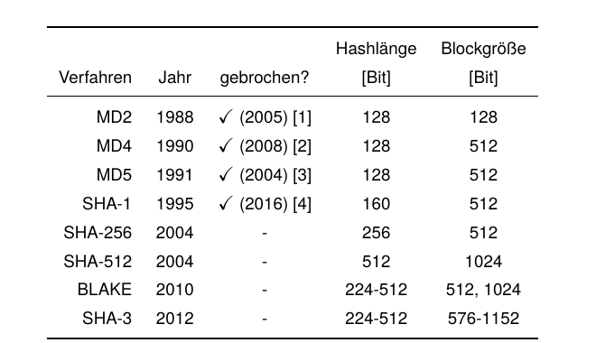
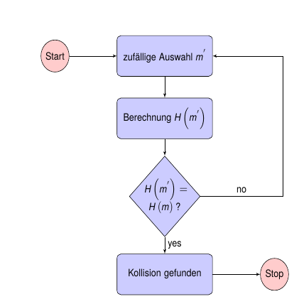
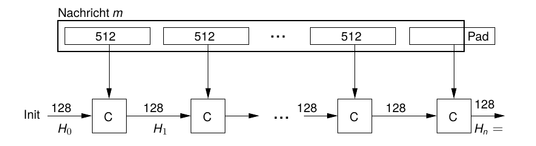
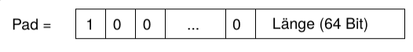
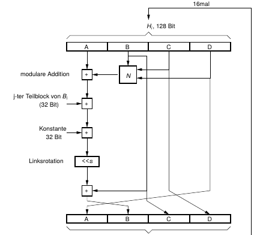

## Einwegfunktionen {.title-slide data-state="hide-footer"}


Prof. Dr. Lukas Iffländer   
HTW Dresden  


---

## Agenda {.content-slide .agenda-slide}

<ul class="agenda">
<li class="agenda-item"><strong>01</strong><span>Einwegfunktionen</span></li>
<li class="agenda-item"><strong>02</strong><span>Einweg-Hashfunktionen</span></li>
<li class="agenda-item"><strong>03</strong><span>Angriffe gegen Hashfunktionen</span></li>
<li class="agenda-item"><strong>04</strong><span>Geburtstagsangriff</span></li>
<li class="agenda-item"><strong>05</strong><span>MD5 und Merkle-Damgård</span></li>
<li class="agenda-item"><strong>06</strong><span>Message Authentication Codes</span></li>
</ul>

---

## Einwegfunktionen I {.content-slide .pdf-slide}
<br>

...sind ein wichtiger Baustein kryptografischer Verfahren

- Bestimmung von f(x) aus x leicht (vorwärts)
- Bestimmung von x aus gegebenem f(x) extrem schwer, d. h. nur mit allen zur Verfügung stehenden Rechnern der Welt in hunderten von Jahren

#### Beispiele

- Suche einer Telefonnummer zu gegebenem Namen im Telefonbuch ist einfach
- Suche eines Namens zu gegebener Telefonnummer im Telefonbuch ist schwierig
- Multiplikation zweier (großer) Primzahlen ist einfach
- Zerlegung des Produktes in zwei Primzahlfaktoren ist extrem aufwändig (-> Faktorisierungsverfahren)

---

## Einwegfunktionen II {.content-slide .pdf-slide}
<br>

Es gibt

- keinen Beweis für die Existenz von und
- keine systematischen Konstruktionsverfahren für

Einwegfunktionen.     
<br>

#### Einwegfunktion mit Hintertür

mit Kenntnis eines Zusatzschlüssels wird die Ermittlung von x aus f(x) einfach.

---

## Einweg-Hashfunktionen {.content-slide .pdf-slide}
<br>

...sind Einwegfunktionen, die zu gegebenen Daten variabler Länge einen Funktionswert konstanter,
meist kurzer Länge (-> "Fingerabdruck", kryptografischer Hash, Message Digest) ermitteln.

- Hash H(m) zu gegebenen Daten m ist leicht zu ermitteln (effizient zu berechnen).
- Gegeben einen Hashwert h: Eine passende Eingabe m' mit H(m') = h zu finden (Preimage) ist praktisch schwer; ebenso ist es schwer, zu gegebenem m ein m' != m mit H(m') = H(m) zu finden (Second Preimage).
- Änderung eines Bits in der Eingabe sollte im Mittel die Hälfte der Bits in der Ausgabe ändern.

#### Anwendung

- Integritätssicherung von Dateien
- Digitales Signieren
- Authentifizierung

---

## Kryptografische Hashverfahren {.content-slide .pdf-slide}
### Beispiele

{width=70%}

Es ist ebenfalls möglich, Blockchiffren als kryptografische Hashes einzusetzen.

---

## Angriffe gegen Hashfunktionen {.content-slide .pdf-slide}
### Kollisionen

**Kollision:** Für zwei Nachrichten m<sub>1</sub> und m<sub>2</sub> wird ein- und derselbe Hash erzeugt, also H(m<sub>1</sub>) = H(m<sub>2</sub>)  


- in der Softwaretechnik z. B. durch Überlauflisten behandelt, unkritisch    
- bei kryptografischen Hashes gefährlich; erste Stufe zum "Brechen" des Hashverfahrens     
- Kollisionsfreiheit ist unmöglich (unendlich viele verschiedene Nachrichten werden auf 2<sup>Hashlänge</sup> verschiedene Hashwerte abgebildet)      
- stattdessen: Kollisionsresistenz gefordert

---

## Angriffe gegen Hashfunktionen {.content-slide .pdf-slide}
### Kollisionsresistenz

#### Schwache Kollisionsresistenz

Zu einer Nachricht m und deren gegebenen Hashwert H(m) ist es praktisch unmöglich, eine zweite
Nachricht m' zu finden, die den gleichen Hashwert H(m') = H(m) hat.

#### Starke Kollisionsresistenz

Es ist praktisch unmöglich, zwei Nachrichten m und m' zu finden, die den gleichen Hashwert
H(m) = H(m') aufweisen.

---

## Angriffe gegen Hashfunktionen {.content-slide .pdf-slide}
### Brute-Force-Angriff gegen schwache Kollisionsresistenz


:::: {.columns}
::: {.column width="50%"}

- **gegeben:** Nachricht \(m\) mit Hashwert \(H(m)\)

- **gesucht:** Nachricht \(m'\) mit \(H(m') = H(m)\)

1. **START**

2. Zufällige Generierung von \(m'\)

3. Ermittlung \(H(m')\)

4. **If** \(H(m') = H(m)\) **then**

5.   - **STOP** (Kollision gefunden)

6. **else**
 
7.   - GOTO 2

8. **end if**

:::

::: {.column width="50%"}

{width=78%}


:::
::::


Bei einer Hashlänge von n Bit ist die Wahrscheinlichkeit einer Kollision bei jeder Iteration 2<sup>-n</sup>.

---

## Angriffe gegen Hashfunktionen {.content-slide .pdf-slide}
### Geburtstagsangriff

#### Geburtstagsparadoxon

**Fall a)** Wie viele Personen müssen sich in einem Raum befinden, damit die Wahrscheinlichkeit, dass jemand mit mir am gleichen Tag Geburtstag hat, größer ist als 50%?

n = 253

**Fall b)** Wie viele Personen müssen sich in einem Raum befinden, damit die Wahrscheinlichkeit, dass zwei von Ihnen am gleichen (beliebigen) Tag Geburtstag haben, größer ist als 50%?

n = 23 (!!)

Wie kommt es zu diesem "Missverhältnis"?

---

## Geburtstagsparadoxon {.content-slide .pdf-slide}
### Beweisskizze, Fall a)


**Voraussetzung:** Geburtstage sind gleichverteilt (ohne Schaltjahr) und unabhängig voneinander.

:::: {.columns}

::: {.column width="50%"}

- Wahrscheinlichkeit, dass eine Person an einem **bestimmten** Tag im Jahr Geburtstag hat:

$$
\frac{1}{365}
$$

- Wahrscheinlichkeit, dass zwei Personen an einem **bestimmten** Tag im Jahr **nicht** Geburtstag haben:

$$
\frac{364}{365}\cdot\frac{364}{365}
=
\left(\frac{364}{365}\right)^2
$$

:::

::: {.column width="50%"}

- Wahrscheinlichkeit, dass eine Person an einem **bestimmten** Tag **nicht** Geburtstag hat:

$$
1-\frac{1}{365}
=
\frac{364}{365}
$$

- Wahrscheinlichkeit, dass \(n\) Personen an einem **bestimmten** Tag **nicht** Geburtstag haben:

$$
\frac{364}{365}\cdot\frac{364}{365}\cdots\frac{364}{365}
=
\left(\frac{364}{365}\right)^n
=
p(n)
$$

:::

::::

$$
p(253)
=
\left(\frac{364}{365}\right)^{253}
\approx
0.50045
$$

---

## Geburtstagsparadoxon {.content-slide .pdf-slide}

### Beweisskizze (Fall b)

**Voraussetzung:** Gleiche Voraussetzungen wie in Fall a).

- Wahrscheinlichkeit, dass eine Person an einem **bestimmten** Tag im Jahr Geburtstag hat:

  $$
  \frac{1}{365}
  $$

- Wahrscheinlichkeit, dass eine Person an einem **bestimmten** Tag im Jahr **nicht** Geburtstag hat:

  $$
  1-\frac{1}{365}
  =
  \frac{364}{365}
  $$

- Wahrscheinlichkeit, dass eine Person an **zwei bestimmten** Tagen im Jahr **nicht** Geburtstag hat:

  $$
  1-\frac{1}{365}-\frac{1}{365}
  =
  \frac{363}{365}
  $$

- Eine Gruppe von zwei Personen enthält mit Wahrscheinlichkeit

  $$
  \frac{364}{365}
  $$

  **keine zwei Personen mit dem gleichen Geburtstag**, da die zweite Person genau an einem Tag keinen Geburtstag haben darf.

---

## Geburtstagsparadoxon {.content-slide .pdf-slide}

### Beweisskizze (Fall b)

- Eine Gruppe von **drei Personen** enthält mit Wahrscheinlichkeit

  $$
  \frac{364}{365}\cdot\frac{363}{365}
  $$

  **keine zwei Personen mit dem gleichen Geburtstag**, da die dritte Person an genau zwei Tagen keinen Geburtstag haben darf.

- Eine Gruppe von **\(n\) Personen** enthält mit Wahrscheinlichkeit

  $$
  \frac{364}{365}\cdot\frac{363}{365}\cdot\ldots\cdot\frac{366-n}{365}
  $$

  **keine zwei Personen mit dem gleichen Geburtstag.**

- Eine Gruppe von **\(n\) Personen** enthält mit Wahrscheinlichkeit

  $$
  p_n
  =
  1-
  \frac{364}{365}\cdot
  \frac{363}{365}\cdot
  \ldots\cdot
  \frac{366-n}{365}
  $$

  **mindestens zwei Personen mit dem gleichen Geburtstag.**

- Für \(n=23\) ergibt sich

  $$
  p_{23}\approx0{,}5072
  $$

- **In einer Gruppe von (mindestens) 23 Personen ist die Wahrscheinlichkeit, dass zwei Personen am gleichen Tag Geburtstag haben, größer als 50 %.**

---

## Angriffe gegen Hashfunktionen {.content-slide .pdf-slide}
### Zurück zum Thema: Geburtstagsangriff

- Der Angreifer möchte zwei Nachrichten m und m' finden, so dass gilt:    
 **H(m) = H(m')**.
- Er kann dann m dem Kommunikationspartner zeigen, den (gemeinsamen) Hash H(m) signieren lassen und dann m durch m' ersetzen

Aus dem Geburtstagsparadoxon folgt

- Es ist sehr schwer, zu einer gegebenen Nachricht mit Hash einen zweiten Hash zu finden, der mit ihrem eigenen Hashwert kollidiert.
- Es ist leichter, eine Kollision zu erzeugen, wenn beide Nachricht variabel sind!
- Die Anzahl zu prüfender Hashes reduziert sich um die Wurzel!

---

## Geburtstagsangriff {.content-slide .pdf-slide}
### Beispiel und Fazit

- Gegeben sei eine kryptografisch sichere Hashfunktion.
- (hypothetische) Hashlänge 64 Bit (k = 64)
- Brute-Force-Angriff eines gegebenen Hashes erfordert das Prüfen von 2<sup>64</sup> Hashwerten (ca. 1.892 * 10<sup>19</sup>)
- Rechner, der in der Sekunde 1.000.000 Hashes generiert, benötigt dafür etwa 600.000 Jahre
- Ein Geburtstagsangriff auf diese Hashfunktion erfordert das Prüfen von 2<sup>k/2</sup> = 2<sup>32</sup> Hashes
- Obiger Rechner benötigt dafür etwa 71 Minuten

#### Fazit

Ist ein Geburtstagsangriff auf die Hashfunktion zu erwarten, so muss die Länge des generierten Hashes im Vergleich zum ausschließlich drohenden Brute-Force-Angriff verdoppelt werden.

---

## Hashing en Detail: MD5 {.content-slide .pdf-slide}
### Idee: Kompression

- (mehrfache) Iteration einer sog. Kompressionsfunktion
     - Eingabe: Daten fester Länge
     - Resultat: Daten fester Länge (kürzer als Eingabe)
- **Beispiel:** Kompression bei MD5: Eingabe H0 (128 Bit), B (512 Bit), Resultat 128 Bit



*Abbildung:  Merkle-Damgård-Verfahren*

---

## Merkle-Damgård-Schema {.content-slide .pdf-slide}

1. M wird aufgefüllt (Padding) mit
     - 1 Bit mit Wert 1,
     - variable Anzahl 0-Bits,
     - 64 Bit, in denen die Länge von m (in Bits) kodiert ist,
so dass die Länge der resultierenden Nachricht m′ ein Vielfaches von 512 Bit beträgt



*Abbildung: Padding im Merkle-Damgård-Verfahren*

2. m′ wird in 512 Bit lange Blöcke B1, B2, . . . Bn aufgeteilt
3. H0 = IV (Initial Value)
4. Hi = C (Hi−1, Bi ) ∀i = 1, . . . , n
5. Hn = H(m), der gesuchte Hashwert von m.

---

## Merkle-Damgård-Schema {.content-slide .pdf-slide}
### Anmerkungen

- maximale Länge der Nachricht: 2<sup>64</sup> Bit = 2 EiB (ExbiByte) = 2048 PiB (PebiByte)
- lineare Komplexität des Verfahrens
- die meisten kryptografischen Hashverfahren nutzen diese Technik (unterscheiden sich in C)

::: {.callout-note title="Satz 1.1 (Merkle/Damgård, 1989)"}
Wenn die Kompressionsfunktion C keine Kollisionen verursacht, dann auch nicht das nach obigem Verfahren konstruierte Hashverfahren.
:::

---

## "Message Digest" MD5 {.content-slide .pdf-slide}
<br>

- Ronald Rivest, 1991
- beschrieben im RFC 1321
- nutzt das Merkle-Damgård-Schema
- sehr populär (Zertifikate, Integritätsprüfungen, ...)
- Linux: Kommando `md5sum`
- seit 2004 sind Kollisionen publiziert -> unsicher

#### Ablauf

- relativ komplexe Kompressionsfunktion
- für jeden der Blöcke B<sub>i</sub> werden 4 Iterationen ("Runden") ausgeführt
- jede Runde besteht aus 16 Operationen

---

## MD5 - ASCII-Kollision {.content-slide .code-slide}
<br>

Die MD5-Prüfsummen der folgenden beiden Texte sind gleich:

```{.text}
TEXTCOLLBYfGiJUETHQ4hAcKSMd5zYpgqf1YRDhkmxHkhPWptrkoyz28wnI9V0aHeAuaKnak

TEXTCOLLBYfGiJUETHQ4hEcKSMd5zYpgqf1YRDhkmxHkhPWptrkoyz28wnI9V0aHeAuaKnak
```

Entdeckt 19. März 2024

---

## Eine Operation in MD5 {.image-slide .pdf-slide}
<br>

:::: {.columns}
::: {.column width="35%"}


:::

::: {.column width="50%"}

#### Nichtlineare Funktionen N:     
F(X, Y , Z) = (X ∧ Y ) ∨ ((¬X) ∧ Z)     
G(X, Y , Z) = (X ∧ Z) ∨ (Y ∧ (¬Z))     
H(X, Y , Z) = X ⊕ Y ⊕ Z     
I(X, Y , Z) = Y ⊕ (X ∨ (¬Z))         

- in jeder Runde wird eine andere Funktion genutzt


:::
::::


---

## Anwendung: Message Authentication Codes (MAC) {.content-slide .pdf-slide}
<br>

- spezieller Hash, der von Eingabedaten und einem zusätzlichen geheimen Schlüssel abhängt
- somit nur für Besitzer des Schlüssels generier- bzw. prüfbar
- mittels Blockchiffre oder aus Hashfunktion implementierbar
- Beispiel: HMAC (RFC 2104) -> TLS, IPsec

#### Zweck

- Sicherung der Integrität von Nachrichten
- Authentisierung der Nachricht
- ~~Nichtabstreitbarkeit der Nachricht~~d

---

## Message Authentication Codes (MAC) {.content-slide .pdf-slide}
### Prinzip

1. Alice und Bob tauschen (geheimen) Schlüssel aus.
2. Alice generiert Nachricht, ermittelt MAC aus Nachricht und Schlüssel.
3. Nachricht und MAC werden an Bob übertragen.
4. Bob berechnet MAC aus Nachricht und Schlüssel.
5. Stimmen errechnete und übertragene MAC überein, ist die Nachricht authentisch und muss von Alice stammen, da nur diese den Schlüssel besitzt.

---

## Anwendungsbeispiel: Hashcash {.content-slide .pdf-slide}
<br>

#### Idee

- zur Autorisierung soll ein Nutzer "etwas" Rechenzeit aufwenden und diesen Aufwand nachweisen
- Nutzung Hashfunktion; Ergebnis muss bestimmte Merkmale aufweisen
- Beispiel: "Generiere einen SHA1-Hash über einem zufälligen Datum, dessen erste 20 Bits alle den Wert Null haben!" -> es müssen ca. 2<sup>20</sup> Hashes ermittelt werden

#### Anwendung

- Abwehr von Spam
- Mining-Funktion in Kryptowährungen (z. B. Bitcoin)

---

## Literaturverzeichnis I {.content-slide .pdf-slide}
<br>

[1] Lars R. Knudsen und John E. Mathiassen. "Preimage and Collision Attacks on MD2". In:
*Lecture Notes in Computer Science.* Springer Berlin Heidelberg, 2005, S. 255-267.
isbn: 9783540316695. doi: 10.1007/11502760_17.

[2] Gaëtan Leurent. "MD4 is Not One-Way". In: *Lecture Notes in Computer Science.*
Springer Berlin Heidelberg, 2008, S. 412-428. isbn: 9783540710394.
doi: 10.1007/978-3-540-71039-4_26.

[3] Xiaoyun Wang u. a. "Collisions for Hash Functions MD4, MD5, HAVAL-128 and RIPEMD".
In: *IACR Cryptol. ePrint Arch.* (2004), S. 199.
url: <http://eprint.iacr.org/2004/199>.

[4] Marc Stevens, Pierre Karpman und Thomas Peyrin. "Freestart Collision for Full SHA-1". In:
*Advances in Cryptology - EUROCRYPT 2016 - 35th Annual International Conference on the
Theory and Applications of Cryptographic Techniques, Vienna, Austria, May 8-12, 2016,
Proceedings, Part I.* Hrsg. von Marc Fischlin und Jean-Sébastien Coron. Bd. 9665.
Lecture Notes in Computer Science. Springer, 2016, S. 459-483.
doi: 10.1007/978-3-662-49890-3_18.
url: <https://doi.org/10.1007/978-3-662-49890-3_18>.

---

## Vielen Dank! {.title-slide data-state="hide-footer"}


Prof. Dr. Lukas Iffländer   
HTW Dresden  

