## Authentifizierung {.title-slide data-state="hide-footer"}


Prof. Dr. Lukas Iffländer   
HTW Dresden  


---

## Agenda {.content-slide .agenda-slide}

<ul class="agenda">
<li class="agenda-item"><strong>01</strong><span>Grundlagen der Authentifizierung</span></li>
<li class="agenda-item"><strong>02</strong><span>Passwörter und Angriffe</span></li>
<li class="agenda-item"><strong>03</strong><span>Wörterbuchangriffe und Salt</span></li>
<li class="agenda-item"><strong>04</strong><span>Regenbogentabellen und KDFs</span></li>
<li class="agenda-item"><strong>05</strong><span>Challenge-Response</span></li>
<li class="agenda-item"><strong>06</strong><span>Objekte, Biometrie und 2FA</span></li>
</ul>

---

## Authentifizierung (oder Authentifikation) {.content-slide}
<br>

**Zwei Rollen**

- Partei, die Identität nachweisen will (Beweisender, "Prover")
- Partei, die Identität prüfen will (Verifizierender, "Verifier")

**Unterscheidung von**

- einseitiger Authentifizierung (z. B. gegenüber Rechner) und
- gegenseitiger Authentifizierung.

**Nutzung von**

- charakteristischen Eigenschaften
- Besitz
- Wissen

---

## Authentisierung, Authentifizierung oder Autorisierung? {.content-slide}
<br>


::: {.callout-important title="Authentisierung"}

Die Feststellung der Identität einer Person oder eines Systems

:::

::: {.callout-note title="Authentifizierung aka Authentifikation"}

Die Prüfung des o. g. Identitätsnachweises auf seine Authentizität

:::

::: {.callout-tip title="Autorisierung"}

Die Feststellung, ob eine Person oder ein System berechtigt ist, eine bestimmte Aktion auszuführen

::: 

---

## Authentifizierung mittels Passwort {.content-slide .image-slide}
### Naive Implementierung

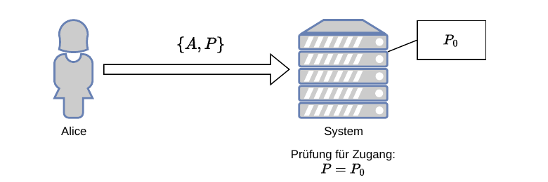{width=78%}

**Anmerkungen**

- Passwort muss erzeugt/vergeben werden
- Identität A muss mit übermittelt werden
- Abspeicherung des Passwortes P<sub>0</sub> im Klartext

---

## Authentifizierung mittels Passwort {.content-slide .image-slide}
### Nutzung einer kryptografischen Hashfunktion

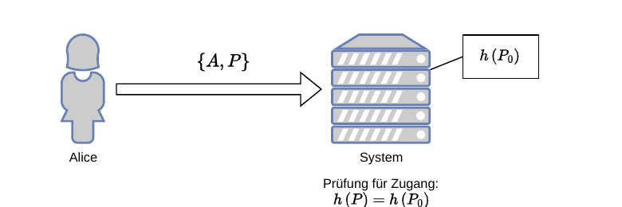{width=78%}

**Anmerkungen**

- Passwort nicht mehr im Klartext abgelegt -> kann nicht gestohlen werden!
- Problem: schlechte Passwörter

---

## Mögliche Angriffe auf den Vorgang der Authentifizierung {.content-slide}
<br>

- Ausspähen des Passworts
- Social Engineering
- Erraten des Passworts
- Wörterbuchangriff
- Brute Force

---

## Social Engineering {.content-slide .pdf-slide}
<br>

::: {.summary}
"Hallo, ich bin der freundliche Mann vom Rechenzentrum. Ich möchte die Virensoftware
auf Ihrem Rechner aktualisieren und benötige dazu Ihr Nutzerkennzeichen und Passwort."
:::

**Verwandte Themen:**

- Dumpster Diving: Auswertung von Papierkörben, Abfallbehältern
- Tailgating: einer berechtigten Person in sensitive Bereiche folgen
- Shoulder Surfing: Ablesen/Abfilmen von Passwörtern bei der Eingabe

**Further Reading:** Johnny Long. *No Tech Hacking. A Guide to Social Engineering, Dumpster Diving,
and Shoulder Surfing.* Hrsg. von Kevin D. Mitnick. Includes index. Rockland, Mass.: Syngress;
2008. 285 S. isbn: 1597492159

---

## Erraten des Passworts {.content-slide .code-slide}
<br>

Ein legendärer Einbruch im Lawrence Berkeley National Laboratory, Kalifornien [2]:

```{.text}
LBL> telnet elxsi
Elxsi at LBL
login: root
password: root
incorrect passwort, try again
login: guest
password: guest
incorrect passwort, try again
login: uucp
password: uucp
WELCOME TO THE ELXSI COMPUTER AT LBL
```

bei gut gewarteten Systemen heute nahezu aussichtslos

---

## Automatisiertes Erraten des Passwortes {.content-slide .code-slide}
### Linux-PC, Authentifizierungs-Logfile `/var/log/auth.log`, Ausschnitt

```{.text}
Apr 5 14:44:35 idir sshd[14612]: Failed password for invalid user admin from 93.99.106.4 port 40799 ssh2
Apr 5 14:44:39 idir sshd[14620]: Failed password for root from 93.99.106.4 port 42116 ssh2
Apr 5 14:44:43 idir sshd[14630]: Failed password for root from 93.99.106.4 port 43885 ssh2
Apr 5 14:44:44 idir sshd[14640]: Invalid user test from 93.99.106.4
Apr 5 14:44:46 idir sshd[14640]: Failed password for invalid user test from 93.99.106.4 port 45676 ssh2
Apr 5 14:44:47 idir sshd[14648]: Invalid user test from 93.99.106.4
Apr 5 14:44:49 idir sshd[14648]: Failed password for invalid user test from 93.99.106.4 port 47395 ssh2
Apr 5 14:44:51 idir sshd[14656]: Invalid user webmaster from 93.99.106.4
Apr 5 14:44:53 idir sshd[14656]: Failed password for invalid user webmaster from 93.99.106.4 port 48814 ssh2
Apr 5 14:44:54 idir sshd[14666]: Invalid user user from 93.99.106.4
Apr 5 14:44:56 idir sshd[14666]: Failed password for invalid user user from 93.99.106.4 port 50581 ssh2
Apr 5 14:44:58 idir sshd[14674]: Invalid user username from 93.99.106.4
Apr 5 14:45:00 idir sshd[14674]: Failed password for invalid user username from 93.99.106.4 port 51972 ssh2
Apr 5 14:45:01 idir sshd[14684]: Invalid user username from 93.99.106.4
Apr 5 14:45:03 idir sshd[14684]: Failed password for invalid user username from 93.99.106.4 port 53530 ssh2
Apr 5 14:45:05 idir sshd[14692]: Invalid user user from 93.99.106.4
Apr 5 14:45:07 idir sshd[14692]: Failed password for invalid user user from 93.99.106.4 port 55065 ssh2
Apr 5 14:45:10 idir sshd[14702]: Failed password for root from 93.99.106.4 port 56829 ssh2
Apr 5 14:45:11 idir sshd[14710]: Invalid user admin from 93.99.106.4
Apr 5 14:45:13 idir sshd[14710]: Failed password for invalid user admin from 93.99.106.4 port 60192 ssh2
Apr 5 14:45:15 idir sshd[14718]: Invalid user test from 93.99.106.4
Apr 5 14:45:17 idir sshd[14718]: Failed password for invalid user test from 93.99.106.4 port 33440 ssh2
Apr 5 14:45:21 idir sshd[14728]: Failed password for root from 93.99.106.4 port 35208 ssh2
Apr 5 14:45:24 idir sshd[14736]: Failed password for root from 93.99.106.4 port 36679 ssh2
Apr 5 14:45:27 idir sshd[14746]: Failed password for root from 93.99.106.4 port 38334 ssh2
Apr 5 14:45:31 idir sshd[14754]: Failed password for root from 93.99.106.4 port 39667 ssh2
Apr 5 14:45:32 idir sshd[14762]: Invalid user danny from 93.99.106.4
Apr 5 14:45:34 idir sshd[14762]: Failed password for invalid user danny from 93.99.106.4 port 41516 ssh2
Apr 5 14:45:35 idir sshd[14770]: Invalid user sharon from 93.99.106.4
Apr 5 14:45:37 idir sshd[14770]: Failed password for invalid user sharon from 93.99.106.4 port 42957 ssh2
Apr 5 14:45:39 idir sshd[14780]: Invalid user aron from 93.99.106.4
```

---

## Wörterbuchangriff (Dictionary Attack) {.content-slide .pdf-slide}
<br>

**Idee**

- Offline-Generierung einer Liste aus Einträgen mit
  - potentielles Passwort
  - potentielles Passwort, verschlüsselt
- alle möglichen Worte, Namen, Bezeichner usw. mittels der Einwegfunktion des Betriebssystems verschlüsseln
- Diebstahl der Passwortdatei
- Vergleich der verschlüsselten Wortliste mit den Hashes aus der Passwortdatei
- Bei Übereinstimmung ist das unverschlüsselte Passwort der entsprechende Eintrag aus der Wortliste

---

## Erschwerung des Wörterbuchangriffes mittels Salz {.content-slide .pdf-slide}
<br>

**Konzept**

- Passwort wird vor Verschlüsselung mit einer Zufallszahl konkateniert (dem Salz)
- Salzwert (Salt) wird mit in der (geheimen) Passwortdatei gespeichert
- bei genügend großer Anzahl möglicher Hash-Werte wird ein Wörterbuchangriff unmöglich
- Mallory müßte zu jedem Wort alle möglichen Salts durchprobieren
- erschwert nur Wörterbuchangriff, kein Brute-Force-Attack

**Beispiel**

`crypt()` im POSIX

---

## Weitere Gegenmaßnahmen gegen Wörterbuchangriff {.content-slide .pdf-slide}
<br>

- möglichst keine Hinweise auf Länge des PW (`*` u. ä.) in der Eingabemaske
- möglichst kein Hinweis, ob Nutzerkennung gültig
- Verzögerung nach jedem erfolglosen Anmeldeversuch
- Rate Limiting mit progressiven Delays/Backoff; keine harten Lockouts (DoS-Risiko)
- periodisches Erneuern der Passworte:      
   `+` gecrackte PW werden automatisch ausgetauscht      
   `-` Nutzer müssen periodisch neue PW lernen      
   `-` Nutzer verwenden möglichst einfache Passwörter     
   `-` Nutzer schreiben Passwörter auf Post-Its und kleben diese unter die Tastatur      

-> **unsicher!!!** Verfahren wird seit einigen Jahren nicht mehr von NIST und BSI empfohlen. Lieber lange komplexe Passwörter und Passwortmanager nutzen.

---

## Anforderungen an gute Passworte {.content-slide .pdf-slide}
<br>

- möglichst lang
- gesamten Zeichenvorrat nutzen (sonst resultiert eine signifikante Verkleinerung des Schlüsselraums -> Brute-Force-Angriff vereinfacht)
- keine Namen, Worte (auch nicht rückwärts)
- computergenerierte Passworte: geringe Akzeptanz (werden aufgeschrieben)
- proaktive PW-Checker prüfen gewähltes PW auf Mindestanforderungen
- Passphrasen (z. B. 4-6 zufällige Wörter) statt kurzer Komplexitätsregeln
- Abgleich gegen "geleakte" Passwörter (z. B. k-Anonymity/HIBP) [3]

---

## Suchdauer vs. Größe des Schlüsselraums {.image-slide}

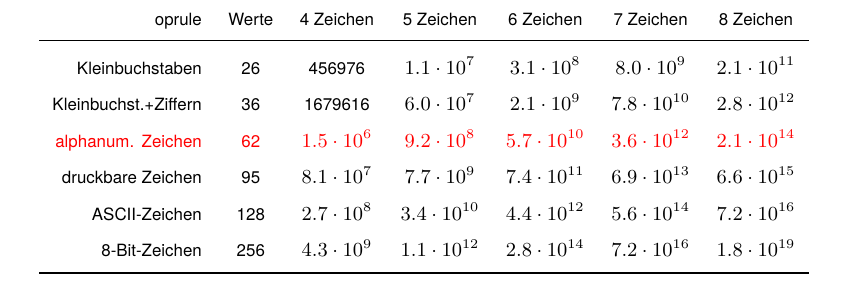

- zugrundegelegt sei eine Geschwindigkeit von 164 GHash/s (MD5, mittels hashcat) [4]
- Rechner: GPU NVIDIA RTX 4090, ca. 1740 €
- benötigt ca. 21 Sekunden, um ein 7 Zeichen langes Passwort aus alphanumerischen Zeichen zu
ermitteln, jedoch 59 Tage, wenn das Passwort 10 Zeichen umfasst

---

## Aktuelle Angriffe auf Accounts {.content-slide .pdf-slide}
<br>

**Beispiele**

- Credential Stuffing: Wiederverwendung geleakter Passwörter über viele Dienste.
- MFA-Fatigue/Push-Bombing: Nutzer zu Bestätigungs-Taps drängen.
- Reverse-Proxy-Phishing (z. B. Evilginx): Abgreifen von Session-Tokens/MFA-Codes.
- SIM-Swapping: Nummernübernahme für SMS-2FA.

**Gegenmaßnahmen**

- Passwort-Manager + einzigartige Passwörter; Passkeys (FIDO2/WebAuthn).
- Rate Limiting, IP-/ASN-Signale, Bot-Detection; keine Benutzer-Enumeration.
- Phishing-resistente MFA: Security Keys/Passkeys; Short-Lived Tokens, Token-Binding.
- Anomalie-Erkennung und Step-Up-Auth bei Risiko.

---

## Passwortstärke {.image-slide}

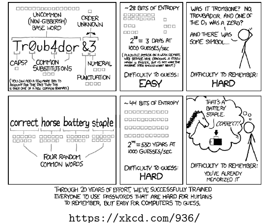

---

## Professionelle Knack-Hardware {.content-slide .pdf-slide  data-state="hide-footer"}
<br>

**a) "Deep Crack"**

- 1998, $ 250.000, EFF[^eff]
- 1536 Kryptoprozessoren
- 88 Milliarden DES-Schlüssel pro Sekunde

**b) COPACOBANA**

- 2006, 10.000 US-$, Unis Bochum und Kiel
- 120 XILINX Spartan3-1000 FPGA
- 65 Milliarden DES-Schlüssel pro Sekunde

**c) distributed.net**

verteiltes Rechnen; Nutzbarmachung von idle-Time auf Internet-Hosts

**d)** es ist davon auszugehen, dass Geheimdiensten weit teurere Systeme zur Verfügung stehen

[^eff]: Electronic Frontier Foundation, eine Nichtregierungsorganisation der Vereinigten Staaten

---

## Regenbogentabellen {.pdf-slide}
### Motivation

#### Bisherige Angriffe und ihre Eigenschaften

:::: {.columns}
::: {.column width="20%"}

**Brute-Force-Angriff:**      
- sehr viel Rechenzeit      
+ kaum Speicher

:::

::: {.column width="50%"}

**Wörterbuchangriff**     
- sehr viel Speicher     
+ kaum Rechenzeit


:::
::::

**Idee**      

„Wir brauchen ein Zwischending — einen Time-Memory-Tradeoff“

**Voraussetzungen**

- Hashfunktion H (bildet Passworte auf Hashes ab)
- Reduktionsfunktion R, bildet Hashes auf (potentielle) Passworte ab (keine Inverse von H!)

**Beispiel für R für ZK der Länge n Bit**

Zugangskennung = (Bit 63…0 des Hashes + Position in Tabelle) mod $2^n$

---

## Regenbogentabellen {.content-slide .pdf-slide}
### Ermittlung

- beginnend mit einem Element des Schlüsselraums (potentielles Passwort)
- Nacheinanderausführung von H und R
- es entstehen Ketten von Passworten und Hashes (ca. 10.000 Elemente lang)
- nur das erste und letzte Passwort jeder Kette wird gespeichert; diese bilden die Regenbogentabelle
- es werden so viele Ketten gebildet, bis 99.9% aller möglichen Passworte erfasst sind
- Tabelle wird nach den jeweils letzten Passworten sortiert

**Wichtiger Hinweis**

Per-User-Salts machen klassische Regenbogentabellen praktisch wirkungslos.
Rainbow-Table-Angriffe sind vor allem bei unsalteten/alten Hash-Schemata (z. B. historisches
NTLM, MD5 ohne Salt) relevant.

---

## Regenbogentabellen {.image-slide}

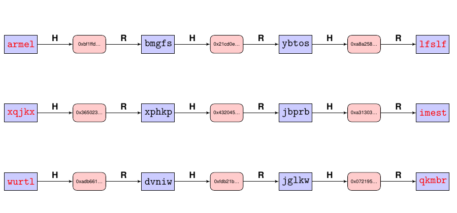

---

## Regenbogentabellen {.content-slide .pdf-slide}
### Knacken eines Hashes (Finden des zugehörigen Passwortes)

1. Hash wird alternierend der Reduktions- und der Hashfunktion unterworfen, bis er ein Passwort generiert, das in der zweiten Spalte der Regenbogentabelle vorkommt.
2. Dann wird die zugehörige Anfangszeichenkette reduziert und gehasht, bis der Eingangshash wieder erzeugt wurde.
3. Das Resultat der vorgangegangenen Reduktionsfunktion ist das gesuchte Passwort.

---

## Regenbogentabellen {.image-slide}
### Knacken eines Hashes

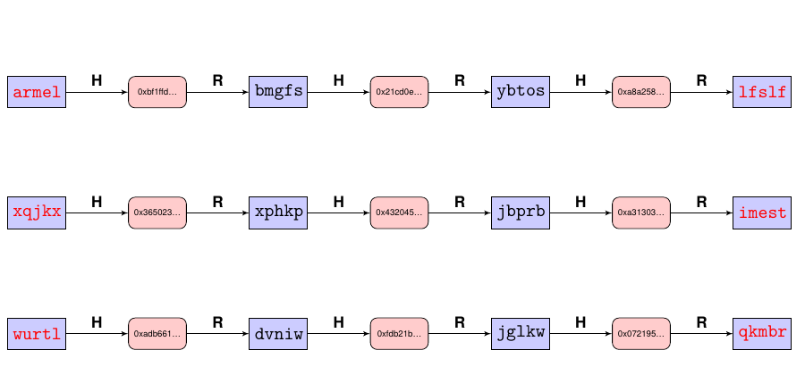

---

## Regenbogentabellen {.image-slide}
### Knacken eines Hashes

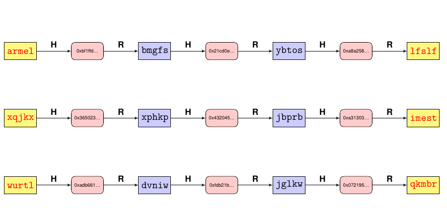

---

## Regenbogentabellen {.image-slide}
### Knacken eines Hashes

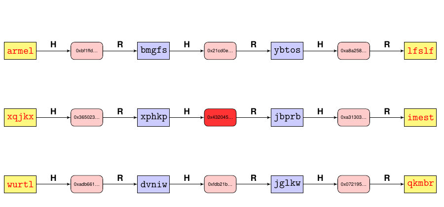

---

## Regenbogentabellen {.image-slide}
### Knacken eines Hashes

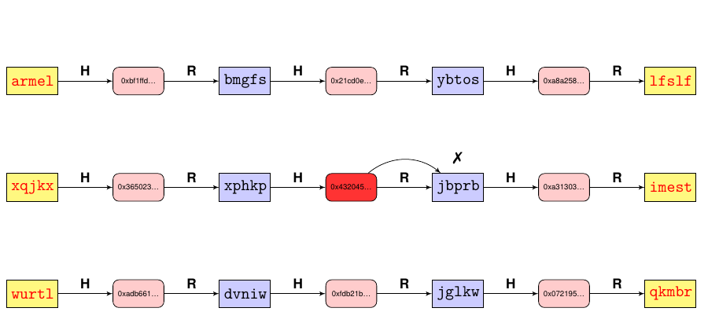

---

## Regenbogentabellen {.image-slide}
### Knacken eines Hashes

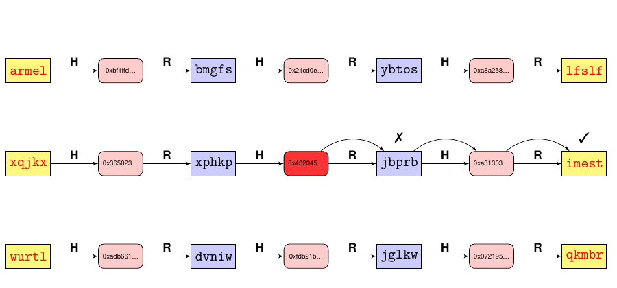

---

## Regenbogentabellen {.image-slide}
### Knacken eines Hashes

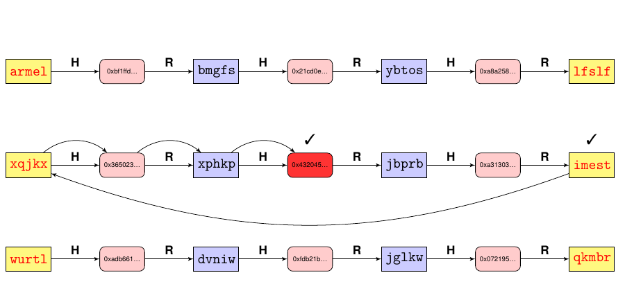

---

## Regenbogentabellen {.image-slide}
### Knacken eines Hashes

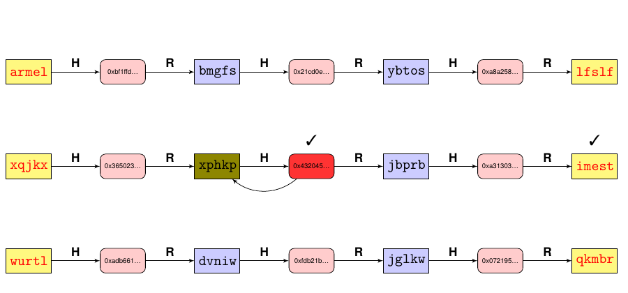

---

## bcrypt {.content-slide .pdf-slide}
<br>

**Problem**

Allgemeine (schnelle) Hashfunktionen wie MD5 oder SHA-x wurden für Effizienz optimiert -> begünstigen Brute-Force-/GPU-Angriffe. Für Passwörter braucht es spezialisierte, langsame, idealerweise speicherharte Verfahren (Passwort-KDFs).

**Idee**

Spezielles Passwort-Hashverfahren, das bewusst langsam und (teilweise) speicherhart arbeitet, um Brute-Force zu verteuern.

**Lösung**

- bcrypt [5]
- 128 Bit Salt
- konfigurierbarer Kostenfaktor ("cost") -> Laufzeit an Hardware anpassbar

---

## Moderne Passwort-KDFs (Stand 2025) {.content-slide .pdf-slide}
<br>

**Empfehlungen**

- Argon2id (bevorzugt): speicherhart, gegen GPU/ASIC vorteilhaft [6].
- bcrypt: weit verbreitet, solide; kein Memory-Hardness, cost z. B. 12-14.
- PBKDF2 / scrypt: etabliert; scrypt speicherhart.

**Praxisleitplanken**

- Argon2id grob: 64-256 MB RAM, 2-4 Threads, 2-4 Iterationen (Work-Factor gemäß Serverlast).
- Per-User Salt obligatorisch; optional Pepper (geheim, getrennt gespeichert, z. B. HSM/Secrets-Manager).
- Screening gegen geleakte Passwörter (z. B. k-Anonymity/HIBP) gemäß [3].

---

## Exkurs: "Forgot your Password?" {.content-slide .pdf-slide}
<br>

::: {.summary}
- viele (webbasierte) Dienste erfordern Authentifizierung (Webmail, ...)
- im Falle eines verlorenen Passwortes wird eine "persönliche" Frage vereinbart, deren korrekte Beantwortung das Passwort zurücksetzt oder dem Eigentümer per Mail zustellt
:::


**Beispiele (veraltet/unsicher)**

- "What is your mother's maiden name?"
- "What is your dog's name?"

::: {.summary}
Diese Informationen sind insbesondere bei Prominenten und Influencern leicht recherchierbar!

Besser: Recovery Codes, Backup-FIDO2/Passkeys, administrativer Reset mit starker Identitätsprüfung.
:::

Literatur: [7]

---

## Exkurs: "Forgot your Password?" {.content-slide .pdf-slide}
### Beispiel: Sarah Palin

- Yahoo-Account von Vizepräsidentschaftskandidatin Sarah Palin
- Passwort wurde durch Unbekannte zurückgesetzt (09/2008)
- "Sicherheits"fragen:
  - ZIP code
  - date of birth
  - "Where did you meet your husband?" -> auf der Webseite steht, dass sie ihren Mann seit Highschool-Zeiten kennt und welche Highschool sie besuchte
- Recherche dauerte ca. 45 Minuten

Quelle: <http://www.itworld.com/security/55185/sarah-palin-goes-way-paris-hilton>

---

## Rätsel {.content-slide .pdf-slide}
<br>

Welche der folgenden Fragen taugen nicht für das Rücksetzen eines Passwortes? Können sie die folgenden Fragen für eine fremde Person (z. B. mich) mit wenig Aufwand recherchieren? Welche Ansätze für Recherchen gibt es?

1. What is my mother's maiden name?
2. What was the brand of my first car?
3. What is the name of my best friend?
4. In which city did I grow up?
5. What was the lastname of my kindergarden teacher?
6. What is my favourite movie?
7. What is my dog's name?

---

## Challenge-Response-Verfahren {.content-slide .pdf-slide}


### oder: "Wer über die Brücke des Todes will gehen, der muß drei mal Rede und Antwort stehen.Dann darf er die andere Seite sehen."
<br>

= Authentifizierung auf der Basis gemeinsamen Wissens

1. Server stellt eine Aufgabe (Challenge))
2. Nutzer (bzw. ein Stellvertreterprozess) löst die Aufgabe (antwortet; Response)
3. Lösung korrekt -> Login erlaubt

**Beispiel:** Kopierschutz in alten Computerspielen.

Zu Beginn Frage, etwa: "Was steht im Handbuch auf S.412, dritte Zeile, 2. Wort?"

- richtiger Begriff -> Spiel startet
- falscher Begriff -> Abbruch

---

## Challenge-Response zur Authentifizierung {.content-slide .pdf-slide}
### Ablauf

1. Alice schickt Bob (dem Host) ihr Nutzerkennzeichen
2. Bob sendet eine Zufallszahl ("Nonce" = (random) number, used once) an Alice = Challenge
3. Alice berechnet eine Antwort mit einer aus dem Passwort-Hash abgeleiteten Schlüssel-Funktion ("Response") und sendet sie an Bob
4. Bob berechnet dieselbe Funktion mit seinem gespeicherten Passwort-Hash
5. sind beide Werte identisch, so wird Zugang gewährt

---

## Beispiel: Authentifizierung in Windows I {.content-slide .pdf-slide}
<br>

- Authentifizierungsprotokoll NTLM (NT Lan Manager) [8]
- Nachfolger des (unsicheren) LM-Authentifizierungsverfahrens
- ursprünglich proprietär, daher reverse-engineered
- mittlerweile durch Microsoft offengelegt

**Grobablauf**

1. Client (Nutzer) schickt seine ID mittels sog. Type-1-Nachricht an den Server
2. Server (Host) antwortet mit einer Type-2-Nachricht, die u. a. eine 8 Byte lange Nonce enthält
3. Client berechnet die NTLM-Response mit einer aus dem Passwort-Hash abgeleiteten (schlüssel-)Funktion und sendet sie als Type-3-Nachricht
4. Server berechnet die erwartete Response aus dem gespeicherten Passworthash und gewährt bei Übereinstimmung Zugang

---

## Beispiel: Authentifizierung in Windows II {.content-slide}
### Hinweise (heute)

- In AD-Umgebungen ist Kerberos der Standard [9]; NTLMv1 deaktivieren, NTLMv2 nur wo nötig.
- Schutz gegen NTLM-Relay: SMB Signing, Channel Binding/EPA, Einschränkung unsignierter Protokolle.

---

## Authentifizierung mit physischen Objekten {.image-slide}


- Schlüssel
- Chipkarten
  - passiv – „Stored Value Cards“, z.B. Telefonkarten
  - aktiv – „Smart Cards“, ausgerüstet mit 8-Bit-CPU, Scratch RAM, ROM, EEPROM

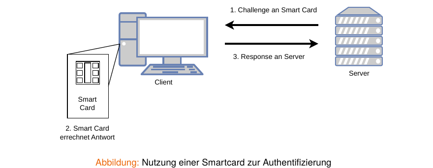

---

## Smartcards {.content-slide}
<br>

- Smartcards können aktualisiert werden, z. B. bei Bruch des verwendeten Kryptografie-Verfahrens
- Problem: Verlust, Diebstahl
- Power Analysis Attack, um Key zu ermitteln
- Diebstahl eröffnet neue Angriffsvektoren; Tamper Resistance nötig

---

## Authentifizierung mittels biometrischer Merkmale {.content-slide .pdf-slide}
<br>

**Idee:** Authentifizierung einer Person anhand individueller physischer Merkmale

- Gesichtsmerkmale (z. B. bei direkter Mensch-Mensch-Authentisierung)
- Fingerabdrücke (wahrscheinlich einzigartig innerhalb der gesamten Bevölkerung)
- Geometrie der Hand (Form, Länge, Dicke der Finger)
- Blutgefäße der Retina (ebenfalls einzigartig)
- Unterschrift
- Sprache

**Probleme**

- False-Match
- False-Nonmatch
- nicht widerrufbar/änderbar (Kompromittierung bleibt bestehen)
- Liveness Detection und Spoofing-Schutz erforderlich

---

## Authentifizierung mit Public-Key-Kryptografie {.content-slide .pdf-slide}
<br>

1. Host sendet Alice einen Zufallsstring Z
2. Alice chiffriert Z mit ihrem privaten Schlüssel und schickt das Chiffrat mit ihrem Namen an den Host
3. Host ruft Alice' öffentlichen Schlüssel aus seiner Datenbank und dechiffriert Nachricht
4. Stimmt Dechiffrat mit ursprünglichen String Z überein, so erhält Alice Zugang zum System

**Praxis: SSH**

Ed25519-Schlüssel mit Passphrase und optionalem Hardware-Token (z. B. Security Key) sind State-of-the-Art; Server speichert nur den öffentlichen Schlüssel, kein Geheimnis.

---

## Zwei-Faktor-Authentifizierung (2FA) {.content-slide .pdf-slide}
<br>

**Idee**

Anstelle einer Methode zur Authentifizierung besser zwei unabhängige Methoden verwenden

**Beispiele**

- Online-Banking: Authentifizierung mit PIN oder Passwort, alle Operationen mit Transaktions-Nr. (TAN)
- Geldabheben am Automaten: Besitz der EC-Karte und Kenntnis der PIN
- viele Webservices: Passwort + Security Token - FIDO2/WebAuthn ("Passkeys"); phishing-resistent

**Hinweise**

- TOTP ist gut, SMS-2FA schwächer (SIM-Swapping, Abhören).
- Bevorzugen Sie FIDO2/WebAuthn-basierte Faktoren, wo möglich [10, 11].

---

## Literaturverzeichnis I {.content-slide .pdf-slide}
<br>

[1] Johnny Long. *No Tech Hacking. A Guide to Social Engineering, Dumpster Diving, and Shoulder Surfing.*
Hrsg. von Kevin D. Mitnick. Includes index. Rockland, Mass.: Syngress; 2008. 285 S. isbn: 1597492159.

[2] Clifford Stoll. *Cuckoo's Egg.* Description based on publisher supplied metadata and other sources.
Westminster: Knopf Doubleday Publishing Group, 2012. 1302 S. isbn: 9780307819420.

[3] Paul A. Grassi u. a. *Digital Identity Guidelines: Authentication and Lifecycle Management.*
Techn. Ber. NIST Special Publication 800-63B. National Institute of Standards und Technology, 2017.
url: <https://nvlpubs.nist.gov/nistpubs/SpecialPublications/NIST.SP.800-63b.pdf>.

[4] Chick3nman. *Hashcat v6.2.6 benchmark on the Nvidia RTX 4090.* [Online; accessed 1. Apr. 2024].
2022. url: <https://gist.github.com/Chick3nman/32e662a5bb63bc4f51b847bb422222fd>.

[5] Niels Provos und David Mazières. "A Future-Adaptable Password Scheme". In: *Proceedings of the FREENIX Track: 1999 USENIX Annual Technical Conference, June 6-11, 1999, Monterey, California, USA.* USENIX, 1999, S. 81-91. url: <http://www.usenix.org/events/usenix99/provos.html>.

[6] Alex Biryukov, Daniel Dinu und Dmitry Khovratovich. "Argon2: the memory-hard function for password hashing and other applications". In: *Proceedings of the IEEE European Symposium on Security and Privacy (EuroS&P) Workshops.* 2016. url: <https://www.password-hashing.net/argon2-specs.pdf>.

[7] Herbert H. Thompson. "How I Stole Someone's Identity". In: *Sci. Am.* (18. Aug. 2008). url: <https://www.scientificamerican.com/article/anatomy-of-a-social-hack>.


---

## Literaturverzeichnis II {.content-slide .pdf-slide}
<br>

[8] Eric Glass. *The NTLM Authentication Protocol and Security Support Provider.* [Online; accessed 1. Apr. 2024]. Sep. 2006. url: <https://davenport.sourceforge.net/ntlm.html>.

[9] Jennifer G. Steiner, B. Clifford Neuman und Jeffrey I. Schiller. "Kerberos: An Authentication Service for Open Network Systems". In: *Proceedings of the USENIX Winter Conference.* Dallas, Texas, USA, January 1988. USENIX Association, 1988, S. 191-202.

[10] W3C WebAuthn Working Group. *Web Authentication: An API for accessing Public Key Credentials Level 1.* W3C Recommendation. 2019. url: <https://www.w3.org/TR/webauthn/>.

[11] FIDO Alliance. *Client to Authenticator Protocol (CTAP) v2.* FIDO2 Specification. 2019. url: <https://fidoalliance.org/specifications/>.

---

## Vielen Dank! {.title-slide data-state="hide-footer"}


Prof. Dr. Lukas Iffländer   
HTW Dresden  

