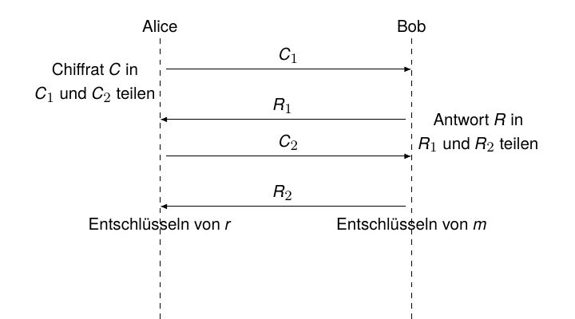
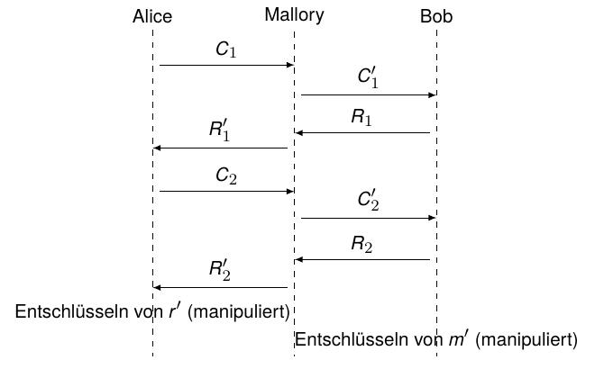
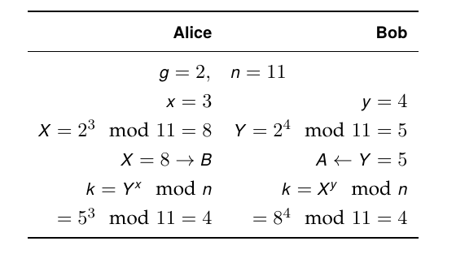

## Schlüsselaustausch {.title-slide data-state="hide-footer"}

Prof. Dr. Lukas Iffländer   
HTW Dresden  


---

## Protokolle zum Schlüsselaustausch {.content-slide .agenda-slide}

<ul class="agenda">
<li class="agenda-item"><strong>01</strong>Austausch mittels symmetrischer Kryptografie</li>
<li class="agenda-item"><strong>02</strong>Austausch mittels Public-Key-Kryptografie</li>
<li class="agenda-item"><strong>03</strong>Man-in-the-Middle-Angriff</li>
<li class="agenda-item"><strong>04</strong>Interlock-Protokoll</li>
<li class="agenda-item"><strong>05</strong>Digitale Signatur</li>
<li class="agenda-item"><strong>06</strong>Diffie-Hellman-Protokoll</li>
</ul>

---

## Protokolle zum Schlüsselaustausch {.pdf-slide}
### Überblick
 

#### Varianten

- Austausch mittels symmetrischer Kryptografie
- Austausch mittels Public-Key-Kryptografie

#### Beispiel

- Diffie-Hellman-Protokoll

--- 

## Schlüsselaustausch mit symmetrischer Kryptografie {.content-slide .pdf-slide}
 

#### Voraussetzungen

Vertrauenswürdige Instanz (Key Distribution Center - KDC, aka Trent), sowohl Alice als auch
Bob besitzen Schlüssel zur Kommunikation mit Trent.

#### Protokoll

1. Alice bittet Trent um Generierung eines Sitzungsschlüssels.
2. Trent generiert zufälligen Sitzungsschlüssel, generiert zwei Kopien, verschlüsselt eine mit Alice' und eine mit Bobs Schlüssel.
3. Trent schickt beide (verschlüsselte) Kopien an Alice.
4. Alice dechiffriert ihre Kopie des Sitzungsschlüssels.
5. Alice schickt Bob dessen (verschlüsselte) Kopie.
6. Bob dechiffriert seine Kopie des Sitzungsschlüssels.
7. Alice und Bob kommunizieren mittels des Sitzungsschlüssels.

---

## Schlüsselaustausch mittels Public-Key-Kryptografie {.content-slide .pdf-slide}
 

...wie bereits unter "hybride Kryptosysteme" diskutiert:

**Protokoll**

1. Alice bezieht Bobs öffentlichen Schlüssel aus einer PKI (z. B. Zertifikatsverzeichnis/CA).
2. Alice generiert einen zufälligen Sitzungsschlüssel und verschlüsselt diesen mit Bobs öffentlichem Schlüssel.
3. Alice sendet das Chiffrat an Bob.
4. Bob dechiffriert die empfangene Nachricht mit seinem privaten Schlüssel.
5. Beide kommunizieren mit Hilfe des Sitzungsschlüssels.

---

## Man-in-the-Middle-Angriff {.content-slide .pdf-slide}
### Ablauf

1. Alice sendet Bob ihren öffentlichen Schlüssel.
2. Mallory fängt diesen Schlüssel ab und schickt stattdessen seinen eigenen öffentlichen Schlüssel an Bob.
3. Bob sendet seinen öffentlichen Schlüssel an Alice.
4. Mallory fängt auch diesen ab und schickt stattdessen seinen öffentlichen Schlüssel an Alice.
5. Sendet Alice eine mit Bobs vermeintlichem öffentlichen Schlüssel verschlüsselte Nachricht an Bob, fängt Mallory diese ab und
   entschlüsselt sie mit seinem privaten Schlüssel,
   liest sie,
   chiffriert sie mit Bobs öffentlichem Schlüssel und
   schickt sie weiter an Bob.

    - entschlüsselt sie mit seinem privaten Schlüssel,
liest sie,
    - chiffriert sie mit Bobs öffentlichem Schlüssel und
    - schickt sie weiter an Bob.

- Analog geht Mallory in der Rückrichtung (Bob -> Alice) vor.

- Weder Alice noch Bob können diesen Angriff entdecken.

---

## Das Interlock-Protokoll (Rivest/Shamir, 1984) {.content-slide .pdf-slide}
### ...erschwert oder vereitelt den Man-in-the-Middle-Angriff
 

1. Alice sendet Bob ihren öffentlichen Schlüssel KA.
2. Bob sendet Alice seinen öffentlichen Schlüssel KB.
3. Alice chiffriert ihre Nachricht M1 mit KB und schickt die Hälfte der verschlüsselten Nachricht an Bob.
4. Bob chiffriert seine Nachricht M2 mit KA und schickt die Hälfte der verschlüsselten Nachricht an Alice.
5. Alice schickt die zweite Hälfte an Bob.
6. Bob fügt beide Hälften zusammen und dechiffriert. Danach schickt er Alice seine zweite Hälfte.
7. Alice setzt Bobs zweite Nachricht zusammen und dechiffriert.

---

## Das Interlock-Protokoll (Rivest/Shamir, 1984) {.image-slide}
### ...erschwert oder vereitelt den Man-in-the-Middle-Attack

---

## Analyse des Interlock-Protokolls {.content-slide .pdf-slide data-state="hide-footer"}
 

- Mallory kann nicht dechiffrieren, weil er nur das halbe Chiffrat C1 hat; die Entschlüsselung
  erfordert in der Regel das vollständige Chiffrat C = C1 || C2.
- Im Allgemeinen gilt zudem

EK(m) != EK(m1) || EK(m2).

- Er muss aber mit seinem privaten Schlüssel dechiffrieren, um anschließend mit Bobs öffentlichem Schlüssel zu chiffrieren.
- Er muss eine andere Nachricht erfinden und die Hälfte davon an Bob schicken (und zurück an Alice).

::: {.summary}
Wenn Alice und Bob ihre Nachrichten vorher absprechen[^kanal], können sie mit dem Interlock-Protokoll
die Authentizität ihrer jeweiligen öffentlichen Schlüssel prüfen und Mallory entlarven.
:::

[^kanal]: Dafür ist aber ein sicherer Kanal notwendig.

---

## Analyse des Interlock-Protokolls {.image-slide}

---

## Schlüsselaustausch mit digitaler Signatur {.content-slide}
 

**Idee**

- Trent signiert die öffentlichen Schlüssel von Bob und Alice.
- Beim Schlüsselerhalt prüfen Alice und Bob Trents Signatur.

-> Mallory kann nicht mehr in deren jeweilige Rolle schlüpfen!

---

## Schlüsselaustausch mittels Diffie-Hellman-Protokoll {.content-slide .pdf-slide}
 

1. Bob und Alice einigen sich auf eine große Primzahl n und eine Zahl g.
2. Alice wählt eine (große) zufällige Zahl x (Alice' geheimer Schlüssel) und berechnet X = gx mod n (Alice' öffentlicher Schlüssel).
3. Alice sendet X an Bob.
4. Bob wählt eine (große) zufällige Zahl y (Bobs geheimer Schlüssel) und berechnet Y = gy mod n (Bobs öffentlicher Schlüssel).
5. Bob sendet Y an Alice.
6. Alice berechnet k = Yx mod n = (gy mod n)x mod n = gxy mod n, den geheimen Sitzungsschlüssel.
7. Bob berechnet k = Xy mod n = (gx mod n)y mod n = gxy mod n.

---

## Anmerkungen zum Diffie-Hellman-Protokoll {.content-slide .image-slide}
 

- g sollte ein Erzeuger von Z_n* sein; für n prim bedeutet das, dass g Ordnung n - 1 hat.
- Eve kann X und Y abfangen, es nützt ihr aber nichts; sie kann gxy mod n nicht aus gx mod n und gy mod n berechnen.

**Beispiel:**

---

## Vielen Dank! {.title-slide data-state="hide-footer"}

Prof. Dr. Lukas Iffländer   
HTW Dresden  

