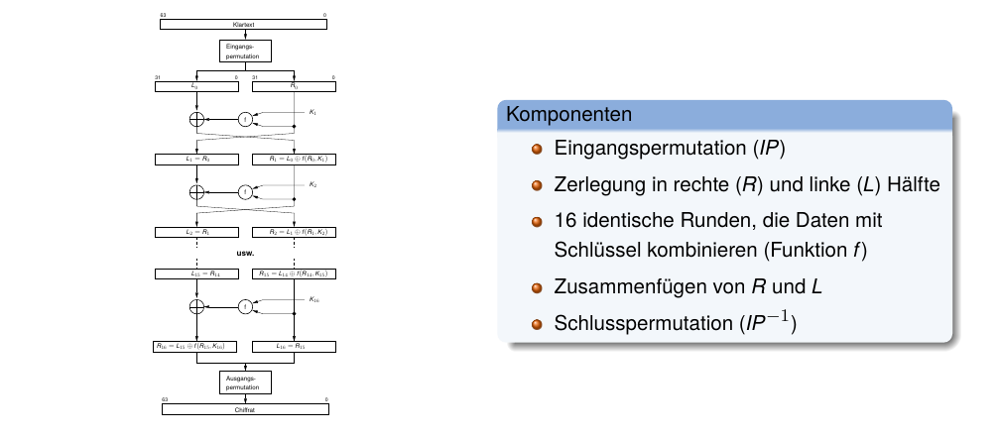
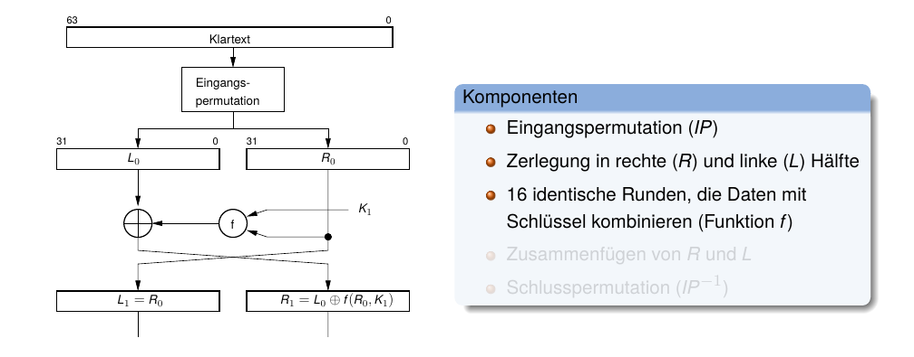
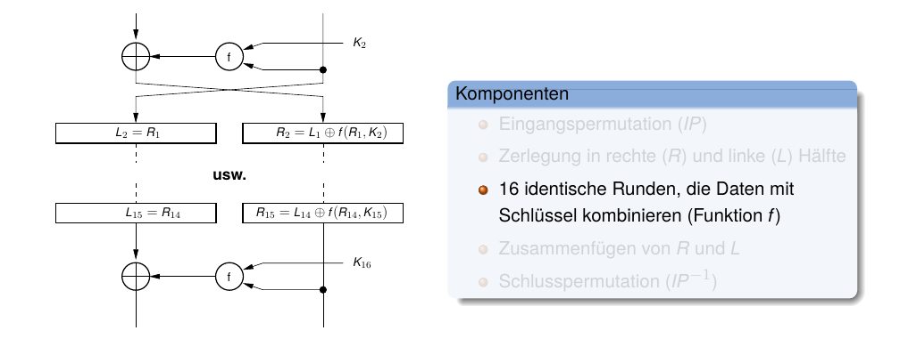
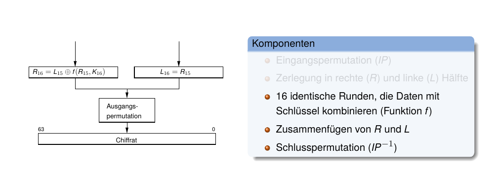
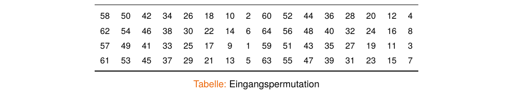
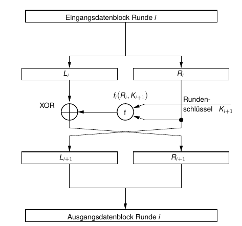
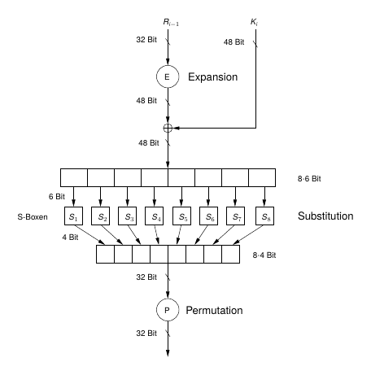
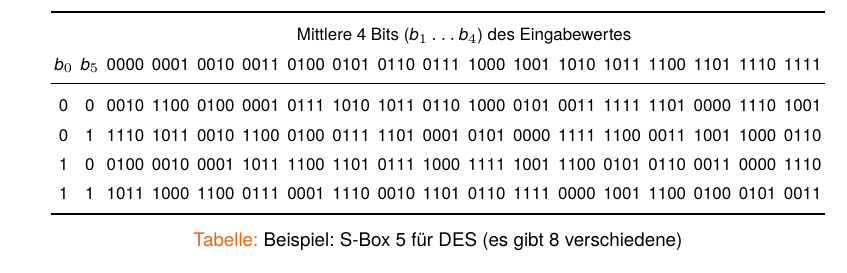
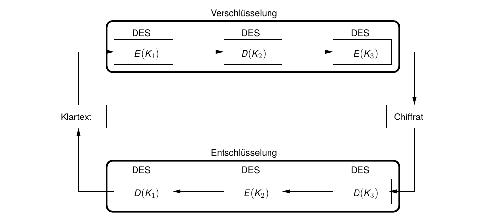

## Data Encryption Standard (DES) {.title-slide data-state="hide-footer"}

Prof. Dr. Lukas Iffländer   
HTW Dresden  


---

## Agenda {.content-slide .agenda-slide}

<ul class="agenda">
<li class="agenda-item"><strong>01</strong>DES Überblick</li>
<li class="agenda-item"><strong>02</strong>DES-Algorithmus</li>
<li class="agenda-item"><strong>03</strong>Feistel-Chiffre</li>
<li class="agenda-item"><strong>04</strong>Sicherheit von DES</li>
<li class="agenda-item"><strong>05</strong>Mehrfachverschlüsselung</li>
<li class="agenda-item"><strong>06</strong>Triple DES</li>
</ul>

---

## Symmetrischer Data Encryption Standard (DES) [1] {.content-slide .pdf-slide}
 

- Ergebnis eines durch das National Bureau of Standards ausgeschriebenen Wettbewerbs
- von IBM im Jahre 1974 erstmalig beschrieben
- Prüfung/Mitentwicklung durch NSA
- Standard ANSI X3.92, 1981
- Prüfung alle 5 Jahre, ob Standard noch den Erfordernissen eines Kryptosystems entspricht
  (-> 1987, 1993 re-zertifiziert)
- Schlüssellänge: 56 Bit
- blockbasiertes Verfahren: 64 Bit Klartext -> 64 Bit Chiffrat
- erstes erfolgreiches Verschlüsselungsverfahren für Rechnereinsatz; Grundlage für alle
  modernen Verfahren

---

## DES {.image-slide}
### Überblick

---

## DES {.image-slide}
### Überblick

---

## DES {.image-slide}
### Überblick

---

## DES {.image-slide}
### Überblick

---

## DES {.pdf-slide}
### Eingangspermutation

::: {.callout-note title="Lesart:"}
Bit 58 des Klartextes wird auf Bit 1 der Permutation abgebildet, Bit 50 des Klartextes auf Bit 2 der Permutation usw.
:::

::: {.callout-note title="Hinweis"}
IP und IP−1 erhöhen die kryptografische Stärke nicht; sie sind historisch u. a. für
Hardwareverdrahtung gedacht.
:::

---

## DES {.content-slide .pdf-slide}
### Anmerkungen zum Algorithmus
 

- Schlüssel ist eigentlich auch 64-bittig, 8 Bit dienen jedoch der Paritätsprüfung (jedes Byte
  muss ungerade Parität haben)
- für jede der 16 Runden wird aus dem 56-Bit-Schlüssel $K$ ein Subschlüssel $K_i$ mit 48 Bit
  Länge generiert
- Struktur des DES-Algorithmus ist ziemlich regulär; eine so genannte Feistel-Chiffre
- Entschlüsselung in umgekehrter Reihenfolge der 16 Runden
- sehr leicht in Hardware zu synthetisieren (keine Additionen/Multiplikationen, nur
  Verschiebungen, Permutationen und XOR)

---

## DES {.two-column-slide}
### Feistel-Chiffre

:::: {.columns}
::: {.column width="50%"}

:::

::: {.column width="50%"}

::: {.callout-note title="Verschlüsselung"}
$$
\begin{aligned}
L_{i+1} &= R_i \\
R_{i+1} &= L_i \oplus f(R_i, K_{i+1})
\end{aligned}
$$

:::

::: {.callout-note title="Entschlüsselung (gleiche f , umgekehrte Rundenschlüssel)"}

$$
\begin{aligned}
R_i &= L_{i+1} \\
L_i &= R_{i+1} \oplus f(R_i, K_{i+1})
\end{aligned}
$$

:::

- keine Umkehrfunktion f −1(R, K ) nötig
- Ver- und Entschlüsselung mit gleicher Funktion f (R, K )
- Funktionsblock vieler symmetrischer Verfahren

:::
::::

---

## Struktur einer Runde ($f(R_{i-1}, K_i)$) {.image-slide}

---

## S-Boxen (Substitution Boxen) {.image-slide}
 

- zentraler Bestandteil jedes symmetrischen Kryptografie-Verfahrens
- nichtlineare Substitution; m Eingangs- werden auf n Ausgangsbits abgebildet
- S-Boxen in DES sind „mythenumrankt“, da Prinzipien ihres Entwurfs nicht offengelegt
wurden

---

## Zur Sicherheit von DES {.content-slide .pdf-slide}
 

- bislang kein kryptanalytischer Angriff publiziert
- (unbewiesener) Verdacht, NSA könnte eine Hintertür eingebaut haben
- Hauptmanko: Schlüssellänge von 56 Bit ist zu kurz
- Wettbewerb DES Challenge ("Wer schafft es als erster, zu einem vorgegebenen
  DES-Schlüssel die zugehörige Passphrase per Brute-Force-Angriff zu ermitteln?")
- DES Challenge, 1997: $t = 96d$ benötigt
- DES Challenge II-1, 1998: $t = 48d$ (distributed.net)
- DES Challenge II-2, 1998: $t = 56h$ mittels Deep Crack, einem parallelen Spezialsystem,
  250.000$
- DES Challenge III, 1999: $t = 22h15min$
- GTX 1080 Ti, 2018: $t = 15d$
- Rainbow-Table + Chosen-Plaintext, 2017: $t = 25s$

---

## Kombination von Blockchiffren {.content-slide .pdf-slide}
 

::: {.callout-note title="Idee"}
- Weiternutzung eines (bewährten) Verfahrens
- Verlängerung des Schlüssels     

-> Erhöhung der Sicherheit des Verfahrens

::: 

**Mehrfachverschlüsselung:** Hintereinanderausführung ein- und desselben Algorithmus mit unterschiedlichen Schlüsseln.

- bei Nutzung gleicher Schlüssel bleibt Komplexität eines Brute-Force-Angriffes konstant
  ($\Rightarrow$ Ziel verfehlt)

---

## Wie oft soll ich nun DES o. ä. ausführen? {.content-slide .pdf-slide}
 

::: {.callout-note title="Doppelte Verschlüsselung"}

$$
C = E_{K_2}(E_{K_1}(P))
$$

::: 

Hat $K$ eine Breite von $n$ Bits, so müssen $2^n$ Schlüssel probiert werden.
Also müssen bei doppelter Verschlüsselung $2^{2n}$ Schlüssel probiert werden, oder?

Antwort: Nein! Es gibt den sog. Meet-in-the-Middle-Angriff[^mitm], eine spezielle Form eines Known-Plaintext-Angriffs.

[^mitm]: Bitte nicht mit Man-in-the-Middle-Angriff verwechseln!

---

## Meet-in-the-Middle-Angriff {.content-slide .pdf-slide}
 

Zwei Chiffrate $C_1$, $C_2$ und zwei (zugehörige) Plaintexte $P_1$, $P_2$ müssen bekannt sein:

$$
\begin{aligned}
C_1 &= E_{K_2}(E_{K_1}(P_1)) \\
C_2 &= E_{K_2}(E_{K_1}(P_2))
\end{aligned}
$$

Angriffsidee ("von beiden Seiten"):

1. $P_1$ mit allen möglichen Schlüsseln verschlüsseln und Chiffrate abspeichern
2. $C_1$ mit allen möglichen Schlüsseln entschlüsseln und Ergebnis mit allen Chiffraten aus 1. vergleichen
3. bei Übereinstimmung: zugehörige Schlüssel nutzen, um $P_2$ (doppelt) zu verschlüsseln; Ergebnis = $C_2$ $\Rightarrow$ Schlüssel aus 1. ist $K_1$, Schlüssel aus 2. ist $K_2$
4. ansonsten weitersuchen

---

## Meet-in-the-Middle-Angriff {.content-slide .pdf-slide}
### Schlussfolgerung
 

- benötigt viel Speicherplatz (für $2^n$ Blöcke)
- Es müssen bei $n$ Bit Schlüssellänge $2 \cdot 2^n$ Schlüssel durchprobiert werden

**Schlussfolgerung**

Ist ein Meet-in-the-Middle-Angriff möglich, dann führt die doppelte Verschlüsselung nicht zur
Erschwerung des Brute-Force-Angriffes von $2^n$ auf $2^{2n}$ Versuche, sondern nur zu $2^{n+1}$.

**Fazit**

Doppelte Verschlüsselung ist (so gut wie) nutzlos!

**Abhilfe**

dreifach verschlüsseln!

---

## Triple DES (3DES) {.image-slide}
### Struktur

---

## Triple DES {.content-slide .pdf-slide}
### Anmerkungen

- drei verschiedene Schlüssel nötig
- Verschlüsselung:

$$
C = E_{K_3}(D_{K_2}(E_{K_1}(P)))
$$

- sog. Encryption-Decryption-Encryption (EDE-Modus)
- sicherer als aufeinanderfolgende Verschlüsselung (Meet-in-the-Middle-Angriff benötigt
  ungefähr $2^{2n}$ Operationen)
- Entschlüsselung (analog):

$$
P = D_{K_1}(E_{K_2}(D_{K_3}(C)))
$$

- Varianten: EDE2 (2 Schlüssel, $K_1 = K_3$) und EDE3 (3 Schlüssel, $K_1$, $K_2$, $K_3$ verschieden)
- Effektive Sicherheitsstärke: EDE2 $\approx$ 80 Bit; EDE3 $\approx$ 112 Bit (trotz 168-Bit Schlüssel wegen
  Meet-in-the-Middle-Angriffen)
- Heute gilt 3DES (TDEA) als veraltet; für neue Systeme wird AES empfohlen
- dreifacher Verarbeitungsaufwand (!)

---

## Literaturverzeichnis I {.content-slide .pdf-slide}
 

[1] Reinhard Wobst. *Abenteuer Kryptologie. Methoden, Risiken und Nutzen der Datenverschlüsselung.*
3. Aufl. net.com - networking & communications. Literaturverz. S. 435 - 450.
München: Addison-Wesley, 2001. 456 S. isbn: 3827318157.

---

## Vielen Dank! {.title-slide data-state="hide-footer"}

Prof. Dr. Lukas Iffländer   
HTW Dresden  

