## Betriebsmodi von Blockchiffren {.title-slide data-state="hide-footer"}

Prof. Dr. Lukas Iffländer   
HTW Dresden  


---

## Agenda {.content-slide .agenda-slide}

<ul class="agenda">
<li class="agenda-item"><strong>01</strong>Betriebsmodi</li>
<li class="agenda-item"><strong>02</strong>Electronic Codebook</li>
<li class="agenda-item"><strong>03</strong>Cipher Block Chaining</li>
<li class="agenda-item"><strong>04</strong>Cipher Feedback</li>
<li class="agenda-item"><strong>05</strong>Output Feedback</li>
<li class="agenda-item"><strong>06</strong>Counter Mode</li>
</ul>

---

## Betriebsmodi blockbasierter symmetrischer Verfahren {.content-slide .pdf-slide}
 

Was tun, wenn Länge des Klartextes $\ne$ Blocklänge des Verfahrens?

-> Betriebsmodi ("Modes of Operation") blockbasierter symmetrischer Verschlüsselungsverfahren

- Electronic Codebook Mode (ECB)
- Cipher Block Chaining (CBC)
- Cipher Feedback Mode (CFB)
- Output Feedback Mode (OFB)
- Counter Mode (CTR)
- ...

---

## Electronic Codebook Modus (ECB) {.content-slide .pdf-slide}
### Prinzip
 

- Klartext wird in Blöcke der Länge $b$ (Blocklänge des Verschlüsselungsverfahrens; z. B. 128 Bit bei AES) unterteilt, letzter Block wird auf Länge $b$ aufgefüllt (Padding)
- Verschlüsselungsfunktion $E$ mit Schlüssel $K$ wird blockweise auf die Klartextblöcke $P_i$ angewandt; es entstehen (gleich große) Chiffratblöcke $C_i$:

$$
C_i = E_K(P_i)
$$

- Entschlüsselungsfunktion $D$ mit Schlüssel $K$ wird blockweise auf die Chiffratblöcke $C_i$ angewandt; es entstehen (gleich große) Klartextblöcke $P_i$:

$$
P_i = D_K(C_i)
$$

-> Blöcke sind voneinander unabhängig

---

## Electronic Codebook Modus (ECB) {.image-slide}
### Prinzip, grafisch

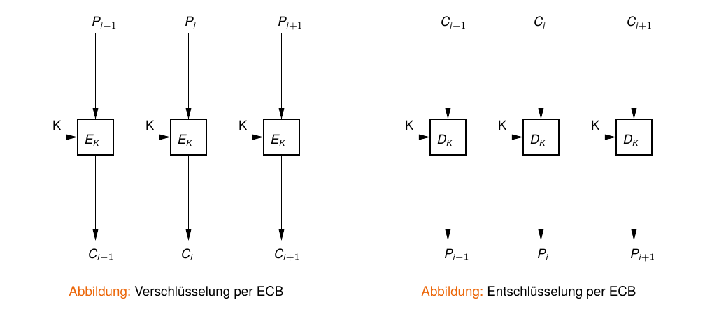

---

## Angriff auf ECB mittels Block Replay {.pdf-slide}
### ECB-verschlüsselter Datenaustausch mit Bank

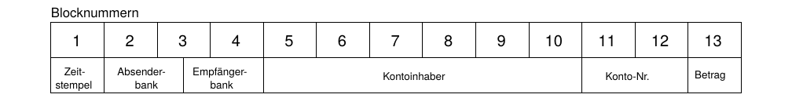

- Mallory zeichnet Datenverkehr zwischen Bank A und Bank B auf
- Mallory überweist zweimal einen festen Betrag von A nach B (bis auf Zeitstempel identische
Nachrichten)
- bei allen abgehörten Nachrichten tauscht er die Felder 5-12 mit den Daten aus seinen
Überweisungen aus

::: {.callout-tip title="Grundproblem"}
ECB erlaubt das Austauschen einzelner Blöcke → Blöcke dürfen nicht unabhängig voneinander
sein → CBC
::: 

---

## Electronic Codebook Modus (ECB) {.content-slide .pdf-slide}
### Eigenschaften
 

#### Vorteile

- 1:1-Abbildung Klartextblock -> Chiffratblock
- fehlertolerant: Bitfehler im Chiffrat verfälscht nur einen Klartextblock, keine Fehlerfortpflanzung
- Blockoperationen parallelisierbar

#### Nachteile

- gleicher Klartext erzeugt stets identisches Chiffrat
- unsicher: angreifbar durch Substitutionsattacken (Austauschen ganzer Blöcke, ohne diese zu entschlüsseln)
- des weiteren angreifbar mit statistischen Methoden bei Wissen über Klartext
- in der Praxis vermeiden: Muster im Klartext bleiben als Muster im Chiffrat sichtbar (Beispielbild)

---

## Electronic Codebook Modus (ECB) {.image-slide}
### Verschlüsselung einer S/W-Bitmap (AES-128)

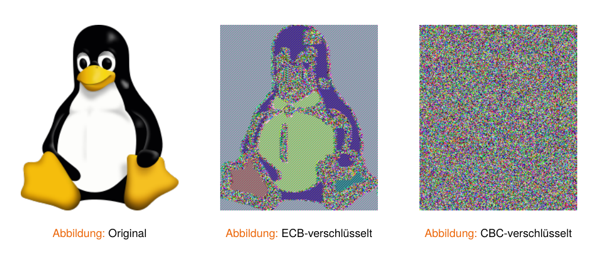

---

## Cipher Block Chaining (CBC) {.content-slide .pdf-slide}
### Prinzip
 

- Ergebnis früherer Verschlüsselungen fließt mit in Verschlüsselung des aktuellen Blockes ein (Rückkopplung)
- Klartextblock wird vor Verschlüsselung mit vorherigem Chiffratblock XOR-verknüpft:

$$
C_i = E_K(P_i \oplus C_{i-1})
$$

- Entschlüsselung umgekehrt; der Block wird nach Entschlüsselung mit dem vorangehenden Chiffratblock XOR-verknüpft:

$$
P_i = C_{i-1} \oplus D_K(C_i)
$$

- erster Block benötigt einen zufälligen, nicht vorhersagbaren Initialisierungsvektor (IV), der nicht geheimgehalten werden muss (Random-IV; kein rein deterministischer Nonce)
- mit $C_0 = IV$

---

## Cipher Block Chaining (CBC) {.image-slide}
### Prinzip

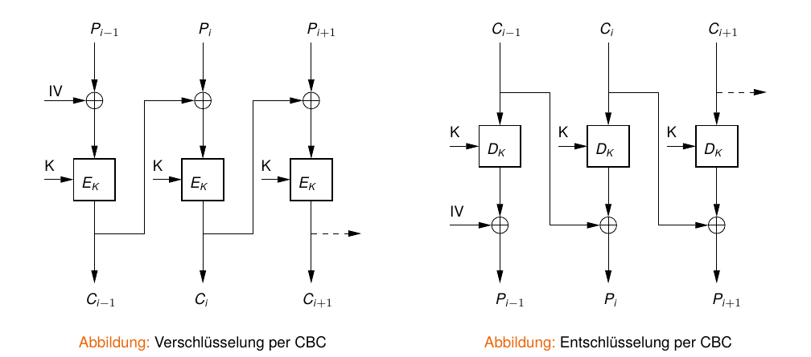

---

## Cipher Block Chaining (CBC) {.content-slide .pdf-slide}
### Fehlertoleranz
 

#### Bitfehler im Chiffrat

- enthaltender Block unbrauchbar
- nachfolgender Block hat einen 1-Bit-Fehler an der entsprechenden Position
- übernächster Block nicht betroffen
- Selbstsynchronisation auf Blockebene

#### Entfernen oder Einfügen eines Bits in das Chiffrat

- alle nachfolgenden Blöcke unbrauchbar
- Synchronisationsfehler nicht toleriert
- externe Rahmenstruktur mit Prüfsummen/CRC nötig

---

## Cipher Feedback Modus (CFB) {.content-slide .pdf-slide}
 

#### Nachteil des CBC

- ganzer Klartextblock benötigt, bevor Verschlüsselung startet -> für byteweise Verarbeitung ungeeignet (z. B. ein sicheres Terminal)

#### Ziel

- Nutzung von blockbasierten Verfahren zur Implementierung einer Stromchiffre

#### Idee

- Der im vorangegangenen Schritt verschlüsselte Block wird nochmals verschlüsselt und in beliebiger Granularität per XOR mit dem Klartextblock verknüpft.

$$
C_i = P_i \oplus E_K(C_{i-1})
$$

$$
P_i = C_i \oplus E_K(C_{i-1})
$$

---

## Cipher Feedback Modus (CFB) {.content-slide .pdf-slide}
### Ablauf
 

1. Initialisierung eines Schieberegisters mit Initialisierungsvektor
2. blockweise Verschlüsselung des Schieberegisters
3. XOR-Operation von $n$ Bit des Chiffrats ($k_i$) mit $n$ Bit des Klartexts ($p_i$)
4. Ausgabe/Übertragung der resultierenden $n$ Bit ($c_i$)
5. gleichzeitige Rückkopplung von $c_i$ in das Schieberegister und Verschiebung desselben um $n$ Bit
6. GOTO 2

---

## Cipher Feedback Modus (CFB) {.image-slide}
### Verschlüsselung (Prinzip, graf.)

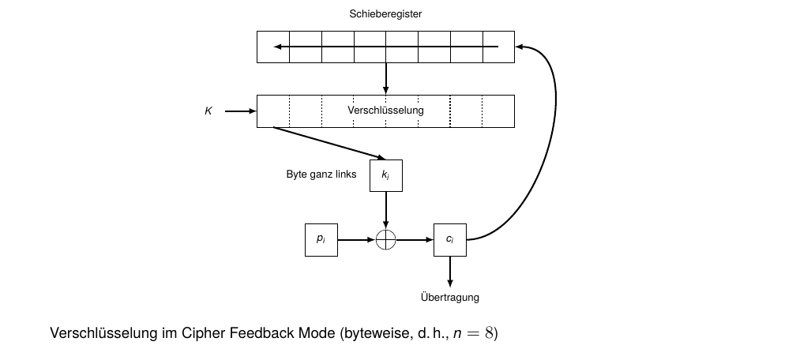

---

## Cipher Feedback Modus (CFB) {.image-slide}
### Beispiel (Verschlüsselung: NOT)

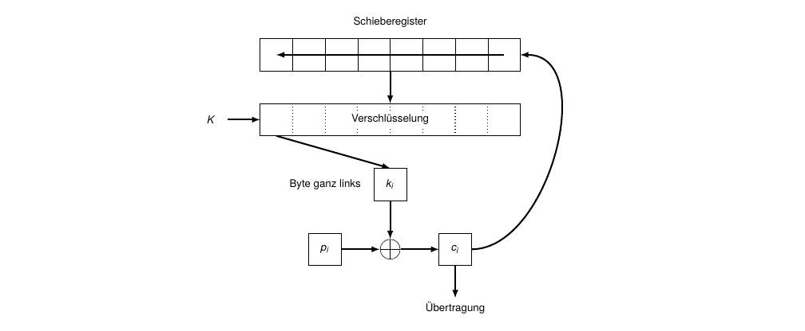

---

## Cipher Feedback Modus (CFB) {.image-slide}
### Beispiel (Verschlüsselung: NOT)

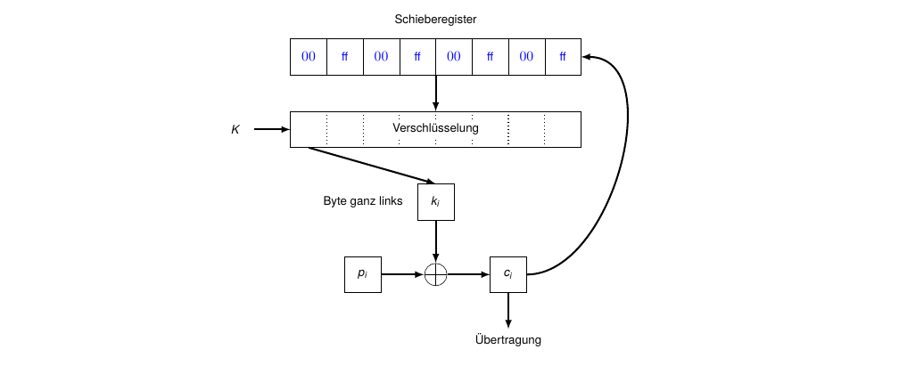

---

## Cipher Feedback Modus (CFB) {.image-slide}
### Beispiel (Verschlüsselung: NOT)

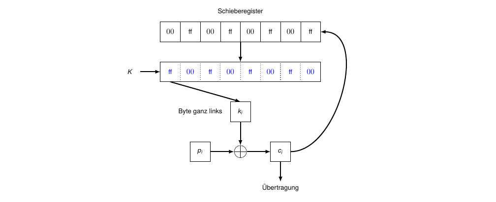

---

## Cipher Feedback Modus (CFB) {.image-slide}
### Beispiel (Verschlüsselung: NOT)

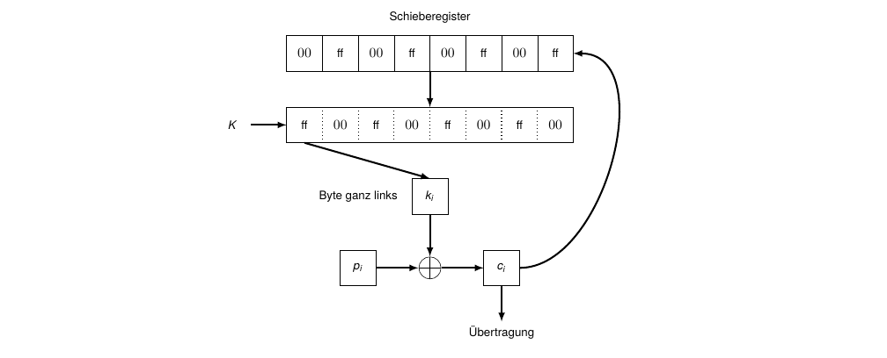

---

## Cipher Feedback Modus (CFB) {.image-slide}
### Beispiel (Verschlüsselung: NOT)

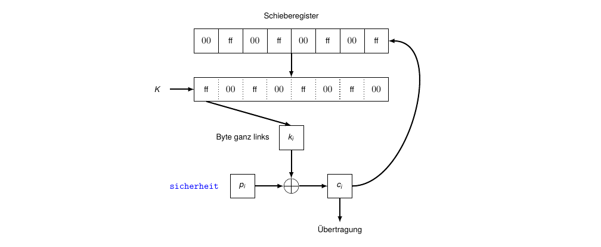

---

## Cipher Feedback Modus (CFB) {.image-slide}
### Beispiel (Verschlüsselung: NOT)

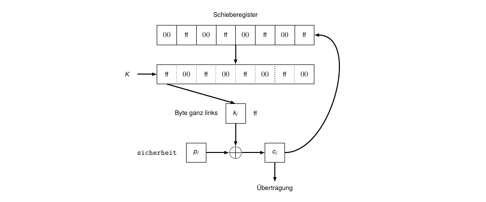

---

## Cipher Feedback Modus (CFB) {.image-slide}
### Beispiel (Verschlüsselung: NOT)

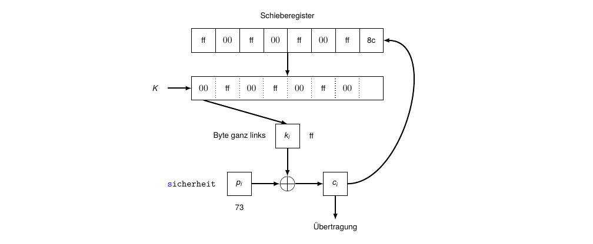

---

## Cipher Feedback Modus (CFB) {.image-slide}
### Beispiel (Verschlüsselung: NOT)

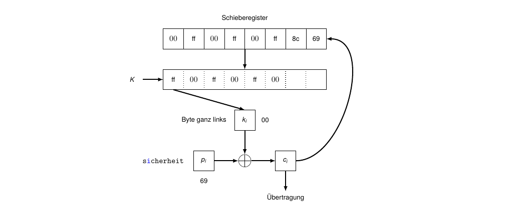

---

## Cipher Feedback Modus (CFB) {.image-slide}
### Beispiel (Verschlüsselung: NOT)

---

## Cipher Feedback Modus (CFB) {.image-slide}
### Beispiel (Verschlüsselung: NOT)

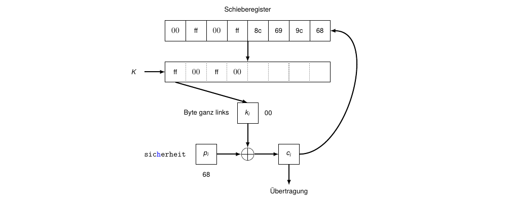

---

## Cipher Feedback Modus (CFB) {.image-slide}
### Beispiel (Verschlüsselung: NOT)

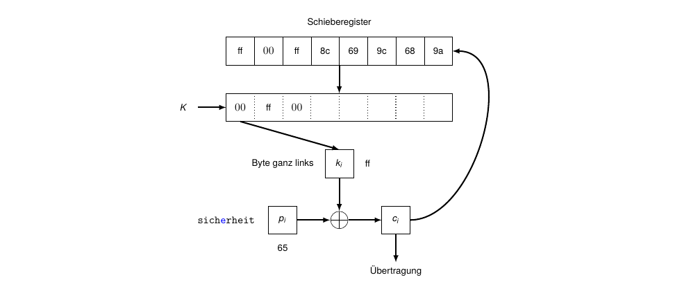

---

## Cipher Feedback Modus (CFB) {.image-slide}
### Beispiel (Verschlüsselung: NOT)

---

## Cipher Feedback Modus (CFB) {.image-slide}
### Beispiel (Verschlüsselung: NOT)

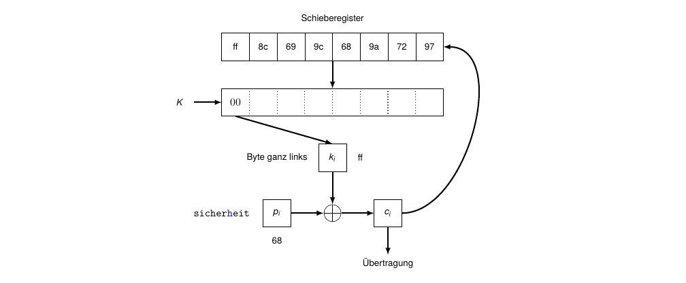

---

## Cipher Feedback Modus (CFB) {.image-slide}
### Beispiel (Verschlüsselung: NOT)

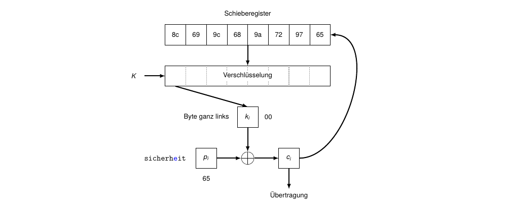

---

## Cipher Feedback Modus (CFB) {.image-slide}
### Beispiel (Verschlüsselung: NOT)

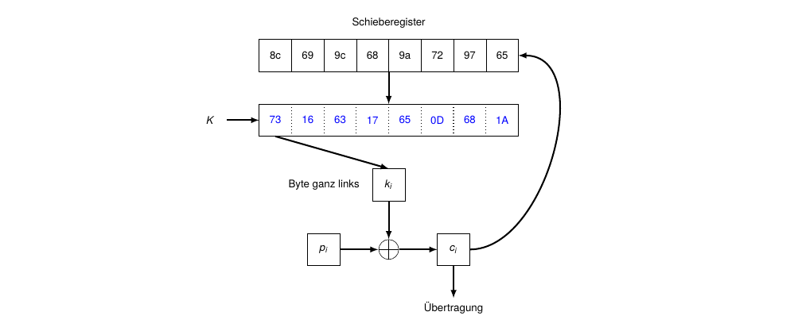

---

## Cipher Feedback Modus (CFB) {.image-slide}
### Beispiel (Verschlüsselung: NOT)

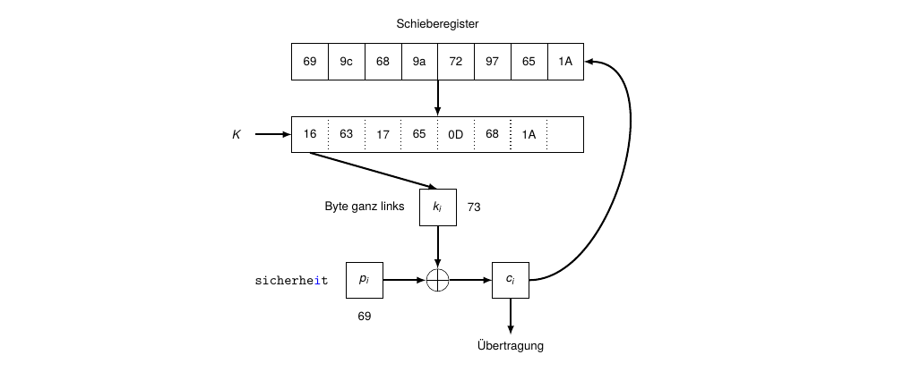

---

## Cipher Feedback Modus (CFB) {.image-slide}
### Beispiel (Verschlüsselung: NOT)

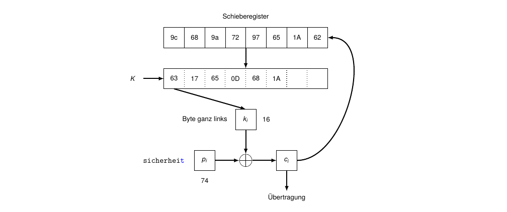

---

## Cipher Feedback Modus (CFB) {.content-slide .pdf-slide}
 

- bei Entschlüsselung sind $p_i$ und $c_i$ vertauscht
- Initialisierungsvektor benötigt (mit $C_0 = IV$)
- Granularität der Ausgabe (fast) beliebig: Byte, 16 Bit, 1 Bit usw.
- Fehler im Klartext bleibt unentdeckt (wird wieder in fehlerhaften Klartext entschlüsselt)
- Bitfehler im Chiffrat verfälscht das aktuelle Klartextsegment und führt für etwa $\frac{b}{n}$ weitere Segmente zu Fehlern (bis der Fehler das Schieberegister verlassen hat); dabei ist $b$ die Blockgröße und $n$ die gewählte Segmentgröße
- fehlende Bits und eingeschobene Fehlerbits ebenso -> CFB stabilisiert sich auf Blockebene
- IV/Nonce darf mit demselben Schlüssel nie wiederverwendet werden (Nonce-Reuse bricht die Vertraulichkeit)
- bietet keine Authentizität/Integrität -> in der Praxis AEAD-Modi bevorzugen (z. B. GCM/CCM)

---

## Output Feedback Modus (OFB) {.image-slide}
### Verschlüsselung (Prinzip)

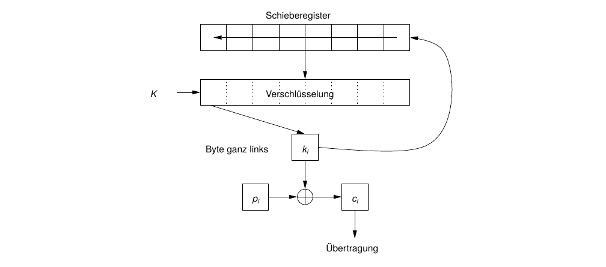

---

## Output Feedback Modus (OFB) {.content-slide .pdf-slide}
### Anmerkungen
 

- Rückkopplung des Resultatbytes $k_i$ vor XOR-Verknüpfung mit Klartextbyte $p_i$:

$$
C_i = P_i \oplus S_i,\qquad S_i = E_K(S_{i-1})
$$

$$
P_i = C_i \oplus S_i,\qquad S_i = E_K(S_{i-1})
$$

- sonst identisch zu CFB (d. h., IV benötigt; Geheimhaltung nicht erforderlich)
- "Hauptarbeit" (Erzeugung des Schlüsselstroms $S_i$) kann offline erfolgen
- 1-Bit-Fehler im Chiffrat führt zu 1-Bit-Fehler im Klartext
- Synchronisationsfehler katastrophal (vollständiger Informationsverlust)
- mit $S_0 = IV$; IV/Nonce darf mit demselben Schlüssel nie wiederverwendet werden (Nonce-Reuse bricht die Vertraulichkeit)
- bietet keine Authentizität/Integrität -> AEAD-Modi bevorzugen (z. B. GCM/CCM)

---

## Counter Mode (CTR) {.content-slide .pdf-slide}
### Prinzip
 

- Initialisierungsvektor IV (pro Nachricht konstant, zwischen Nachrichten eindeutig) wird zusammen mit einem Zähler $CTR_i$ mittels des Schlüssels $K$ verschlüsselt; das Resultat wird mit dem Klartextblock $P_i$ per XOR verknüpft:

$$
C_i = P_i \oplus E_K(IV || CTR_i)
$$

- Der Klartextblock ergibt sich symmetrisch als

$$
P_i = C_i \oplus E_K(IV || CTR_i)
$$

- Länge von IV und CTR zusammen entspricht der Blocklänge des Verfahrens; "$||$" bezeichnet Konkatenation

---

## Counter Mode (CTR) {.content-slide .pdf-slide}
### Eigenschaften
 

- benötigt IV und Counter; beide sind nicht geheim, müssen zusammen eine Nonce sein (eindeutig pro Schlüssel). Nicht wiederverwenden!
- nutzt Blockchiffre, betrieben als Stromchiffre
- Bitfehler invertiert genau das betreffende Bit im Klartext (bitweise)
- Blöcke sind unabhängig; gleiche Klartextblöcke ergeben aber unterschiedliche Chiffratblöcke, da sie von CTR abhängen
- parallelisierbar; wahlfreier Zugriff auf jeden Block
- Ver- und Entschlüsselung mit identischer Funktion (=> Nutzung einer Einwegfunktion möglich)
- keine Authentizität/Integrität -> AEAD-Modi bevorzugen (z. B. GCM)

---

## Counter Mode (CTR) {.image-slide}
### Prinzip

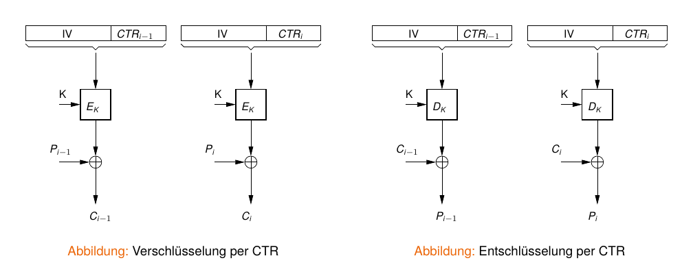

---

## Weitere Betriebsmodi {.content-slide .pdf-slide}
 

- Galois Counter Mode (GCM) - ermittelt zusätzlich einen MAC zur Authentisierung
- Counter with CBC-MAC (CCM)
- Offset Codebook Mode (OCB)
- Integrity Aware Parallelizable Mode (IAPM)
- ...

---

## Vielen Dank! {.title-slide data-state="hide-footer"}

Prof. Dr. Lukas Iffländer   
HTW Dresden  

