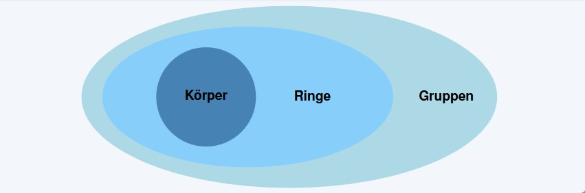
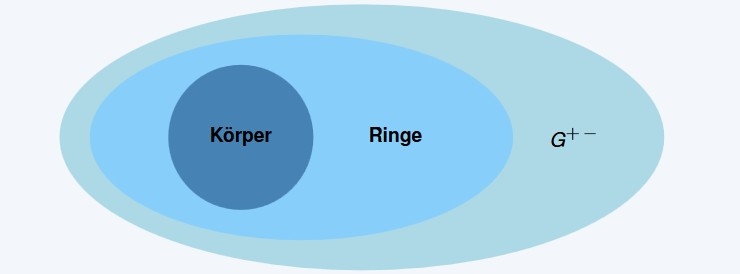
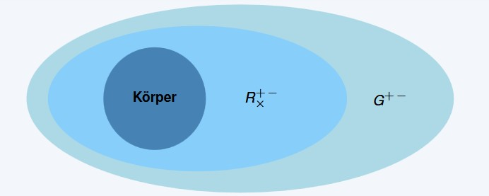
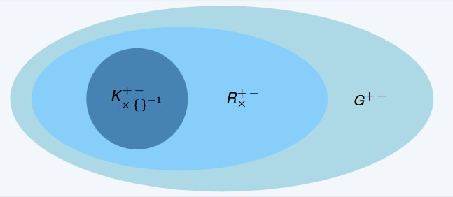
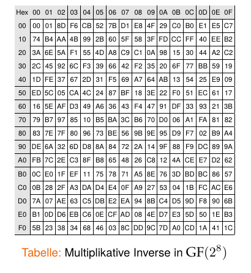

## Galois-Körper / Endliche Körper {.title-slide data-state="hide-footer"}

Prof. Dr. Lukas Iffländer   
HTW Dresden  


---

## Agenda {.content-slide .agenda-slide}

<ul class="agenda">
<li class="agenda-item"><strong>01</strong>Motivation</li>
<li class="agenda-item"><strong>02</strong>Algebraische Strukturen</li>
<li class="agenda-item"><strong>03</strong>Endliche Körper</li>
<li class="agenda-item"><strong>04</strong>Primzahlkörper</li>
<li class="agenda-item"><strong>05</strong>Erweiterungskörper</li>
<li class="agenda-item"><strong>06</strong>Arithmetik in GF(2^m)</li>
</ul>

---

## Motivation {.content-slide .pdf-slide}
 

- DES ist unsicher (nur 56-Bit Schlüssel, anfällig für Brute-Force-Angriffe)
- Moderne Kryptografie benötigt stärkere Algorithmen
- Wollen DES durch AES ersetzen
- AES arbeitet mit endlichen Körpern

=> Wir müssen endliche Körper verstehen

---

## Einleitung zu endlichen Körpern {.pdf-slide}
 

#### Begriffe

- Endliche Körper = Galois 
- Fields = Finite Fields

-> Benannt nach Évariste Galois (1811–1832)

---

## Gruppen {.content-slide .pdf-slide}
 

::: {.callout-note title="Definition 1.1"}
Eine Gruppe ist eine Menge von Elementen $G$ zusammen mit einer Operation $\circ$, die zwei Elemente von $G$ verknüpft.

Eine Gruppe hat die folgenden Eigenschaften:

- Die Gruppenoperation ist abgeschlossen. D. h. für alle $a, b \in G$ gilt $a \circ b = c \in G$.
- Die Gruppenoperation ist assoziativ. D. h. für alle $a, b, c \in G$ gilt $(a \circ b) \circ c = a \circ (b \circ c)$.
- Es existiert ein Element $1 \in G$, genannt neutrales Element, sodass für alle $a \in G$ gilt $a \circ 1 = a$.
- Für jedes Element $a \in G$ existiert ein inverses Element $a^{-1} \in G$, sodass $a \circ a^{-1} = 1$.

**Zusätzlich:** Eine Gruppe heißt abelsch (oder kommutativ), wenn für alle $a, b \in G$ gilt:

$$
a \circ b = b \circ a.
$$

:::

---

## Einleitung zu endlichen Körpern {.image-slide}
### Grundlegende algebraische Strukturen
 

---

## Ringe {.content-slide .pdf-slide}
 

::: {.callout-note title="Definition 1.2"}
Ein Ring ist eine Menge von Elementen $R$ zusammen mit zwei Operationen $+$ und $\times$, die zwei Elemente von $R$ verknüpfen.

Ein Ring hat die folgenden Eigenschaften:

- Die Addition ist abgeschlossen. D. h. für alle $a, b \in R$ gilt $a + b \in R$.
- Die Addition ist assoziativ. D. h. für alle $a, b, c \in R$ gilt $(a + b) + c = a + (b + c)$.
- Es existiert ein Element $0 \in R$, genannt neutrales Element der Addition, sodass für alle $a \in R$ gilt $a + 0 = a$.
- Für jedes Element $a \in R$ existiert ein inverses Element $-a \in R$, sodass $a + (-a) = 0$.
- Die Multiplikation ist abgeschlossen. D. h. für alle $a, b \in R$ gilt $a \times b \in R$.
- Die Multiplikation ist assoziativ. D. h. für alle $a, b, c \in R$ gilt $(a \times b) \times c = a \times (b \times c)$.
- Die Multiplikation ist distributiv über die Addition. D. h. für alle $a, b, c \in R$ gilt $a \times (b + c) = a \times b + a \times c$ und $(a + b) \times c = a \times c + b \times c$.

:::

---

## Einleitung zu endlichen Körpern {.image-slide}
### Grundlegende algebraische Strukturen
 

---

## Körper {.content-slide .pdf-slide}
 

::: {.callout-note title="Definition 1.3"}
Ein Körper $F$ ist eine Menge von Elementen mit den folgenden Eigenschaften:

- Alle Elemente von $F$ bilden eine additive abelsche Gruppe mit der Gruppenoperation $+$ und dem neutralen Element $0$.
- Alle Elemente von $F \setminus \{0\}$ bilden eine multiplikative abelsche Gruppe mit der Gruppenoperation $\times$ und dem neutralen Element $1$.
- Die beiden Gruppenoperationen sind über das Distributivgesetz miteinander verknüpft. D. h. für alle $a, b, c \in F$ gilt $a \times (b + c) = a \times b + a \times c$.

:::

#### Vereinfachte Übersetzung

Ein Körper ist eine Menge von Zahlen, in denen addiert, subtrahiert, multipliziert und dividiert werden kann.

---

## Einleitung zu endlichen Körpern {.image-slide}
### Grundlegende algebraische Strukturen
 

---

## Endliche Körper {.content-slide .pdf-slide}
 

::: {.callout-note title="Unendliche Körper"}

Unendliche Körper sind Körper, die unendlich viele Elemente enthalten. Beispiele sind $\mathbb{Q}$, $\mathbb{R}$ und $\mathbb{C}$.

:::

::: {.callout-important title="Problem"}

Mit unendlich kann ein Computer nicht umgehen. Wir benötigen endliche Körper.

:::

::: {.callout-note title="Satz 1.1"}
Ein Körper mit Ordnung $q$ existiert nur, wenn $q$ eine Primzahlpotenz ist. D. h. $q = p^m$ mit $p$ prim und $m \in \mathbb{N}$. Man nennt $p$ die Charakteristik des endlichen Körpers.
:::

---

## Endliche Körper {.content-slide .pdf-slide}
 

#### Beispiele

- Es existiert ein endlicher Körper mit 11 Elementen. Dieser Körper wird als $GF(11)$ bezeichnet.
- Es existiert ein endlicher Körper mit 81 Elementen. Dieser Körper wird als $GF(81)$ oder $GF(3^4)$ bezeichnet.
- Es existiert ein endlicher Körper mit 256 Elementen. Dieser Körper wird als $GF(256)$ oder $GF(2^8)$ bezeichnet.
- Der "AES-Körper".
- Es existiert kein endlicher Körper mit 12 Elementen, da $12 = 2^2 \cdot 3$.

---

## Endliche Körper {.content-slide .pdf-slide}
### Arten
 

#### Primzahlkörper (Prime Fields)

- $GF(p)$ mit $p$ prim.

#### Erweiterungskörper (Extension Fields)

- $GF(p^m)$ mit $p$ prim und $m > 1$.

Beide Arten von Körpern sind für die Kryptografie relevant. Primzahlkörper vor allem für asymmetrische Kryptografie, Erweiterungskörper $GF(2^m)$ vor allem für symmetrische Kryptografie.

---

## Primzahlkörper {.content-slide .pdf-slide}
### Arithmetik

- Die Elemente eines Primzahlkörpers $GF(p)$ sind die Ganzahlen $\{0, 1, 2, \ldots, p - 1\}$.
- Addition:  $$a + b \equiv c \pmod p$$

- Subtraktion:  $$a - b \equiv d \pmod p$$

- Multiplikation:  $$a \cdot b \equiv e \pmod p$$

- Inversion:   $$a \cdot a^{-1} \equiv 1 \pmod p$$

- Berechnung durch erweiterten euklidischen Algorithmus (kommt später).

---

## Primzahlkörper {.content-slide .table-slide}
### Beispiel $GF(2)$

- $GF(2) = \{0, 1\}$
- Additionstabelle (Subtraktionstabelle identisch):

| + | 0 | 1 |
|---|---|---|
| 0 | 0 | 1 |
| 1 | 1 | 0 |

- Multiplikationstabelle:

| $\times$ | 0 | 1 |
|---|---|---|
| 0 | 0 | 0 |
| 1 | 0 | 1 |

- Inversion trivial (da $1 \cdot 1 = 1 \bmod 2$)

---

## Primzahlkörper {.content-slide .pdf-slide}
### Beispiel $GF(5)$

$GF(5) = \{0, 1, 2, 3, 4\}$

#### Beispielrechnungen

- Addition: $3 + 4 \equiv 7 \equiv 2 \pmod 5$
- Multiplikation: $3 \cdot 4 \equiv 12 \equiv 2 \pmod 5$
- Inversion: $3^{-1} \equiv 2 \pmod 5$
  - Prüfung: $3 \cdot 2 = 6 \equiv 1 \pmod 5$
- Inversion: $4^{-1} \equiv 4 \pmod 5$
  - Prüfung: $4 \cdot 4 = 16 \equiv 1 \pmod 5$

---

## Warum Erweiterungskörper? {.content-slide .pdf-slide}
 

#### Problem mit Primzahlkörpern

- Computer arbeiten binär (Bits: 0 und 1)
- $GF(2)$ hat nur 2 Elemente -> zu klein für Kryptografie
- $GF(3)$, $GF(5)$, $GF(7)$ sind nicht binär -> ineffizient in Hardware
- Lösung: $GF(2^m)$ kombiniert binäre Darstellung mit genug Elementen

#### Vorteile von $GF(2^m)$

- Alle Koeffizienten sind 0 oder 1 (binär)
- Effiziente Implementierung in Hardware (XOR-Gatter)
- $GF(2^8)$ hat 256 Elemente -> perfekt für Bytes

---

## Erweiterungskörper $GF(2^m)$ - Arithmetik {.content-slide .pdf-slide}
### Darstellung der Elemente

::: {.callout-note title="Definition 1.4"}
Die Elemente eines Erweiterungskörpers $GF(2^m)$ sind Polynome vom Grad $m - 1$ mit Koeffizienten aus $GF(2)$:

$$
A(x) = a_{m-1}x^{m-1} + a_{m-2}x^{m-2} + \ldots + a_1x + a_0 \in GF(2^m)
$$

$$
a_i \in GF(2) = \{0, 1\}
$$
:::

#### Beispiel $GF(2^3)$

- $A(x) = a_2x^2 + a_1x + a_0$
- $GF(2^3) = \{0, 1, x, x + 1, x^2, x^2 + 1, x^2 + x, x^2 + x + 1\}$
- Addition, Subtraktion, Multiplikation, Inversion analog zu $GF(2)$.

---

## Erweiterungskörper $GF(2^m)$ - Arithmetik {.content-slide .pdf-slide}
### Addition und Subtraktion

#### Frage

Wie rechnet man mit diesen Elementen?

::: {.callout-note title="Definition 1.5"}
Seien $A(x), B(x) \in GF(2^m)$. Die Summe der beiden Körperelemente berechnet sich als:

$$
C(x) = A(x) + B(x) = \sum_{i=0}^{m-1} c_i x^i
\qquad \text{mit} \qquad c_i = a_i \oplus b_i
$$

und die Differenz berechnet sich als:

$$
C(x) = A(x) - B(x) = \sum_{i=0}^{m-1} c_i x^i
\qquad \text{mit} \qquad c_i = a_i \oplus b_i
$$

$(\oplus$ bezeichnet XOR, also Addition modulo 2$)$

:::

---

## Erweiterungskörper $GF(2^m)$ - Arithmetik {.content-slide .pdf-slide}
### Addition und Subtraktion
 

#### Beispiel für $GF(2^8)$

$$
\begin{array}{rcccccccc}
A(x) = & x^7 & + & x^6 & + & x^4 & + &   & 1 \\
B(x) = &     &   &     &   & x^4 & + & x^2 & + 1 \\
\hline
C(x) = & x^7 & + & x^6 &   &     & + & x^2 &
\end{array}
$$
 

Die Subtraktion erfolgt analog und kommt zum gleichen Ergebnis.

---

## Erweiterungskörper $GF(2^m)$ - Arithmetik {.content-slide .pdf-slide}
### Multiplikation
 

#### Schritt 1

Multiplikation von zwei Polynomen $A(x)$ und $B(x)$:

$$
C'(x) = A(x) \cdot B(x) = \sum_{i=0}^{2m-2} c_i x^i
$$

#### Beispiel in $GF(2^3)$

$$
C'(x) = A(x) \cdot B(x) = (x^2 + x + 1) \cdot (x^2 + 1)
$$

$$
= x^4 + x^3 + x^2 + x^2 + x + 1
$$

$$
= x^4 + x^3 + (1 + 1)x^2 + x + 1
$$

$$
= x^4 + x^3 + x + 1
$$

Problem: $x^4$ existiert nicht in $GF(2^3)$.

---

## Erweiterungskörper $GF(2^m)$ - Arithmetik {.content-slide .pdf-slide}
### Multiplikation
 

#### Warum irreduzible Polynome?

- In $\mathbb{Z}$ reduzieren wir modulo Primzahlen (z. B. $\bmod\ 7$)
- In Polynomringen reduzieren wir modulo irreduzible Polynome
- Irreduzibel = nicht weiter zerlegbar (wie Primzahlen)
- Beispiel: $x^3 + x + 1$ ist irreduzibel in $GF(2)[x]$

#### Reduktion von $C'(x)$

- Wir reduzieren $C'(x)$ modulo eines irreduziblen Polynoms $P(x)$
- Für jeden endlichen Körper $GF(2^m)$ gibt es mehrere irreduzible Polynome
- Die Wahl beeinflusst die Eigenschaften des Körpers
- Das AES-Polynom ist $P(x) = x^8 + x^4 + x^3 + x + 1$

---

## Erweiterungskörper $GF(2^m)$ - Arithmetik {.pdf-slide}
### Multiplikation

#### Beispiel für $GF(2^3)$

$$
\begin{aligned}
&C'(x) : P(x) = (x^4 + x^3 + x + 1) : (x^3 + x + 1) = x + 1 \\
&\quad\ \underline{(x^4 + x^2 + x)} \cdot x \\
&\qquad\quad (x^3 + x^2 + 1) \\
&\qquad\quad \underline{(x^3 + x + 1)} + 1 \\
&\qquad\qquad\quad (x^2 + x) \\[4pt]
&\Rightarrow C(x) = C'(x) \bmod P(x) = x^2 + x
\end{aligned}
$$

---

## Erweiterungskörper $GF(2^m)$ - Arithmetik {.content-slide .pdf-slide}
### Multiplikation
 

::: {.callout-note title="Definition 1.6"}
Seien $A(x), B(x) \in GF(2^m)$ und sei

$$
P(x) = \sum_{i=0}^{m} p_i x^i
$$

ein irreduzibles Polynom. Die Multiplikation der beiden Körperelemente berechnet sich als:

$$
C(x) = A(x) \cdot B(x) \bmod P(x)
$$
:::

---

## Erweiterungskörper $GF(2^m)$ - Arithmetik {.content-slide .pdf-slide}
### Inversion
 

::: {.callout-note title="Definition"}
Sei $A(x) \in GF(2^m)$. Das multiplikative Inverse $A^{-1}(x)$ ist das Polynom $B(x)$, sodass:

$$
A(x) \cdot B(x) \equiv 1 \pmod{P(x)}
$$

Berechnung durch erweiterten euklidischen Algorithmus (kommt später).

:::

#### Für kleine Körper

- Bei kleinen Körpern wird in der Regel die Multiplikation für alle Elemente durchgeführt und eine Tabelle mit den Inversen erstellt.
- Dies ist in der Praxis bis zu $GF(2^{16})$ typisch und folglich auch für $GF(2^8)$ in AES.

---

## Erweiterungskörper $GF(2^m)$ - Arithmetik {.content-slide .pdf-slide}
### Inversion in AES - Vorbereitung
 

::: {.callout-important title="Hinweis"}
Die folgende Tabelle enthält alle 256 Inversen für $GF(2^8)$. Sie ist nur zur Nachschau gedacht, nicht zum Auswendiglernen!
:::

#### Ablesen der Tabelle

- Elemente als Hexadezimalzahlen dargestellt (00-FF)
- Zeile = erste Hexziffer, Spalte = zweite Hexziffer
- Beispiel: Inverses von C2
  - Suche Zeile C0, Spalte 02
  - Ergebnis: 2F

---

## Erweiterungskörper $GF(2^m)$ - Arithmetik {.two-column-slide .pdf-slide}
### Inversion in AES

#### Beispiel für GF($2^8$)

:::: {.columns}
::: {.column width="50%"}

**Gesucht:** Inverses zu $x^7 + x^6 + x$.

$$
\begin{aligned}
x^7 + x^6 + x &= (1100\ 0010)_2 \\
&= (\text{C2})_{16}
\end{aligned}
$$

Wir suchen in der ersten Spalte nach $\text{C}$ und in der ersten Zeile nach $2$ und finden am Schnittpunkt $\text{2F}$.

$$
\begin{aligned}
(\text{2F})_{16} &= (0010\ 1111)_2 \\
&= x^5 + x^3 + x^2 + x + 1
\end{aligned}
$$

:::

::: {.column width="50%"}

:::
::::

---

## Vielen Dank! {.title-slide data-state="hide-footer"}

Prof. Dr. Lukas Iffländer   
HTW Dresden  

