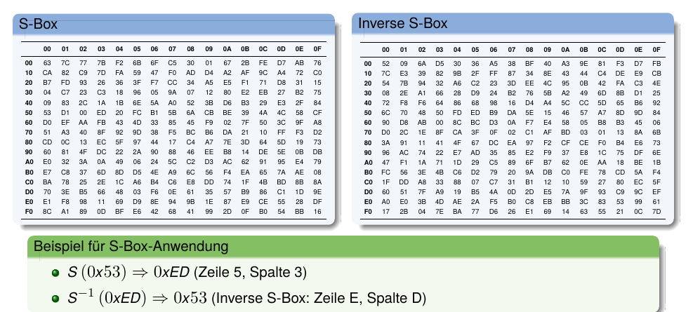
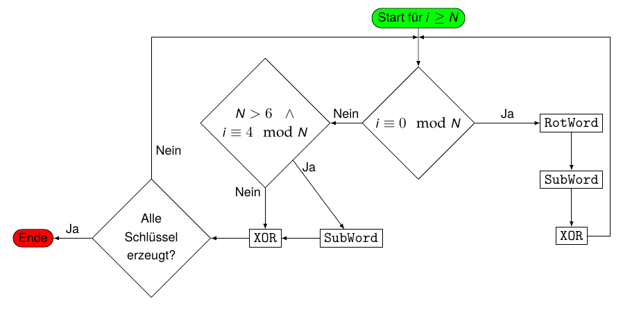
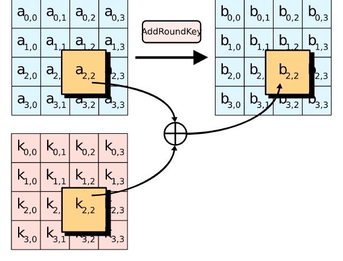
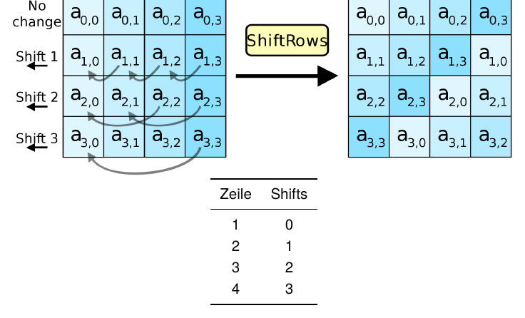
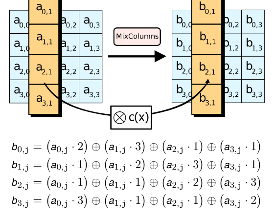
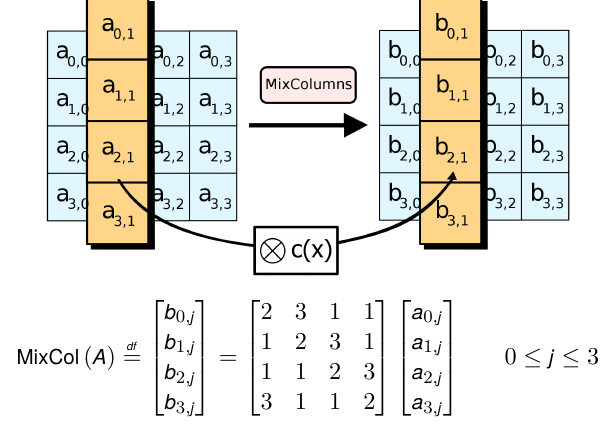

## AES {.title-slide data-state="hide-footer"}

Prof. Dr. Lukas Iffländer   
HTW Dresden  


---

## Agenda {.content-slide .agenda-slide}

<ul class="agenda">
<li class="agenda-item"><strong>01</strong>Entwicklung</li>
<li class="agenda-item"><strong>02</strong>Grundlagen</li>
<li class="agenda-item"><strong>03</strong>AES-Überblick</li>
<li class="agenda-item"><strong>04</strong>KeyExpansion</li>
<li class="agenda-item"><strong>05</strong>Rundenoperationen</li>
<li class="agenda-item"><strong>06</strong>Sicherheit</li>
</ul>

---

## Entwicklung {.content-slide .pdf-slide}
 

- **1990er** DES mit 56 Bit nicht mehr ausreichend sicher gegen Brute-Force-Angriffe
- **1997** offene Ausschreibung durch NIST
  - Kriterien:
    - symmetrischer Algorithmus und Blockchiffre
    - Blocklänge 128 Bit
    - Schlüssellänge 128, 192 und 256 Bit
    - leicht in Hard- und Software implementierbar
    - überdurchschnittliche Leistung in Hard- und Software
    - gegen alle bekannten Kryptoanalyseverfahren resistent
    - für Einsatz in Smartcards geringer Ressourcenbedarf
    - frei von Lizenzgebühren und Patenten
- **2000** Rijndael Algorithmus als Sieger gekürt
- **2001** Standardisierung von AES

---

## Grundlagen {.content-slide .pdf-slide}
 

Rijndaelchiffre mit:

- Bytes werden als Elemente des Körpers $F_{256}$ interpretiert.
- Blockgröße 128 Bits
- Schlüssellänge 128, 192 oder 256 Bit
- Schlüssellänge definiert die Anzahl von Verschlüsselungsrunden $R$:
  - 128 Bit $\rightarrow R = 10$
  - 192 Bit $\rightarrow R = 12$
  - 256 Bit $\rightarrow R = 14$
- AES arbeitet auf einer $4 \times 4$ Matrix von Bytes

::: {.callout-tip title="Word"}
Ein Word ist eine Sequenz von 4 Bytes (32 Bit). AES arbeitet grundsätzlich mit Words.
:::

---

## Überblick {.content-slide .pdf-slide}
 

1. KeyExpansion: $R + 1$ Rundenschlüssel werden ermittelt

2. Anfangsrunde:
   - AddRoundKey - jedes Byte wird mit dem Rundenschlüssel durch bitweises XOR kombiniert

3. Runden (wiederholt $R - 1$ mal):
   - SubBytes - nichtlineare Substitution durch Look-Up-Table (wie S-Box bei DES)
   - ShiftRows - Shiften jeder Zeile
   - MixColumns - Mischoperation, welche die Spalten kombiniert
   - AddRoundKey

4. Abschlussrunde:
   - SubBytes
   - ShiftRows
   - AddRoundKey

---

## KeyExpansion {.content-slide .pdf-slide}

- $N =$ Blockgröße in 32-Bit-Words
  - 4 für 128 Bit
  - 6 für 192 Bit
  - 8 für 256 Bit
- $K_0, K_1, \ldots, K_{N-1}$ sind die Words des Schlüssels
- $R =$ Anzahl der Runden
- $W_0, W_1, \ldots, W_{4(R+1)-1}$ sind die Wörter der Rundenschlüssel
- Rundenkonstanten

$$
rcon_i = [rc_i\quad 0x00\quad 0x00\quad 0x00]
$$

mit

$$
rc_i =
\begin{cases}
1 & \text{if } i = 1 \\
2 \cdot rc_{i-1} & \text{if } i > 1 \text{ and } rc_{i-1} < 0x80 \\
(2 \cdot rc_{i-1}) \oplus 0x11B & \text{if } i > 1 \text{ and } rc_{i-1} \ge 0x80
\end{cases}
$$

$(0x11B$ entspricht dem irreduziblen Polynom $x^8 + x^4 + x^3 + x + 1)$

---

## KeyExpansion {.image-slide}
### S-Box and Inverse S-Box

---

## KeyExpansion {.pdf-slide}

::: {.callout-note title="RotWord"}
RotWord ([b0 b1 b2 b3]) = [b1 b2 b3 b0]
:::

::: {.callout-note title="SubWord"}
SubWord ([b0 b1 b2 b3]) = [S (b0) S (b1) S (b2) S (b3)]
:::

::: {.callout-tip title="Algorithmus"}
$$
W_i =
\begin{cases}
K_i & \text{if } i < N \\
W_{i-N} \oplus \text{SubWord}(\text{RotWord}(W_{i-1})) \oplus \text{rcon}_{i/N} & \text{if } i \geq N \text{ und } i \equiv 0 \ (\text{mod } N) \\
W_{i-N} \oplus \text{SubWord}(W_{i-1}) & \text{if } i \geq N,\ N > 6,\ \text{und } i \equiv 4 \ (\text{mod } N) \\
W_{i-N} \oplus W_{i-1} & \text{sonst}
\end{cases}
$$

:::

---

## KeyExpansion {.image-slide}
### Grafische Darstellung

---

## AddRoundKey {.image-slide}

---

## ShiftRows {.image-slide}

---

## MixColumns {.image-slide}

---

## MixColumns {.image-slide}

---

## Bekannte Anwendungen {.content-slide .pdf-slide}
 

- IEEE 802.11i (z. B. eduroam)
- WPA2
- SSH
- IPsec
- IP-Telefonie
- Skype
- Festplattenverschlüsselung (Windows, macOS, Linux)
- 7zip, RAR

---

## Sicherheit {.content-slide .pdf-slide}
### Brute Force
 

::: {.callout-note title="Komplexität AES 256 Bit"}
Benötigte Versuche: $2^{256} = 1{,}2 \cdot 10^{77}$
:::

::: {.callout-tip title="Annahmen"}
- ein Versuch = 14 Runden $\times$ 16 Bytes = 224 Rechenschritte
- moderne Desktopgrafikkarte: 48 TFlops = $48 \cdot 10^{12}$ Flops
:::

::: {.callout-important title="Dauer"}
$0{,}54 \cdot 10^{66}\ s = 0{,}62 \cdot 10^{61}\ d = 1{,}7 \cdot 10^{58}\ a$
:::

- Brute-Force-Angriff mit aktueller Hardware nicht durchführbar.

---

## Sicherheit {.content-slide .pdf-slide}
### Schwächen
 

- Gute Hardwareimplementierbarkeit erleichtert Entwicklung von Angriffshardware
- Bestimmte "schwache" Schlüssel können die effektive Sicherheitsmarge um bis zu 5 Runden reduzieren (theoretisch)
- AES lässt sich als großes Gleichungssystem darstellen, was algebraische Angriffe ermöglicht
- Aus einem beliebigen Rundenschlüssel lassen sich 128 Bit des Ausgangsschlüssels rekonstruieren
- Side-Channel-Angriffe (Timing, Stromverbrauch) bei ungeschützten Implementierungen möglich

#### Hinweis

Alle bekannten Schwächen sind bisher nur von theoretischer Bedeutung und ermöglichen keine praktischen Angriffe auf korrekt implementiertes AES.

---

## Sicherheit {.content-slide .pdf-slide}
### Angriffe
  

#### Biclique-Angriff (2011)

- Von Dmitry Khovratovich, Ivica Nikolić und Christian Rechberger
- Reduziert theoretische Komplexität auf $2^{254{,}4}$ für AES-256
- Praktisch nicht durchführbar (nur geringfügig besser als Brute Force)

#### Kettenbruch-Angriff (2002)

- Durch Niels Ferguson et al.
- Darstellung von AES als BES (arbeitet auf 128-Byte-Blöcken)
- Theoretische Reduktion der Komplexität auf $2^{100}$
- Nur von akademischem Interesse

--- 

## Sicherheit {.content-slide .pdf-slide}
### Angriffe II
 

#### Angriff durch verwandte Schlüssel (2009)

- Ausnutzung von Schwächen in der Schlüsselexpansion
- Theoretische Komplexität: $2^{99{,}5}$ für AES-256
- Erfordert unrealistische Annahmen (Angreifer kann verwandte Schlüssel wählen)

---

## Bewertete Aufgabe {.content-slide .pdf-slide}
 

#### Aufgabenstellung

Implementierung von AES-128

- Programmiersprache: C/C++

#### Hinweis

Nutzen Sie keine fertigen AES-Bibliotheken. Ziel ist das Verständnis des Algorithmus!

---

## Vielen Dank! {.title-slide data-state="hide-footer"}

Prof. Dr. Lukas Iffländer   
HTW Dresden  

