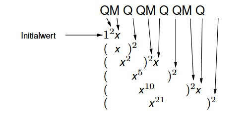
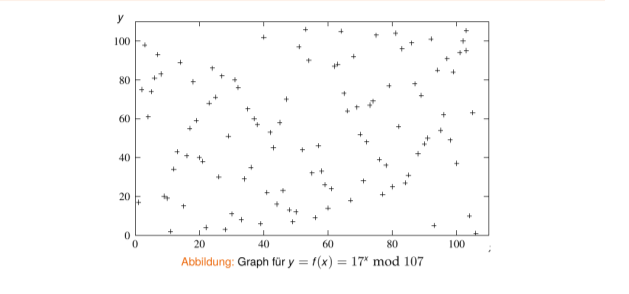
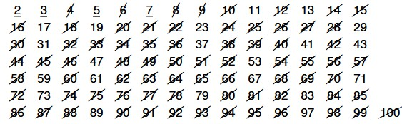
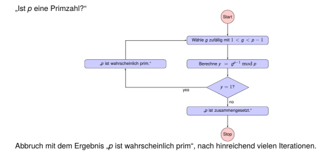
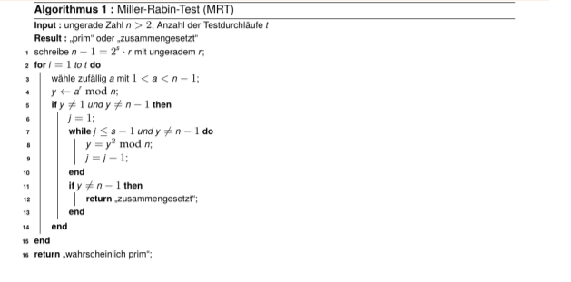
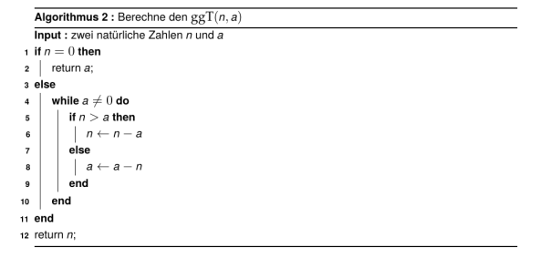
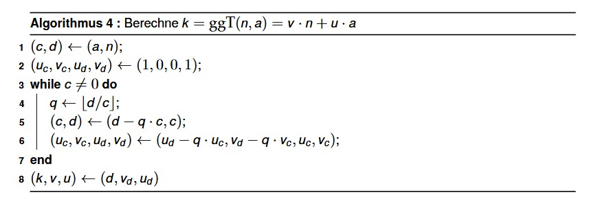
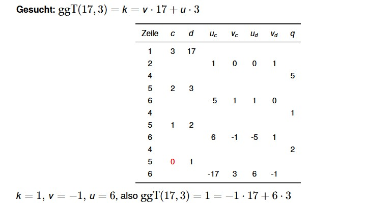

## Zahlentheorie {.title-slide data-state="hide-footer"}


Prof. Dr. Lukas Iffländer   
HTW Dresden  


---

## Agenda {.content-slide .agenda-slide}

<ul class="agenda">
<li class="agenda-item"><strong>01</strong><span>Motivation</span></li>
<li class="agenda-item"><strong>02</strong><span>Restklassen und modulo</span></li>
<li class="agenda-item"><strong>03</strong><span>Modulare Exponentiation</span></li>
<li class="agenda-item"><strong>04</strong><span>Diskreter Logarithmus</span></li>
<li class="agenda-item"><strong>05</strong><span>Primzahlen und Primzahltests</span></li>
<li class="agenda-item"><strong>06</strong><span>ggT, Euler und Inverse</span></li>
</ul>

---

## Warum Zahlentheorie? {.content-slide .pdf-slide}
<br>

- Zahlentheorie bildet die mathematische Grundlage moderner Kryptografie
- Asymmetrische Verfahren (RSA, Diffie-Hellman) basieren auf:
  - Rechnen mit Restklassen (modulare Arithmetik)
  - Eigenschaften von Primzahlen
  - Einwegfunktionen (leicht zu berechnen, schwer umzukehren)
- Zentrale Frage: Welche Operationen sind effizient durchführbar, welche sind praktisch unmöglich?

---

## Rechnen mit Restklassen {.content-slide .pdf-slide}
<br>

- **Beispiel:** Rudi ist um 7:00 Uhr aufgestanden und seit 34 Stunden wach. Wie spät ist es?

$$
(7 + 34) \bmod 24 = 41 \bmod 24 = 17 \bmod 24
$$

Es ist offensichtlich 17:00 Uhr.

- Man spricht: "41 und 17 sind äquivalent modulo 24" und notiert

$$
41 \equiv 17 \pmod{24}.
$$

---

## Rechnen mit Restklassen {.content-slide .pdf-slide data-state="hide-footer"}
<br>

Allgemein gilt

$$
a \equiv b \pmod n \Longleftrightarrow \exists k \in \mathbb{Z}: a = b + kn
$$

- wenn $a > 0$ und $0 \le b < n$, dann ist $b$ der Rest bei Division von $a$ durch $n$.

- $a \bmod n$ wird häufig modulare Reduktion (von $a$) genannt.

#### Rechenregeln

$$
(a + b) \bmod n = ((a \bmod n) + (b \bmod n)) \bmod n
$$

$$
(a - b) \bmod n = ((a \bmod n) - (b \bmod n)) \bmod n
$$

$$
(a \cdot b) \bmod n = ((a \bmod n) \cdot (b \bmod n)) \bmod n
$$

$$
(a \cdot (b + c)) \bmod n = ((a \cdot b \bmod n) + (a \cdot c \bmod n)) \bmod n
$$

- häufig in der Kryptografie eingesetzt, da bestimmte Berechnungen modulo $n$ schwierig[^schwierig] sind.
- Zwischenergebnisse haben beschränkten Wertebereich.

[^schwierig]: im Sinne von "sehr lange dauern"


---

## Modulare Exponentiation {.content-slide .pdf-slide}
<br>

Eine wichtige Operation, z. B. für RSA, ist

$$
a^x \bmod n
$$

**Berechnung** am Beispiel $y = 3^8 \bmod 7$:

1. naiver Ansatz

$$
y = (3 \cdot 3 \cdot 3 \cdot 3 \cdot 3 \cdot 3 \cdot 3 \cdot 3) \bmod 7 = 6561 \bmod 7 = 2
$$

-> Zwischenergebnis sehr groß (6561), schlecht zu speichern

2. Kombination von Potenzierung und modularer Reduktion

$$
y = ((3^2 \bmod 7)^2 \bmod 7)^2 \bmod 7 = ((9 \bmod 7)^2 \bmod 7)^2 \bmod 7 = 2
$$

-> Zwischenergebnisse bleiben klein ($\le 49$), nur 3 Multiplikationen
<br>

Schön und gut - was aber, wenn $x$ keine Zweierpotenz ist?

---

## Modulare Exponentiation {.content-slide .pdf-slide}
### Binäre Exponentiation ("Square-and-Multiply") von $x^e$
<br>

**Idee:** Binärdarstellung des Exponenten $e$ drückt diesen als Summe von Zweierpotenzen aus!

Algorithmus zur Berechnung von $y = x^e$:

- $e$ als Binärzahl darstellen
- Binärdarstellung von $e$ bitweise von links beginnend lesen:
  - wenn Bit = 1, dann "QM" notieren
  - wenn Bit = 0, dann "Q" notieren
- Initialwert: $y = 1$
- wiederum von links beginnend generierte Zeichenkette analysieren:
  - wenn Zeichen = "Q", dann $y$ quadrieren
  - wenn Zeichen = "M", dann $y$ mit $x$ multiplizieren

---

## Modulare Exponentiation {.content-slide .image-slide}
### Binäre Exponentiation - Beispiel

Berechnung von $x^{42}$

Es gilt:

$$
42_{10} = 101010_2
$$

d.h.

$$
42 = 2^5 + 2^3 + 2^1
$$

$$
42 = 1\ 0\ 1\ 0\ 1\ 0
$$




d.h.,

$$
x^{42} = ((((x^2)^2 \cdot x)^2)^2 \cdot x)^2
$$

---

## Modulare Exponentiation {.content-slide .pdf-slide}
### Binäre Exponentiation – Beispiel

Berechnung von $x^{42}$

Es gilt:

$$42_{10} = 101010_2$$

d.h.

$$42 = 2^5 + 2^3 + 2^1 = 1\ 0\ 1\ 0\ 1\ 0$$


$$x^{42} = ((((x^2)^2 \cdot x)^2)^2 \cdot x)^2$$

--- 

## Modulare Exponentiation {.content-slide .pdf-slide}
### Kombination mit Modulo-Operation: Berechnung von $y = x^e \bmod p$
<br>

da gilt:

$$
(a \cdot b) \bmod n = ((a \bmod n) \cdot (b \bmod n)) \bmod n,
$$

muss Modulo-Operation nach jeder Multiplikation und nach jeder Quadrierung ausgeführt werden

**Beispiel:** Berechnung von $x^{25} \bmod p$

Es gilt:

$$
25_{10} = 11001_2,\ \text{d. h. } QM\ QM\ Q\ Q\ QM
$$

$$
x^{25} \bmod p =
(((((((x^2 \bmod p) \cdot x) \bmod p)^2 \bmod p)^2 \bmod p)^2 \bmod p) \cdot x) \bmod p
$$

- benötigt 6 Multiplikationen und 6 Modulo-Operationen

---

## Diskreter Logarithmus {.content-slide .pdf-slide}
<br>

**Def.** Eine primitive Wurzel modulo $p$ ist eine Zahl $a$, deren Potenzen modulo $p$ alle Werte zwischen 1 und $p - 1$ generieren kann.

**Beispiel:** 5 ist eine primitive Wurzel modulo 7:

$$
5^1 = 5 \pmod 7
$$

$$
5^2 \equiv 5 \cdot 5 \equiv 4 \pmod 7
$$

$$
5^3 \equiv 4 \cdot 5 \equiv 6 \pmod 7
$$

$$
5^4 \equiv 6 \cdot 5 \equiv 2 \pmod 7
$$

$$
5^5 \equiv 2 \cdot 5 \equiv 3 \pmod 7
$$

$$
5^6 \equiv 3 \cdot 5 \equiv 1 \pmod 7
$$

Das bedeutet: Für jedes $y < p$ können wir das $x$ ermitteln, welches die Gleichung

$$
f(x) = y = a^x \bmod p
$$

erfüllt. Wir nennen $x$ den diskreten Logarithmus modulo $p$ von $y$.

---

## Grafische Darstellung {.image-slide}



---

## Diskreter Logarithmus {.content-slide .pdf-slide}
<br>

Schlussfolgerung:

- **Vorwärtsrichtung:** Modulare Exponentiation $f(x) = a^x \bmod p$ ist leicht zu berechnen (polynomial, mittels Square-and-Multiply).
- **Rückwärtsrichtung:** Umkehrung der modularen Exponentiation ("diskreter Logarithmus") ist sehr schwierig.
  - Für große Primzahlen $p$ (z. B. 2048 Bit) existiert kein effizienter Algorithmus
  - Bester bekannter Ansatz benötigt exponentiell viele Schritte
- **Einwegfunktion** - Basis für Diffie-Hellman und ElGamal

---

## Primzahlen {.content-slide .pdf-slide data-state="hide-footer"}
<br>

**Def.** Eine natürliche Zahl $p > 1$ ist eine Primzahl, wenn sie genau zwei positive Teiler hat: 1 und sich selbst.

- 0 und 1 sind keine Primzahlen (per Definition).
- Beispiele: 2, 3, 5, 7, 11, ..., 73, ..., $2^{82.589.933} - 1$ (gegenwärtig größte bekannte)[^mersenne].
- Primzahlen mit Abstand 2 sind so genannte Primzahlzwillinge[^zwillinge]; z. B. (3,5), (101, 103), $(3756801695685 \cdot 2^{666669} \pm 1)$.
- Hat $p$ mehr als 2 Teiler, so ist sie eine zusammengesetzte Zahl (ein Produkt von Primzahlen).
- Kein Verfahren, keine Funktion, keine Formel usw. bekannt, um effizient (große) Zahlen in Primfaktoren zu zerlegen.

[^mersenne]: am 21. 12. 2018 gefunden; vgl. http://www.mersenne.org/

[^zwillinge]: Deren (Un)endlichkeit ist bislang nicht bewiesen.

---

## Primzahlen {.content-slide .pdf-slide}
### Unendlichkeit von Primzahlen
<br>

**Satz:** Es gibt unendlich viele Primzahlen.

**Beweis** (Euklid, ca. 300 v. u. Z.):

- Angenommen, es gäbe nur endlich viele Primzahlen $p_1, p_2, \ldots, p_n$.

- Betrachte die Zahl $m = p_1 \cdot p_2 \cdot \ldots \cdot p_n + 1$.

- Falls $m$ zusammengesetzt ist, muss sie einen Primfaktor $q$ enthalten mit
$q \mid m = p_1 \cdot p_2 \cdot \ldots \cdot p_n + 1$.

- Da $q$ in $\{p_1, p_2, \ldots, p_n\}$ enthalten sein muss (denn das sind alle Primzahlen, die es gibt), muss auch gelten

$$
q \mid p_1 \cdot p_2 \cdot \ldots \cdot p_n = m - 1.
$$

- Aus $q \mid m$ und $q \mid (m - 1)$ folgt $q \mid m - (m - 1)$, also $q \mid 1$.

- Da aber keine Primzahl 1 teilt, haben wir einen Widerspruch. Die Annahme endlich vieler Primzahlen ist somit falsch.

---

## Generierung von Primzahlen {.content-slide .pdf-slide}
### Übersicht über Verfahren
<br>

- Probedivision
- Sieb des Eratosthenes
- Fermatscher Primzahltest
- Miller-Rabin-Test (1974)
- Solovay-Strassen-Test (1977)
- Sieb von Atkin (1999)
- AKS-Primzahltest (2002; polynomielle Laufzeit) [1]

---

## Generierung von Primzahlen {.content-slide .pdf-slide}
### Sieb des Eratosthenes (Eratosthenes von Kyrene, ca. 276-196 v. u. Z.)
<br>

#### Algorithmus
1. Man schreibe alle Zahlen von 2 bis zum gewünschten Maximum M auf.
2. Es sei n die kleinste nicht gestrichene und nicht markierte Zahl. Man markiere n und streiche dann
alle Vielfache von n aus.
3. Man führe Schritt 2 für alle n ≤ √M aus.
4. Alle markierten und alle nicht gestrichenen Zahlen sind Primzahlen.

#### Beispiel (M=100):



---

## Primzahltest nach Fermat {.content-slide .pdf-slide}
### Kleiner Satz des Fermat
<br>

::: {.callout-note title="Satz 1.1 (Kleiner Satz des Fermat)"}
**Voraussetzung:** $p$ sei prim, $g \in \mathbb{Z}$, $ggT(g, p) = 1$.

Dann gilt:

$$
g^{p-1} \equiv 1 \pmod p.
$$
:::


::: {.callout-note title="Umkehrung"}

**Umkehrung** des Satzes: Wenn gilt:

$$
g^{p-1} \not\equiv 1 \pmod p,
$$

dann kann $p$ keine Primzahl sein, sondern muss zusammengesetzt sein.
::: 

-> Grundidee für einen (probabilistischen) Primzahltest.

---

## Primzahltest nach Fermat {.image-slide}



---

## Primzahltest nach Fermat {.content-slide .pdf-slide}
### Fermatsche Pseudoprimzahlen, Carmichael-Zahlen
<br>

::: {.callout-important title="Problem"}
Es gibt einige (wenige) Zahlen $p$, für die $g^{p-1} \equiv 1 \pmod p$ gilt und die dennoch zusammengesetzt sind, die so genannten fermatschen Pseudoprimzahlen zur Basis $g$.
:::

**Abhilfe:** Nutzung einer anderen Basis $g$

::: {.callout-important title="Problem 2"}
Es gibt (sehr, sehr wenige) Zahlen $p$, für die $g^{p-1} \equiv 1 \pmod p\ \forall\ 1 < g < p - 1$ gilt und die dennoch zusammengesetzt sind, die so genannten Carmichael-Zahlen.
:::

**Abhilfe:** keine bzw. Nutzung eines anderen Primzahltests.

**Beispiel**

$561 = 3 \cdot 11 \cdot 17$ ist die kleinste Carmichael-Zahl.

---

## Miller-Rabin-Test (MRT) {.image-slide}



---

## Miller-Rabin-Test (MRT) {.content-slide .pdf-slide}
<br>

**Beispiel:** Test von $n = 91$ mit $t = 3$ Durchläufen

- $n = 91, t = 3$
- $91 - 1 = 2^1 \cdot 45 \qquad r = 45, s = 1$
- $a = 12,\ y = 12^{45} \bmod 91 = 90 \qquad$ "prim"
- $a = 17,\ y = 17^{45} \bmod 91 = 90 \qquad$ "prim"
- $a = 34,\ y = 34^{45} \bmod 91 = 34 \qquad$ "zusammengesetzt!"

$a = 12$ und $a = 17$ werden "Lügner" (liars) bzgl. der Eigenschaft "prim" genannt. (Tatsächlich: $91 = 7 \cdot 13$)

---

## Eulersche $\phi$-Funktion {.content-slide .pdf-slide}
<br>

::: {.callout-note title="Definition 1.1 (Eulersche $\phi$-Funktion)"}
$\phi(n)$ ist die Anzahl der zu $n$ teilerfremden positiven ganzen Zahlen, die nicht größer sind als $n$.

$$
\phi(n) = \left|\{1 \le a \le n \mid ggT(n, a) = 1\}\right|
$$

$\phi(n)$ ist die Mächtigkeit der Menge, die alle Zahlen $a$ enthält, die teilerfremd zu $n$ sind.
:::


- zahlentheoretische Funktion
- Beispiele:
  - $\phi(1) = 1$
  - $\phi(2) = 1$
  - $\phi(6) = 2 \qquad (a \in \{1, 5\})$
  - $\phi(7) = 6 \qquad$ (Primzahl!)
  - $\phi(15) = 8 \qquad (a \in \{1, 2, 4, 7, 8, 11, 13, 14\})$

---

## Eulersche $\phi$-Funktion und Primzahlen {.content-slide .pdf-slide}
<br>

- Wenn $p$ prim, dann $\phi(p) = p - 1$.
- Wenn $p$ und $q$ prim, dann $\phi(p \cdot q) = (p - 1)(q - 1)$.
- wichtig für RSA!

**Beweis:**

- Es gibt genau $p \cdot q - 1$ Zahlen, die kleiner als $p \cdot q$ sind.
- Unter diesen gibt es $(p - 1)$ Vielfache von $q$ und $(q - 1)$ Vielfache von $p$.
- Alle anderen Zahlen $< p \cdot q$ sind keine Teiler von $p \cdot q$, da $p$ und $q$ prim sind.
- Folglich gilt:

$$
\phi(p \cdot q) = (p \cdot q - 1) - (p - 1) - (q - 1)
$$

$$
= p \cdot q - p - q + 1
$$

$$
= (p - 1)(q - 1).
$$

---

## Der Satz von Euler {.content-slide .pdf-slide}
<br>

::: {.callout-note title="Definition 1.2 (Satz von Euler)"}
Es seien $m, n$ zwei teilerfremde natürliche Zahlen. Dann gilt:

$$
m^{\phi(n)} \bmod n = 1.
$$
:::

Für Primzahlen $p, q$ mit $p \ne q$ und $n = p \cdot q$ gilt damit (vgl. vorherige Folie)

$$
m^{(p-1)(q-1)} \bmod (p \cdot q) = 1.
$$

---

## Größter gemeinsamer Teiler (ggT) {.content-slide .pdf-slide}
### Berechnung über Primfaktorzerlegung
<br>

**Idee:**

- Zerlegung beider Operanden in Primfaktoren
- Produkt der gemeinsamen Faktoren ist der ggT.

**Beispiel:** $ggT(468, 1260)$

Zerlegung in Primfaktoren liefert:

$$
468 = 2 \cdot 2 \cdot 3 \cdot 3 \cdot 13
$$

$$
1260 = 2 \cdot 2 \cdot 3 \cdot 3 \cdot 5 \cdot 7
$$

$$
ggT = 2 \cdot 2 \cdot 3 \cdot 3 = 36
$$

- nur für kleine Zahlen praktikabel, da Primfaktorzerlegung algorithmisch aufwändig für große Zahlen

---

## Größter gemeinsamer Teiler (ggT) {.image-slide}
### Euklidischer Algorithmus (ca. 500 v. u. Z.)



---

## Größter gemeinsamer Teiler (ggT) {.content-slide .pdf-slide}
### Euklidischer Algorithmus (ca. 500 v. u. Z.)
<br>

- sukzessive Subtraktion kann effizient auf modulo-Operation abgebildet werden:

$$
ggT(n, a) =
\begin{cases}
ggT(a, (n \bmod a)) & \text{für } a > 0 \\
n & \text{für } a = 0
\end{cases}
$$

- mit $n > a \ge 0$

```{.text}
Algorithmus 3: Berechne den ggT(n, a) (Modulo-Variante); gibt n zurück

while a != 0 do
    h <- n mod a
    n <- a
    a <- h
end
```

---

## Euklidischer Algorithmus {.content-slide .pdf-slide}
### Beispiel
<br>

$$
ggT(792, 75) = ggT(75, 42) \qquad (792 = 10 \cdot 75 + 42)
$$

$$
= ggT(42, 33) \qquad (75 = 1 \cdot 42 + 33)
$$

$$
= ggT(33, 9) \qquad (42 = 1 \cdot 33 + 9)
$$

$$
= ggT(9, 6) \qquad (33 = 3 \cdot 9 + 6)
$$

$$
= ggT(6, 3) \qquad (9 = 1 \cdot 6 + 3)
$$

$$
= ggT(3, 0) \qquad (6 = 2 \cdot 3 + 0)
$$

$$
= 3
$$

**Fazit:**

- effizienter Algorithmus (viel effizienter als Primfaktorzerlegung!).

---

## Erweiterter Euklidischer Algorithmus {.pdf-slide}
<br>

generiert zusätzlich zum ggT eine so genannte Linearkombination (aka Vielfachsumme) des ggT:
$$ggT(n, a) = k = v · n + u · a$$



---

## Erweiterter Euklidischer Algorithmus {.image-slide}
### Beispiel



---

## Modulare Inverse {.content-slide .pdf-slide}
<br>

::: {.callout-note title="Satz 1.2 (Satz von der modularen Inversen)"}
Seien $a$ und $n$ teilerfremde ganze Zahlen (d. h., $ggT(n, a) = 1$). Dann gibt es eine Ganzzahl $b$, so dass gilt:

$$
a \cdot b \bmod n = 1.
$$


("a ist modulo $n$ invertierbar.", "$b$ ist das zu $a$ inverse multiplikative Element modulo $n$.")
:::

**Beweis:**

- wenn $k = 1$, dann gibt es lt. erweitertem euklidischen Algorithmus ganze Zahlen $v, u$ mit

$$
1 = k = ggT(n, a) = v \cdot n + u \cdot a.
$$

- Bei (Modulo-)Division durch $n$ liefert linke Seite den Wert 1, rechte Seite den Wert $u \cdot a \bmod n$ (da $v \cdot n$ durch $n$ teilbar).

- Also gilt:

$$
1 = u \cdot a \bmod n
$$

- Mit $u = b$ folgt die Behauptung.

---

## Literaturverzeichnis I {.content-slide .pdf-slide}
<br>

[1] Manindra Agrawal, Neeraj Kayal und Nitin Saxena. PRIMES Is in P on JSTOR. [Online; accessed 8. Apr. 2024]. Sep. 2004. url: https://www.jstor.org/stable/3597229.

---

## Vielen Dank! {.title-slide data-state="hide-footer"}


Prof. Dr. Lukas Iffländer   
HTW Dresden  

