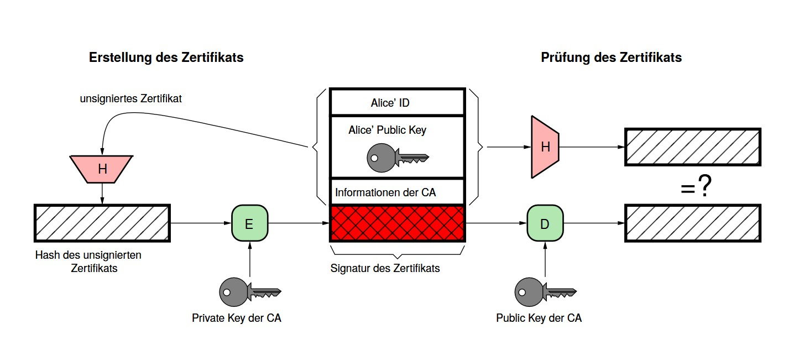
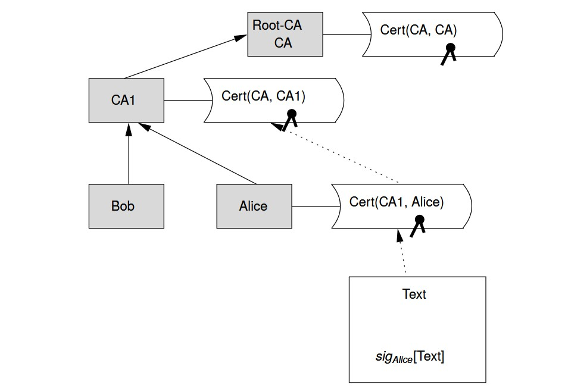
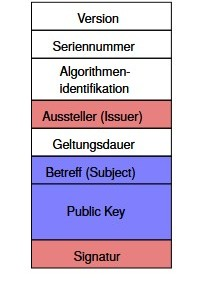
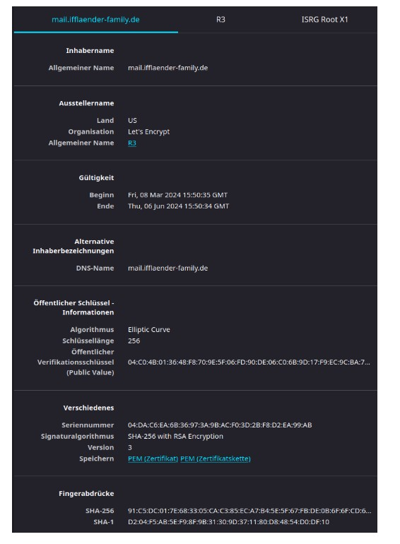
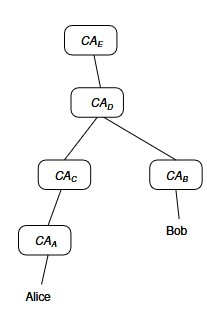
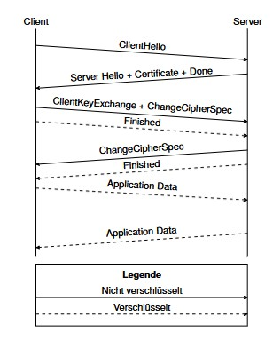
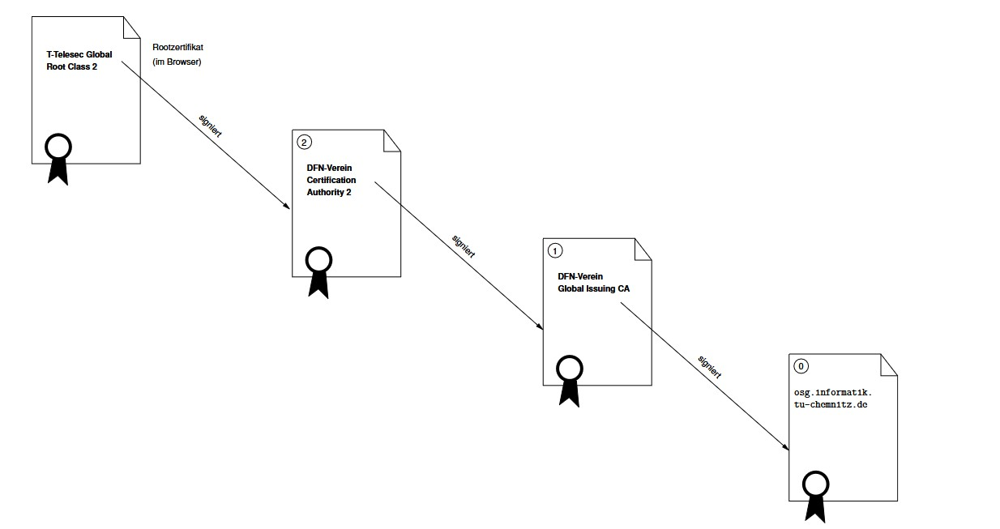
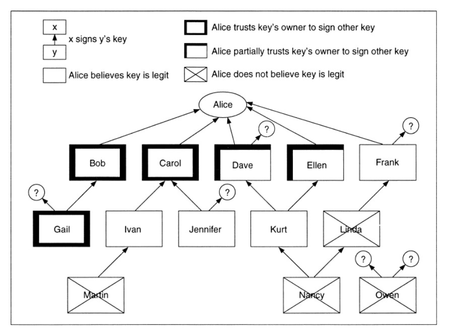

## Schlüsselverwaltung {.title-slide data-state="hide-footer"}


Prof. Dr. Lukas Iffländer   
HTW Dresden  


---

## Agenda {.content-slide .agenda-slide}

<ul class="agenda">
<li class="agenda-item"><strong>01</strong><span>Zertifikate</span></li>
<li class="agenda-item"><strong>02</strong><span>Public Key Infrastructure</span></li>
<li class="agenda-item"><strong>03</strong><span>Certification Authorities</span></li>
<li class="agenda-item"><strong>04</strong><span>TLS-Zertifikate</span></li>
<li class="agenda-item"><strong>05</strong><span>PGP und GPG</span></li>
<li class="agenda-item"><strong>06</strong><span>Schlüsselsicherheit</span></li>
</ul>

---

## Lernziele {.content-slide .pdf-slide}
<br>

Nach dieser Einheit können Sie ...

- X.509-Zertifikate lesen (Issuer/Subject, SAN, Laufzeit)
- Zertifikatsketten bis zur Root CA prüfen
- Widerrufsmechanismen (CRL, OCSP, Stapling) einordnen
- den TLS-Handshake skizzieren (TLS 1.2/1.3, (EC)DHE)
- PGP/GPG-Grundlagen anwenden (Signieren, Verifizieren, Export)

---

## Management öffentlicher Schlüssel {.content-slide .pdf-slide}
<br>

- Problem: Übereinstimmung öffentlicher Schlüssel – Identität    

- Lösung: **Zertifikat** = Nachricht, die
  - Repräsentation der Identität,
  - zugehörigen öffentlichen Schlüssel,
  - Zeitstempel oder Geltungsdauer
enthält und durch eine vertrauenswürdige Instanz (Trent, „Issuer“, Certification Authority) signiert
wurde.

::: {.callout-tip title=""}
Def.: Ein Zertifikat ist eine Einheit, die einen kryptografischen Schlüssel an eine Identität bindet.
:::


---

## Zertifikate für öffentliche Schlüssel {.image-slide}



---

## Management öffentlicher Schlüssel
### Aufbau eines Zertifikats; formal {.content-slide .pdf-slide}
<br>


Ein durch Zertifizierungsinstanz CA ausgestelltes Zertifikat für Nutzer A enthält:

$$
Cert(CA,A) = \{ID_{CA}, ID_A, e_A, T, Ext, sig_{CA}\}
$$

mit

$$
sig_{CA} = d_{CA}\{H(ID_{CA}, ID_A, e_A, T, Ext)\}
$$

**Legende:**

- $ID_A$: eindeutiger Name des Teilnehmers A
- $e_A$: öffentlicher Schlüssel des Teilnehmers A
- $d_{CA}$: privater Schlüssel der CA
- $T$: Gültigkeitszeitraum des Zertifikats

---

## Verifikation einer digitalen Signatur {.content-slide .pdf-slide}
<br>

**Schritt 1: Verifikation der Signatur**

Bob möchte Alice' Signatur eines Dokuments prüfen. Dazu muss er:

1. Alice' Zertifikat besorgen (enthält den zur Unterschrift passenden öffentlichen Schlüssel $e_A$),
2. mit $e_A$ den ursprünglichen Hashwert des Dokuments $H_1$ entschlüsseln,
3. den aktuellen Hashwert des Dokuments $H_2$ ermitteln,
4. Die Signatur passt zum Dokument, wenn $H_1 = H_2$.

---

## Verifikation einer digitalen Signatur {.content-slide .pdf-slide}
<br>

**Schritt 2: Verifikation des Zertifikates**

Nun muss Bob prüfen, ob das Zertifikat stimmt:

1. den öffentlichen Schlüssel $e_{CA}$ der CA besorgen, die Alice' Zertifikat ausgestellt hat,
2. mit $e_{CA}$ den ursprünglichen Hashwert des Zertifikats $H_3$ entschlüsseln,
3. den aktuellen Hashwert des Zertifikats $H_4$ ermitteln,
4. das Zertifikat ist gültig, wenn $H_3 = H_4$.

---

## Bob verifiziert Alice' Signatur {.image-slide}
### Prinzipielle Struktur einer Public Key Infrastructure (PKI)



---

## Aufbau eines Zertifikats {.image-slide}
### X.509 (ISO Authentication Framework)

::: {.columns}

::: {.column width="44%"}



:::

::: {.column width="56%"}
- Version: des Protokolls (1, 2 oder 3)
- Seriennummer: eindeutig innerhalb der CA
- Algorithmus: der Signatur (zum Nachvollzug)
- Aussteller: eindeutiger Name der CA
- Subject (Inhaber): Identität, der der öffentliche
Schlüssel zugeordnet ist
- Subject Alternative Name (SAN):
Hostname/URI/E-Mail für Prüfungen
- Key Usage/EKU: erlaubte Verwendungen (z. B.
TLS-Server)
- Signatur: ausgestellt durch CA
:::

::::

---

## Zertifikatseigenschaften {.image-slide}



---

## Namen im X.509-Zertifikat {.content-slide .table-slide}
<br>

Benennung von Issuer und Subject in X.509 erfolgt mittels hierarchischem Distinguished Naming des X.500-Protokolls mit den folgenden Feldern:

| Kürzel | Bedeutung | Beispiel |
|---|---|---|
| CN | Common Name | `rtypo3p.rz.htw-dresden.de` |
| E | E-Mail-Adresse | `certificate@trustcenter.de` |
| O | Organization Name | TC TrustCenter for Security |
| OU | Organizational Unit (Organisationseinheit) | TC TrustCenter Class 2 CA in Data Networks GmbH |
| L | Locality Name | Hamburg |
| ST | State Name | Hamburg |
| C | Country | DE |

---

## Certification Authorities {.content-slide .image-slide}

**Def.:** Eine Einheit, die Zertifikate ausstellt, wird Certification Authority (CA) genannt.

:::: {.columns}

::: {.column width="44%"}

:::

::: {.column width="56%"}
- Untergeordnete CAs besitzen Zertifikate, die von der jeweils übergeordneten CA signiert sind.
- Zuoberst: Root CA (hier: CAE) als Vertrauensanker.
- Es entsteht eine Zertifizierungshierarchie.
- CAs können sich gegenseitig zertifizieren (Cross Certification).

:::

::::


---

## Certification Authorities {.content-slide .pdf-slide}
<br>

Einige Unternehmen bieten Zertifizierung als Dienstleister an, z. B. (historisch und aktuell):

- VeriSign (heute Teil von DigiCert), Thawte
- DigiCert, Sectigo (ehemals Comodo), GlobalSign, Entrust

Darüber hinaus gibt es gemeinnützige oder akademische Organisationen:

- Internet Security Research Group (Let's Encrypt)
- DFN e. V. (DFN-PKI für Hochschulen)

Zertifikate der Root-CAs sind in typischer Software (Browser) eingebaut.

---

## Problem des zentralisierten Modells {.content-slide .pdf-slide}
<br>

::: {.callout-important title="Problem"}
Kann man der CA unbedingt vertrauen?
:::

**Antwort:** Leider nein:

- Einbruch in (niederländische) Firma DigiNotar 2011, Angreifer stellten sich unberechtigte Zertifikate aus, diese wurden missbräuchlich zur Überwachung iranischer Bürger genutzt[^diginotar]
- (türkische) CA Türktrust stellte im August 2011 irrtümlich 2 Zertifikate aus, mit denen sich beliebige Domains zertifizieren lassen

[^diginotar]: <https://securitylab.disi.unitn.it/lib/exe/fetch.php?media=teaching:offtech:2014:black-tulip-update.pdf>

---

## Widerruf von Zertifikaten (Certificate Revocation) {.content-slide .pdf-slide}
<br>


Problem: Schlüssel können vor ihrem "Verfallsdatum" ungültig werden, z. B. bei Kompromittierung eines privaten Schlüssels -> zugehöriges Zertifikat muss zurückgezogen werden

**a) Certificate Revocation List (CRL)**

- signierte Sperrliste der CA mit allen widerrufenen Zertifikaten
- beim Prüfen eines Zertifikates muss CRL durchsucht werden
- Voraussetzung: Teilnehmer sind permanent online

**b) Kurzlebige Zertifikate (Short-Lived Certificates)**

- kurze Gültigkeitsdauer des Zertifikats (z. B. 24-72 h)
- nutzt Mechanismus der begrenzten Lebensdauer
- Voraussetzung: Teilnehmer sind permanent online

---

## Exkurs: TLS {.content-slide .pdf-slide}
<br>

**Transport Layer Security**

- "S" in HTTPS
- primäre Motivation historisch: E-Payment im Netz
- © Netscape (SSL 2.0/3.0); heute: TLS 1.2/1.3
- komplexer Standard    

Sicherer Kanal zwischen Client und Server     

- Vertraulichkeit: Verschlüsselte Kommunikation
- Authentisierung: Zertifikate und vertrauenswürdige CAs

---

## Verbindungsaufbau: TLS-Handshake {.image-slide}

:::: {.columns}

::: {.column width="44%"}

:::

::: {.column width="56%"}
1. ClientHello: Cipher Suites
(Schlüsselaustausch, Verschlüsselung, MAC),
TLS-Version
2. ServerHello: gewählte Verfahren, Zertifikat
des Servers, optional »Client Certificate
Request«
3. Schlüsselaustausch: (EC)DHE, gemeinsame
Sitzungsschlüssel werden abgeleitet (in TLS
1.3 kein RSA-Keytransport)

:::

::::


---

## Prüfung des TLS-Zertifikats {.content-slide .code-slide}
### Beispiel einer Zertifikatskette
<br>

```{.text}
$ openssl s_client -connect htw-dresden.de:443 -servername htw-dresden.de -showcerts \
    2>/dev/null </dev/null
Certificate chain
 0 s:C=DE, ST=Sachsen, O=Hochschule für Technik und Wirtschaft Dresden,
   CN=rtypo3p.rz.htw-dresden.de
   i:C=NL, O=GEANT Vereniging, CN=GEANT OV RSA CA 4
   a:PKEY: rsaEncryption, 4096 (bit); sigalg: RSA-SHA384
   v:NotBefore: Aug 2 00:00:00 2023 GMT; NotAfter: Aug 1 23:59:59 2024 GMT
 1 s:C=GB, ST=Greater Manchester, L=Salford, O=Comodo CA Limited, CN=AAA Certificate [...]
   i:C=GB, ST=Greater Manchester, L=Salford, O=Comodo CA Limited, CN=AAA Certificate [...]
   a:PKEY: rsaEncryption, 2048 (bit); sigalg: RSA-SHA1
   v:NotBefore: Jan 1 00:00:00 2004 GMT; NotAfter: Dec 31 23:59:59 2028 GMT
 2 s:C=US, ST=New Jersey, L=Jersey City, O=The USERTRUST Network, CN=USERTrust RSA [...]
   i:C=GB, ST=Greater Manchester, L=Salford, O=Comodo CA Limited, CN=AAA Certificate [...]
   a:PKEY: rsaEncryption, 4096 (bit); sigalg: RSA-SHA384
   v:NotBefore: Mar 12 00:00:00 2019 GMT; NotAfter: Dec 31 23:59:59 2028 GMT
 3 s:C=NL, O=GEANT Vereniging, CN=GEANT OV RSA CA 4
   i:C=US, ST=New Jersey, L=Jersey City, O=The USERTRUST Network, CN=USERTrust RSA [...]
   a:PKEY: rsaEncryption, 4096 (bit); sigalg: RSA-SHA384
   v:NotBefore: Feb 18 00:00:00 2020 GMT; NotAfter: May 1 23:59:59 2033 GMT
```

---

## Prüfung des TLS-Zertifikats {.image-slide}



---

## Schlüsselzertifizierung bei PGP {.content-slide .pdf-slide}
<br>

**"Web of Trust"**

- keine Zertifizierungsinstanzen
- Benutzer unterzeichnen öffentliche Schlüssel gegenseitig
- behalten Kopien der unterzeichneten Schlüssel
- Keysigning Party
- erlaubt individuelle Beurteilung:
  - Vertrauen in die Gültigkeit eines Schlüssels
  - Zuverlässigkeit der Unterschrift eines Teilnehmers
  - Zuverlässigkeit eines Teilnehmers, andere Schlüssel zu zertifizieren
- auch nicht vertrauenswürdige Schlüssel können benutzt werden

---

## Beispiel für Vertrauensmodell im PGP [1] {.image-slide}



---

## Schlüsselaufbewahrung {.content-slide .pdf-slide}
<br>

- öffentliche Schlüssel sind einfach aufzubewahren
- ihre Integrität muss gesichert sein
- Nutzung der Zertifikate
- geheime Schlüssel und Schlüssel für symmetrische Kryptografie?
- persistent in Datei; Nutzung von OS-Mechanismen zum Zugriffsschutz
- verschlüsselte Abspeicherung (hilft nicht gegen Keylogging)
- ROM oder Smartcard; Hardware-Token (HSM/TPM, FIDO2/YubiKey)
- Problem: Diebstahl der Smartcard
- Verbesserung: Verteilung auf mehrere Karten oder Karte und Lesegerät

---

## Pretty Good Privacy (PGP) {.content-slide .image-slide}
<br>

:::: {.columns}

::: {.column width="38%"}

:::

::: {.column width="62%"}
- ist eine Software zum Verschlüsseln und Signieren von E-Mails
- 1991 durch Phil Zimmermann entwickelt
- erste Implementierung von Public-Key-Kryptografie für die Allgemeinheit
- unterlag restriktiven Exportbestimmungen (als Buch exportiert)
- nutzt hybride Kryptografie
:::

::::

---

## PGP {.content-slide .pdf-slide}
<br>

- nutzte (ursprünglich) IDEA zur symmetrischen Verschlüsselung, MD5 als Hash und RSA zur Public-Key-Kryptografie (historisch)
- Web of Trust anstatt CAs
- wechselvolle Entwicklungsgeschichte
- zeitweise Eigentum von Network Associates (aka McAfee)
- in dieser Zeit Weiterentwicklung als Closed Source (Vertrauen verschwunden)
- wieder zurück an die PGP Corporation
- als kommerzielle Software entwickelt und vertrieben
- -> OpenPGP-Standard als offene Alternative (heute üblich: AES, SHA-256/512)

---

## Gnu PrivacyGuard (GPG) {.content-slide .pdf-slide}
<br>

- freie und patentfreie Implementierung des OpenPGP-Standards (RFC 4880)
- unterstützt u. a. DSA, ElGamal; heute gängig: AES und SHA-2 (z. B. SHA-256)
- alle gängigen Desktop-Betriebssysteme (Unix-Systeme, Windows, macOS) unterstützt
- in Standardsoftware (MUA, Browser, Chatsoftware) bereits integriert, aber auch als Kommandozeilenprogramm nutzbar
- unterstützt Schlüsselverteilung, z. B. über Web Key Directory (WKD) und <https://keys.openpgp.org>

---

## Nutzung von GPG {.content-slide .code-slide}
### ... an der Kommandozeile
<br>

- `gpg --full-generate-key` erzeugt den Schlüsselring (Key Ring) sowie das
Schlüsselpaar
- `gpg --export --armor` extrahiert den Public Key und schreibt diesen als 7-Bit-Zeichen nach stdout oder in eine Datei
- `gpg --import [datei]` importiert einen Schlüssel in den Keyring
- `gpg --sign <datei>` signiert die Datei
- `gpg --verify <sig> [<datei>]` überprüft die Signatur, sofern der öffentliche Schlüssel vorliegt
- `gpg -c <datei>` verschlüsselt symmetrisch
- `gpg -e / -d` ver- bzw. entschlüsselt asymmetrisch

---

## Schlüsselsicherheit {.content-slide .pdf-slide}
<br>

**Der Word-Makro-Virus "Caligula" (W97M/Caligula.a)**

> Searches for PGP Secure Keyring using registry entry to get PGP installed path. [...] If user name is not 'Caligula', runs PGP Secure Keyring find and send routine - user name retrieved from registry [...] If file found, file is uploaded to the virus author's ftp site using a script file written as `extttc:\cdbrk.vxd` and using `ftp.exe` in a hidden process (McAfee Virusdatenbank)

- Keyring lässt sich viel leichter knacken als eine verschlüsselte Nachricht, insbesondere bei kurzer/schlechter Passphrase (Wörterbuch-Angriff)
- Die beste Verschlüsselung nützt nichts, wenn andere Aspekte der Systemsicherheit vernachlässigt werden (z. B. Keylogger; Gegenmaßnahmen: PIN-Pad/Hardware-Token)!

---

## Exkurs: Schlangenöl {.content-slide .pdf-slide}
### Woran erkennt man schlechte kryptografische Software?
<br>

Warning Sign No.1: Pseudo-mathematical gobbledygook.

- "Encryptor 4.0 uses a unique in-house developed incremental base shift algorithm"
- "From a mathematical point of view, the TTM algorithm is intuitively natural and less cumbersome to use than methods that are number-theory based." (<http://www.usdsi.com/>)
- "SuperKrypt products utilize the DNGT bulk encryption method"
- "Since key length and key structure vary and since the encryption engine does not use any mathematical algorithms, reverse engineering is impossible and guessing is not an option."

<http://www.schneier.com/crypto-gram-9902.html>

---

## Literaturverzeichnis I {.content-slide .pdf-slide}
<br>

[1] Bruce Schneier. *Angewandte Kryptographie. Protokolle, Algorithmen und Sourcecode in C.* [Nachdr.] Informationssicherheit. Bonn [u.a.]: Addison-Wesley, 2002. 844 S. ISBN: 3893198547.

---

## Vielen Dank! {.title-slide data-state="hide-footer"}


Prof. Dr. Lukas Iffländer   
HTW Dresden  

